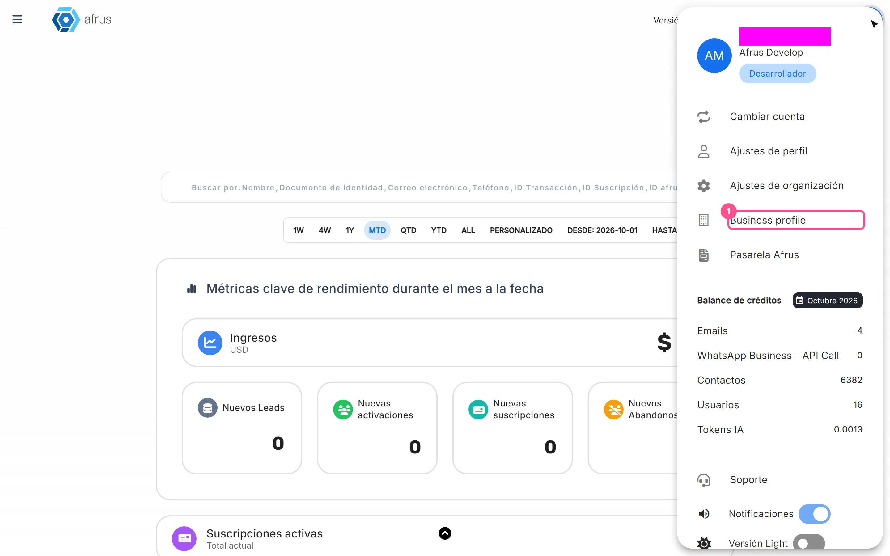
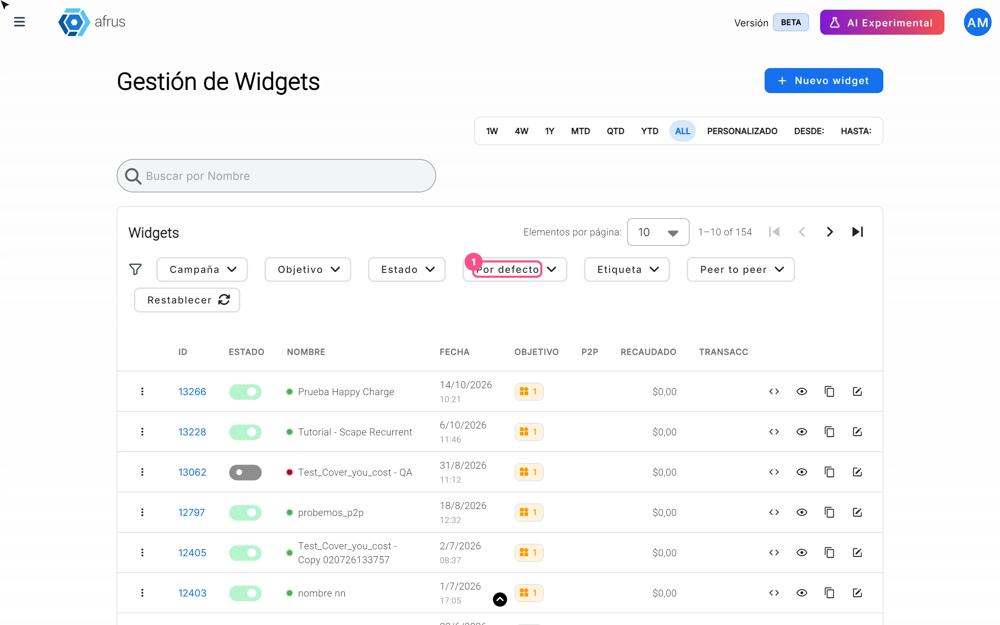

# Guia do Business profile

Depois de ler este guia, você vai saber o que é o Business profile, para que ele serve à sua organização, como criá-lo e como escolher os widgets que aparecem nele.

*Módulo: Business profile · Menu: **Business profile** (menu de perfil, canto superior) · Público: equipes de captação, comunicação e administração*

> **Sobre os nomes de tela neste guia:** botões, campos e menus estão escritos exatamente como aparecem na versão em espanhol do console, com a explicação em português quando ajuda.

---

## O que é o Business profile

**O Business profile é a página pública da sua organização na AFRUS.** Ele tem um endereço próprio, do tipo `https://afrus.org/business/<sua-url>`, e reúne seus dados de contato, redes sociais, textos, perguntas frequentes, logotipo e cores.

As mesmas informações também alimentam a inteligência artificial da AFRUS, para que as funções de IA conheçam a sua organização.

## Para que serve

- **Ter uma página onde qualquer pessoa pode fazer uma doação.** Como diz a própria tela: *"Tu empresa tiene una página donde cualquiera puede pagarte."* ("Sua empresa tem uma página onde qualquer pessoa pode pagar você.")
- **Mostrar seus widgets principais.** A página mostra o widget de doação e o widget de cadastro que você marcou como padrão.
- **Enviar links de pagamento.** Os links de pagamento que você envia pela AFRUS (pela **Home** ou pelo perfil de uma pessoa) apontam para o endereço do seu Business profile. Sem Business profile com URL, o link de pagamento não pode ser enviado.
- **Ter seu QR code e seu link de pagamento à mão.** Quando o Business profile tem URL, a **Home** mostra um QR code e o formulário de **Link de pago** (link de pagamento).
- **Alimentar a IA da AFRUS.** Com "Enviar AI" (enviar para a IA), a descrição, o texto "Sobre nosotros" (Sobre nós) e as perguntas frequentes são enviados para a IA. Algumas funções, como **Experiences AI**, pedem que o Business profile esteja atualizado.

## Antes de começar

- **Tenha à mão os dados da sua organização.** Nome, número de identificação pública, telefone, endereço, cidade e e-mail; os links das suas redes sociais; seu logotipo (jpg, gif, webp ou png, menor que 1 MB).
- **Escolha bem a URL.** Depois que o Business profile é criado, a URL não pode ser alterada.

---

# Passo a passo

## Como criar o Business profile

O Business profile é criado com um assistente de 7 etapas: **URL**, **Contacto** (Contato), **Redes sociales** (Redes sociais), **Comunicación** (Comunicação), **Preguntas Frecuentes** (Perguntas frequentes), **Logotipo** e **Tema**.

> **Importante:** durante a criação, nada é salvo até você clicar em "Guardar" (Salvar) na última etapa. Se você sair antes, os dados preenchidos não ficam salvos.

1. **Abra o Business profile.** No menu de perfil (canto superior), escolha **Business profile**. Acima do assistente você verá o **Estado** (Status); se ainda não criou, ele mostra **Incompleto**.
   

2. **Escolha sua URL.** Na etapa **URL**, digite a parte final do endereço no campo **URL del negocio** (URL do negócio) — o início do endereço é fixo — e clique em "Continuar". A AFRUS verifica se ela está livre; se já estiver em uso, você verá *"La URL no está disponible"* (A URL não está disponível) e precisará escolher outra.

   > **Importante:** depois de criar o perfil, a URL fica bloqueada e não pode ser alterada.

3. **Preencha seus dados de contato.** Na etapa **Contacto**, preencha **¿Cuál es el nombre de tu organización?** (nome da organização), **Número de identificación pública** (número de identificação pública), **Teléfono** (telefone), **Dirección** (endereço), **Ciudad** (cidade) e **Correo electrónico** (e-mail). Todos são obrigatórios. Na primeira vez, a AFRUS preenche com os dados da sua organização; confira e clique em "Continuar".

4. **Adicione suas redes sociais.** Na etapa **Redes sociales**, ative a chave de cada rede que quer mostrar (Facebook, Instagram, Youtube, WhatsApp, Linkedin, TikTok) e cole o link. Com a chave ativa, o link é obrigatório. Assim seus doadores encontram seus canais pela página.

5. **Escreva seus textos.** Na etapa **Comunicación**, preencha **Título** (até 70 caracteres), **Descripción** (descrição, até 300), **Título leads** (até 70), **Descripción leads** (descrição de leads, até 255) e **Sobre nosotros** (sobre nós, até 300). Todos são obrigatórios.

6. **Adicione perguntas frequentes (opcional).** Na etapa **Preguntas Frecuentes**, clique em "Agregar pregunta frecuente" (Adicionar pergunta frequente) e escreva a **Pregunta** (pergunta) e a **Respuesta** (resposta), com até 300 caracteres cada. Responder às dúvidas mais comuns poupa tempo da sua equipe.

7. **Envie seu logotipo (opcional).** Na etapa **Logotipo**, clique em **Sube tu foto aquí** (Envie sua foto aqui). Use um arquivo jpg, gif, webp ou png, de 400 × 400 pixels recomendado e menor que 1 MB.

8. **Escolha um tema e salve.** Na etapa **Tema**, escolha uma das 9 combinações de cores e clique em "Guardar" (o botão fica ativo quando há um tema escolhido).

9. **Envie as informações para a IA (recomendado).** Na mesma etapa **Tema**, clique em "Enviar AI". Você verá *"Información enviada correctamente"* (Informação enviada com sucesso) e o status mudará para **Sincronizado con AI** (Sincronizado com a IA). Assim as funções de IA da AFRUS trabalham com as informações da sua organização.

Ao terminar, você verá a mensagem *"¡Listo!"* (Pronto!) com *"Perfil de negocio creado correctamente."* (Perfil de negócio criado com sucesso) e o botão "Continuar". O status muda para **Guardado sin enviar a AI** (Salvo sem enviar para a IA), ou para **Sincronizado con AI** se você fez a etapa 9.

**Para ver sua página pública:** na etapa **URL**, clique em "Ver". Ela abre em outra aba.

**Para editar o perfil depois:** abra o **Business profile**, clique na aba da etapa que quer mudar, altere os dados e clique em "Continuar". Cada "Continuar" salva as alterações. Se você mudar as perguntas frequentes, o status passa para **Pendiente de sincronización con AI** (Sincronização com a IA pendente): clique de novo em "Enviar AI" na etapa **Tema**.

> **Dá para desfazer?** Você pode editar todos os dados, menos a URL. Ao apagar uma pergunta frequente pelo ícone de lixeira, ela é excluída na hora, sem confirmação.

## Como configurar os widgets que aparecem no Business profile

O Business profile não tem um seletor de widgets próprio. A página mostra automaticamente:

- o widget **padrão** com o objetivo **Transacción** (Transação) — seu formulário de doação — e
- o widget **padrão** com o objetivo **Registro** (Cadastro) — seu formulário para captar contatos.

Por isso, para mudar o que aparece na sua página, você escolhe qual widget é o padrão em **Widgets**.

1. **Abra seus widgets.** Acesse **Fundraising > Widgets**.
   

2. **Encontre o widget que quer mostrar.** Você pode usar o filtro **Por defecto** (Padrão) / **No predeterminado** (Não padrão) para ver qual está marcado hoje. O widget padrão tem uma estrela ao lado do nome.

3. **Marque-o como padrão.** Na linha do widget, abra o menu de três pontos e escolha **Establecer como predeterminado** (Definir como padrão). Só pode haver um widget padrão por objetivo: ao marcar um, o anterior com o mesmo objetivo deixa de ser padrão.

4. **Repita com o outro objetivo.** Faça o mesmo com o widget de **Registro** se também quiser trocá-lo.

Ao terminar, você verá a estrela ao lado do nome do widget escolhido, e o seu Business profile passará a mostrar esse widget.

> **Dá para desfazer?** Sim. No mesmo menu de três pontos, escolha **Quitar predeterminado** (Remover padrão) ou marque outro widget como padrão. Lembre-se: se não houver widget padrão para um objetivo, a página não mostra esse widget.

> **Importante:** os dois widgets, o de doação e o de cadastro, precisam estar configurados para aparecer na página do seu Business profile.

---

## Status do Business profile

| Status | O que significa | O que você pode fazer |
|---|---|---|
| **Incompleto** | Você ainda não criou o Business profile | Crie seguindo este guia |
| **Guardado sin enviar a AI** (Salvo sem enviar para a IA) | O perfil existe, mas as informações não foram enviadas para a IA | Clique em "Enviar AI" na etapa **Tema** |
| **Pendiente de sincronización con AI** (Sincronização pendente) | Você alterou as perguntas frequentes e falta enviá-las para a IA | Clique em "Enviar AI" na etapa **Tema** |
| **Sincronizado con AI** (Sincronizado com a IA) | As informações foram enviadas para a IA da AFRUS | Nada; envie de novo se fizer mudanças |

## Perguntas frequentes

**Posso mudar a URL do meu Business profile?**
Não. Depois que o perfil é criado, o campo **URL del negocio** fica bloqueado.

**Posso enviar links de pagamento sem Business profile?**
Não. Os links de pagamento apontam para o endereço do seu Business profile, então você precisa tê-lo criado com URL.

**O que acontece se eu excluir o Business profile?**
Na etapa **URL** há um botão "Eliminar" (Excluir). Como a tela avisa, você não poderá usar a mesma URL de novo e perderá todas as informações relacionadas ao perfil; ele também é desconectado da IA.

> **Dá para desfazer?** Não. Excluir o Business profile é definitivo.

**O que acontece se eu trocar o widget padrão?**
Seu Business profile passa a mostrar o novo widget padrão daquele objetivo.

---

> **[Voltar ao índice da seção](./README.md)** · **[Voltar ao índice geral](../README.md)**

*Última atualização: 2026-10-26*
