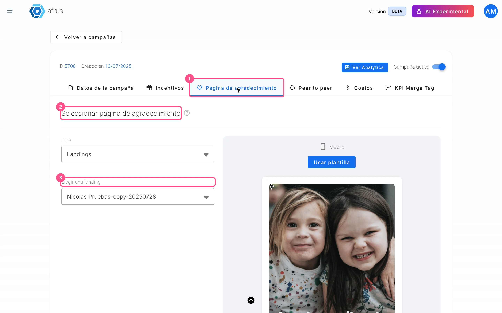
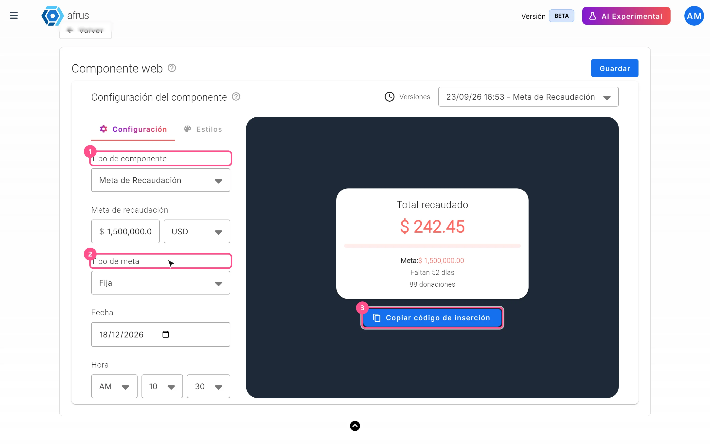
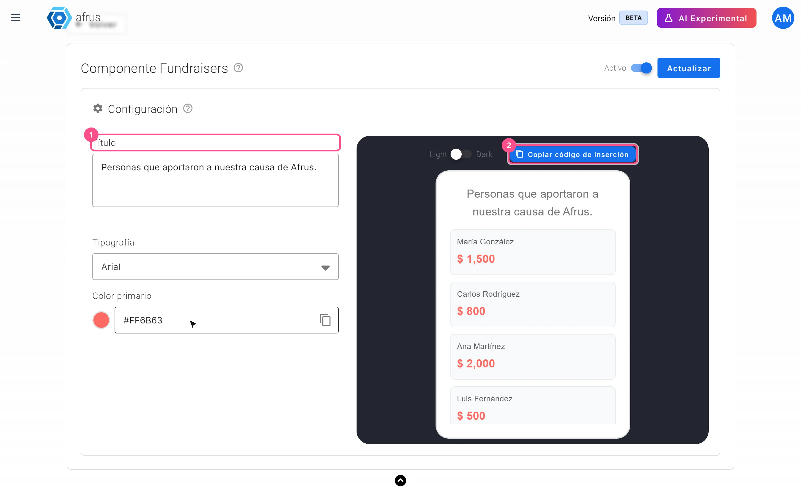
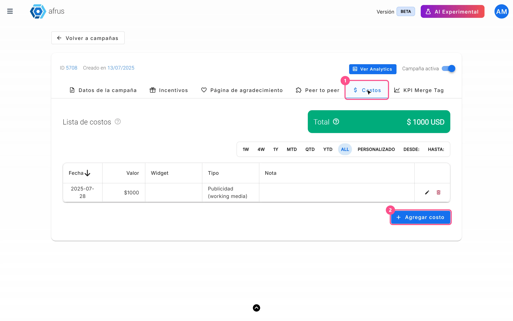
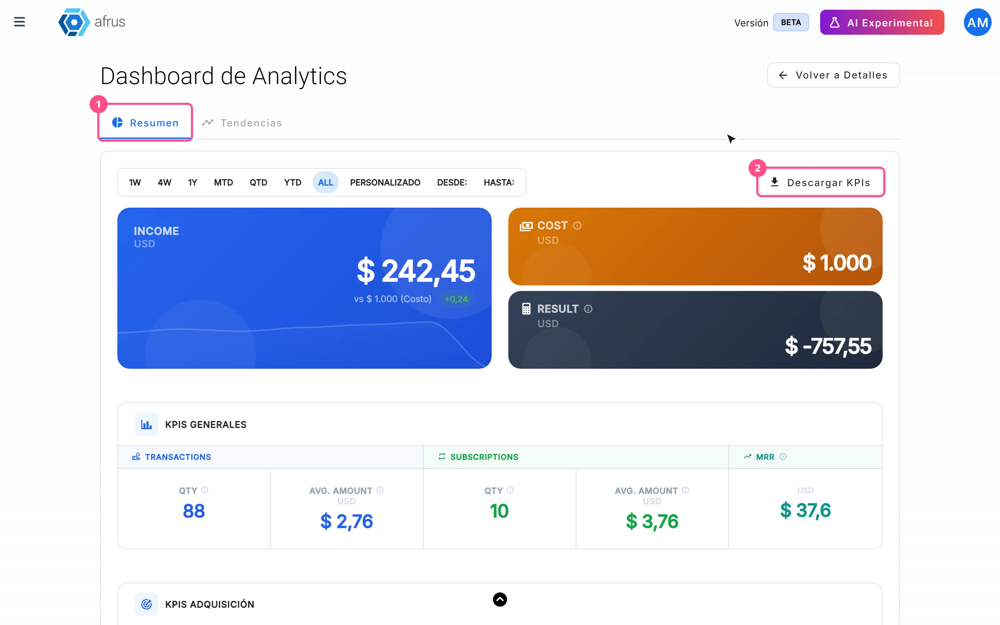
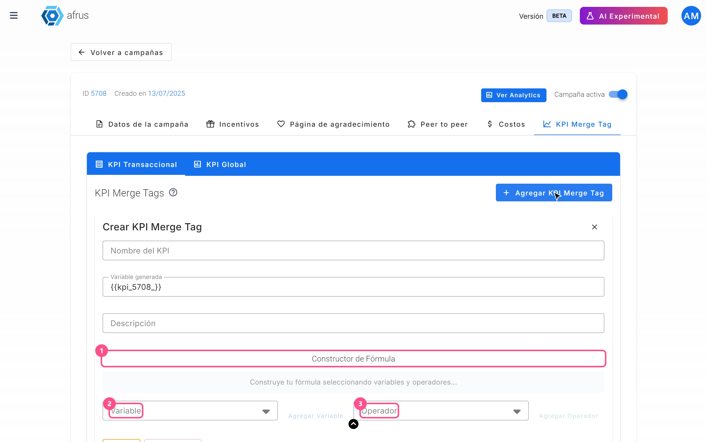

# Campaigns guide

After reading this guide you will know what a campaign is in Afrus, what it is for, how to link widgets and a thank-you page to it, how to show its progress and donors on your website, and how to measure its return with costs, Analytics and KPI Merge Tags.

*Module: Campaigns · Menu: **Fundraising > Campañas** · Audience: fundraising, digital marketing and leadership teams*

> **About the labels in this guide:** buttons, fields and menus are written exactly as they appear in the Spanish version of the console, with an English explanation where it helps.

---

## What a campaign is

**A campaign groups the donations and registrations that come in through one or more widgets under a single fundraising goal.** It has an internal name, a public name, a description, a goal in your organization's currency and a status (active or inactive).

You find your campaigns in **Fundraising > Campañas**. From the list you can create a campaign with "Crear campaña" (Create campaign), search by name and filter by **Estado** (Status), **Tipo de Campaña** (Campaign type) and **Total Recaudado** (Total raised). To see this section, your user role needs the permission to view campaigns.

## What it is for

- **Tracking your goal.** You see in one place how much an initiative has raised against its goal (**Total recaudado**, with a progress bar).
- **Measuring your widgets' conversion.** The **Tasa de conversión** (Conversion rate) compares donations and registrations with the number of times the campaign's widgets were shown.
- **Using a shared thank-you page** for every campaign widget that uses it.
- **Measuring return.** You record the campaign's costs and see ROI, cost per transaction, cost per recurring donor, Lifetime Value and more in the Analytics dashboard.
- **Showing your campaign on your website.** The **Crowdfunding widget** shows progress towards the goal; the **Componente donantes** (Donors component) shows the list of people who donated.
- **Telling your impact in numbers.** With **KPI Merge Tags** you insert calculated figures (for example, "meals donated") into automated emails or landings.

## Before you start

- **Have the campaign created.** In **Fundraising > Campañas**, click "Crear campaña" and fill in **Nombre de campaña** (campaign name, up to 100 characters), **Descripción** (description, up to 500), **Nombre público** (public name, up to 100) and **Meta de recaudación** (fundraising goal). Leave **Campaña activa** (Active campaign) on and click "Crear" (Create). The goal is always saved in your organization's currency.
- **To edit it**, open the row's three-dot menu in the list and choose **Editar** (Edit), or click the ID. Text changes save on their own a moment after you stop typing; there is no save button on that tab.

---

# Step by step

## How to link a widget to a campaign

When you link a widget, its donations and registrations are associated with the campaign and count in its results.

**Before you start:** the campaign must be **active**. The widget editor only lists active campaigns, by their public name.

1. **Open the widget.** Go to **Fundraising > Widgets** and edit the widget you want to link. The editor opens in a new tab. This screen opens in the previous version of Afrus, so it looks different.
   <!-- screenshot pending: how-to-link-a-widget-to-a-campaign-01 — widget editor, Renderización panel -->

2. **Choose the campaign.** In the **Renderización** (Rendering) panel, in the **Elige tus campañas** (Choose your campaigns) field, select one or more campaigns.

3. **Save the widget changes.**

   > **Pending confirmation:** the exact name of the save button in the widget editor.

When you finish, the widget appears in the **Widgets de la campaña** (Campaign widgets) table in the campaign detail, and its donations and registrations are associated with the campaign.

- **With a single campaign**, the donor sees nothing different on the form.
- **With more than one campaign**, the donor sees an **Elige tu campaña** (Choose your campaign) drop-down in the form, with the first campaign preselected. This lets them choose which initiative their donation goes to.

> **Can it be undone?** Yes. Go back to **Elige tus campañas** in the widget editor, remove the campaign and save.

## How to link a thank-you page to a campaign

This way every widget in the campaign can take the donor to the same page after donating. There are two parts: choosing the page in the campaign and turning it on in each widget.

**Before you start:** have the page you want to use created, as an experience in **Fundraising > Experiences AI** or as a landing in **Fundraising > Landings**.

**Part 1 — In the campaign**

1. **Open the campaign.** In **Fundraising > Campañas**, open the row's three-dot menu and choose **Editar**.
2. **Go to the Página de agradecimiento (Thank-you page) tab.** You also find it when creating the campaign.
   
3. **Choose the page type.** In **Tipo** (Type), choose **Experiences** or **Landings**.
4. **Choose the page.** In **Elegir una experiencia** (Choose an experience) or **Elegir una landing** (Choose a landing), select the page. You will see a **Mobile** preview.
5. **Click "Usar plantilla" (Use template).** This button shows no confirmation message: to check it was saved, reload the campaign and make sure the tab shows the chosen page.

**Part 2 — In each widget that should use it**

6. **Open the widget.** In **Fundraising > Widgets**, edit the widget. This screen opens in the previous version of Afrus, so it looks different.
7. **Turn on the campaign's page.** In the **Avanzado** (Advanced) section, **Página de agradecimiento** area, tick **Usa la página de agradecimiento de la campaña.** (Use the campaign's thank-you page). When ticked, the "Configurar" (Configure) button for the widget's own thank-you page disappears.
8. **Save the widget changes.**

When you finish, after donating, the donor lands on the landing or experience chosen in the campaign their donation was associated with.

> **Important:** if the campaign has no page chosen, or the page no longer exists, the widget's normal thank-you page is used. The editor also warns: *"Los países que no tienen la misma traducción en las campañas, por favor revise sus páginas de agradecimiento."* (Countries without the same translation in the campaigns: please check your thank-you pages.) Check your pages if your widget is used in several countries.

> **Can it be undone?** Yes. Untick the box in the widget to go back to its own thank-you page, or choose another page in the campaign.

## What the Crowdfunding widget is

**The Crowdfunding widget is a block you paste into any website that shows your campaign's progress towards a goal, live.** It shows the total reached, the goal, a progress bar, the number of donations and, if you set an end date, how many days are left or *"Campaña finalizada"* (Campaign ended). The data is fetched every time the page loads.

You can track three goal types, in **Tipo de componente** (Component type):

| Type | What it counts |
|---|---|
| **Meta de Recaudación** (Fundraising goal) | The sum of successful donations |
| **Meta de Suscriptores** (Subscribers goal) | Active subscriptions |
| **Meta de Registros** (Registrations goal) | Registered people, without duplicates |

And two ways to set the goal, in **Tipo de meta** (Goal type):

- **Fija** (Fixed): you type the goal, choose the currency (fundraising only) and the end **Fecha** (date) and **Hora** (time).
- **Dinámica** (Dynamic): it uses the campaign's **Meta de recaudación**; it doesn't ask for a goal, currency, date or time.

**How to set it up:**

1. **Open the configurator.** In **Fundraising > Campañas**, open the row's three-dot menu and choose **Crowdfunding widget**.
   
2. **Set the goal.** In the **Configuración** (Settings) tab, choose **Tipo de componente** and **Tipo de meta**, and fill in the details it asks for.
3. **Adjust the design.** In the **Estilos** (Styles) tab, choose **Tipografía** (Font: Roboto, Arial, Open Sans or Times New Roman), **Tamaño de tipografía** (Font size, 12 to 20) and **Color primario** (Primary color), to match your website.
4. **Save.** Click "Guardar" (Save). Each save creates a new version, which you can choose in **Versiones** (Versions).
5. **Copy the code.** Click "Copiar código de inserción" (Copy embed code) and paste it into your site's HTML.

> **Important:** font, size, color and language are inside the code you copy. If you change something and save, copy and paste the code again so your website uses the new version.

> **Known limitation:** with **Meta de Suscriptores** or **Meta de Registros** and a **Dinámica** goal, the block shows a goal of 0. For those types, use a **Fija** goal.

## What the Donors component is

**The Componente donantes (Donors component) is a block for your website that shows the list of people who donated to the campaign.** By default it is titled *"Personas que también donaron"* (People who also donated) and shows the first name, last name and amount of each successful donation, newest first, with vertical scrolling. If there are no donations yet, it shows *"No hay donantes disponibles"* (No donors available).

**How to set it up:**

1. **Open the configurator.** In **Fundraising > Campañas**, open the row's three-dot menu and choose **Componente donantes**.
   
2. **Customize it.** Set **Título** (Title), **Tipografía** (Font), **Color primario** (Primary color), the **Light** or **Dark** theme and the **Activo** / **Inactivo** (Active / Inactive) switch. The preview uses sample names, not your real donors.
3. **Save.** Click "Guardar" (or "Actualizar" — Update — if it already existed).
4. **Copy the embed code** and paste it into your website.

> **Important:** title, theme and **Activo** / **Inactivo** apply without touching your website. Font and color are inside the code: if you change them, copy and paste the code again. If you set it to **Inactivo**, the block stops showing.

> **Keep in mind:** the block publishes each donor's first name, last name and amount. There is no option to hide names or amounts, so make sure your organization can publish that information. Amounts show with your organization's currency symbol.

## What the cost center is for and how to use it

In the campaign, the cost center is the **Costos** (Costs) tab: *"Agrega en esta sección todos los costos implicados en la realización de tu campaña"* (Add in this section all the costs involved in running your campaign).

**What it is for:**

- **Knowing how much you invested** in the campaign, with a total you can filter by date.
- **Calculating return.** With your costs, Afrus calculates Result, ROI, cost per transaction, cost per recurring donor and other indicators.
- **Turning on the Analytics dashboard.** The "Ver Analytics" (View Analytics) button is only enabled once the campaign has at least one cost recorded.

**How to record a cost:**

1. **Open the campaign** and go to the **Costos** tab.
   
2. **Click "Agregar costo" (Add cost).**
3. **Fill in the details.**
   - **Costo** (Cost): required, greater than 0.
   - **Tipo** (Type): required, **Publicidad (working media)** (Advertising) or **Costos de apoyo y producción** (Support and production costs).
   - **Fecha de gasto** (Expense date): required.
   - **Widget:** optional, only widgets in this campaign. A cost assigned to a widget counts in that widget's analytics; one without a widget only counts in the whole campaign's analytics.
   - **Nota** (Note): optional, up to 1000 characters.
4. **Click "Agregar" (Add)** (or "Guardar" if you are editing).

When you finish, the cost appears in **Lista de costos** (Cost list — columns **Fecha**, **Valor**, **Widget**, **Tipo**, **Nota** and **Acciones**) and adds to the **Total**, which you can filter by date range.

> **Known limitation:** the value is saved without decimals (for example, 150.75 becomes 150). Record rounded amounts. Costs are always recorded in your organization's currency.

> **Can it be undone?** You can edit a cost. Deleting it asks for confirmation and cannot be undone.

## Campaign Analytics: what data you get, how to turn it on and how to analyze it

**How to turn it on:** record at least one cost in the **Costos** tab. Until then, "Ver Analytics" is disabled with the message *"Para acceder a las analíticas, primero debes registrar al menos un costo en la sección de Costos."* (To access analytics, you must first record at least one cost in the Costs section.)

**How to open and use it:**

1. **Open the dashboard.** In the campaign detail, click "Ver Analytics".
   
2. **Choose the period.** In the **Resumen** (Summary) tab, choose the date range (by default, all history). The indicator cards recalculate for that range.
3. **Download the indicators (optional).** Click "Descargar KPIs" (Download KPIs) to get a CSV file with all indicators for the range (columns KPI, Value and Unit).
4. **Look at one widget in detail.** In **Rendimiento por Widget** (Performance by widget), click a widget to open its **Analytics del Widget**: the same indicators, only for that widget and its costs.
5. **See the trend.** In the **Tendencias** (Trends) tab, choose the range (by default, the current month). Afrus groups by day up to 31 days, by week up to 90 days, and by month beyond that.

**What data you get in Resumen (cards):**

| Indicator | What it is |
|---|---|
| Ingresos Totales / Costos (Total income / Costs) | Income from successful donations against the sum of recorded costs |
| Resultado (Result) | Income minus costs |
| ROI | (income − costs) / costs |
| MRR Adquirido / ARR Adquirido (Acquired MRR / ARR) | Monthly income from acquired active subscriptions; ARR is MRR × 12 |
| CPT Bruto / CPR Bruto (Gross CPT / CPR) | Cost per transaction / cost per recurring donor |
| CPT Neto / CPR Neto (Net CPT / CPR) | The same, using only the net loss (0 if the campaign is profitable) |
| Punto de Equilibrio (Break-even) | Months to recover the net loss with MRR |
| Inversión (Investment) | Net loss (0 if the campaign is profitable) |
| RCR | Subscriptions / (subscriptions + one-time payments) |
| Tasa de Calidad (Quality rate) | Subscriptions / transactions |
| Tasa de Abandono (Churn rate) | Cancelled subscriptions / new subscriptions |
| Vida del Donante (Donor lifetime) | 1 / churn rate, in months |
| Lifetime Value | AMV × 12 / churn rate |
| Eficiencia de Adquisición (Acquisition efficiency) | LTV / CPR; should be greater than 1 |
| AMV | MRR / subscriptions |
| Counts and averages | Successful transactions, new activated subscriptions and average amount of one-time payments and subscriptions |

If there are no cancelled subscriptions yet, the screen uses a 3% reference value to calculate churn rate, donor lifetime and Lifetime Value, and says so in its help text.

**What data you get in the Histórico (Historical) tables:** **Rendimiento por Widget**, **Rendimiento por UTM Source**, **UTM Medium**, **UTM Campaign** and **Rendimiento por URL**, with transactions, amounts, subscriptions and subscription amounts. They tell you which widget, which traffic source and which page bring in the most donations.

**How to analyze them:**

- **Is the campaign profitable?** Look at **Resultado** and **ROI**. If there is a loss, **Punto de Equilibrio** tells you in how many months your recurring donors will recover it.
- **Are you acquiring well?** Compare **Lifetime Value** with **CPR**: if **Eficiencia de Adquisición** is greater than 1, each recurring donor is worth more than it costs you to get them.
- **Are you getting recurring donors?** **RCR** and **Tasa de Calidad** show what share of your donations are subscriptions.
- **Where to invest?** The widget, UTM and URL tables show which channels and pages bring in the most income.

**How often the data updates:**

| Where | When it updates |
|---|---|
| **Resumen** cards and **Analytics del Widget** | Instantly, with current data |
| **Histórico** tables (by widget, UTM and URL) | Once a day: they may not include today. They show the all-time total and ignore the date range |
| **Tendencias** tab | Once a day: it may not include today |

> **Pending confirmation:** the exact time the Histórico tables and the Tendencias tab update.

**Conversion rate (in Datos de la campaña):** besides the dashboard, the **Datos de la campaña** (Campaign data) tab shows **Donaciones** (Donations, %), **Registros** (Registrations, %) and **Visualizaciones** (Views) for the campaign's widgets. Its help text says *"Este dato se calcula cada 24 horas y puede no reflejar cambios recientes"* (This figure is calculated every 24 hours and may not reflect recent changes).

## What KPI Merge Tags are for and how to use them

**KPI Merge Tags are figures calculated with a formula that you insert into automated emails or landings.** They help you tell your impact concretely: for example, turning a donation amount into "meals donated". You create them in the campaign's **KPI Merge Tag** tab, and there are two types:

| Type | Where it is used | What it calculates with |
|---|---|---|
| **KPI Transaccional** (Transactional KPI) | Automated emails (**Interacciones > Autoresponders**) | The **Monto** (Amount) of the donation that triggers the email |
| **KPI Global** | Landings | The campaign's **Total Recaudado** (Total raised) and **Cantidad de Donantes** (Number of donors) |

**How to create a Transactional KPI:**

1. **Open the tab.** In the campaign, go to **KPI Merge Tag**, section **KPI Transaccional** and click "Agregar KPI Merge Tag" (Add KPI Merge Tag).
   
2. **Name it.** Type **Nombre del KPI** (KPI name) and an optional **Descripción**. **Variable generada** (Generated variable) shows the tag you will use.
3. **Build the formula.** In **Constructor de Fórmula** (Formula builder), alternate "Agregar Variable" (Add variable) and "Agregar Operador" (Add operator: +, -, ×, ÷). The available variable is **Monto**. With "Agregar Variable Multiplicador" (Add multiplier variable) you create a constant (**Nombre de la variable** and **Valor constante**) to use in the formula. "Limpiar" (Clear) and "Quitar Último" (Remove last) help you fix it. The formula must end with a variable.
4. **Click "Crear" (Create)** (or "Actualizar" if editing).
5. **Use it in your automated email.** The tag looks like this: `{{kpi_<campaign ID>_<name>}}`, with the name in lowercase and spaces replaced by `_`. For example, campaign 88 and name "Comidas Donadas" → `{{kpi_88_comidas_donadas}}`.

When the email is sent, the tag is replaced by the formula result using that donation's amount, with 2 decimals. Multiplication and division are calculated before addition and subtraction.

> **Pending confirmation:** whether Transactional KPIs appear in the merge tag picker of the email editor. In the meantime, type the tag exactly as shown in **Variable generada**.

**How to create a Global KPI:**

1. **Open the tab.** In the campaign, go to **KPI Merge Tag**, section **KPI Global** and click "Agregar KPI global" (Add global KPI).
2. **Name it and build the formula** as above. The available variables are **Total Recaudado** and **Cantidad de Donantes** (plus constants). Use only unaccented letters, numbers and spaces in the name.
3. **Click "Crear".**
4. **Use it in your landing, in square brackets.** The screen shows the tag with curly braces (`{{global_kpi_88_comidas_donadas}}`), but in a landing you must write it in square brackets: `[global_kpi_88_comidas_donadas]`.

When the published landing opens, the tag shows the value calculated at that moment from all the campaign's successful donations, with up to 2 decimals.

> **Important (Global KPI):** operations are applied left to right; multiplication and division do not go first. Order your formula the way you want it calculated.

> **Can it be undone?** You can edit a KPI Merge Tag, but there is no button to delete it.

---

## Campaign statuses

| Status | What it means | What you can do |
|---|---|---|
| **activo** (active) | The campaign is active and can be chosen in the widget editor | Link it to your widgets |
| **inactivo** (inactive) | The campaign is off (**Campaña activa** switch off) | Turn **Campaña activa** on in the detail to use it again |
| **archivado** (archived) | The campaign is archived | Consult it |

## Known limitations

- **"Ver Analytics" is disabled** until you record at least one cost.
- **Costs are saved without decimals.** Record rounded amounts.
- **"Usar plantilla" gives no confirmation** that the thank-you page was saved: reload the campaign to check.
- **Crowdfunding widget with a Dinámica goal** for subscribers or registrations shows a goal of 0: use a **Fija** goal.
- **Global KPI in landings** is written in square brackets `[...]`, even though the screen shows curly braces; and its name must not contain accents, ñ or symbols.
- **KPI Merge Tags cannot be deleted.**
- **The Donors component has no anonymity option.**
- **The Analytics Histórico tables** are not filtered by date.
- **Subscription cohorts** are temporarily disabled in the campaign detail.

## Frequently asked questions

**What does "Seleccionar por defecto" (Set as default) do in a campaign's menu?**
It marks your organization's default campaign (there can only be one). Transactions that arrive from some payment gateways without a known campaign are assigned to it, for example charges from subscriptions created outside Afrus.

**Why don't I see my campaign when linking it in the widget?**
Because it is inactive. The widget editor only lists active campaigns: turn on **Campaña activa** in the campaign detail.

**Can a campaign have a different currency?**
No. The goal and costs are always recorded in your organization's currency.

**Can I use a Global KPI in an email?**
For now, its use is only confirmed in landings. For automated emails, use a Transactional KPI.

---

> **[Back to section index](./README.md)** · **[Back to main index](../README.md)**

*Last updated: 2026-10-20*
