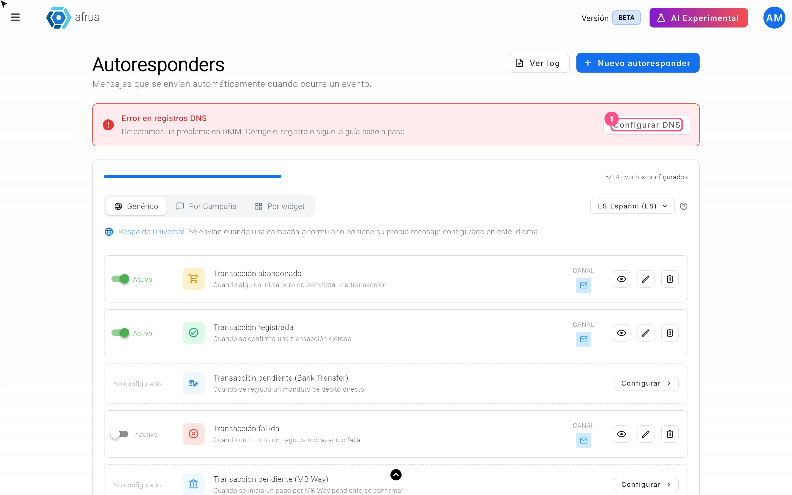
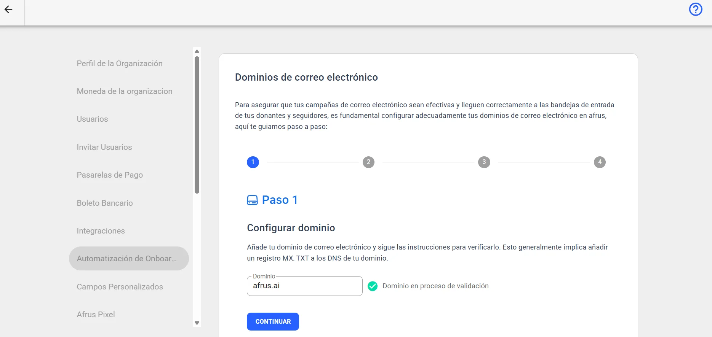
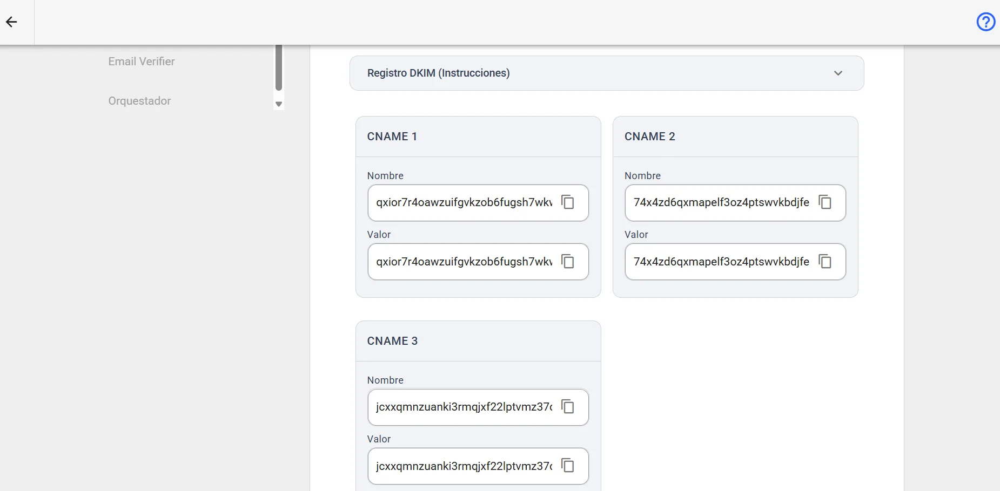

# Guia de Automação Onboarding: seu domínio de e-mail

Com este guia você vai configurar seus DNS para que a AFRUS envie seus e-mails com o domínio da sua organização (por exemplo, `suaorg.org`).

*Módulo: Configurações · Abre pelo botão "Configurar DNS" em **Interacciones > Autoresponders**, **Interacciones > Blast** ou **Interacciones > Flujos de trabajo** · Público: administração, comunicação e quem gerencia o domínio*

> **Sobre os nomes de tela neste guia:** botões, campos e menus estão escritos como aparecem na versão em espanhol do console, com a explicação em português quando ajuda.

---

## O que é

**É a etapa em que você autoriza a AFRUS a enviar e-mails com o domínio da sua organização.** Para isso, você cria alguns registros (DNS) no provedor onde está o seu domínio.

Enquanto você não configurar, seus e-mails saem de uma conta da AFRUS.

## Para que serve

- **Enviar do seu próprio e-mail.** Seus doadores recebem os e-mails de um endereço da sua organização, por exemplo `doacoes@suaorg.org`.
- **Chegar mais à caixa de entrada.** Como diz a tela, configurar seus DNS permite usar seu e-mail com seu domínio e melhorar a entregabilidade.
- **Criar fluxos de trabalho.** Para criar um fluxo em **Interacciones > Flujos de trabajo** você precisa do domínio verificado.
- **Escolher o remetente.** Ao verificar o domínio, no remetente de autoresponders e Blast aparecem os e-mails dos usuários da sua organização que terminam nesse domínio.

## Como saber se já está configurado

No topo de **Interacciones > Autoresponders** e de **Interacciones > Blast** você verá um cartão com um destes status:

| Cartão | O que significa |
|---|---|
| **Dominio verificado** (Domínio verificado) | Pronto: seus e-mails saem com o seu domínio |
| **No tienes un dominio verificado para Email** (Você não tem um domínio verificado) | Seus e-mails saem de uma conta da AFRUS |
| **Error en registros DNS** (Erro nos registros DNS) | Há um problema nos registros; é preciso corrigi-los |

---

# Passo a passo

## Como configurar meus DNS na AFRUS

**Antes de começar:**
- **Tenha acesso ao painel do seu provedor de domínio** (onde você comprou o domínio) ou peça ajuda a quem cuida disso na sua equipe.
- **A conta de envio da sua organização precisa estar configurada pela AFRUS.** Se ao começar aparecer *"Hubo un error al crear el dominio"* (Houve um erro ao criar o domínio), escreva para nós.

1. **Abra a configuração.** Em **Interacciones > Autoresponders** ou **Interacciones > Blast**, clique em "Configurar DNS" no cartão do domínio.

2. **Digite seu domínio.** Na etapa 1, **Configurar dominio** (Configurar domínio), digite seu **Dominio** (Domínio), por exemplo `exemplo.com`, clique em "Iniciar autenticación" (Iniciar autenticação) e depois em "Continuar".
   

3. **Informe seu provedor.** Na etapa 2, responda *"¿Cuál es tu proveedor de DNS?"* (Qual é o seu provedor de DNS?) e siga as instruções para entrar no painel dele. Clique em "Continuar".

4. **Crie os registros DKIM.** Na etapa 3, a tela mostra 3 registros do tipo **CNAME**, cada um com **Nombre** (Nome) e **Valor**. Copie-os com o botão de copiar e crie-os no painel do seu provedor. Clique em "Continuar".
   

5. **Crie os registros DMARC.** Na etapa 4, crie no seu provedor os registros da tabela: dois do tipo **TXT** e um do tipo **MX** com **Prioridad** (Prioridade) 10. Clique em "Finalizar".

Ao terminar, a tela mostra seu domínio e o status: **Pendiente** (Pendente), **Exitoso** (Concluído), **Fallido** (Falhou), **Fallido temporalmente** (Falhou temporariamente) ou **No iniciado** (Não iniciado). Como diz a tela, a validação pode levar até 48 horas, mas em geral é muito mais rápida.

**Para conferir o status:** ele se atualiza quando você abre a tela ou clica em "Comprobar estado" (Verificar status).

> **Dá para desfazer?** O ícone de excluir ao lado do domínio o remove. Se você excluir, seus e-mails voltam a sair de uma conta da AFRUS.

**Para enviar de um endereço específico** (por exemplo `doacoes@suaorg.org`): esse endereço precisa ser de um usuário da sua organização.

---

## Perguntas frequentes

**Quanto tempo leva a verificação?**
Até 48 horas, mas em geral é muito mais rápida.

**A AFRUS me avisa quando termina?**
Não, não avisa. Você precisa conferir se o domínio foi validado: quando estiver, você verá o domínio verificado em **Interacciones > Blast** ou em **Interacciones > Autoresponders**.

---

> **[Voltar ao índice da seção](./README.md)** · **[Voltar ao índice geral](../README.md)**

*Última atualização: 2026-10-28*
