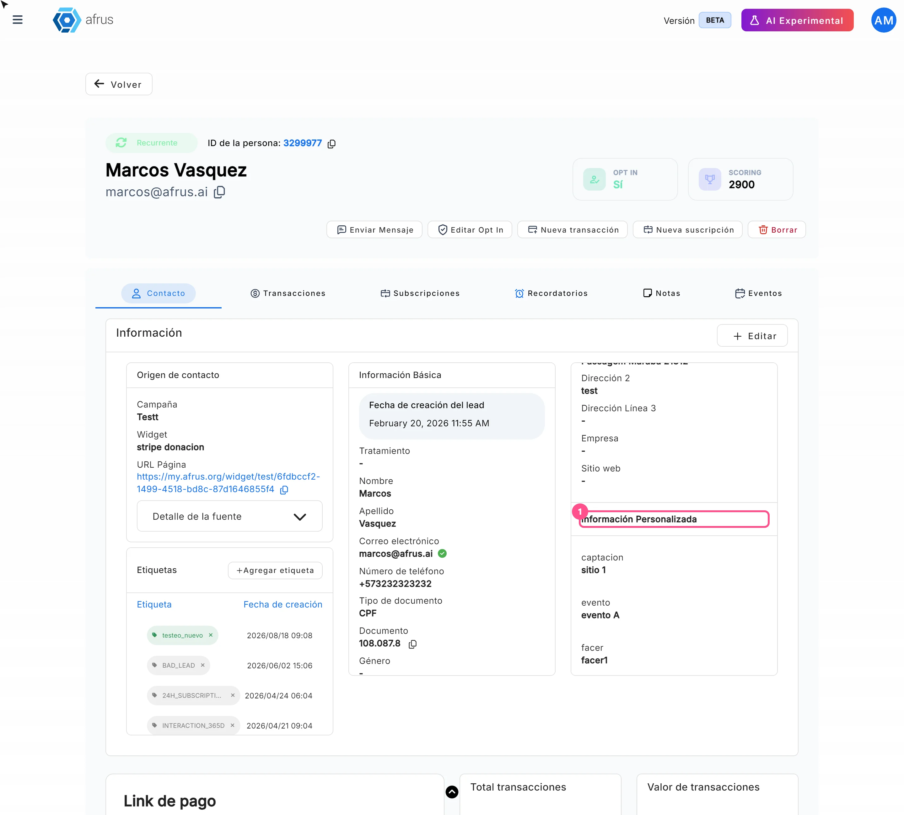

# Guía de Campos personalizados

Con esta guía vas a entender qué son los campos personalizados, cómo pedirlos en tus formularios y dónde ver la información que dejan tus donantes.

*Módulo: Configuración · Menú: **Ajustes de Organización > Campos personalizados** · Audiencia: equipos de recaudación, comunicaciones y datos*

---

## Qué son los campos personalizados

**Son datos extra que tu organización quiere guardar de cada persona, además de los que AFRUS ya trae** (nombre, correo, teléfono, documento, dirección…). Por ejemplo: "¿Cómo nos conociste?" o "Área de interés".

Se definen en **Ajustes de Organización > Campos personalizados**.

## Para qué sirven

- **Conocer mejor a tus donantes.** Guardas la información que es importante para tu organización.
- **Pedir esos datos en tus formularios.** Puedes agregar el campo a tus formularios de donación o de registro.
- **Completarlos a mano.** También los llenas al crear o editar una persona.
- **Usarlos en tus correos.** En los autoresponders puedes insertar el valor de un campo personalizado con un merge tag.
- **Analizarlos fuera de AFRUS.** Cada campo sale como una columna al descargar tu lista de personas.

---

# Paso a paso

## Cómo configurar un campo personalizado

1. **Abre la pantalla.** Ve a **Ajustes de Organización > Campos personalizados**.
   <!-- captura pendiente: como-configurar-un-campo-personalizado-01 — pantalla Campos personalizados -->

## Cómo incluir un campo personalizado en mi widget

**Antes de empezar:** el campo ya tiene que existir en **Ajustes de Organización > Campos personalizados**.

1. **Abre el editor del formulario.** En **Fundraising > Widgets**, edita el formulario. El editor se abre en la versión anterior de AFRUS, por eso se ve distinto.

2. **Agrega el bloque.** Haz clic en "Agregar" y elige **Campo personalizado**.
   <!-- captura pendiente: como-incluir-un-campo-personalizado-en-mi-widget-02 — menú Agregar con la opción Campo personalizado -->

3. **Configúralo.** Haz clic sobre el bloque y configúralo en **Configuración del snippet**.

4. **Ordénalo.** Arrástralo hasta el lugar donde quieres que aparezca en el formulario.

5. **Guarda.** Haz clic en "Guardar Snippet" y después en "Guardar Widget".

Al terminar, el donante verá el campo al llenar el formulario.

**Ten en cuenta:**
- Puedes agregar **Campo personalizado** varias veces en el mismo país del formulario, para pedir varios campos.
- Cada país del formulario tiene su propia lista de bloques: si tu formulario tiene varios países, agrégalo en cada uno.
- Si el bloque aparece con borde rojo y un icono de alerta, le falta configuración.

## Dónde queda guardada esta información

**En el perfil de cada persona, dentro de Personas.** Lo que el donante escribe en el formulario, o lo que tu equipo llena a mano, queda guardado en su perfil.

Los campos se llenan:
- cuando la persona completa un formulario que tiene el campo;
- cuando tu equipo crea una persona con "Crear persona" o la edita, en la sección **Información Personalizada**.

## Dónde la puedo ver

1. **En el perfil de la persona.** Abre la persona en **Personas**, pestaña **Contacto**, tarjeta **Más información**, sección **Información Personalizada**. Verás cada campo con su valor, o "-" si está vacío. La sección solo aparece si la persona tiene algún campo personalizado.
   

2. **En la descarga de personas.** Al descargar tu lista de personas con **Base de datos en tiempo real**, cada campo personalizado sale en su propia columna.

3. **En tus correos.** En un autoresponder puedes mostrar el valor con el merge tag `{{customFields.<campo>}}`, cambiando `<campo>` por el nombre de tu campo.

**Ojo:** en las landings, los campos personalizados no funcionan como variables: si los escribes, el donante ve el texto tal cual, con las llaves.

---

## Preguntas frecuentes

**¿Puedo pedir varios campos personalizados en un mismo formulario?**
Sí. Agrega un bloque **Campo personalizado** por cada uno.

**¿Puedo ver los campos personalizados en Excel?**
Sí. Descarga tu lista de personas con **Base de datos en tiempo real**: cada campo sale en una columna.

---

> **[Volver al índice de la sección](./README.md)** · **[Volver al índice general](../README.md)**

*Última actualización: 2026-10-26*
