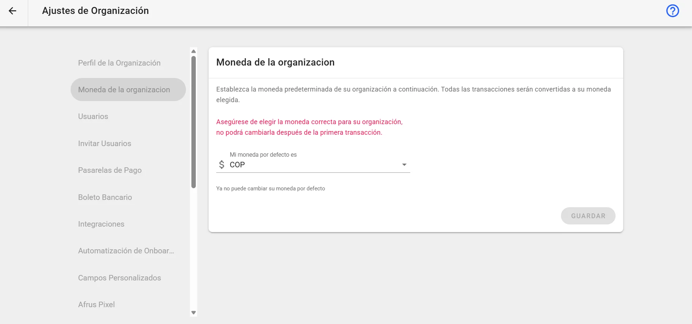

# Guía de Moneda de la organización

Con esta guía vas a entender qué es la moneda de tu organización y en qué partes de AFRUS se usa.

*Módulo: Configuración · Menú: **Ajustes de Organización > Moneda predeterminada** · Audiencia: administración y equipos de recaudación*

---

## Qué es la moneda de la organización

**Es la moneda principal de tu organización en AFRUS.** AFRUS la usa para mostrar tus totales, tus metas y tus reportes en una sola moneda, aunque recibas donaciones en varias.

Se encuentra en **Ajustes de Organización > Moneda predeterminada**.

## Para qué sirve

- **Ver tus donaciones en una sola moneda.** En **Transacciones**, si una donación llegó en otra moneda, verás el monto original y su conversión a la moneda de tu organización.
- **Filtrar por monto.** El filtro **Valor** de **Transacciones** y de **Suscripciones** compara los montos ya convertidos a la moneda de tu organización.
- **Poner metas a tus campañas.** La meta de una campaña siempre está en la moneda de tu organización; la campaña no tiene moneda propia. Lo mismo pasa con los costos que registras en la campaña.
- **Leer tus reportes.** Los montos del **Reporte general** están en la moneda de tu organización.
- **Ofrecer incentivos.** Los montos mínimos de los regalos están en la moneda de tu organización. Si un formulario acepta varias monedas, los regalos solo se ofrecen en la de tu organización.

**Ojo:** cada país de un formulario (widget) tiene su propia moneda, que se elige en el editor del formulario. Esa es la moneda que ve el donante; la de tu organización es la que usa AFRUS para sumar y comparar.

---

## Preguntas frecuentes

**¿Puedo cambiar la moneda de mi organización?**
No. Después de la primera transacción ya no se puede cambiar.

**¿Puedo recibir donaciones en otras monedas?**
Sí. Cada país de tu formulario tiene su propia moneda. AFRUS convierte esos montos a la moneda de tu organización para mostrar tus totales.

**¿En qué moneda está la meta de mi campaña?**
En la moneda de tu organización.

---

> **[Volver al índice de la sección](./README.md)** · **[Volver al índice general](../README.md)**

*Última actualización: 2026-10-28*
