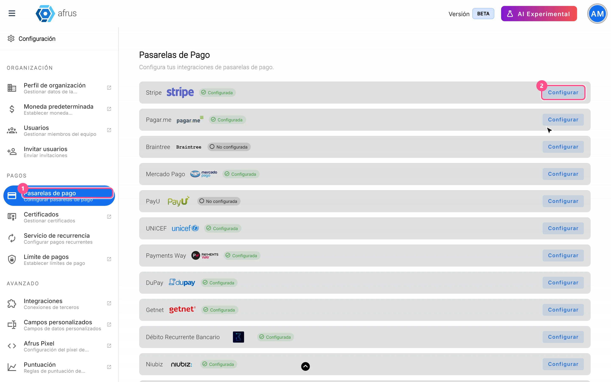
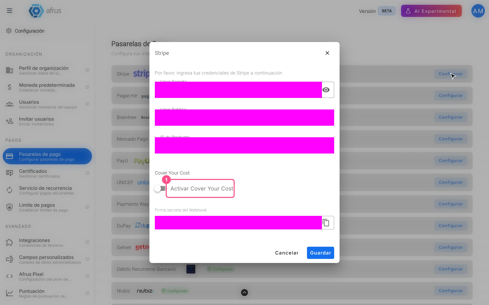

# Guia de Gateways de pagamento

Com este guia você vai entender o que são os gateways de pagamento na Afrus, para que você precisa deles e como ativar o Cover Your Cost para que seus doadores possam cobrir a taxa.

*Módulo: Configurações · Menu: **Configuración > Pagos > Pasarelas de pago** (Configurações > Pagamentos > Gateways de pagamento) · Público: administração e equipes de captação*

> **Sobre os nomes de tela neste guia:** botões, campos e menus estão escritos como aparecem na versão em espanhol do console, com a explicação em português quando ajuda.

---

## O que são os gateways de pagamento

**Um gateway de pagamento é o serviço que cobra as doações da sua organização.** É ele que processa o cartão, o Pix, o boleto ou outro meio de pagamento que o doador usar.

Os gateways são configurados uma vez para toda a organização, em **Configuración > Pagos > Pasarelas de pago**. Você também chega lá pelo menu de perfil (canto superior), opção **Ajustes de organización** (Configurações da organização).

## Para que servem

- **Cobrar as doações dos seus formulários.** Um formulário de doação (widget) só pode oferecer os gateways que sua organização tem conectados.
- **Decidir quais meios de pagamento o doador vê.** O que o doador vê depende dos gateways que você ativou e do que você escolhe em cada formulário.
- **Oferecer pagamentos por país e moeda.** Em cada país do formulário, só aparecem os gateways conectados que aceitam a moeda daquele país.
- **Permitir que o doador cubra a taxa (Cover Your Cost).** É configurado em cada gateway.

**Para lembrar sobre os meios de pagamento:**
- Pix, boleto e dinheiro só são oferecidos para doações únicas. A exceção é Pix com InfoPago, que também aceita doações mensais.
- Alguns meios de pagamento ficam **pendentes** até o gateway ou o banco confirmar o pagamento. Por isso uma doação pode aparecer primeiro como pendente e mudar depois.
- Nos formulários de cadastro com pagamento (objetivo **Sign up**) só são oferecidos Stripe e Niubiz.

Depois de conectar um gateway, você o escolhe em cada formulário, no bloco **Medio de pago** (Meio de pagamento) do editor. O guia de Widgets explica como.

---

# Passo a passo

## Como ativar ou desativar o Cover Your Cost

Com o Cover Your Cost, o doador pode pagar um pouco mais para cobrir a taxa do gateway. Assim sua organização recebe o valor completo da doação.

**Antes de começar:** a Afrus precisa ativar o Cover Your Cost para sua organização. Se você não vê a seção **Cover Your Cost** ao abrir um gateway, escreva para nós para ativá-la.

1. **Abra o gateway.** Acesse **Configuración > Pagos > Pasarelas de pago** e abra o gateway onde quer oferecê-lo.
   

2. **Ative a opção.** Na seção **Cover Your Cost**, ative **Activar Cover Your Cost** (Ativar Cover Your Cost).

3. **Informe a taxa do gateway.** Em **Comisión de pasarela (%)** (Taxa do gateway %), coloque a porcentagem que esse gateway cobra (mínimo 0.01). A **Comisión Afrus (%)** (Taxa Afrus %) aparece só para consulta; não pode ser alterada.

4. **Escolha como o doador vê.** Com **Preseleccionar la opción para el donante** (Pré-selecionar a opção para o doador) ativado, o doador vê a opção já ligada e pode tirá-la. Desativado, ele vê a opção desligada e pode ativá-la.

5. **Salve.** Salve o gateway. Repita em cada gateway onde quiser oferecê-lo.

Ao terminar, quando o doador paga com esse gateway, no último passo do formulário ele vê o cartão *"Cubrir el 100% los costos de donación"* (Cobrir 100% dos custos da doação), com a **Donación base** (Doação base), o **Costo aproximado de transacción** (Custo aproximado da transação) e o **Total**. O total é calculado para que, depois das taxas, sua organização receba pelo menos o valor da doação. Por isso o doador paga um pouco mais do que a soma simples das porcentagens.

**Para desativar:** abra o gateway, desligue **Activar Cover Your Cost** e salve.

> **Dá para desfazer?** Sim. Você pode ligar e desligar quando quiser.

**Lembre-se:**
- É configurado em cada gateway, não em cada formulário.
- A taxa do gateway mais a taxa da Afrus precisam somar menos de 80%.
- Se aparecer *"No se pudo cargar la comisión de Afrus. Inténtalo de nuevo."* (Não foi possível carregar a taxa da Afrus. Tente de novo.), o gateway não pode ser salvo naquele momento. Tente de novo.

---

## Conectar um gateway

> **Pendente de confirmação:** se sua organização pode conectar um gateway sozinha, quais dados cada um pede e quais são os passos para AvalPay, Stripe, Payments Way, Pagar.me, InfoPago, Niubiz, PayPal e Conekta. Enquanto isso, se precisar conectar um gateway novo, escreva para o suporte da Afrus.

## Perguntas frequentes

**Por que meu gateway não aparece no formulário?**
Em cada país do formulário, só aparecem os gateways conectados que aceitam a moeda daquele país. Confira se o gateway está conectado e aceita essa moeda.

**Posso oferecer Pix em doações mensais?**
Só com InfoPago. Com os outros gateways, o Pix é só para doações únicas.

**O Cover Your Cost é ativado no formulário?**
Não. Ele é ativado em cada gateway, em **Configuración > Pagos > Pasarelas de pago**.

---

> **[Voltar ao índice da seção](./README.md)** · **[Voltar ao índice geral](../README.md)**

*Última atualização: 2026-10-26*
