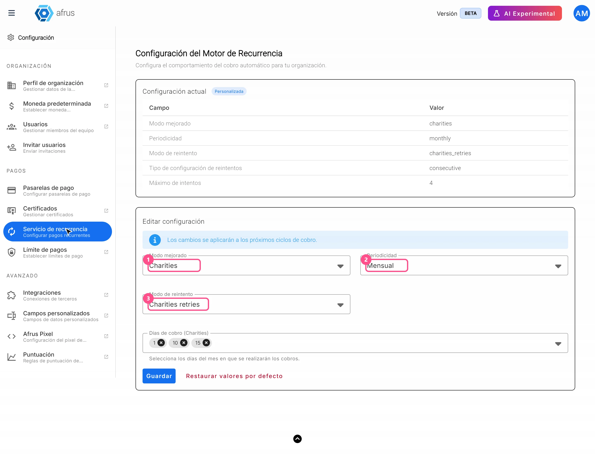
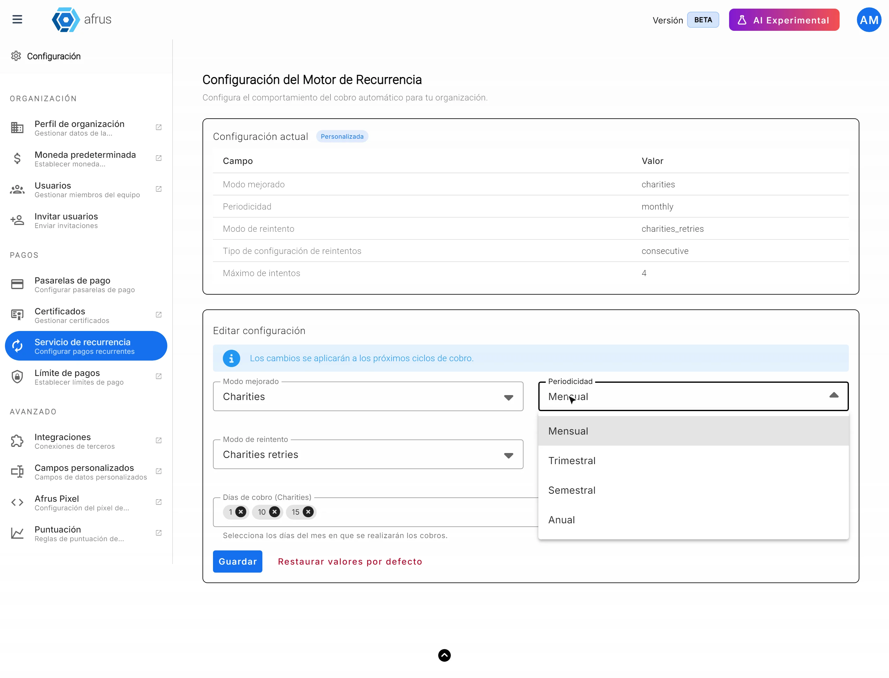
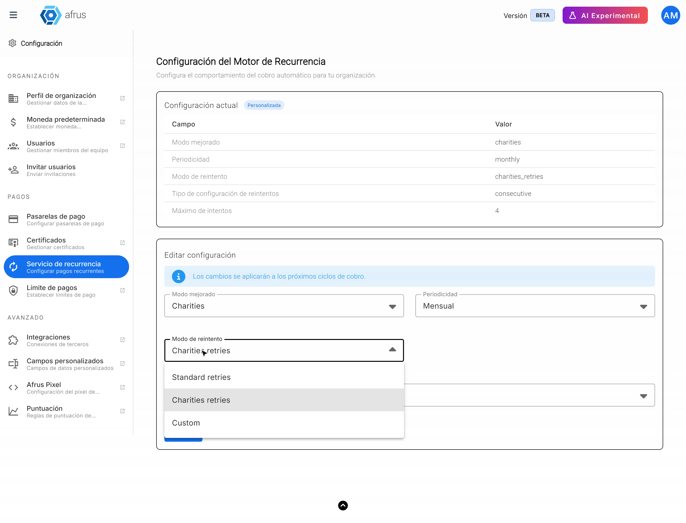
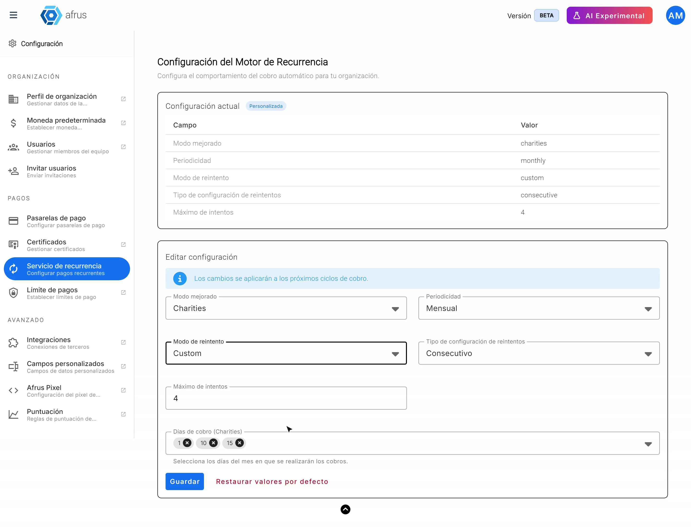

# Guia do Serviço de recorrência

Com este guia você vai saber o que é o Serviço de recorrência, para que ele serve e quais opções pode configurar nele.

*Módulo: Configuración (Configurações) · Menu: **Configuración > Pagos > Servicio de recurrencia** · Público: administradores da organização*

> **Sobre os nomes de tela neste guia:** botões, campos e menus estão escritos exatamente como aparecem na versão em espanhol do console, com a explicação em português quando ajuda.

---

## O que é o Serviço de recorrência

**É a tela onde você configura como a Afrus faz as cobranças automáticas das suas doações mensais e recorrentes.** Na tela, o título é **Configuración del Motor de Recurrencia** (Configuração do motor de recorrência).

Ali você escolhe, por exemplo, a cada quanto tempo a doação é cobrada e o que fazer quando uma cobrança falha.

> **Importante:** esta configuração vale para as doações recorrentes que a Afrus cobra. Se o seu gateway de pagamento cobra as assinaturas por conta própria (por exemplo Stripe, PayU ou Pagar.me), é o gateway que decide quando cobrar.

## Para que serve

- **Escolher a cada quanto tempo** uma doação recorrente é cobrada: todo mês, a cada três meses, a cada seis meses ou todo ano.
- **Decidir o que acontece se uma cobrança falhar:** quantas vezes ela é tentada de novo e em quais datas.
- **Escolher os dias de cobrança**, se você usa o modo **Charities**.
- **Voltar à configuração original** com um só botão, se algo não convencer você.

> **Pendente de confirmação:** que as mudanças nesta tela alteram as cobranças reais. Antes de mudar algo importante, fale com a equipe da Afrus.

## Antes de começar

- **Você precisa ter acesso à Configuración** (Configurações) da sua organização.
- **As mudanças não são imediatas:** a tela avisa *"Los cambios se aplicarán a los próximos ciclos de cobro."* (As mudanças serão aplicadas aos próximos ciclos de cobrança.)

---

# Passo a passo

## Como configurar o Serviço de recorrência

1. **Abra a tela.** Acesse **Configuración > Pagos > Servicio de recurrencia**. Você verá o título **Configuración del Motor de Recurrencia**.
   

2. **Escolha o modo.** Em **Modo mejorado** (Modo aprimorado), escolha **Standard** ou **Charities**. Com **Charities**, você também pode escolher os dias de cobrança.

3. **Escolha a cada quanto tempo cobrar.** Em **Periodicidad** (Periodicidade), escolha **Mensual** (mensal), **Trimestral**, **Semestral** ou **Anual**.
   

4. **Se escolheu Charities, marque os dias de cobrança.** Aparece **Días de cobro (Charities)** (Dias de cobrança) para você escolher em quais dias cobrar.

5. **Decida o que acontece se uma cobrança falhar.** Em **Modo de reintento** (Modo de nova tentativa), escolha **Standard retries**, **Charities retries** ou **Custom** (personalizado).
   

6. **Se escolheu Custom, defina as novas tentativas.** Em **Tipo de configuración de reintentos** (Tipo de configuração de novas tentativas), escolha:
   - **Consecutivo:** indique o **Máximo de intentos** (máximo de tentativas).
   - **Fechas específicas** (Datas específicas): escolha as **Fechas específicas de reintento** (datas específicas de nova tentativa).
   

7. **Salve as mudanças.** Elas serão aplicadas aos próximos ciclos de cobrança.

> **Pendente de confirmação:** o nome exato do botão de salvar.

> **Dá para desfazer?** Sim. Você pode mudar as opções quando quiser, ou clicar em "Restaurar valores por defecto" (Restaurar valores padrão) para voltar à configuração original.

---

## Limitações conhecidas

- **Gateways que cobram por conta própria:** com Stripe, PayU ou Pagar.me, o gateway decide quando cobrar; esta tela não muda essas cobranças.
- **Efeito nas cobranças reais:** ainda não está confirmado que esta configuração muda as cobranças. Fale com a equipe da Afrus antes de fazer mudanças.
- **Periodicidades diferentes de mensal e anual:** não está confirmado como **Trimestral** e **Semestral** são calculadas.

## Perguntas frequentes

**A que horas as cobranças são feitas?**
> **Pendente de confirmação:** o horário das cobranças automáticas.

**Quantas vezes uma cobrança que falhou é tentada de novo antes de a assinatura ser cancelada?**
> **Pendente de confirmação:** o número de novas tentativas e quando uma assinatura é cancelada automaticamente.

**As mudanças afetam as assinaturas que já existem?**
A tela indica que as mudanças valem para os próximos ciclos de cobrança.

---

> **[Voltar ao índice da seção](./README.md)** · **[Voltar ao índice geral](../README.md)**

*Última atualização: 2026-10-26*
