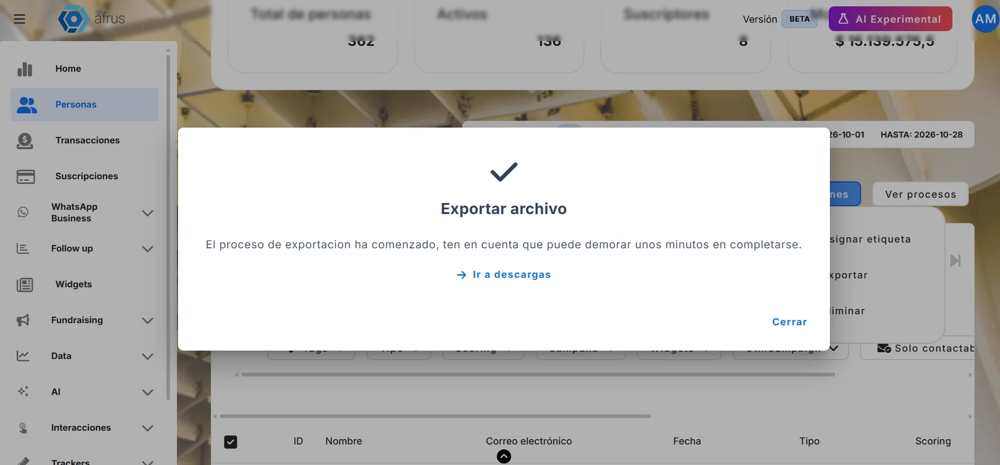
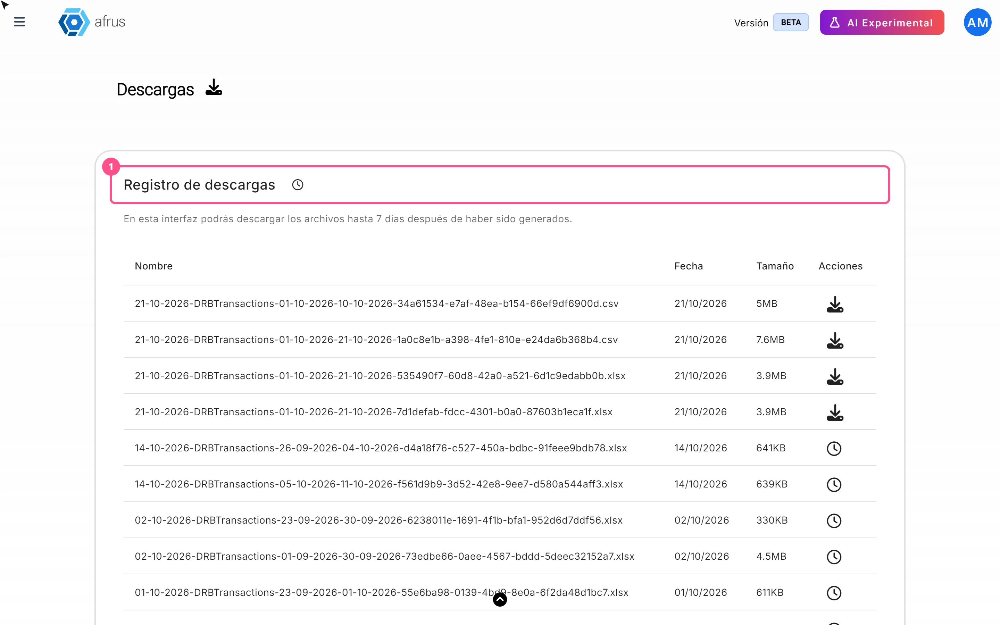
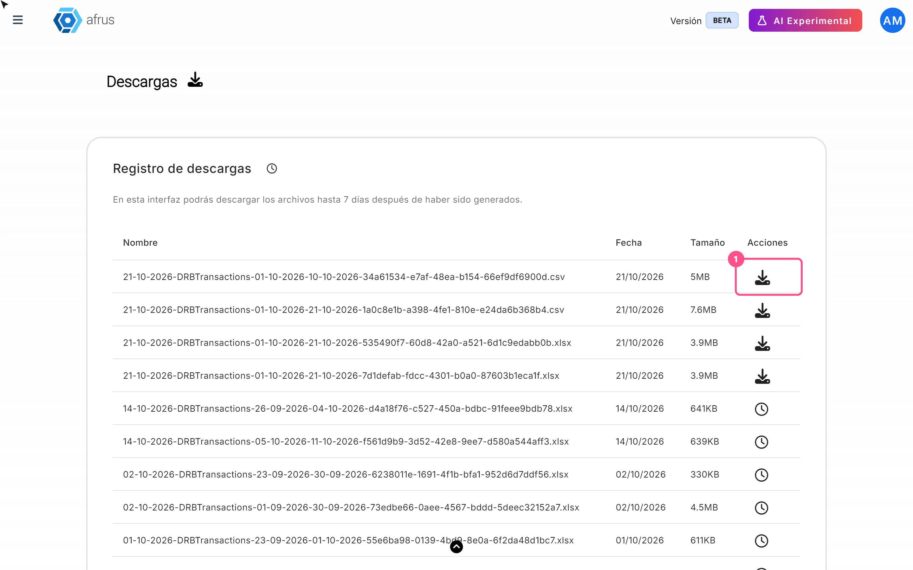
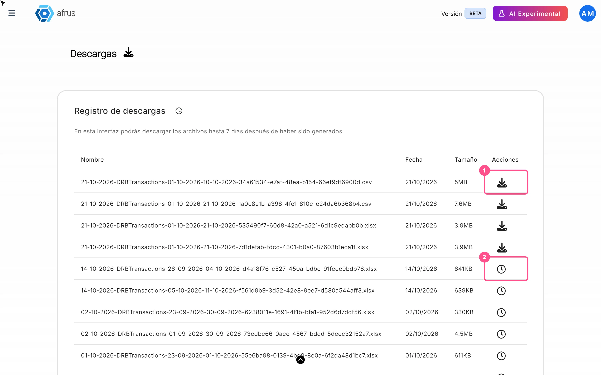

# Guia de Downloads

Com este guia você vai saber onde encontrar os arquivos que exporta na AFRUS e o que significa cada ícone da lista.

*Módulo: Data · Menu: **Data > Descargas** (Downloads) · Público: equipes de captação, dados e administração*

> **Sobre os nomes de tela neste guia:** botões, campos e menus estão escritos exatamente como aparecem na versão em espanhol do console, com a explicação em português quando ajuda.

---

## O que é Downloads

**Descargas (Downloads) é a lista de todos os arquivos que a sua organização exporta na AFRUS.**

Quando você pede para exportar dados (por exemplo, suas pessoas ou suas transações), a AFRUS prepara o arquivo enquanto você continua trabalhando. Quando ele fica pronto, você baixa por aqui.

Você também encontra essa tela em **Trackers > Descargas**: é a mesma.

## Para que serve

- **Baixar seus arquivos exportados.** Tudo o que você exporta chega a esta lista.
- **Saber se um arquivo já está pronto.** Você vê se ele está sendo preparado, se já pode baixar ou se deu erro.
- **Ter suas exportações num só lugar,** não importa de qual tela você pediu.

**De onde dá para exportar?**

- **Personas** (Pessoas), em "Acciones" (Ações) e depois "Exportar".
- **Transacciones** (Transações), **Suscripciones** (Assinaturas) e **Radar - monitor de fraude**.
- **Segmentos** (básico e avançado).
- **Tareas de suscripciones** (Tarefas de assinaturas) e **Transacciones abandonadas** (Transações abandonadas).
- A lista de resultados de um envio de e-mail em massa (Blast) e o painel de um widget.

O **Reporte general** (Relatório geral) é a exceção: o botão "Descargar" (Baixar) dele salva o arquivo direto no seu computador, sem passar por esta lista.

---

# Passo a passo

## Como baixar um arquivo

1. **Peça a exportação.** Na tela que quiser (por exemplo, **Personas**), use a opção de exportar. Você verá *"El proceso de exportacion ha comenzado, ten en cuenta que puede demorar unos minutos en completarse."* (A exportação começou; pode levar alguns minutos.)
   

2. **Abra Downloads.** Acesse **Data > Descargas**. Em **Personas** você também pode usar o link "Ir a descargas" (Ir para downloads) da mensagem.
   

3. **Espere ficar pronto.** A lista se atualiza sozinha quando o arquivo termina. Pode levar alguns minutos.

4. **Baixe.** Clique no botão de download da linha. Você verá *"¡Archivo descargado con éxito!"* (Arquivo baixado com sucesso!).
   

Os arquivos chegam em formato Excel (.xlsx).

## Que tipos de ações existem

Na coluna **Acciones** (Ações) de cada linha você vê um ícone que indica o status do arquivo:

| O que você vê | O que significa | O que você pode fazer |
|---|---|---|
| **Botão de download** | O arquivo está pronto | Clique para baixar |
| **Círculo girando** | A AFRUS está preparando o arquivo | Esperar alguns minutos |
| **Ponto de exclamação** | Deu erro ao preparar o arquivo | Passe o mouse por cima para ver o detalhe e peça a exportação de novo |
| **Relógio** | Passaram mais de 7 dias | Não dá mais para baixar por aqui; exporte de novo |
| **Sem ícone** | O arquivo está na fila | Esperar: ainda não começou |

A lista mostra primeiro os arquivos mais novos. Cada linha tem o **Nombre** (Nome) do arquivo, a **Fecha** (Data) e o **Tamaño** (Tamanho). Você pode ver 5, 10, 15 ou 20 linhas por página.

> **Importante:** você pode baixar cada arquivo até 7 dias depois de criado. Se for precisar depois, salve no seu computador.

---

## Para ter em conta

- **Se você escolher CSV, recebe um Excel (.xlsx) mesmo assim.** Abra no Excel ou no Google Sheets e, se precisar, salve como CSV por lá.
- **Se uma exportação falhar, a lista não se atualiza sozinha.** Recarregue a página para ver o ícone de erro.
- **Depois de baixar, o botão pode continuar girando.** O arquivo já foi baixado; recarregue a página.
- **Arquivos na fila não mostram ícone.** Não é erro: espere um pouco e recarregue.
- **Você não recebe e-mail quando o arquivo fica pronto.** Confira esta lista.
- **Se você pedir a mesma exportação duas vezes** enquanto a primeira está sendo preparada, a segunda não é criada, mesmo que apareça a mensagem de início.

## Perguntas frequentes

**A AFRUS tenta de novo uma exportação que falhou?**
Não. Peça de novo na tela onde você a fez.

**Os arquivos são apagados depois de 7 dias?**
Depois de 7 dias você não consegue mais baixá-los por esta tela.

**Os dados de Pessoas estão atualizados?**
Ao exportar Pessoas você escolhe a fonte: **Base de datos en tiempo real** (Banco de dados em tempo real) traz os dados atuais, e **Datos analizados** (Dados analisados) são atualizados a cada 24 horas.

---

> **[Voltar ao índice da seção](./README.md)** · **[Voltar ao índice geral](../README.md)**

*Última atualização: 2026-10-28*
