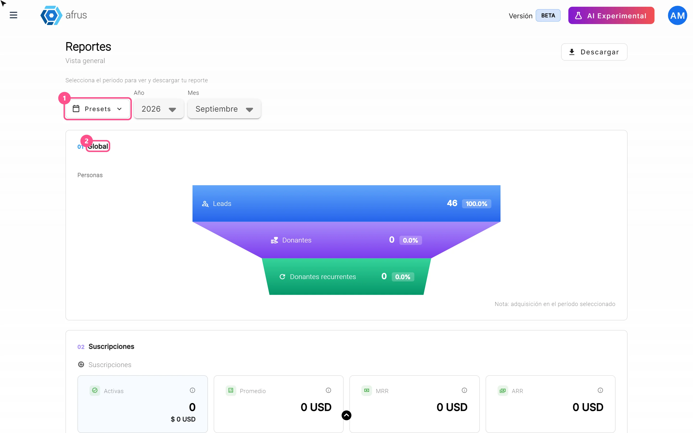
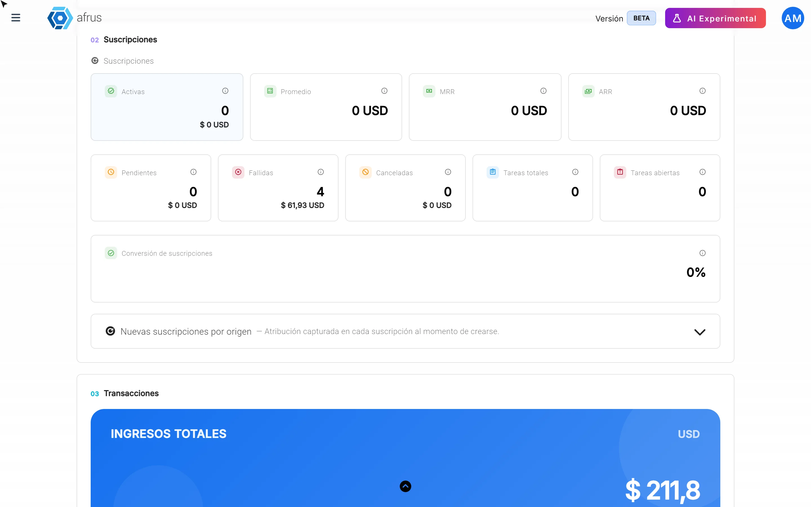
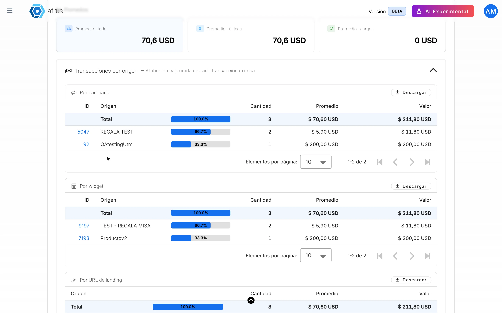
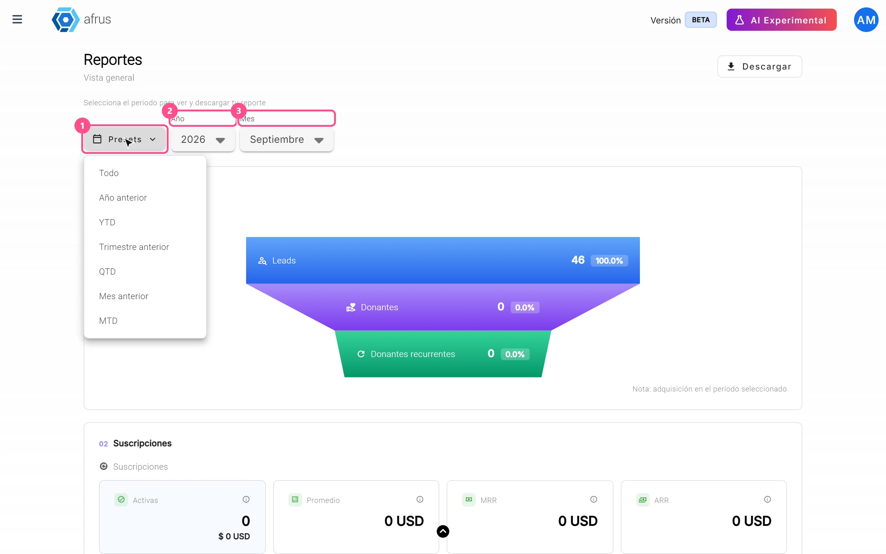
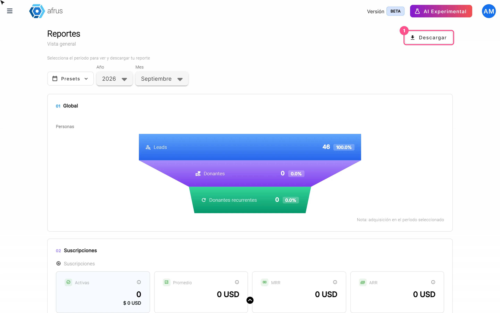

# Reporte general (General report) guide

With this guide you will be able to see on one screen how your organization is doing: how much you raised, how many new people arrived, how your monthly donations are going and where your donors come from.

*Module: Data · Menu: **Data > Reporte general** · Audience: leadership, fundraising and communications teams*

> **About the labels in this guide:** buttons, fields and menus are written exactly as they appear in the Spanish version of the console, with an English explanation where it helps.

---

## What the Reporte general is

**The Reporte general (General report) is a dashboard with your organization's most important numbers for the period you choose.** It brings together in one place your people, your subscriptions (monthly donations), your transactions and your communications.

The numbers are calculated on the spot, with the latest data, every time you open the screen or change the period.

## What it is for

- **See at a glance how you are doing.** How much you raised, how many new people arrived and how monthly donations are going.
- **Know what works.** You see which campaign, form (widget), UTM or page your people, subscriptions and donations come from.
- **Share results.** You can download the numbers for your team or your board.

---

# Step by step

## How to analyze the Reporte general

1. **Open the report.** Go to **Data > Reporte general**. When it opens, you will see the last full month (for example, if it is October, you will see September).
   

2. **Choose the period.** Use the filters at the top (we explain them in "What the Presets, Año and Mes filters are for").

3. **Review the 5 zones, from top to bottom.** Each one answers a different question:

| Zone | What it tells you | What to look at |
|---|---|---|
| **01 Global** | How many new people arrived and how many became donors | The step from **Leads** to **Donantes** (Donors) and to **Donantes recurrentes** (Recurring donors): the percentage tells you how many new people decided to donate |
| **02 Suscripciones** (Subscriptions) | How your monthly donations are going | **Activas** (Active), **Fallidas** (Failed) and **Canceladas** (Cancelled); **MRR** (what your new active subscriptions add up to in a month) and **ARR** (that figure projected over a year) |
| **03 Transacciones** (Transactions) | How much you raised | **Ingresos totales** (Total income), **Confirmadas** (Confirmed) donations and **Otras** (Other: pending, failed and refunded) |
| **04 Personas** (People) | How many new contacts you have | **Personas nuevas** (New people), **Leads**, **Donantes** and **Donantes recurrentes** |
| **05 Comunicaciones** (Communications) | How much you communicated | **Emails enviados** (Emails sent) and **Mensajes WhatsApp enviados** (WhatsApp messages sent) |

   

4. **See where they come from.** The "by origin" tables (**Nuevas suscripciones por origen**, **Transacciones por origen** and **Nuevos leads por origen**) split results into blocks, one below the other: **Por campaña** (By campaign), **Por widget**, **Por UTM campaign**, **Por UTM medium**, **Por UTM source** and **Por URL de landing** (By landing URL). Each table starts closed: click its title to open it. Each block has its own "Descargar" (Download) button. This way you know which campaign or form brings you the most donors.
   

**Some keys to read it well:**

- **Total fallidas** (Total failed) counts only one-time donations that failed. Monthly charges that failed are in **Cargos fallidos** (Failed charges).
- Amounts are in your organization's currency.
- **ARR** is a projection (MRR multiplied by 12), not money received.

## What the Presets, Año and Mes filters are for

They let you choose the period you want to see and download.

**Presets** are one-click shortcuts:

| Preset | Period it shows |
|---|---|
| **Todo** (All) | Your organization's whole history |
| **Año anterior** (Previous year) | All of last year |
| **YTD** | From January 1 this year until today |
| **Trimestre anterior** (Previous quarter) | The three months of last quarter |
| **QTD** | From the start of this quarter until today |
| **Mes anterior** (Previous month) | All of last month |
| **MTD** | From the start of this month until today |

**Año** (Year) and **Mes** (Month) let you choose a specific month or year, up to 8 years back. For example, to compare this year's December campaign with last year's, look at one December first and then the other.

> **Keep in mind:** there is no filter by campaign or currency, no free date range and no automatic comparison with the previous period.

## What the Descargar button downloads

- **The "Descargar" (Download) button at the top** downloads a CSV file (it opens in Excel or Google Sheets) with all the indicators for the chosen period. It has four columns: **Sección** (Section), **KPI**, **Actual** (Current) and **Unidad** (Unit).
- **Each "by origin" table has its own "Descargar" button**, which downloads only that table.

> **Keep in mind:** if a "by origin" table has more than 5,000 rows, it can't be downloaded and you will see an error message. Choose a shorter period and try again.

---

## Frequently asked questions

**Are the numbers up to date?**
Yes. They are calculated on the spot every time you open the screen or change the period.

**Can I see the report for a single campaign?**
Not with a filter, but in the "by origin" tables, under **Por campaña**, you see the results for each campaign.

**Why does the report open on last month?**
Because it shows the last full month, which already has all its results. If you want to see the current month, use **MTD**.

---

> **[Back to section index](./README.md)** · **[Back to main index](../README.md)**

*Last updated: 2026-10-26*
