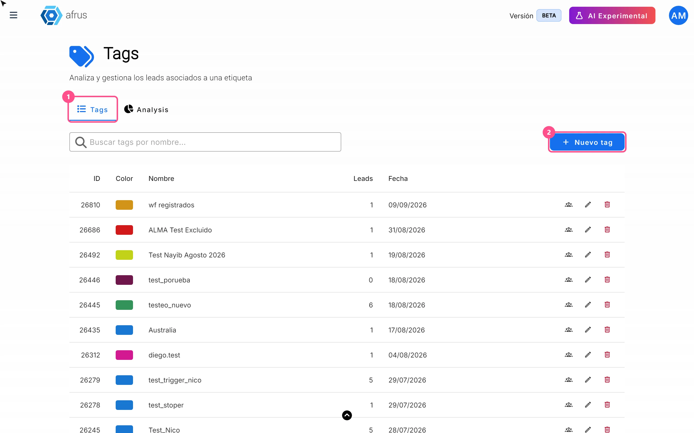
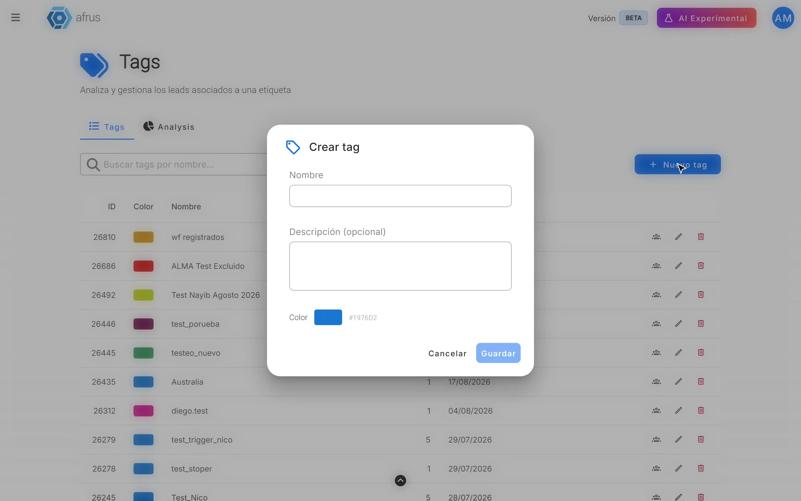
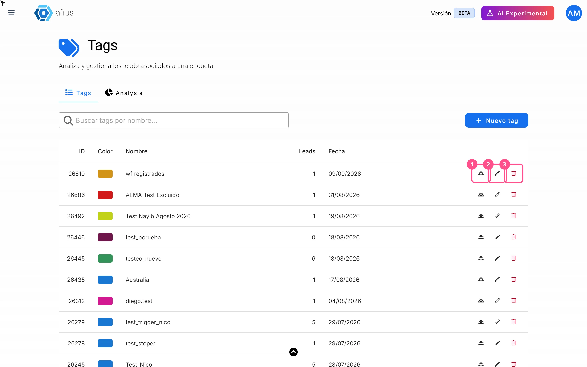
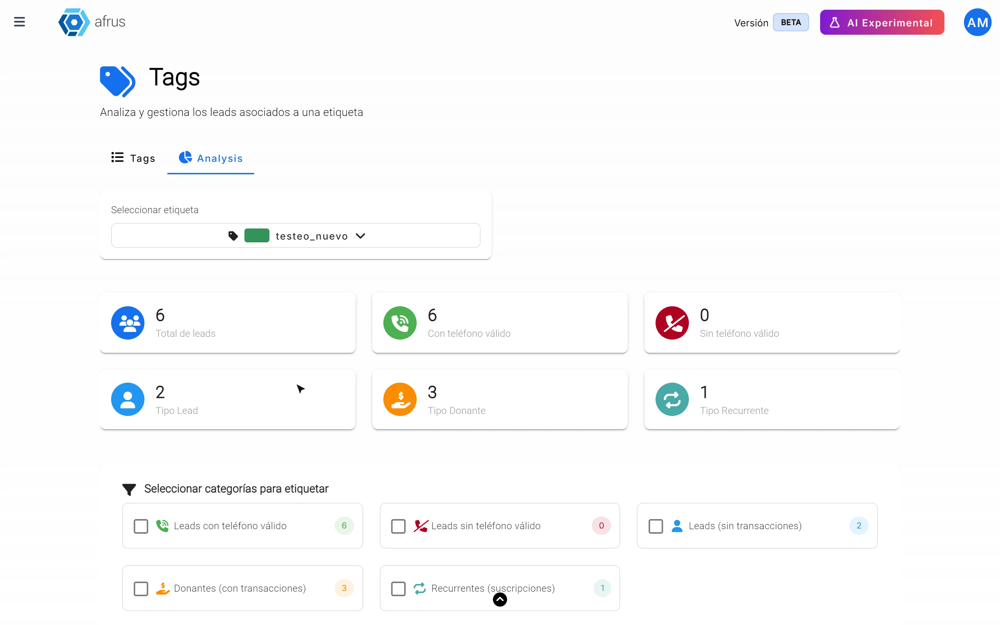

# Guia de Tags

Com este guia você vai poder criar tags (etiquetas) para agrupar seus contatos, alterá-las ou excluí-las e ver quantas pessoas cada uma tem.

*Módulo: Data · Menu: **Data > Tags** · Público: equipes de captação, comunicação e dados*

> **Sobre os nomes de tela neste guia:** botões e campos estão escritos como aparecem na versão em espanhol do console, com a explicação em português.

---

## O que são as tags

**Uma tag (ou etiqueta) é uma marca que você coloca em uma pessoa para agrupá-la com outras.** Por exemplo: "EVENTO_2026", "VOLUNTARIO" ou "INTERESSE_EDUCACAO".

Uma pessoa pode ter várias tags. Na tela **Data > Tags** você cria, altera e exclui suas tags, e vê quantas pessoas cada uma tem.

## Para que servem

- **Organizar sua base de contatos.** Você agrupa as pessoas por origem, interesse ou evento.
- **Encontrar pessoas rápido.** Em **Personas** (Pessoas) você pode filtrar por tag.
- **Enviar mensagens para um grupo.** Você pode usar uma tag para escolher quem recebe um e-mail em massa (Blast) ou para montar um segmento.
- **Conhecer melhor um grupo.** Você vê quantas pessoas da tag têm telefone, quantas já doaram e quantas doam todo mês.

---

# Passo a passo

## Como criar uma nova tag

1. **Abra as tags.** Acesse **Data > Tags**. Você verá a aba **Tags** com a lista das suas etiquetas.
   

2. **Crie uma nova.** Clique em "Nuevo tag" (Nova tag).

3. **Preencha os dados.** Escreva o **Nombre** (Nome, obrigatório). Se quiser, adicione uma **Descripción (opcional)** (Descrição, opcional) de até 200 caracteres, para sua equipe saber para que serve. Escolha uma **Color** (Cor) para reconhecê-la fácil.
   

4. **Salve.** Você verá *"Tag creado correctamente."* (Tag criada com sucesso).

A tag aparece na lista e você já pode colocá-la nos seus contatos.

**Outra forma:** você também pode criar uma tag no momento de colocá-la em alguém. Quando escolher **Asignar etiqueta** (Atribuir etiqueta) em **Personas**, no perfil de uma pessoa ou em um segmento, use "Crear etiqueta" (Criar etiqueta).

## O que fazem os 3 ícones de cada tag

Em cada linha da lista de tags há três ícones:

| Ícone | O que faz |
|---|---|
| **Ver personas** (Ver pessoas) | Abre **Personas** mostrando só quem tem essa tag |
| **Lápis** (editar) | Abre **Editar tag** para mudar o nome, a descrição ou a cor |
| **Lixeira** (excluir) | Exclui a tag |

**Para editar uma tag:**

1. **Clique no lápis** da linha.
2. **Mude o que precisar** e salve. Você verá *"Tag actualizado correctamente."* (Tag atualizada com sucesso).

O novo nome aparece em todas as pessoas que têm essa tag.

**Para excluir uma tag:**

1. **Clique na lixeira** da linha.
2. **Confirme.** A tela pergunta *"¿Estás seguro de que quieres eliminar el tag…? Esta acción no se puede deshacer."* (Tem certeza de que quer excluir a tag…? Esta ação não pode ser desfeita.) Clique em "Eliminar" (Excluir). Você verá *"Tag eliminado correctamente."* (Tag excluída com sucesso).

> **Dá para desfazer?** Não. Se você excluir uma tag, não dá para recuperá-la.

> **Importante:** uma tag que está sendo usada em outras partes da Afrus (por exemplo, em uma sequência, um newsletter ou uma etiqueta automática) não pode ser excluída. Nesse caso aparece um erro que não explica o motivo. Se isso acontecer, veja onde você usa essa tag e tire-a de lá primeiro.

## Estatísticas das tags

Há dois lugares onde você vê os números das suas tags. Os dois mostram dados na hora.

**1. Na lista (aba Tags)**

A coluna **Leads** mostra quantas pessoas cada tag tem. Você pode buscar uma tag pelo nome.

**2. Na aba Analysis**

1. **Abra a aba.** Em **Data > Tags**, entre em **Analysis** (essa aba aparece em inglês).
2. **Escolha uma tag.** Você verá estes números:
   

| Número | O que mostra |
|---|---|
| **Total de leads** | Quantas pessoas têm a tag |
| **Con teléfono válido** (Com telefone válido) | Quantas têm um telefone que pode ser usado |
| **Sin teléfono válido** (Sem telefone válido) | Quantas não têm um telefone que possa ser usado |
| **Tipo Lead** | Quantas ainda não doaram |
| **Tipo Donante** (Tipo doador) | Quantas já doaram |
| **Tipo Recurrente** (Tipo recorrente) | Quantas doam todo mês |

**Coloque uma tag em parte do grupo.** Pela aba **Analysis** você pode marcar um subgrupo com outra tag. Por exemplo, os doadores dessa tag:

1. **Marque as categorias** em "Seleccionar categorías para etiquetar" (Selecionar categorias para etiquetar): **Leads con teléfono válido**, **Leads sin teléfono válido**, **Leads (sin transacciones)**, **Donantes (con transacciones)** ou **Recurrentes (suscripciones)**.
2. **Escolha a tag** que quer colocar e clique em "Aplicar etiqueta".

Se você marcar várias categorias, a tag vai para quem cumprir **qualquer** uma delas, não todas ao mesmo tempo. O processo leva um tempinho; você pode acompanhar em "Ver procesos" (Ver processos).

---

## Para ter em conta

- **O número da lista pode ser um pouco maior que o da aba Analysis.** A lista conta também as pessoas marcadas como spam; a Analysis não.
- **Se ninguém cumprir as categorias** escolhidas, o aviso aparece em inglês: *"No leads match the selected categories"*.
- **Quando você coloca uma tag em muitas pessoas,** não chega um e-mail ao terminar. Acompanhe em "Ver procesos".
- **Para tirar uma tag de uma pessoa,** vá ao perfil dela e, em **Etiquetas**, clique no **x** da tag. Por enquanto não dá para tirar uma tag de muitas pessoas de uma vez em **Personas**.

## Perguntas frequentes

**Posso ter duas tags com o mesmo nome?**
> **Pendente de confirmação:** se a Afrus permite duas tags com o mesmo nome. Recomendamos usar nomes diferentes para não se confundir.

**Onde vejo as tags de uma pessoa?**
No perfil dela, seção **Etiquetas**, e na coluna **Tags** de **Personas**.

---

> **[Voltar ao índice da seção](./README.md)** · **[Voltar ao índice geral](../README.md)**

*Última atualização: 2026-10-26*
