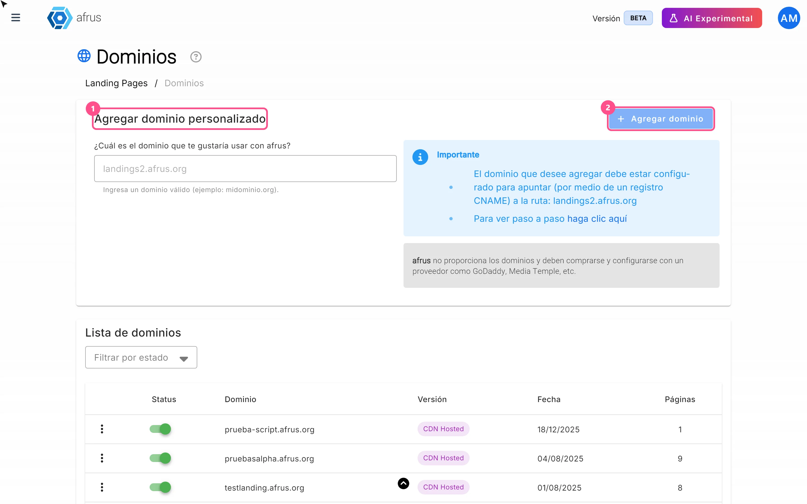

# Guia de Domínios

Depois de ler este guia, você vai saber o que é um domínio próprio na Afrus, para que ele serve e como configurá-lo para que suas landings sejam publicadas com o endereço da sua organização.

*Módulo: Dominios (Domínios) · Menu: **Fundraising > Dominios** · Público: equipes de marketing digital, comunicação e TI*

> **Sobre os nomes de tela neste guia:** botões, campos e menus estão escritos exatamente como aparecem na versão em espanhol do console, com a explicação em português quando ajuda.

---

## O que é Domínios

**Dominios (Domínios) é a tela onde você cadastra o domínio ou subdomínio próprio da sua organização (por exemplo `doe.minhaorganizacao.org`) para que suas landing pages sejam publicadas com esse endereço**, em vez do endereço padrão da Afrus (`web.afrus.org`).

Como diz a própria tela: *"Asocia un dominio propio para que tus landing pages se vean con la URL de tu organización, fortaleciendo tu marca y generando más confianza en tus campañas."* ("Associe um domínio próprio para que suas landing pages apareçam com a URL da sua organização, fortalecendo sua marca e gerando mais confiança nas suas campanhas.")

## Para que serve

- **Publicar suas landings com a sua marca.** O doador vê o endereço web da sua organização, o que gera mais confiança.
- **Ter vários endereços próprios** e escolher qual cada landing usa.
- **Controlar seus domínios:** ver quantas landings usam cada um (coluna **Páginas**) e ativá-los ou desativá-los.
- **Segurança sem burocracia.** A Afrus gerencia automaticamente o certificado de segurança do domínio (o cadeado, HTTPS): você não precisa comprar nem instalar certificados.

## Antes de começar

- **Compre o domínio com um provedor.** A Afrus não vende domínios: *"afrus no proporciona los dominios y deben comprarse y configurarse con un proveedor como GoDaddy, Media Temple, etc."* (a Afrus não fornece domínios; compre e configure com um provedor como GoDaddy, Media Temple etc.)
- **Tenha acesso à configuração de DNS** do domínio, no seu provedor ou com sua equipe de TI.
- **Use um subdomínio** (por exemplo `doe.minhaorganizacao.org`). É o recomendado: a tela só pede um registro CNAME, e muitos provedores não permitem CNAME no domínio principal (`minhaorganizacao.org`).

---

# Passo a passo

## Como adicionar e configurar meu domínio na Afrus

### Parte 1 — No seu provedor de domínio (fora da Afrus)

1. **Crie um registro CNAME.** Na configuração de DNS do seu domínio, crie este registro, como indica o quadro **Importante** da tela da Afrus:

   | Tipo | Nome / Host | Valor / Destino |
   |---|---|---|
   | CNAME | o subdomínio que você quer usar (por exemplo `doe` para `doe.minhaorganizacao.org`; dependendo do provedor, escreve-se só `doe` ou o nome completo) | `landings2.afrus.org` |

   Se o valor mostrado na tela da Afrus for diferente, use sempre o da tela.

2. **Espere a alteração se propagar.** Mudanças de DNS podem demorar; o tempo depende do seu provedor, não da Afrus. O ideal é criar o registro e esperar antes de adicionar o domínio na Afrus.

### Parte 2 — Na Afrus

3. **Abra Domínios.** Acesse **Fundraising > Dominios**.
   

4. **Digite seu domínio.** No cartão **Agregar dominio personalizado** (Adicionar domínio personalizado), no campo abaixo de *"¿Cuál es el dominio que te gustaría usar con afrus?"* (Qual domínio você gostaria de usar com a afrus?), digite seu domínio sem `http://`, `https://`, barras nem caminhos, por exemplo `doe.minhaorganizacao.org`. O campo passa tudo para minúsculas.

5. **Adicione.** Clique em "Agregar dominio" (Adicionar domínio), no canto superior direito do cartão; ele fica ativo quando o texto é válido.

Ao terminar, você verá *"Dominio registrado con exito"* (Domínio cadastrado com sucesso), e seu domínio aparecerá em **Lista de dominios** (Lista de domínios) com o **Status** ligado (ativo) e a **Versión** "CDN Hosted".

**O que acontece depois:** a Afrus deixa o domínio pronto e solicita automaticamente o certificado de segurança (HTTPS). Ela verifica se o domínio responde na hora e depois a cada 30 segundos, durante cerca de 15 minutos. Não existe um botão "Verificar" e você não precisa esperar a aprovação da nossa equipe.
- Se a verificação der certo, o domínio fica confirmado.
- Se depois desses 15 minutos não der certo (normalmente porque o registro DNS está errado ou ainda não se propagou), o domínio passa a **inativo** sozinho.

> **Importante:** a tela não se atualiza sozinha. Para ver o status atual, recarregue-a ou mude o filtro. Enquanto o certificado não for emitido, o domínio aparece como ativo e você já pode escolhê-lo em uma landing, mas o endereço `https://` ainda não abre corretamente.

### Parte 3 — Use nas suas landings

6. **Atribua a uma landing.** Ao criar ou editar uma landing, em **Datos básicos** (Dados básicos), escolha seu domínio no seletor **Dominio**. A landing é publicada em `https://<seu-domínio><caminho>`. Veja o [guia de Landings](../landings/landings-guide.pt.md).

> **Importante:** adicionar o domínio não publica nada sozinho. Se nenhuma landing o usar, ao abri-lo seu conteúdo não aparecerá.

### Mensagens que você pode ver

| Mensagem | O que significa | O que fazer |
|---|---|---|
| *"Dominio existente, prueba otro"* (Domínio já existe, tente outro) | Esse domínio já está cadastrado na Afrus. Cada domínio só pode ser cadastrado uma vez em toda a plataforma. | Confira sua **Lista de dominios** ou use outro subdomínio. |
| *"El dominio no se encuentra apuntando al Host (landings2.afrus.org)"* (O domínio não está apontando para o host) | A Afrus verificou o DNS e o domínio ainda não aponta para a Afrus. | Confira o registro CNAME e espere a propagação. |
| *"Error al registrar dominio"* (Erro ao cadastrar domínio) | Outro erro. | Tente de novo; se continuar, fale com o suporte. |
| *"El dominio no puede contener espacios"*, *"El dominio solo puede contener letras, números, puntos y guiones"*, *"El formato del dominio no es válido (ejemplo: dominio.com)"*, *"El dominio debe tener entre 3 y 253 caracteres"* | O texto do campo não é válido (espaços, caracteres inválidos, formato ou tamanho). | Corrija o domínio. |

---

## Outras tarefas

### Como ativar ou desativar um domínio

Em **Lista de dominios**, use a chave da coluna **Status**. Você verá *"Dominio actualizado con exito"* (Domínio atualizado com sucesso). Um domínio inativo deixa de aparecer no seletor **Dominio** das landings.

> **Pendente de confirmação:** se desativar um domínio faz as landings já publicadas nele deixarem de aparecer. Para deixar de usar um domínio com segurança, retire-o das suas landings ou exclua-o.

### Como excluir um domínio

1. **Abra o menu da linha.** Em **Lista de dominios**, abra o menu de três pontos do domínio e escolha **Eliminar** (Excluir).
2. **Confirme.** No diálogo **Confirmar eliminación** (Confirmar exclusão), clique em "Confirmar".

Você verá *"Dominio eliminado con exito"* (Domínio excluído com sucesso). Lembre-se:
- Embora o aviso diga que *"las landings asociadas se borrarán"* (as landings associadas serão excluídas), **elas não são excluídas**: ficam sem domínio e desativadas. Para continuar usando, reative-as e atribua outro domínio (ou o da Afrus).
- A Afrus deixa de servir o domínio. O registro DNS no seu provedor não é alterado: você pode apagá-lo.
- O domínio fica livre para ser cadastrado de novo.

> **Dá para desfazer?** Não pela tela. Você pode cadastrar o domínio de novo e reatribuí-lo às suas landings.

---

## Colunas e status da lista

| Coluna | O que mostra |
|---|---|
| **Status** | Chave: ligada = ativo, desligada = inativo. Bloqueada quando o domínio está com exclusão pendente. |
| **Dominio** | O nome cadastrado. |
| **Versión** | "CDN Hosted" (cadastrado com o sistema atual; os únicos que podem ser escolhidos nas landings) ou "Classic" (domínios do sistema anterior). |
| **Fecha** | Data de cadastro, ou "Sin fecha" (sem data). |
| **Páginas** | Quantas landings usam esse domínio. |

| Situação | Aparece como |
|---|---|
| Certificado de segurança confirmado | Ativo |
| Recém-cadastrado, verificação em andamento | Ativo |
| Desativado por você, ou a verificação falhou depois de cerca de 15 minutos | Inativo |
| Exclusão pendente | Inativo, com a chave bloqueada |

Use **Filtrar por estado** (Filtrar por status: Todos / Activos / Inactivos) para encontrar seus domínios.

## Limitações conhecidas

- **Só é indicado um registro CNAME.** A tela não oferece alternativa para usar o domínio principal (`minhaorganizacao.org`); por isso recomendamos um subdomínio.
- **`www.minhaorganizacao.org` e `minhaorganizacao.org` são domínios diferentes:** cada um é cadastrado separadamente e precisa do seu próprio registro DNS.
- **Religar não repete a verificação.** Se o domínio ficou inativo porque a verificação falhou, ligar a chave de novo o marca como ativo, mas não solicita o certificado outra vez.

  > **Pendente de confirmação:** como refazer a verificação nesse caso. Enquanto isso, fale com o suporte.
- **Os domínios "Classic"** não aparecem no seletor de domínio das landings atuais.
- **Mensagens de erro técnicas.** Se a exclusão ou o carregamento da lista falhar, a mensagem pode aparecer como texto técnico. Recarregue a tela e, se continuar, fale com o suporte.

## Perguntas frequentes

**A Afrus me vende o domínio?**
Não. Você compra com um provedor (GoDaddy, Media Temple ou outro) e configura lá.

**Preciso comprar um certificado de segurança?**
Não. A Afrus gerencia automaticamente.

**Posso usar meu domínio principal, sem subdomínio?**
A tela aceita, mas só indica um registro CNAME, que muitos provedores não permitem no domínio principal. Recomendamos usar um subdomínio.

> **Pendente de confirmação:** qual registro usar para o domínio principal.

**Quanto tempo leva para ficar pronto?**
Depende de quanto tempo seu provedor leva para propagar o DNS. Depois de adicionado, a Afrus verifica o domínio por cerca de 15 minutos.

**Meu domínio ficou inativo. O que faço?**
Normalmente o registro CNAME está errado ou ainda não se propagou. Confira com seu provedor. Se o registro estiver certo e o domínio continuar inativo, fale com o suporte: religar a chave não repete a verificação.

**Posso usar meu domínio como página principal?**
Sim. Na landing, use o caminho `/` com seu domínio.

---

> **[Voltar ao índice da seção](./README.md)** · **[Voltar ao índice geral](../README.md)**

*Última atualização: 2026-10-20*
