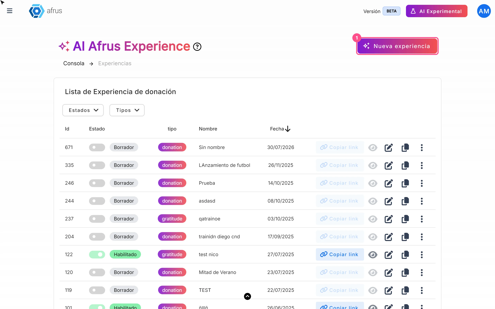
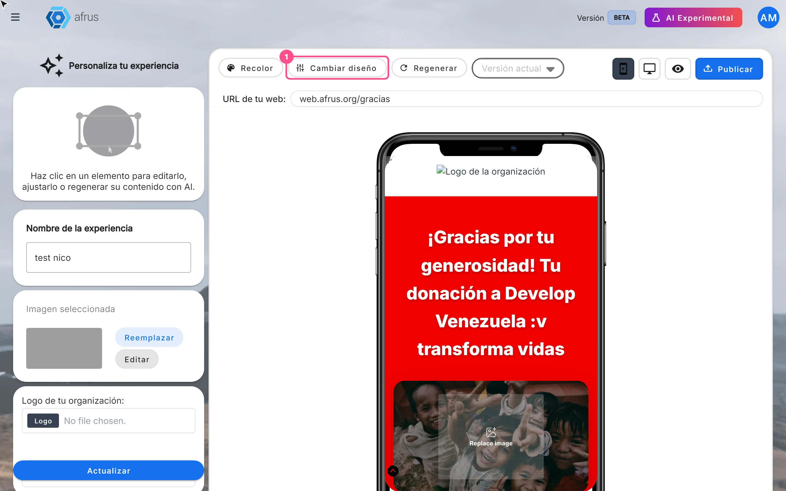
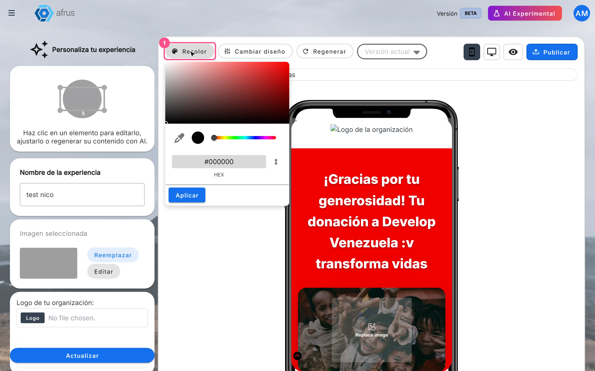

# Experiences AI guide

After reading this guide you will know how to create a donation or thank-you page with artificial intelligence, change its template and colors, and show your social networks, logo and FAQs on it.

*Module: Experiences AI · Menu: **Fundraising > Experiences AI** · Audience: fundraising, communications and digital marketing teams*

> **About the labels in this guide:** buttons, fields and menus are written exactly as they appear in the Spanish version of the console, with an English explanation where it helps.

---

## What Experiences AI is

**Experiences AI is a tool that uses artificial intelligence to create a donation or thank-you page (landing page) from a few answers you give.** You can then edit it and publish it at its own web address.

The pages you create here live only in **Fundraising > Experiences AI**: they are not landings from the **Landings** module and do not appear in that list.

## What it is for

- **Having a donation page ready in minutes.** You don't design from scratch: the AI writes the texts.
- **Thanking donors with emotion.** Create a thank-you page to show after a donation.
- **Sharing easily.** Share the page with a link or a QR code.

## Before you start

- **Activate AFRUS AI.** If it isn't active, you will see the notice *"Activación necesaria para usar afrus experience"* (Activation required to use afrus experience) with the button "Ir a business profile" (Go to business profile). To activate it, complete your **Business profile** (profile menu, top corner) and, in the last step, click "Enviar AI" (Send to AI). When the profile status says **Sincronizado con AI** (Synced with AI), you can use the module.
- **Have a donation widget created** if you are going to make a **Donación** (Donation) page.

---

# Step by step

## How to create a landing page with AI

1. **Create the experience.** Go to **Fundraising > Experiences AI** and click "Nueva experiencia" (New experience). A draft is created right away and the wizard opens.
   

2. **Choose the goal.** In the **Objetivo** (Goal) tab, choose **Donación** (Donation) or **Agradecimiento** (Thank you). The wizard moves to the next tab on its own.

3. **Set the name and address.** In the **Configuracion** (Settings) tab, type the **Nombre de la experiencia** (experience name, required). In **URL para la experiencia de donación**, choose the domain on the left (by default `web.afrus.org`, or one of your organization's domains) and type the path on the right, for example `donatenow`. Click "Continuar" (Continue).

   > **Important:** the path only accepts lowercase letters a to z: no numbers, hyphens, spaces or accents.

4. **Answer the 3 questions.** In the **Instrucciones** (Instructions) tab, answer one question at a time and move on with "Siguiente pregunta" (Next question). All three are required. If you like, click "Mejorar respuesta" (Improve answer) so the AI rewrites your answer; the help icon gives you tips. The more specific your answer, the better the texts.
   - Donation: **¿Cuál es el objetivo para el que quiere recaudar?** (What are you raising funds for?), **Danos información sobre tu causa** (Tell us about your cause), **¿Qué lograrás con esta experiencia de donación?** (What will you achieve with this donation experience?)
   - Thank you: **¿Qué tipo de campaña originó la donación?** (What kind of campaign led to the donation?), **¿Qué emoción o mensaje queremos transmitir al donante?** (What emotion or message do we want to convey to the donor?), **¿Qué impacto tuvo o tendrá esta donación en la causa?** (What impact did or will this donation have on the cause?)

5. **Choose the widget (Donation only).** In the **Widget** tab, in **Seleccionar Widget de donación** (Select donation widget), choose the widget that will receive the donations. You can search by name.

6. **Finish.** Click "Finalizar" (Finish) — for Thank you pages it already appears in the **Instrucciones** tab. You will see a loading screen while the AI writes the texts.

   > **Important:** don't close or leave the page until the editor opens.

7. **Review and publish.** The **Personaliza tu experiencia** (Customize your experience) editor opens with the preview. Review the texts and click "Publicar" (Publish).

When you finish, your page is online at the address shown in **URL de tu web:** (Your web URL) and the experience changes to **Habilitado** (Enabled) in the list. Until you click "Publicar", it stays as **Borrador** (Draft) and has no public link.

**If you click "Cancelar" (Cancel) in the wizard:** if you already filled in the name, domain and path, the experience is saved as a draft; if not, it is deleted. If you leave the wizard some other way (for example, from the menu), an unnamed draft ("Sin nombre") stays in the list.

**To edit texts and images later:** in the list, click the pencil icon. Click a text in the preview, edit it in the left panel and click "Actualizar" (Update), or use "Editar con IA" (Edit with AI) so the AI writes a new version. For images, click the image and use **Reemplazar** (Replace) or **Editar** (Edit) — recommended size: 1080 × 1920 px. Click "Publicar" to take the changes to the public page.

## How to change my landing page's template

When the experience is created, AFRUS randomly assigns one of the templates available for its type. You can change it whenever you like.

1. **Open the editor.** In **Fundraising > Experiences AI**, click the experience's pencil icon.
2. **Change the design.** In the top bar, click "Cambiar diseño" (Change design). Each click moves to the next available template of the same type (Donation or Thank you); after the last one, it goes back to the first. Your existing texts are kept and fit into the new design.
   
3. **Publish.** When you like the design, click "Publicar" to take it to the public page.

When you finish you will see the public page with the new design. The template change is saved right away in the editor, but it doesn't show online until you publish.

> **Can it be undone?** Yes. Keep clicking "Cambiar diseño" until you get back to the previous template, or choose an earlier published version in the **Versión actual** (Current version) selector and click "Publicar".

## How to change my landing page's styles

1. **Open the editor.** In the list, click the experience's pencil icon.
2. **Choose a base color.** In the top bar, click "Recolor", choose a color in the picker and click "Aplicar" (Apply). From that color, the AI creates a complete palette (primary, secondary, accent and text colors) and applies it to the template. It is saved right away.
   
3. **Show or hide sections (Donation only).** Use the **Compartir** (Share — section for sharing the cause) and **Meta de recaudación** (Fundraising goal — progress bar) switches, and click "Actualizar".
4. **Check mobile and desktop.** Use the phone and monitor icons in the preview.
5. **Publish.** Click "Publicar" to take the changes to the public page.

> **Important:** the editor has no controls for fonts, font sizes or individual colors. You can change the whole palette with "Recolor" or switch templates with "Cambiar diseño".

> **Can it be undone?** Yes. Apply another color, or choose an earlier published version in the **Versión actual** selector and click "Publicar".

## How to make my social networks and logo appear on my landing page

Your social networks, contact details and logo are not set up inside each experience: the page takes them from your **Business profile**.

1. **Open your Business profile.** In the profile menu (top corner), choose **Business profile**.
2. **Complete your networks.** In the **Redes sociales** (Social networks) step, turn on and fill in **Facebook**, **Instagram**, **LinkedIn** and **YouTube**. If you like, also complete **Contacto** (Contact: phone, address and email) and **Logotipo** (Logo). Click "Continuar" to save.
3. **Publish the experience again.** Go to **Fundraising > Experiences AI**, open the experience with the pencil icon and click "Publicar". This way the public page picks up your new data.

When you finish you will see your networks and logo on the page. If a network isn't set up, its icon is removed from the page, so there is no broken link.

> **Important:** the published page is a snapshot of the moment you published. If you later change networks, contact details or logo in the Business profile, the page doesn't change until you click "Publicar" again.

> **Important:** WhatsApp and TikTok from your Business profile are not used on these pages.

> **Important:** the editor also has a "Logo" button under **Logo de tu organización:** (Your organization's logo). That button changes the Business profile logo for **your whole organization**, not just for this experience.

## How to change the FAQs on my landing page

The page's frequently asked questions are the ones in the **Preguntas Frecuentes** (FAQs) step of your **Business profile**. They are not edited inside Experiences AI.

1. **Open your Business profile.** In the profile menu, choose **Business profile** and go to the **Preguntas Frecuentes** step.
2. **Edit the questions.** Click "Agregar pregunta frecuente" (Add FAQ) and fill in **Pregunta** (question) and **Respuesta** (answer), up to 300 characters each, or delete one with the delete icon.
3. **Save.** Go to the last step, **Tema** (Theme), and click "Guardar" (Save) or "Enviar AI". Questions deleted with the delete icon are removed right away.
4. **Publish the experience again.** In **Fundraising > Experiences AI**, open the experience with the pencil and click "Publicar" so the page shows the new questions.

> **Important:** the FAQs are the same for all your organization's experiences; there are no per-experience FAQs.

> **Pending confirmation:** whether every template has an FAQ section. If you don't see the questions on your page, try another template with "Cambiar diseño".

> **Can it be undone?** Deleting a question is immediate and has no confirmation; to get it back, write it again.

---

## Experience statuses

| Status | What it means | What you can do |
|---|---|---|
| **Borrador** (Draft) | Created but never published. It has no public link | Open it with the pencil and click "Publicar" |
| **Habilitado** (Enabled) | Published at least once | Copy the link, view the page and download the QR code |
| **Deshabilitado** (Disabled) | Marked as disabled in the list | Turn it back on with the **Estado** (Status) switch |

> **Pending confirmation:** whether the public page stops showing when you disable or delete an experience.

## Known limitations

- **Goal and currency:** they can't be set or changed from this module. The experience stores a default goal of 10,000. For now there is no alternative within AFRUS.
- **Only two types:** you can create **Donación** or **Agradecimiento**. Although "Registro" (Registration) appears in some texts and in the **Tipos** (Types) filter, it can't be created; and the **Tipos** filter has no option for Thank you.
- **Label on Thank you pages:** in the **Configuracion** tab of a Thank you experience, the top label says "Registro".
- **"Editar con IA" on Thank you pages:** it doesn't generate anything and the preview may keep loading. Reload the page and edit the text by hand.
- **Type column in English:** the list shows `donation` or `gratitude`.
- **Untranslated texts:** some editor buttons look the same in every language ("Recolor", "Aplicar", "Logo", "Widget afrus:", "Google tag manager", "Editar con IA", "Copiar link", "Descargar QR", "Eliminar").
- **Same address as a landing:** if you publish a landing from the **Landings** module and an experience on the same domain and path, the latest publication replaces the other one. Use different paths.

## Frequently asked questions

**Does my experience show up in the Landings module?**
No. Experiences only appear in **Fundraising > Experiences AI**.

**How long does the AI take to create the page?**
It depends on the AI service at that moment; there is no fixed time. Don't close the tab until the editor opens.

**Can I go back to an earlier version?**
Yes. Every time you click "Publicar" a version is saved. In the editor, the **Versión actual** selector lists them by date and time; choose one and click "Publicar".

**Can I regenerate all the texts?**
Yes. In the top bar, "Regenerar" (Regenerate) rewrites all the texts with AI using your **Prompt AI** answers. If you changed those answers, click "Actualizar" first and then "Regenerar".

---

> **[Back to section index](./README.md)** · **[Back to main index](../README.md)**

*Last updated: 2026-10-20*
