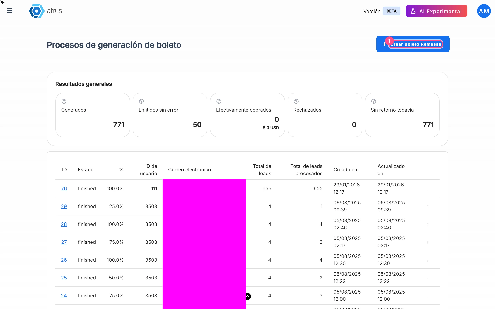

# Boleto Itaú guide

After reading this guide you will know what **Boleto Itaú** is, what it is for, and how to generate boletos in batches for a group of people and track their collection.

*Module: Follow up · Menu: **Follow up > Boleto Itaú** · Audience: fundraising and finance teams at organizations in Brazil*

> **About the labels in this guide:** buttons, fields and menus are written exactly as they appear in the Spanish version of the console, with an English explanation where it helps. A *boleto* is a Brazilian bank payment slip.

---

## What Boleto Itaú is

**Boleto Itaú is the screen where you track the batches of bank boletos (Brazil, Itaú bank) your organization generates for a group of people, and their collection result.**

Each batch prepares one boleto per person, in Brazilian reais (BRL), and produces the "remessa" file that is sent to the bank. When the bank sends back its response and you upload it in **Follow up > Importaciones - itaú**, this screen shows which boletos were collected and which weren't.

> **Important:** generating boletos is only available for organizations whose country is Brazil. The menu appears for every organization, but the option to generate them only shows for Brazilian ones.

## What it is for

- **Generating boletos in batches** for a segment of people, with a common amount and due date.
- **Getting the remessa file** for each batch to send to the bank.
- **Seeing collection progress**: how many boletos are **Generados** (Generated), **Emitidos sin error** (Issued without errors), **Efectivamente cobrados** (Actually collected), **Rechazados** (Rejected) and **Sin retorno todavía** (No bank response yet).
- **Reviewing the detail per person**: each boleto's status, errors and the bank's response.

## Before you start

- **Your organization must be in Brazil.**
- **Each person needs a CEP (postal code), document type and document number.** If any is missing, their boleto gets an error. Check this in the segment before generating.
- **Have the segment ready** with the people you want to send boletos to, in **Data > Segmentos > Básico**.

---

# Step by step

## How it works and how boletos are generated

The full journey has four moments:

1. **You generate the batch** in AFRUS (steps below).
2. **You download the remessa file** and send it to Itaú bank. This is done outside AFRUS.
3. **The bank gives you a return file** with the result of each boleto.
4. **You upload that file** in **Follow up > Importaciones - itaú**: AFRUS records the paid donations and updates this screen's indicators (see the Importaciones - itaú guide).

### Part 1 — Generate the batch

1. **Open Boleto Itaú.** Go to **Follow up > Boleto Itaú** and click "Crear Boleto Remessa" (Create remessa boleto). It takes you to **Segmentos** (Segments); you can also go straight to **Data > Segmentos > Básico**.
   

2. **Choose the segment.** Select the segment and open **Acciones** (Actions) > **Generar Archivos de Remessa (Boleto Brasil)** (Generate remessa files). You can also do it from **Personas** (People): select the people and use the same option in **Acciones**.

3. **Set amount and due date.** In **Generar archivo de remessa**, fill in **Monto (BRL)** (Amount, minimum 2.99 BRL) and **Fecha de vencimiento** (Due date — must be after today; by default, 3 months from now). The amount and due date are the same for every boleto in the batch.

4. **Create the file.** Click "Crear archivo de remessa" (Create remessa file).

You will see *"El archivo de Remessa se está generando. En unos minutos podrás descargar el archivo."* (The remessa file is being generated. In a few minutes you will be able to download it.) with the "Ver procesos" (View processes) button. A batch is created in **Procesos de generación de boleto** (Boleto generation processes).

> **Can it be undone?** **Pending confirmation:** whether a generated batch can be cancelled. Check the segment, amount and due date carefully before creating the file.

### Part 2 — Download and track the batch

5. **Wait for the batch to finish.** In **Follow up > Boleto Itaú** you will see the batch with its status and **%** progress. The screen doesn't refresh by itself: reload it to see progress.

6. **Download the file.** When it is ready, choose "Descargar" (Download) in the row menu. This is the file you send to the bank.

7. **Review the detail per person.** In the row menu choose "Ver detalle por lead" (View detail per lead). You will see each boleto's status, its errors, the transaction and, once you upload the bank's response, the **Estado de retorno** (Return status).

---

## Indicators

Shown overall in the list and per batch in the detail.

| Indicator | What it means |
|---|---|
| **Generados** (Generated) | Total boletos generated |
| **Emitidos sin error** (Issued without errors) | Boletos generated correctly, with no error in the person's data or the gateway |
| **Efectivamente cobrados** (Actually collected) | Boletos that, when the bank's return file was uploaded, were confirmed as donations in AFRUS. Includes the amount collected |
| **Rechazados** (Rejected) | Boletos the bank reported as rejected in the return file |
| **Sin retorno todavía** (No response yet) | Issued boletos with no return file uploaded yet |

## Return status per person

| Status | What it means | What you can do |
|---|---|---|
| **Sin retorno** (No response) | The bank's response for this boleto hasn't been uploaded yet | Upload the return file when the bank delivers it |
| **Cobrado** (Collected) | The bank confirmed it and it was recorded as a donation in AFRUS | Nothing |
| **Rechazado** (Rejected) | The bank rejected it | Review the case with the person |
| **Pagado - no registrado** (Paid – not recorded) | The bank confirmed it as paid, but it wasn't recorded as a donation, usually because of missing data (CEP or document) | Complete the person's data |
| **Otro** (Other) | Another bank response | Check the detail |

> **Pending confirmation:** how to record the donation for a **Pagado - no registrado** boleto after completing the data.

## Batch statuses

Shown in English as is: `created`, `queued`, `pending` (in progress), `succeeded` and `failed`.

## How often it updates

- **Generation runs in the background** and takes a few minutes, according to the on-screen message.
- **The screen doesn't refresh by itself.** It loads when you open it and when you change page.
- **The collection indicators** change when the bank's return file is uploaded in **Follow up > Importaciones - itaú**.

## Known limitations

- **Brazilian organizations only**, although the menu appears for all.
- **Batch statuses are shown in English.**
- **You can't choose a campaign or widget when generating.** The campaign and widget are chosen later, when uploading the return file.

## Frequently asked questions

**Does AFRUS send the file to the bank?**
No. You download the remessa file and send it to the bank outside AFRUS.

**Which bank details does the file use, and who sets them up?**
> **Pending confirmation:** which of the organization's bank details (branch, account, portfolio) the file uses and how they are configured. Write to us to review it.

**Does generating a boleto create a pending transaction?**
> **Pending confirmation.**

---

> **[Back to section index](./README.md)** · **[Back to main index](../README.md)**

*Last updated: 2026-10-20*
