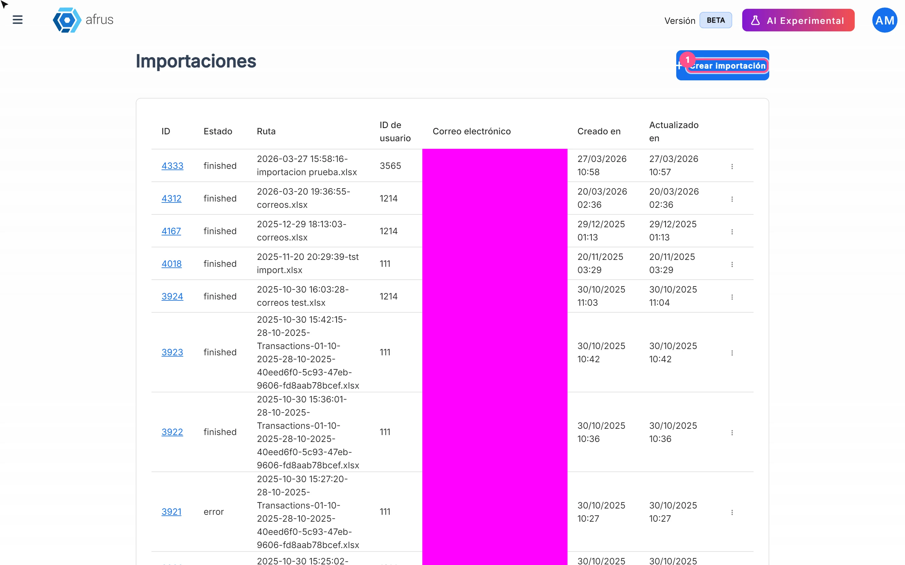

# Guia de Importações Itaú

Depois de ler este guia, você vai saber o que é **Importaciones - itaú** (Importações Itaú), para que serve e como carregar o arquivo de retorno do banco Itaú para que a Afrus registre as doações dos boletos pagos.

*Módulo: Follow up · Menu: **Follow up > Importaciones - itaú** · Público: equipes de captação e financeiro de organizações no Brasil*

> **Sobre os nomes de tela neste guia:** botões, campos e menus estão escritos exatamente como aparecem na versão em espanhol do console, com a explicação em português quando ajuda.

---

## O que são as Importações Itaú

**Importaciones - itaú é onde você carrega o arquivo de retorno que o banco Itaú entrega (formato CNAB 400) depois de processar seus boletos, para que a Afrus registre como doações os boletos pagos.**

É o último passo do caminho do **Follow up > Boleto Itaú**: você gera os boletos, envia ao banco, o banco devolve o resultado e você o carrega aqui.

## Para que serve

- **Registrar automaticamente os pagamentos de boletos** a partir do arquivo do banco, associando cada um à pessoa certa.
- **Ver o resultado linha por linha**, com os status **Éxito** (Sucesso), **Error** (Erro), **Pendiente** (Pendente) e **Omitido**, e a mensagem de cada erro.
- **Alimentar os indicadores do Boleto Itaú**: pagos, rejeitados e sem retorno.

## Antes de começar

- **Tenha o arquivo de retorno do banco** (CNAB 400) de boletos gerados pela Afrus.
- **Tenha uma campanha ativa** onde registrar as doações.
- **Confira os dados das pessoas.** Para registrar a doação, cada pessoa precisa de CEP, tipo de documento e número de documento.

---

# Passo a passo

## Qual é o processo para criar uma importação

1. **Abra Importações.** Acesse **Follow up > Importaciones - itaú** e clique em "Crear importación" (Criar importação).
   

2. **Confira o tipo.** Em **Tipo de importación** (Tipo de importação), deixe **Boleto** (é a única opção).

3. **Escolha a campanha.** Em **Campaña** (Campanha), escolha uma campanha ativa (obrigatório). As doações ficarão registradas nela.

4. **Escolha o widget (opcional).** **Formulario / Widget** mostra os widgets ativos daquela campanha. Se você não escolher nenhum, *"Se usará el widget predeterminado si no se selecciona ningún formulario"* (Será usado o widget padrão se nenhum formulário for selecionado).

5. **Envie o arquivo.** Clique em "Subir archivos" (Enviar arquivos) ou arraste para *"Arrastra archivos para subirlos"* (Arraste arquivos para enviá-los). Tamanho máximo: 64 MB.

6. **Importe.** Clique em "Importar".

Você verá o diálogo **Importación en proceso** (Importação em andamento): *"El proceso de importación comenzó con éxito. En minutos podrás ver los resultados"* (A importação começou com sucesso. Em minutos você poderá ver os resultados), com o botão "Ver procesos de importación" (Ver processos de importação).

> **Importante:** esse diálogo pode aparecer mesmo que o envio do arquivo tenha falhado. Confirme sempre que a sua importação aparece na lista de **Follow up > Importaciones - itaú**.

> **Dá para desfazer?** **Pendente de confirmação:** se uma importação pode ser cancelada. Confira a campanha e o arquivo antes de clicar em "Importar".

### O que a Afrus faz com o arquivo

Para cada linha do arquivo, a Afrus identifica a pessoa do boleto. Se ela tiver CEP, tipo e número de documento, a Afrus registra uma **doação com sucesso** pelo valor do boleto, em reais (BRL), com método boleto, na campanha e no widget escolhidos. Se faltarem esses dados, a linha fica com **Error** e o boleto aparece como **Pagado - no registrado** (Pago - não registrado) em **Follow up > Boleto Itaú**.

A importação fica finalizada quando todas as linhas terminam de ser processadas.

## Como revisar o resultado

1. **Abra a lista.** Acesse **Follow up > Importaciones - itaú**.
2. **Abra a importação.** No menu da linha, escolha:
   - "Registros", com as abas **Detalles de transacciones** (Detalhes das transações) e **Registros** e um resumo de **Encontradas** / **No encontradas** (Não encontradas), ou
   - "Ver Líneas" (Ver linhas), que abre **Líneas de Importación** (Linhas da importação).
3. **Revise cada linha.** Em **Líneas de Importación** você verá **Línea #** (Linha #), **ID de Lead**, **ID de Donación** (ID da doação), o status e o **Mensaje de Error** (Mensagem de erro). Clique em uma linha para ver os **Datos en Bruto** (Dados brutos).

---

## Status

| Status da importação (em inglês) | O que significa |
|---|---|
| `queue` | Na fila |
| `processing` | Em processamento |
| `finished` | Todas as linhas foram processadas |
| `error` | A importação falhou |

| Status da linha | O que significa | O que você pode fazer |
|---|---|---|
| **Pendiente** (Pendente) | A linha está em processamento | Esperar e recarregar a tela |
| **Éxito** (Sucesso) | A doação foi registrada | Nada |
| **Error** (Erro) | Não foi possível registrar | Ler a **Mensaje de Error**; se faltar CEP ou documento, completar os dados da pessoa |
| **Omitido** | A linha foi pulada | Revisar os **Datos en Bruto** |

## Com que frequência é atualizado

- **O processamento acontece em segundo plano** e leva alguns minutos, segundo a mensagem da tela.
- **A tela não se atualiza sozinha.** Recarregue para ver o avanço.

## Limitações conhecidas

- **O diálogo "Importación en proceso" aparece mesmo que o envio tenha falhado.** Confira se a importação aparece na lista.
- **Os status da importação aparecem em inglês.**
- **Só serve para boletos Itaú (Brasil)**, embora o menu apareça para todas as organizações.

## Perguntas frequentes

**O que acontece com os boletos que o banco rejeitou?**
Eles aparecem como **Rechazado** (Rejeitado) em **Follow up > Boleto Itaú**.
> **Pendente de confirmação:** como a importação trata as linhas de boletos rejeitados. Fale com a gente se encontrar uma doação que não deveria estar lá.

**O que acontece se eu carregar o mesmo arquivo duas vezes?**
> **Pendente de confirmação.** Enquanto isso, confira a lista antes de carregar um arquivo de novo.

**Posso usar uma campanha inativa?**
Não. Só aparecem campanhas ativas.

---

> **[Voltar ao índice da seção](./README.md)** · **[Voltar ao índice geral](../README.md)**

*Última atualização: 2026-10-20*
