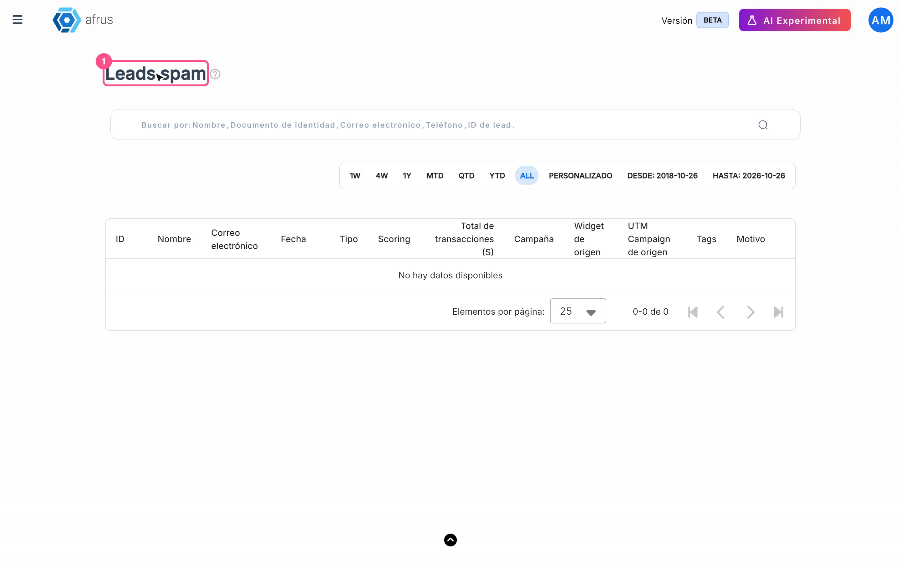

# Guía de Leads spam

Después de leer esta guía sabrás qué es **Leads spam**, para qué sirve, cuándo AFRUS considera un registro como spam y cómo devolver a tu base a una persona real que quedó apartada.

*Módulo: Follow up · Menú: **Follow up > Leads spam** · Audiencia: equipos de recaudación, datos y atención a donantes*

---

## Qué es Leads spam

**Leads spam es la lista de personas que AFRUS apartó automáticamente, en "cuarentena", porque su registro desde un formulario parece hecho por un bot.**

Estas personas no se borran: quedan guardadas en esta lista para que tu equipo las revise y, si alguna es real, la devuelva a la base con un clic.

## Para qué sirve

- **Mantener limpia tu base de Personas.** Los registros automatizados no se mezclan con tus donantes y contactos reales.
- **No perder a nadie.** Las personas apartadas se guardan, así que puedes revisarlas cuando quieras.
- **Corregir a tiempo.** Con "No es spam" devuelves a la base a cualquier persona real que haya quedado apartada.
- **Proteger tus números.** Las personas en cuarentena no cuentan en segmentos, campañas, reportes ni en el panel de inicio, y no reciben correos automáticos.

---

# Paso a paso

## Cómo revisar los leads spam y restaurar una persona

1. **Abre la lista.** Entra a **Follow up > Leads spam**.
   

2. **Elige el rango de fechas.** Por defecto se muestra el **mes en curso**. El filtro usa la fecha de creación de la persona.

3. **Revisa cada fila.** Mira el nombre, el correo, la **Campaña**, el widget de origen y la columna **Motivo**, que muestra por qué AFRUS apartó el registro (ver la tabla de motivos más abajo).

4. **Restaura a las personas reales.** Si reconoces a una persona real, pulsa "No es spam" en su fila. Así vuelve a **Personas**, a tus segmentos y a tus comunicaciones automáticas.

Al terminar, la persona deja de aparecer en la lista y vuelve a tu base. Si algo falla verás *"Error al restaurar la persona"*.

> **Importante:** se restaura de a una persona. En esta pantalla no hay selección múltiple ni acciones masivas (exportar, etiquetar o borrar), a propósito, para que cada caso se revise con cuidado.

---

## Cada cuánto se actualiza

- **La decisión se toma en tiempo real**, en el momento en que la persona se registra desde un formulario o widget.
- **La pantalla no se refresca sola.** Carga al abrirla y al cambiar fechas, orden o página. Si esperas un registro nuevo, vuelve a cargarla.

## Cuándo un lead se considera spam

AFRUS evalúa cada registro en el momento en que llega desde un formulario o widget. Lo aparta como spam cuando el registro **reúne varias señales típicas de registros automatizados**. La columna **Motivo** muestra las señales que coincidieron, con estos códigos (aparecen en inglés tal cual):

| Motivo | Qué significa |
|---|---|
| `no_origin_metadata` | El registro llegó sin los datos de origen que normalmente envía un widget |
| `ua_missing_or_blocklisted` | El navegador no se identificó o se identificó como una herramienta automatizada |
| `ip_velocity` | Llegaron demasiados registros desde la misma conexión en poco tiempo |
| `implausible_identity` | Los datos de identidad no son plausibles (por ejemplo, correos desechables o datos inconsistentes) |

Si una persona en cuarentena completa una donación confirmada, AFRUS la restaura automáticamente.

## Qué mecanismos tiene AFRUS para combatir el spam

- **Clasificación automática de cada registro de formulario**, con las señales descritas arriba.
- **Cuarentena:** las personas apartadas se guardan, pero quedan fuera de **Personas**, segmentos, conteos de campañas, reportes, panel de inicio, etiquetas y correos automáticos hasta que alguien las restaure.
- **Restauración automática** de quien completa una donación confirmada.
- **Controles antifraude en los formularios**, como la verificación anti-bots. Puedes ver más en la guía de **Radar - monitor de fraude**.

## Limitaciones conocidas

- **La columna Motivo muestra códigos técnicos en inglés**, sin traducir. Usa la tabla de esta guía para interpretarlos.
- **No hay acciones masivas** en esta pantalla: la revisión es persona por persona.

## Preguntas frecuentes

**¿Las personas en Leads spam se borran?**
No. Quedan guardadas en esta lista hasta que las restaures.

**¿Las personas en cuarentena reciben mis correos?**
No. Quedan fuera de los correos automáticos, segmentos y reportes hasta que las restaures.

**¿Está activa esta clasificación en mi organización?**
> **Pendiente de confirmar:** si la clasificación está activa en todas las organizaciones. Si tienes dudas, escríbenos.

---

> **[Volver al índice de la sección](./README.md)** · **[Volver al índice general](../README.md)**

*Última actualización: 2026-10-20*
