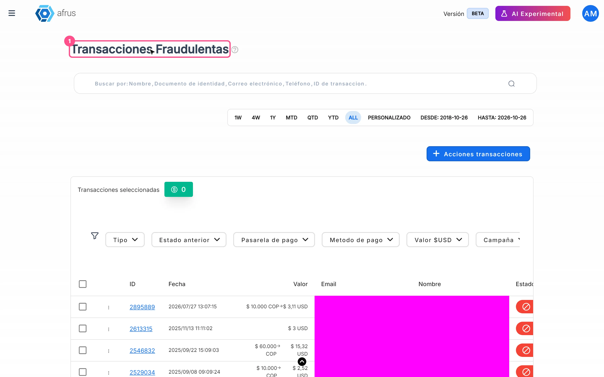

# Guía de Radar - monitor de fraude

Después de leer esta guía sabrás qué es el Radar, cuándo una transacción aparece en él, cómo revisarlo y cómo te protege AFRUS frente al fraude.

*Módulo: Follow up · Menú: **Follow up > Radar - monitor de fraude** · Audiencia: equipos de finanzas, recaudación y administración*

---

## Qué es el Radar - monitor de fraude

**El Radar es la lista de las transacciones de tu organización que quedaron marcadas como fraude.** La pantalla se llama **Transacciones Fraudulentas**.

Para cada transacción ves, entre otros datos, su **Valor**, **Email**, **Nombre**, **Estado**, **Estado anterior** (el estado que tenía antes de marcarse como fraude), la fecha **Marcada como fraude el**, la **Pasarela de pago**, el **Método de pago**, el **Widget** y la **Campaña**.

## Para qué sirve

- **Revisar el fraude en un solo lugar.** Todas las transacciones marcadas como fraude, con su estado anterior y la fecha en que se marcaron.
- **Encontrar patrones.** Filtra por **Pasarela de pago**, **Metodo de pago**, **Campaña**, **Widgets**, **Tipo**, **Estado anterior** y rango de valor.
- **Conciliar y analizar.** Exporta la lista con "Acciones" > **Exportar**.
- **Ver el detalle de cada caso.** Ábrelo desde el menú de la fila.

---

# Paso a paso

## Cada cuánto se actualiza

- **Al instante.** Una transacción aparece en el Radar en cuanto se marca como fraude.
- **La pantalla no se refresca sola.** Los datos se cargan al abrirla y al cambiar fechas, filtros, orden o página. Recarga la página para ver lo último.

## Cuándo una transacción se considera fraudulenta

Una transacción aparece en el Radar cuando queda marcada como fraude:

- **Por tu equipo**, con la acción **Marcar como Fraude** en **Transacciones**, o
- **Por el equipo de AFRUS**, por ejemplo al cargar un listado de transacciones fraudulentas.

El Radar muestra transacciones de pago; no muestra el registro de la suscripción en sí.

### Cómo marcar una transacción como fraude

Se hace desde **Transacciones**, no desde el Radar (en el Radar las filas ya son fraude).

1. **Selecciona las transacciones.** En **Transacciones**, marca una o varias filas.
2. **Elige la acción.** Pulsa "Acciones" y elige **Marcar como Fraude**.
3. **Confirma.** En el diálogo **Marcar como fraude**, revisa el aviso *"¿Estás seguro de que quieres marcar {count} transacción(es) como fraudulenta(s)? Esta acción no se puede deshacer."* y confirma.

Verás *"Transacciones marcadas como fraude"* y las transacciones pasarán al Radar.

> **¿Se puede deshacer?** No. Además, **se borran las personas asociadas** a esas transacciones: dejan de verse en **Personas**. Revisa bien la selección antes de confirmar.

## Cómo revisar el Radar

1. **Abre el Radar.** Entra a **Follow up > Radar - monitor de fraude**.
   
2. **Elige las fechas.** Por defecto se muestra el mes en curso. Ojo: el filtro usa la **fecha de la transacción**, no la fecha en que se marcó como fraude.
3. **Filtra o busca.** Usa los filtros o el buscador para encontrar lo que necesitas. La tabla muestra 25 filas por página.

## Qué mecanismos tiene AFRUS para combatir el fraude

AFRUS combina varias protecciones. Algunas dependen de la configuración de cada organización:

- **Verificación anti-bots (reCAPTCHA)** en los pagos con widgets, que puede activarse en un formulario cuando se detecta actividad anómala.
- **Límites a los intentos de pago repetidos**, para frenar a quien prueba muchas tarjetas.
- **Protección automática de formularios:** ante una actividad de pagos fallidos inusual, AFRUS puede exigir la verificación anti-bots, limitar temporalmente el formulario o desactivarlo, y avisarte por correo.
- **Verificación por código:** ante actividad sospechosa en un formulario, se le puede pedir al donante un código de verificación antes de cobrar.
- **Bloqueo de correos en lista negra** y otros controles sobre cada pago.
- **Detección de registros automatizados (bots)** en los formularios de registro (ver **Follow up > Leads spam**).
- **Marcado manual de fraude** por tu equipo, con el Radar para el seguimiento.

> **Pendiente de confirmar:** qué protecciones están activas para tu organización. Escríbenos si quieres revisarlo.

---

## Preguntas frecuentes

**¿Puedo quitar la marca de fraude a una transacción?**
No desde la consola. Marcar como fraude no se puede deshacer.

**¿Por qué no veo en el Radar una transacción que marqué hoy?**
Probablemente es de un mes anterior. El filtro usa la fecha de la transacción: amplía el rango de fechas.

---

> **[Volver al índice de la sección](./README.md)** · **[Volver al índice general](../README.md)**

*Última actualización: 2026-10-20*
