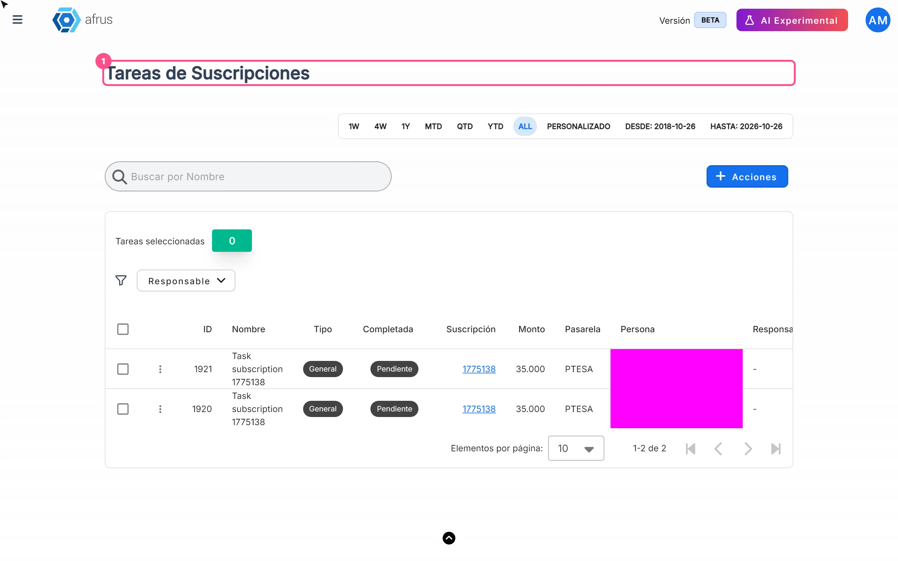

# Subscription tasks guide

After reading this guide you will know what Subscription tasks are, when they appear, what each status means and how to manage them to win back your recurring donors.

*Module: Follow up · Menu: **Follow up > Tareas de suscripciones** · Audience: donor care and fundraising teams*

> **About the labels in this guide:** buttons, fields and menus are written exactly as they appear in the Spanish version of the console, with an English explanation where it helps.

---

## What Subscription tasks are

**Subscription tasks are a follow-up list that AFRUS creates automatically when a subscription charge fails.** Each task is a case for your team to contact the donor and recover their recurring donation.

The screen is called **Tareas de Suscripciones** (Subscription tasks) and shows, for each case, the subscription, amount, gateway, person, owner and date.

## What they are for

- **See all failed recurring charges in one place.** No need to search case by case in **Suscripciones** (Subscriptions).
- **Share out the work.** Assign each case to a **Responsable** (owner) on your team.
- **Keep track of what's solved.** Mark the task as **Completada** (Completed) when you've finished.
- **Have the context at hand.** You see **Monto** (amount), **Pasarela** (gateway), **Persona** (person) and **Razón de fallo** (failure reason), and you can open the subscription from the **Suscripción** column.
- **Work the list outside AFRUS.** Export all tasks or a selection; the file goes to **Descargas** (Downloads).

## Before you start

- **Subscriptions only.** Tasks are created when a recurring donation charge fails, not a one-time donation.
- **Gateways shown.** This screen lists tasks for subscriptions with the **Recurrent Payments** or **PTESA** gateway.

---

# Step by step

## How often it updates

- **Tasks are created right away.** AFRUS creates the task as soon as it processes the failed charge; it doesn't wait for a daily check.
- **When a new task is created**, users with the owner or admin role in your organization get a notification in AFRUS.
- **If the subscription already had a task**, AFRUS doesn't create another one: it reopens the existing one (back to **Pendiente**, Pending) and removes its **Responsable**, so someone picks it up again.
- **The screen doesn't refresh on its own.** Data loads when you open it and when you change dates, search, filter, sort or page. If you're expecting a new case, reload the page.

## When a subscription is charged successfully again, does the task leave the list?

**No.** When the subscription is charged successfully again, the task is not completed or removed automatically. It stays on the list with its current status until someone on your team marks it as **Completada**.

That's why we recommend checking the subscription (**Suscripción** column) before working a case: if it has already been charged successfully, just mark the task as completed.

## Task statuses

The **Completada** column shows each task's status:

| Status | What it means |
|---|---|
| **Pendiente** (Pending) | The task is open and nobody has marked it as solved. It's the status a task is created with, and also the status of a task reopened by a new failed charge. |
| **Completada** (Completed) | Someone on your team marked it as solved. |

Each task also has a **Tipo** (type), which you can change by hand:

| Type | What it means |
|---|---|
| **General** | The type AFRUS uses when it creates tasks automatically. |
| **Fallo Mensual** (Monthly failure) | A label you can use to classify the case by hand. |
| **Cancelada por el Sistema** (Cancelled by the system) | A label you can use to classify the case by hand. |

> **Pending confirmation:** whether any AFRUS process assigns the **Fallo Mensual** and **Cancelada por el Sistema** types automatically.

## What I can do in each status

| Status | What you can do |
|---|---|
| **Pendiente** | Assign a **Responsable**, change **Nombre** (name) or **Tipo**, mark it as completed, open the subscription and export it. |
| **Completada** | Unmark it so it goes back to **Pendiente**, reassign it, edit it and export it. |

### How to review and filter tasks

1. **Open the list.** Go to **Follow up > Tareas de suscripciones**.
   
2. **Choose the dates.** In the date bar, choose the range. By default the whole history is shown. The filter uses the date the task was created: a reopened task keeps its original date.
3. **Search or filter.** Search by task **Nombre** or filter by **Responsable** to see only one team member's cases.

The table shows 25 tasks per page (you can change it to 10, 50 or 100), newest first.

### How to assign, edit or complete a task

1. **Open the task.** In the row, click the three-dot menu (untitled column on the left).
2. **Edit it.** In **Editar Tarea** (Edit task), fill in **Nombre**, **Tipo**, **Responsable** or the **Marcar como completada** (Mark as completed) checkbox. The **Responsable** must be a user in your organization.
3. **Save.** Click "Guardar" (Save). You'll see *"Tarea actualizada correctamente"* (Task updated successfully) and the table reloads.

> **Can it be undone?** Yes. Open **Editar Tarea** again and untick **Marcar como completada** or change the owner.

### How to export tasks

1. **Select the tasks.** Tick the rows you want, or use the notice *"Seleccionar las {total} tareas que coinciden con los filtros actuales."* (Select all {total} tasks matching the current filters) to take them all.
2. **Export.** Click "Acciones" (Actions) and choose **Exportar** (Export). You'll see *"La exportación ha comenzado. Puede tardar unos minutos en completarse; encontrarás el archivo en Descargas."* (The export has started. It may take a few minutes; you'll find the file in Downloads.)

---

## Frequently asked questions

**Are tasks created for one-time donations that fail?**
No. They're only created when a subscription charge fails.

**Why did a completed task go back to Pending with no owner?**
Because the subscription had another failed charge. AFRUS reopens the same task instead of creating a new one.

**Who is notified about a new task?**
Users with the owner or admin role in your organization, with a notification in AFRUS.

---

> **[Back to section index](./README.md)** · **[Back to main index](../README.md)**

*Last updated: 2026-10-20*
