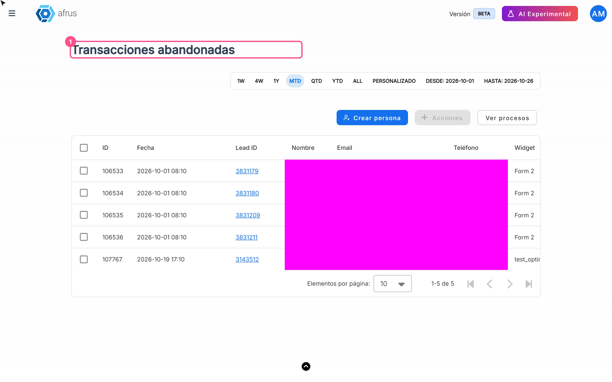

# Guia de Transações abandonadas

Depois de ler este guia, você vai saber o que são as Transações abandonadas, quando a Afrus considera uma doação abandonada e como usar esta lista para entrar em contato de novo com essas pessoas.

*Módulo: Follow up · Menu: **Follow up > Transacciones abandonadas** · Público: equipes de captação e relacionamento com doadores*

> **Sobre os nomes de tela neste guia:** botões, campos e menus estão escritos exatamente como aparecem na versão em espanhol do console, com a explicação em português quando ajuda.

---

## O que são as Transações abandonadas

**As Transações abandonadas são a lista de pessoas que começaram uma doação em um widget, chegaram à etapa de pagamento e não a concluíram.**

Para cada caso você vê o **Lead ID**, o nome, o **Email**, o telefone, o **Widget** e a **Campaña** (campanha) em que a doação começou, e a data em que o abandono foi registrado.

## Para que serve

- **Recuperar doações pela metade.** São pessoas que já mostraram intenção de doar: um bom lembrete pode convertê-las.
- **Saber onde pararam.** Você vê com qual **Widget** e **Campaña** começaram, para conferir se algo nesse formulário está travando seus doadores.
- **Ter os dados de contato à mão.** **Email** e telefone, prontos para escrever ou ligar.
- **Trabalhar a lista fora da Afrus.** Exporte a lista; o arquivo fica em **Descargas** (Downloads).

---

# Passo a passo

## Com que frequência é atualizado

- **A Afrus verifica os abandonos a cada hora, na hora cheia.**
- **Uma doação aparece como abandonada entre 15 minutos e cerca de 1 hora e 15 minutos** depois que a pessoa parou de avançar.
- **A tela não se atualiza sozinha.** Os dados são carregados ao abrir e ao mudar datas, ordem ou página. Recarregue a página para ver os casos novos.

## Quando uma transação é considerada abandonada

1. **A pessoa inicia uma doação em um widget e chega à etapa de pagamento.** Nesse momento a Afrus a marca como "em processo de doação".
2. **Se a doação termina, não é abandono.** Seja o pagamento aprovado ou recusado, essa marca é apagada e a pessoa não aparece nesta lista.
3. **Se a marca continua ativa, a verificação de hora em hora a registra como abandonada** quando a última atividade da pessoa foi entre 15 minutos e 1 hora e 15 minutos antes.
4. **Precisa existir o registro de início da doação** para esse widget e essa campanha.

As pessoas marcadas como spam (veja **Follow up > Leads spam**) não são registradas como abandonadas.

## Como revisar e exportar as transações abandonadas

1. **Abra a lista.** Acesse **Follow up > Transacciones abandonadas**.
   
2. **Escolha as datas.** Por padrão aparece o mês atual. O filtro usa a data em que o abandono foi registrado.
3. **Selecione as linhas.** Marque as que quiser, ou selecione todas pelo aviso de seleção.
4. **Exporte.** Clique em "Acciones" (Ações) e escolha **Exportar**. O arquivo é gerado em **Descargas**.

Nesta tela, "Acciones" só oferece exportar: não permite atribuir etiquetas nem excluir.

---

## Limitações conhecidas

- **Minutos da data:** a coluna de data mostra os minutos de forma errada (no lugar aparece o número do mês). Se você precisa do horário exato, por enquanto não há alternativa nesta tela.
- **Botão "Ver procesos"** (Ver processos): hoje ele leva a uma página que não existe. Para acompanhar sua exportação, acesse diretamente **Data > Descargas**.

## Perguntas frequentes

**Se a doação falha, a pessoa aparece aqui?**
Não. Se o pagamento termina, aprovado ou recusado, não conta como abandono.

**A Afrus envia um e-mail automático para essas pessoas?**
> **Pendente de confirmação:** existe uma automação para leads abandonados, mas ela depende da configuração de cada organização.

---

> **[Voltar ao índice da seção](./README.md)** · **[Voltar ao índice geral](../README.md)**

*Última atualização: 2026-10-20*
