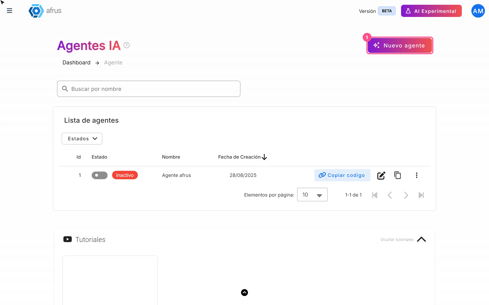
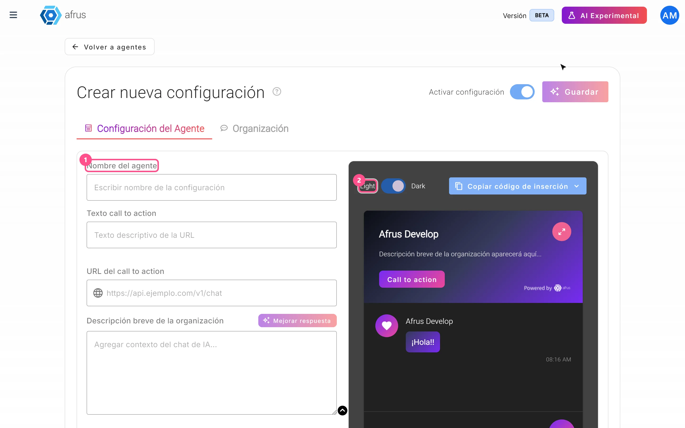
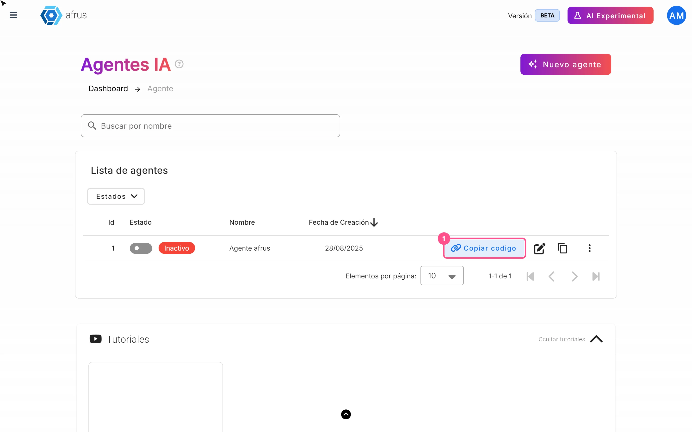
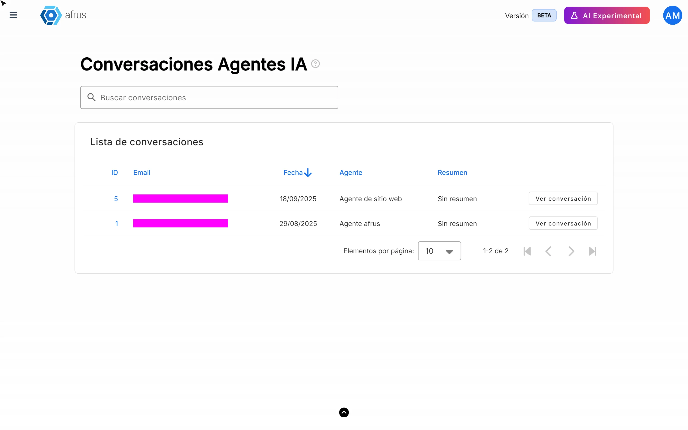

# Guía de Agentes para la web

Con esta guía vas a poder crear un chat con IA para tu sitio web, que responde a tus visitantes con la información de tu organización.

*Módulo: AI · Menú: **AI > Agentes para la web** · Audiencia: equipos de comunicaciones, recaudación y quien administra el sitio web*

---

## Qué son los Agentes para la web

**Un agente es un chat con IA que instalas en tu propio sitio web.** El visitante deja su nombre y su correo, y conversa con un asistente que responde con la información que tu organización cargó en AFRUS.

## Para qué sirven

- **Responder dudas de tus visitantes a cualquier hora.** Por ejemplo, qué hace tu organización o cómo donar.
- **Llevarlos a actuar.** El chat muestra un botón que lleva a donde quieras, como tu formulario de donación.
- **Sumar contactos a tu base.** Quien conversa queda registrado como persona en AFRUS.
- **Conocer qué pregunta la gente.** Puedes revisar después las conversaciones y su resumen.

## Antes de empezar

- **Activa la IA de AFRUS** desde el **Business profile** (menú de perfil): crea tu perfil y pulsa "Enviar AI".
- **Sube al menos un documento en AI > Entrenamiento [AI RAG].** Sin documentos, el agente no se puede guardar.
- **Ten a mano a quien administra tu sitio web,** para pegar el código del chat.

---

# Paso a paso

## Cómo se usan los Agentes para la web

### Parte 1 — Crea el agente

1. **Crea un agente nuevo.** Entra a **AI > Agentes para la web** y pulsa "Nuevo agente".

2. **Completa la configuración.** En la pestaña **Configuración del Agente**, llena:
   - **Nombre del agente** (obligatorio).
   - **Texto call to action**: el texto del botón, por ejemplo "Dona aquí" (hasta 20 caracteres).
   - **URL del call to action**: a dónde lleva el botón, por ejemplo tu formulario de donación (obligatoria).
   - **Descripción breve de la organización** (obligatoria, hasta 200 caracteres).
   - **Comportamiento del agente**: **Cerrado** o **Abierto**.
   - **Instrucciones para el agente IA** (obligatorias): cómo quieres que hable y qué debe priorizar.
   

   > **Importante:** aunque la pantalla te deje guardar con **Texto call to action** vacío, AFRUS lo rechaza. Escribe siempre un texto para el botón.

3. **Mejora los textos (opcional).** "Mejorar respuesta", junto a la descripción o las instrucciones, reescribe tu texto con IA.

4. **Revisa cómo se ve.** A la derecha tienes una vista previa en modo claro u oscuro (**Light** / **Dark**). En la pestaña **Organización** verás el **Resumen de la organización**, que AFRUS arma solo con tus documentos.

5. **Guarda.** Deja encendido **Activar configuración** y pulsa "Guardar". El botón se activa cuando completas los campos obligatorios. Verás *"Configuración creada correctamente"*.

> **Pendiente de confirmar:** qué cambia entre **Cerrado** y **Abierto**, y si el chat de tu sitio usa las instrucciones y la descripción de cada agente.

### Parte 2 — Instálalo en tu sitio web

6. **Copia el código.** En la lista de agentes, pulsa "Copiar codigo" en la fila del agente. Verás *"Código copiado al portapapeles"*. También lo encuentras al editar el agente, en "Copiar código de inserción".
   

7. **Pégalo en tu sitio.** Entrégale el código a quien administra tu página web para que lo pegue en el sitio. A partir de ahí, el chat aparece para tus visitantes.

### Parte 3 — Administra tus agentes

- **Activar o desactivar:** usa el interruptor **Estado** de la fila.
- **Duplicar:** el icono "Duplicar configuración" crea una copia **inactiva**. La copia no trae el comportamiento ni el tema de color: revísalos antes de activarla.
- **Eliminar:** en el menú de tres puntos, elige "Eliminar" y confirma.

> **¿Se puede deshacer?** No. Eliminar un agente es definitivo. Si solo quieres pausarlo, desactívalo con el interruptor **Estado**.

### Qué pasa cuando alguien usa el chat

- El visitante escribe su **nombre** y su **correo** (obligatorios) y, si quiere, su teléfono.
- Si su correo ya está en tu base, AFRUS lo reconoce. Si no, lo crea como una persona nueva (como registro, no como donante).
- La IA responde con tus documentos e instrucciones de **Entrenamiento [AI RAG]** y con la información de tu **Business profile** (descripción, "Sobre nosotros" y preguntas frecuentes).
- Cada respuesta puede tardar entre 30 segundos y 2 minutos.

### Cómo ver las conversaciones

Hoy las conversaciones no tienen un botón en el menú. Para verlas, escribe esta dirección en tu navegador con tu sesión de AFRUS abierta: `console.afrus.app/iachat-conversations-index`.

Ahí verás cada conversación con el correo, la fecha, el agente y un resumen. "Ver conversación" abre todos los mensajes y los datos de contacto del visitante.

---

## Limitaciones conocidas

- **Las conversaciones no tienen enlace en el menú.** Usa la dirección indicada arriba.
- **Texto del botón:** el contador dice 20 caracteres, pero el mensaje de error habla de 30. Usa 20 o menos.
- **Si un agente no carga al editarlo,** la pantalla no vuelve sola a la lista: usa "Volver a agentes".
- **Las personas que llegan por el chat** se crean sin aceptación de términos y quedan asociadas a tu formulario y tu campaña por defecto.

## Preguntas frecuentes

**¿Qué ve el visitante si desactivo el agente?**
> **Pendiente de confirmar.**

**¿Las conversaciones gastan créditos?**
> **Pendiente de confirmar.**

**¿La misma persona puede tener varias conversaciones?**
No. Cada persona tiene una sola conversación por agente.

---

> **[Volver al índice de la sección](./README.md)** · **[Volver al índice general](../README.md)**

*Última actualización: 2026-10-26*
