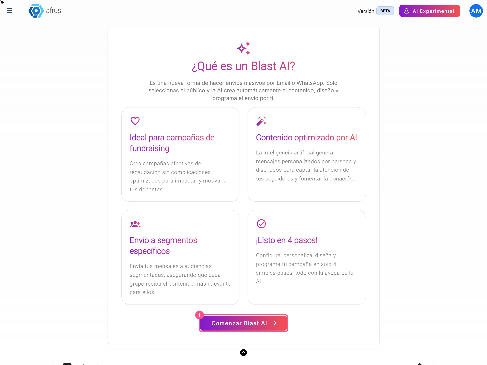
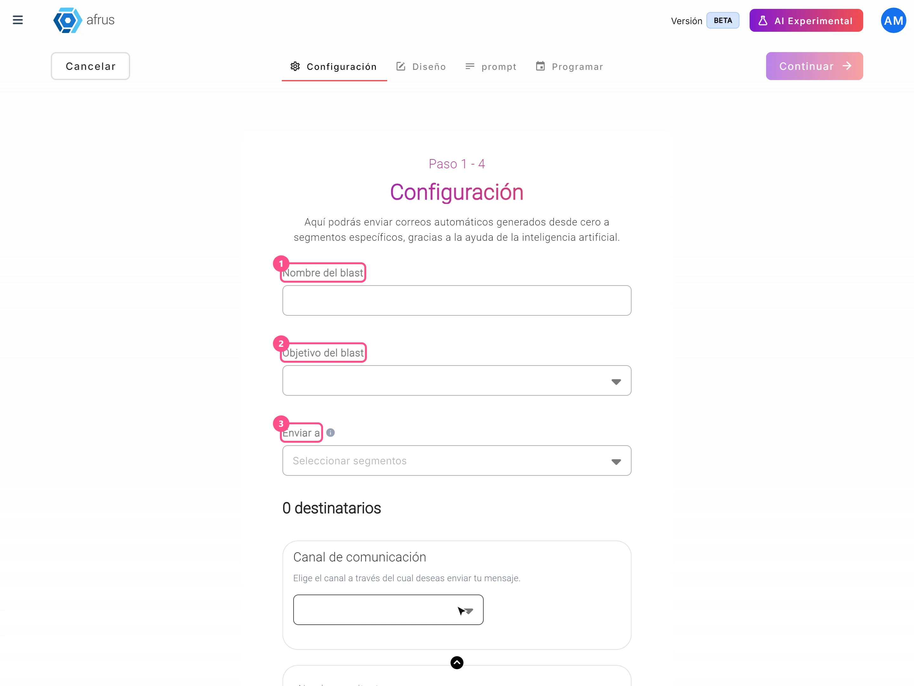

# AI Blast guide (Blast de AI)

With this guide you will be able to send a mass email where the AI writes the message for you, different for each person.

*Module: AI · Menu: **AI > Blast de AI** (also in **Interacciones > Blast de AI**) · Audience: communications and fundraising teams*

> **About the labels in this guide:** buttons, fields and menus are written as they appear in the Spanish version of the console, with an English explanation where it helps.

---

## What an AI Blast is

**It is a mass email send where the AI writes the content for you.** The screen explains it like this: *"una nueva forma de hacer envíos masivos por Email o WhatsApp. Solo seleccionas el público y la AI crea automáticamente el contenido, diseño y programa el envío por ti"* (a new way to send mass messages by email or WhatsApp: you choose the audience and the AI creates the content and design and schedules the send for you).

You choose who receives it, the goal and what you want to say. The AI writes a different email for each person, using what you uploaded in **AI > Entrenamiento [AI RAG]**.

## What it is for

- **Running campaigns without writing the email.** You only give the goal, your instructions and the link you want people to visit.
- **Personalizing each message.** Each person gets a text written for them.
- **Sending to a specific group.** You choose a segment or a tag.
- **Measuring results.** You see opens, clicks and bounces, just like in a regular Blast.

## Before you start

- **Turn on AFRUS AI** from the **Business profile** (profile menu): create your profile and click "Enviar AI" (Send to AI). Without it, the goals list doesn't load and you can't move forward.
- **Upload information in AI > Entrenamiento [AI RAG].** That's what the AI uses to write.
- **Have your sending email account and your credits ready,** just like for a regular Blast.
- **Create your signature in AI > Firmas de usuarios.** Without a signature you can't send with AI.
- **Optional:** if you want designed emails with images, check **AI > Plantillas AI Email** and **AI > Galería para AI**.

---

# Step by step

## How to use the AI Blast

### Part 1 — Setup

1. **Start the blast.** Go to **AI > Blast de AI** and click "Comenzar Blast AI" (Start AI Blast).

2. **Give it a name and a goal.** Type the **Nombre del blast** (blast name) and choose the **Objetivo del blast** (blast goal): talk about your organization, ask for donations, talk about your cause, talk about your impact, share stories or promote a campaign.
   

3. **Choose who receives it.** In **Enviar a** (Send to), use the **Segmentos Predefinidos** (Predefined segments) or **Etiquetas** (Tags) tab and choose **one** segment or **one** tag. Below you'll see how many people will receive it.

4. **Fill in the sender details.** The channel available today is **Email**. Fill in **Nombre remitente** (sender name), **Dirección de email** (one of your organization's authorized addresses) and **Email para respuestas** (reply-to email). Click "Continuar" (Continue).

### Part 2 — Design

5. **Choose how it will look.** Choose **Correo de texto** (plain email, no images) or **Plantillas AI Email** (the AI uses one of your active templates). If you choose templates, check in **Seleccionar atributos para imágenes** (Select attributes for images) which images from your **Galería para AI** it can use. Click "Continuar".
   <!-- screenshot pending: blast-de-ai-05 — Diseño step with Correo de texto and Plantillas AI Email -->

### Part 3 — Message

6. **Write the link and your instructions.** In **URL del Call to Action** paste the link you want people to go to (your donation form, for example). In **Prompt (Mensaje o Instrucciones)** (message or instructions) tell the AI what you want to say. Both are required.
   <!-- screenshot pending: blast-de-ai-06 — prompt step with URL del Call to Action and Prompt -->

7. **Improve your instructions (optional).** "Mejorar prompt" (Improve prompt) rewrites your text with AI. Careful: it replaces what you wrote. Click "Continuar".

### Part 4 — Schedule and send

8. **Send yourself a test (optional).** Click "Enviar prueba" (Send test), type your email and click "Enviar". You'll get an email with the subject **[BLAST TEST]**.

   > **Important:** the test shows a sample design but does **not** include the text the AI will write for each person (those areas arrive empty). Today there's no way to see the final text before sending.

9. **Choose when to send it.** **Enviar ahora** (Send now) or **Programar fecha** (Schedule date): choose **Fecha** (date) and **Hora** (time); minutes can be 00, 15, 30 or 45.
   <!-- screenshot pending: blast-de-ai-09 — Programar step with summary and Finalizar button -->

   > **Important:** the screen shows Bogotá time (GMT -5), but the send goes out according to your computer's time. If your computer is in another time zone, adjust the time so it matches the one you want.

10. **Review and send.** Check the summary (name, segment and number of sends) and click "Finalizar" (Finish).

When you finish you'll see *"Blast IA enviado con éxito"* (AI Blast sent successfully) and the "Ver blast IA" (View AI blast) button. The AI writes each person's subject and text at the moment of sending.

> **Can it be undone?** Check everything before clicking "Finalizar".
>
> A scheduled AI Blast can't be deleted, not even before its time.

### How to see the results

In **Interacciones > Blast**, your AI Blasts have the **AI** label. Click "Detalles" (Details) to see how many emails were sent, the open, click, bounce and unsubscribe rates, and the clicks on each link.

---

## Frequently asked questions

**Can I see the email each person will get before sending it?**
No. The AI writes it at the moment of sending.

**Are people who can't be contacted left out?**
Yes.

**Which template is my email sent with?**
With one of the templates you have enabled in **AI > Plantillas AI Email**.

---

> **[Back to section index](./README.md)** · **[Back to main index](../README.md)**

*Last updated: 2026-10-27*
