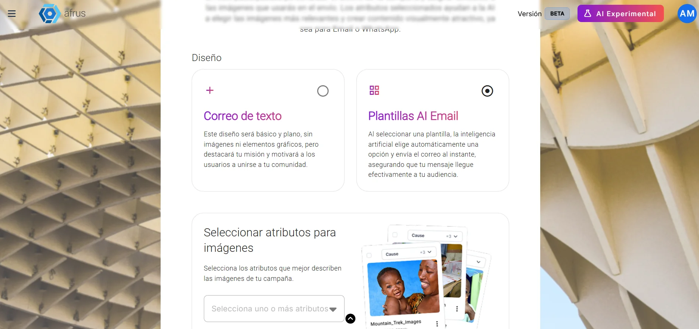
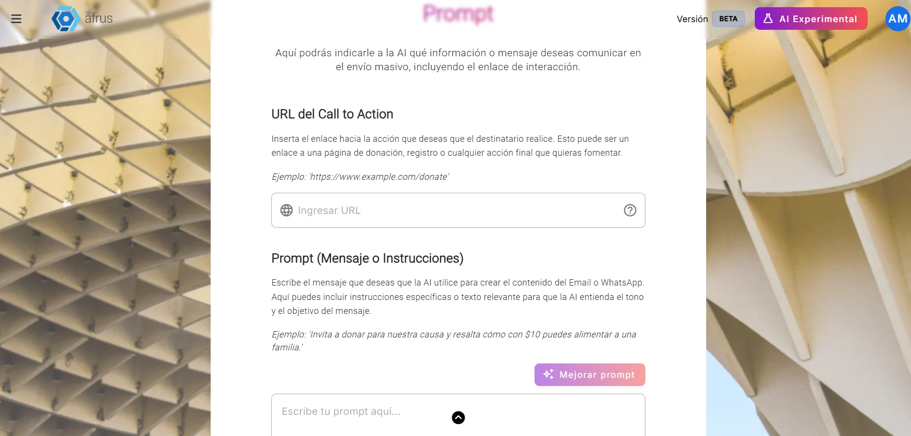
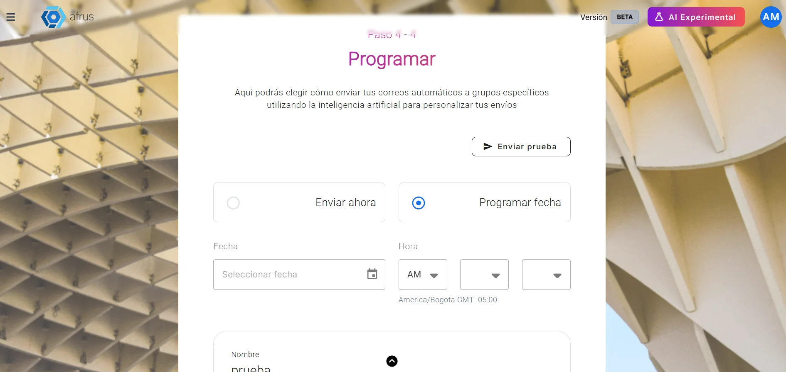

# Guia do Blast de IA (Blast de AI)

Com este guia você vai poder fazer um envio de e-mail em massa em que a IA escreve a mensagem por você, diferente para cada pessoa.

*Módulo: AI · Menu: **AI > Blast de AI** (também em **Interacciones > Blast de AI**) · Público: equipes de comunicação e captação*

> **Sobre os nomes de tela neste guia:** botões, campos e menus estão escritos como aparecem na versão em espanhol do console, com a explicação em português quando ajuda.

---

## O que é o Blast de IA

**É um envio de e-mails em massa em que a IA escreve o conteúdo por você.** A tela explica assim: *"una nueva forma de hacer envíos masivos por Email o WhatsApp. Solo seleccionas el público y la AI crea automáticamente el contenido, diseño y programa el envío por ti"* (uma nova forma de fazer envios em massa por e-mail ou WhatsApp: você escolhe o público e a IA cria o conteúdo e o design e agenda o envio).

Você escolhe quem recebe, o objetivo e o que quer dizer. A IA escreve um e-mail diferente para cada pessoa, usando o que você enviou em **AI > Entrenamiento [AI RAG]**.

## Para que serve

- **Fazer campanhas sem redigir o e-mail.** Você só informa o objetivo, suas instruções e o link para onde quer levar as pessoas.
- **Personalizar cada mensagem.** Cada pessoa recebe um texto escrito para ela.
- **Enviar para um grupo específico.** Você escolhe um segmento ou uma etiqueta.
- **Medir resultados.** Você vê aberturas, cliques e rejeições, como em um Blast comum.
- **Crie sua assinatura em AI > Firmas de usuarios.** Sem assinatura você não consegue fazer envios com IA.

## Antes de começar

- **Ative a IA da AFRUS** pelo **Business profile** (menu de perfil): crie seu perfil e clique em "Enviar AI" (enviar para a IA). Sem isso, a lista de objetivos não carrega e você não consegue avançar.
- **Envie informações em AI > Entrenamiento [AI RAG].** É isso que a IA usa para escrever.
- **Tenha prontos sua conta de e-mail de envio e seus créditos,** como em um Blast comum.
- **Opcional:** se quiser e-mails com design e imagens, revise **AI > Plantillas AI Email** e **AI > Galería para AI**.

---

# Passo a passo

## Como usar o Blast de IA

### Parte 1 — Configuração

1. **Comece o blast.** Acesse **AI > Blast de AI** e clique em "Comenzar Blast AI" (Começar Blast de IA).

2. **Dê um nome e um objetivo.** Escreva o **Nombre del blast** (nome do blast) e escolha o **Objetivo del blast**: falar da sua organização, pedir doações, falar da sua causa, falar do seu impacto, compartilhar histórias ou promover uma campanha.
   

3. **Escolha quem vai receber.** Em **Enviar a** (Enviar para), use a aba **Segmentos Predefinidos** ou **Etiquetas** e escolha **um** segmento ou **uma** etiqueta. Abaixo você verá quantas pessoas vão receber.

4. **Preencha os dados do remetente.** O canal disponível hoje é **Email**. Preencha **Nombre remitente** (nome do remetente), **Dirección de email** (um dos endereços autorizados da sua organização) e **Email para respuestas** (e-mail para respostas). Clique em "Continuar".

### Parte 2 — Design

5. **Escolha como vai ficar.** Escolha **Correo de texto** (e-mail simples, sem imagens) ou **Plantillas AI Email** (a IA usa um dos seus modelos ativos). Se escolher modelos, marque em **Seleccionar atributos para imágenes** (Selecionar atributos para imagens) quais imagens da sua **Galería para AI** ela pode usar. Clique em "Continuar".
   

### Parte 3 — Mensagem

6. **Escreva o link e suas instruções.** Em **URL del Call to Action** cole o link para onde quer levar as pessoas (seu formulário de doação, por exemplo). Em **Prompt (Mensaje o Instrucciones)** (mensagem ou instruções) conte à IA o que quer dizer. Os dois são obrigatórios.
   

7. **Melhore suas instruções (opcional).** "Mejorar prompt" (Melhorar prompt) reescreve seu texto com IA. Atenção: substitui o que você escreveu. Clique em "Continuar".

### Parte 4 — Agendar e enviar

8. **Envie um teste para você (opcional).** Clique em "Enviar prueba" (Enviar teste), escreva seu e-mail e clique em "Enviar". Você recebe um e-mail com o assunto **[BLAST TEST]**.

   > **Importante:** o teste mostra um design de exemplo, mas **não** traz o texto que a IA vai escrever para cada pessoa (esses espaços chegam vazios). Hoje não há como ver o texto final antes do envio.

9. **Escolha quando enviar.** **Enviar ahora** (Enviar agora) ou **Programar fecha** (Agendar data): escolha **Fecha** (data) e **Hora**; os minutos podem ser 00, 15, 30 ou 45.
   

   > **Importante:** a tela mostra o horário de Bogotá (GMT -5), mas o envio sai de acordo com o horário do seu computador. Se seu computador estiver em outro fuso horário (o horário de Brasília, por exemplo), ajuste a hora para que coincida com a que você quer.

10. **Revise e envie.** Confira o resumo (nome, segmento e quantidade de envios) e clique em "Finalizar".

Ao terminar, você verá *"Blast IA enviado con éxito"* (Blast de IA enviado com sucesso) e o botão "Ver blast IA". A IA escreve o assunto e o texto de cada pessoa no momento do envio.

> **Dá para desfazer?** Revise tudo antes de clicar em "Finalizar".
>
> Um Blast de IA agendado não pode ser excluído, nem mesmo antes do horário.

### Como ver os resultados

Em **Interacciones > Blast**, seus Blasts de IA têm a etiqueta **AI**. Clique em "Detalles" (Detalhes) para ver quantos e-mails foram enviados, as taxas de abertura, cliques, rejeição e descadastro, e os cliques em cada link.

---

## Perguntas frequentes

**Posso ver o e-mail que cada pessoa vai receber antes de enviar?**
Não. A IA o escreve no momento do envio.

**As pessoas que não podem ser contatadas ficam de fora?**
Sim.

**Com qual modelo meu e-mail é enviado?**
Com algum dos modelos que você tem habilitados em **AI > Plantillas AI Email**.

---

> **[Voltar ao índice da seção](./README.md)** · **[Voltar ao índice geral](../README.md)**

*Última atualização: 2026-10-28*
