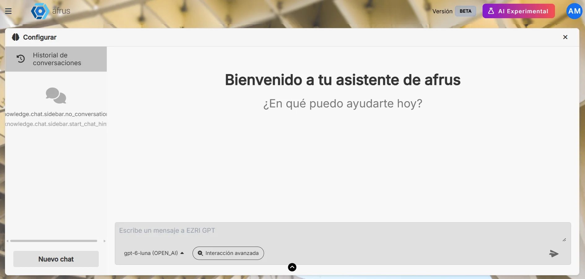
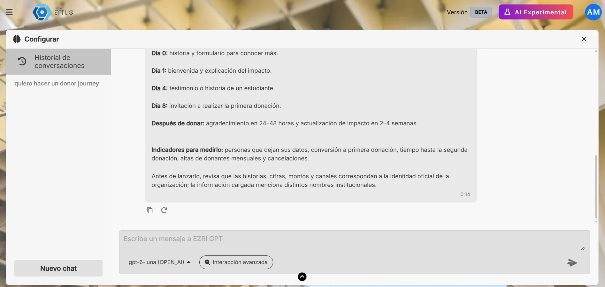

# Guía de Chat con AI

Con esta guía vas a poder usar el asistente de IA de AFRUS para pedir ideas, textos y respuestas sobre tu organización.

*Módulo: AI · Menú: **AI > Chat con AI** · Audiencia: todo el equipo de la organización*

---

## Qué es el Chat con AI

**Es un asistente de inteligencia artificial, tipo chat, para el equipo de tu organización.** Le escribes una pregunta o un pedido y te responde.

Responde con la información que tu organización cargó en **AI > Entrenamiento [AI RAG]**: tus documentos, tus páginas web y tus instrucciones.

## Para qué sirve

- **Pedir ideas de fundraising.** Por ejemplo, un plan de campaña.
- **Escribir textos más rápido.** Correos para pedir donaciones, textos para landing pages o guiones de video.
- **Preguntar sobre tus documentos.** Por ejemplo: "¿Qué logramos el año pasado según el informe de impacto?".

## Antes de empezar

- **Activa la IA de AFRUS** desde el **Business profile** (menú de perfil): crea tu perfil y pulsa "Enviar AI". Si no lo has hecho, verás el aviso *"¡Ups! Parece que no tienes un Business Profile"*.
- **Carga información en AI > Entrenamiento [AI RAG].** Mientras más le cuentes a la IA, mejores serán sus respuestas. Desde el chat llegas ahí con el botón "Configurar".

---

# Paso a paso

## Cómo se usa el Chat con AI

1. **Abre el chat.** Entra a **AI > Chat con AI**. Para empezar una conversación nueva, pulsa "Nuevo chat".

2. **Escribe tu mensaje.** Escribe en el cuadro y pulsa Enter para enviarlo. Si quieres pasar a la línea siguiente sin enviar, usa Alt + Enter.
   

3. **Espera la respuesta.** Puede tardar entre 30 segundos y 2 minutos.

4. **Usa la respuesta.** En cada respuesta puedes copiarla o pedir que se genere otra. Si quieres cambiar algo de tu pregunta, edita tu mensaje y vuelve a enviarlo.
   

5. **Retoma una conversación.** Tus conversaciones quedan guardadas a la izquierda, en **Historial de conversaciones**.

**Consejo:** sé específico. "Escribe un correo de 150 palabras para pedir donaciones para nuestra campaña de becas, en tono cercano" funciona mejor que "escribe un correo".

## Qué restricciones tiene

- **Solo sabe lo que le enseñaste.** Usa tus documentos, páginas web e instrucciones de **Entrenamiento [AI RAG]**. No consulta los datos de tus donantes, donaciones ni campañas.
- **No puedes adjuntar archivos en el chat.** Si quieres que la IA conozca un documento, súbelo en **Entrenamiento [AI RAG]**.
- **Cada usuario ve solo sus conversaciones.** El historial no se comparte con el resto del equipo.
- **No se pueden borrar ni renombrar conversaciones.**
- **Las respuestas pueden tardar hasta 2 minutos.** Si pasa ese tiempo, verás *"Lo siento, hubo un error al obtener la respuesta."* Vuelve a enviar tu mensaje.
- **Busca en todos los temas.** Hoy no puedes elegir un tema concreto ni usar atajos de conversación.
- **Revisa siempre lo que escribe la IA** antes de publicarlo o enviarlo.

---

## Preguntas frecuentes

**¿La IA conoce a mis donantes?**
No. Solo usa lo que cargaste en **Entrenamiento [AI RAG]**.

**¿Mis compañeros ven mis conversaciones?**
No. Cada usuario ve las suyas.

**¿Usar el chat tiene un costo?**
Sí, debes adquirir tokens. Para más información, escríbenos a billing@afrus.ai.

---

> **[Volver al índice de la sección](./README.md)** · **[Volver al índice general](../README.md)**

*Última actualización: 2026-10-28*
