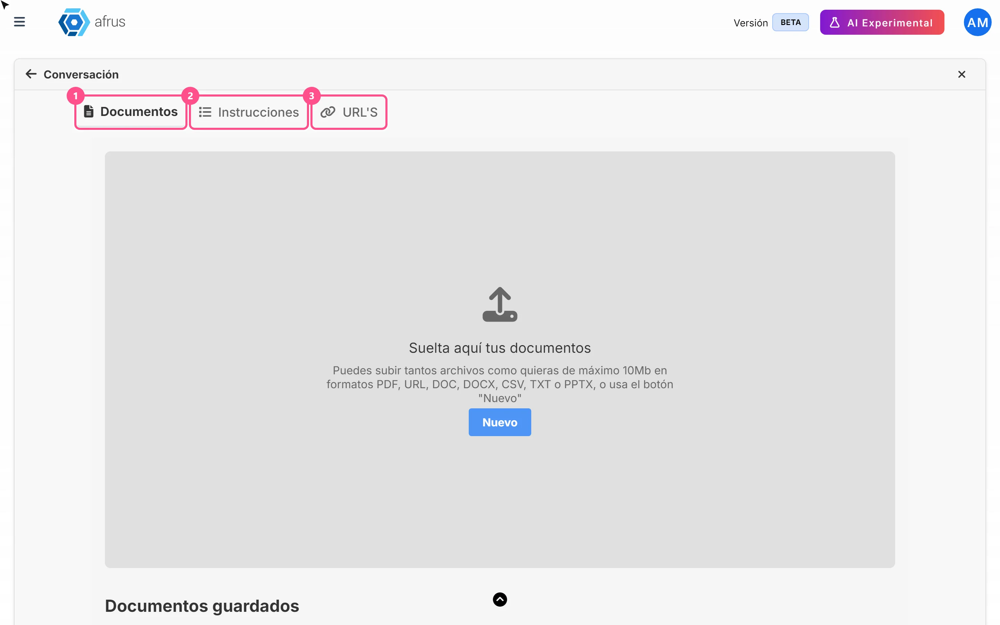
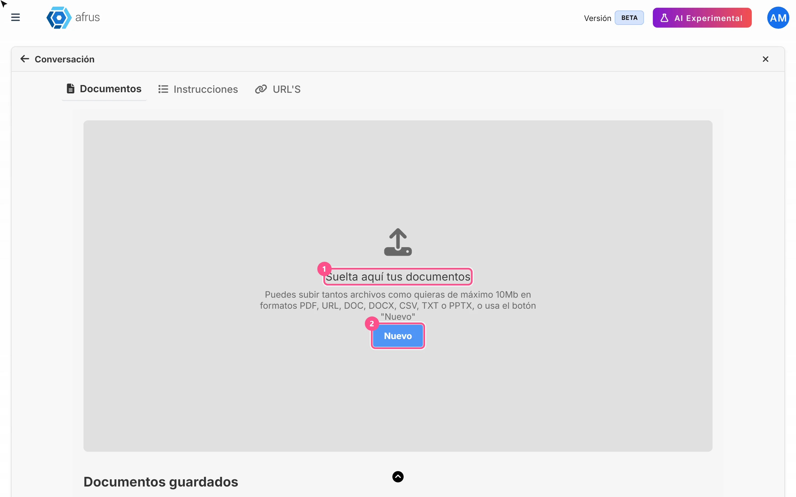
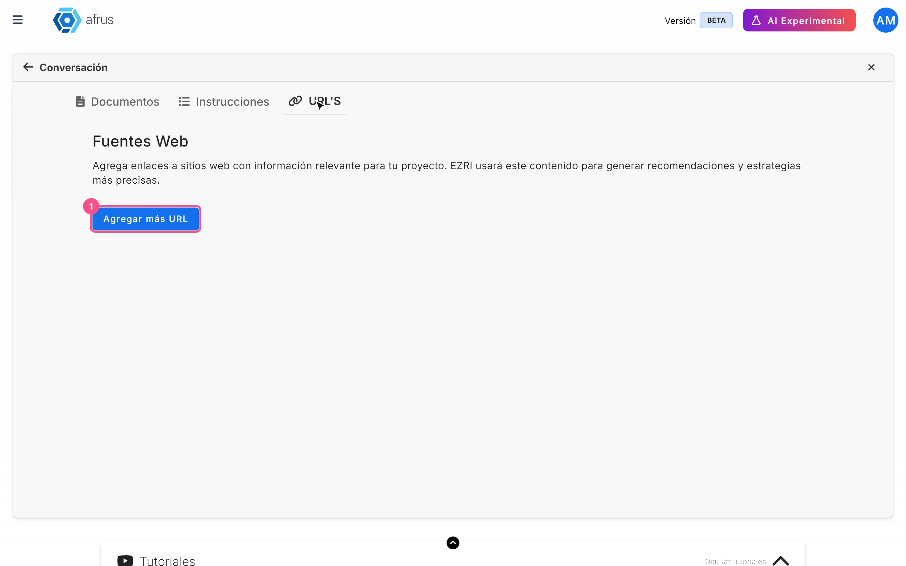

# Guia de Treinamento da IA (Entrenamiento [AI RAG])

Com este guia você vai poder ensinar à IA da Afrus quem é a sua organização: enviar documentos, adicionar páginas web e escrever instruções.

*Módulo: AI · Menu: **AI > Entrenamiento [AI RAG]** · Público: equipes de comunicação e captação*

> **Sobre os nomes de tela neste guia:** botões, campos e menus estão escritos como aparecem na versão em espanhol do console, com a explicação em português quando ajuda.

---

## O que é o Treinamento da IA

**É o lugar onde você dá à IA da Afrus as informações da sua organização.** Aqui você envia documentos, adiciona páginas web e escreve instruções.

A IA usa tudo isso para responder no **Chat con AI** (chat com IA) e nos **Agentes para la web** (o chat que você pode colocar no seu site). Quanto melhores as informações, melhores as respostas.

A tela tem três abas: **Documentos**, **Instrucciones** (Instruções) e **URL'S**.

## Para que serve

- **Fazer a IA conhecer a sua organização.** Sua causa, seu impacto, suas campanhas e seus dados institucionais.
- **Ter respostas com as suas informações, não com dados genéricos.** O chat e o agente do seu site procuram primeiro no que você enviou aqui.
- **Dar orientações de tom e conteúdo.** Você pode dizer como falar de cada tema.

## Antes de começar

- **Ative a IA da Afrus.** Ela é ativada pelo **Business profile** (menu de perfil, canto superior): crie seu perfil e, na última etapa, clique em "Enviar AI" (enviar para a IA). Se ainda não fez isso, ao entrar você verá o aviso *"¡Ups! Parece que no tienes un Business Profile"* (Ops! Parece que você não tem um Business Profile) com o botão "Crear Business Profile" (Criar Business Profile).

---

# Passo a passo

## O que se envia em Documentos e quais tipos de arquivo são aceitos

Em **Documentos** você envia os arquivos que descrevem a sua organização: relatórios de impacto, apresentações institucionais, perguntas frequentes, descrições dos seus programas ou campanhas.

**Tipos de arquivo aceitos:** PDF, DOC, DOCX, CSV, TXT e PPTX. A tela indica um máximo de 10 MB por arquivo.

> **Pendente de confirmação:** se o limite de 10 MB é sempre aplicado.

1. **Abra a aba Documentos.** Acesse **AI > Entrenamiento [AI RAG]** e escolha **Documentos**.
   

2. **Escolha seus arquivos.** Arraste-os para **Suelta aquí tus documentos** (Solte aqui seus documentos) ou clique em "Nuevo" (Novo). Você pode escolher vários de uma vez.

3. **Classifique-os (recomendado).** Na janela **Archivos cargados con éxito** (Arquivos enviados com sucesso), escolha para cada arquivo um ou mais **Atributos** (o tema do documento) e escreva uma **Etiqueta** (digite e pressione Enter). Se não tiver certeza, pode fazer isso depois.
   <!-- captura pendente: entrenamiento-ai-03 — janela Archivos cargados con éxito com atributos e etiquetas -->

4. **Envie-os.** Deixe marcados os arquivos que quer enviar (ou use "Seleccionar todos", Selecionar todos) e clique em "Listo" (Pronto).

Ao terminar, você verá *"Documento guardado exitosamente"* (Documento salvo com sucesso) e seus arquivos aparecerão em **Documentos guardados** (Documentos salvos). A IA lê cada documento e faz um resumo. Quando o envio termina, ela já pode usá-lo.

**Fique atento:**
- Se você não escolher um tema, o documento serve para **todos** os temas.
- Não é possível enviar dois arquivos com o mesmo nome.
- Se um documento demorar mais de 5 minutos para ser processado, o envio falha.

## O que se envia em Instruções

Em **Instrucciones** você escreve para a IA, com suas palavras, o que ela deve saber e como deve falar. A tela explica assim: *"Aquí describe el conocimiento de la AI. Escribe información clave, contexto, tono, y temas principales que debes manejar."* (Descreva aqui o conhecimento da IA: informações-chave, contexto, tom e temas principais.)

Por exemplo: "Somos uma fundação que protege florestas na Colômbia. Fale de forma próxima e otimista. Não prometa números que não estejam nos nossos relatórios."

1. **Abra a aba Instruções.** Em **AI > Entrenamiento [AI RAG]**, escolha **Instrucciones**.
   <!-- captura pendente: entrenamiento-ai-04 — aba Instrucciones com um painel por atributo -->

2. **Escolha o tema.** Há um painel para cada atributo (tema). Abra o que quer preencher.

3. **Escreva suas instruções.** Escreva em **Escribe aquí tus instrucciones...** (Escreva aqui suas instruções).

4. **Salve.** Clique no botão "Guardar instrucciones" (Salvar instruções) desse tema. Você verá *"¡Instrucciones guardadas con éxito!"* (Instruções salvas com sucesso!)

As instruções valem para toda a sua organização, e a IA as usa junto com os documentos desse tema.

> **Fique atento:** os temas (atributos) são definidos pela Afrus; não é possível criar novos aqui.

**Atalhos de conversa:** nesta mesma aba você verá **Atajos de conversación** (Atalhos de conversa), para salvar perguntas frequentes como botões do chat. Hoje esses botões não aparecem no **Chat con AI**, então por enquanto não é preciso configurá-los.

## O que se envia em URLs

Em **URL'S** você adiciona páginas web da sua organização para a IA ler: por exemplo a página "Quem somos", a dos seus programas ou a de uma campanha.

1. **Abra a aba URL'S.** Em **AI > Entrenamiento [AI RAG]**, escolha **URL'S** (seção **Fuentes Web**, Fontes web).
   

2. **Adicione um endereço.** Clique em "Agregar más URL" (Adicionar mais URLs) e clique na nova linha para abri-la.

3. **Preencha os dados.** Escreva o endereço em **URL:** (obrigatório). Se quiser, escolha **Atributos** e escreva etiquetas em **Escribe tu Tag** (Escreva sua tag).

4. **Salve.** Clique em "Guardar cambios" (Salvar alterações). Você verá *"¡URL guardada con éxito!"* (URL salva com sucesso!)

> **Pendente de confirmação:** se a IA lê só essa página ou também as páginas que estão abaixo dela. Por enquanto, adicione uma a uma as páginas mais importantes.

**Fique atento:** se você clicar em "Guardar cambios" sem ter mudado nada, pode aparecer um aviso com texto técnico. Não há problema: suas informações já estavam salvas.

## Como ver o que enviei

- **Documentos:** na aba **Documentos**, a lista **Documentos guardados** mostra **Nombre del archivo** (nome do arquivo), **Tipo**, **Atributo**, **Tags** e **Fecha de carga** (data de envio). O ícone de olho baixa o arquivo para você conferir.
  <!-- captura pendente: entrenamiento-ai-06 — lista Documentos guardados com suas colunas e ícones -->
- **Instruções:** na aba **Instrucciones**, abra o painel de cada tema para ler o que escreveu.
- **Páginas web:** na aba **URL'S** você vê cada endereço salvo.

**Para apagar algo,** use o ícone de lixeira da linha.

> **Dá para desfazer?** Não. Ao clicar na lixeira de um documento, ele é apagado na hora, sem pedir confirmação. Se errar, terá que enviá-lo de novo.

> **Fique atento:** o botão "Buscar" de **Documentos guardados** hoje não filtra a lista. Para encontrar um documento, procure na lista pelo nome ou pela data.

---

## Limitações conhecidas

- A busca de **Documentos guardados** não filtra.
- Os atalhos de conversa não aparecem no chat.
- Alguns erros ao enviar ou apagar documentos aparecem com texto técnico. Se vir um, fale com a gente.

## Perguntas frequentes

**Quanto tempo a IA leva para usar um documento novo?**
Ela pode usá-lo assim que o envio termina.

**O que acontece se eu enviar um documento sem escolher tema?**
Ele serve para todos os temas.

**As etiquetas mudam como a IA responde?**
> **Pendente de confirmação:** hoje elas são salvas, mas não está confirmado que mudam as respostas.

---

> **[Voltar ao índice da seção](./README.md)** · **[Voltar ao índice geral](../README.md)**

*Última atualização: 2026-10-26*
