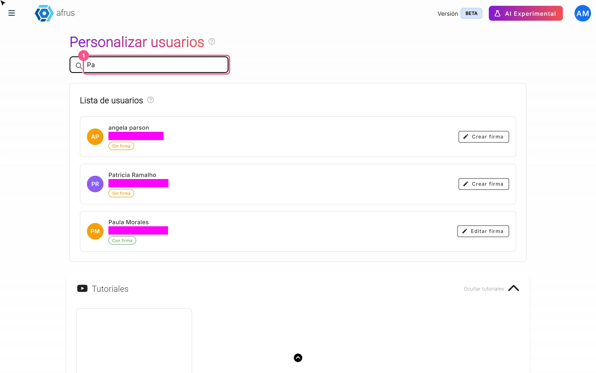
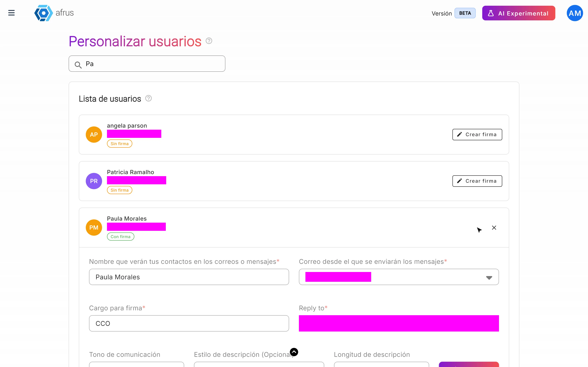
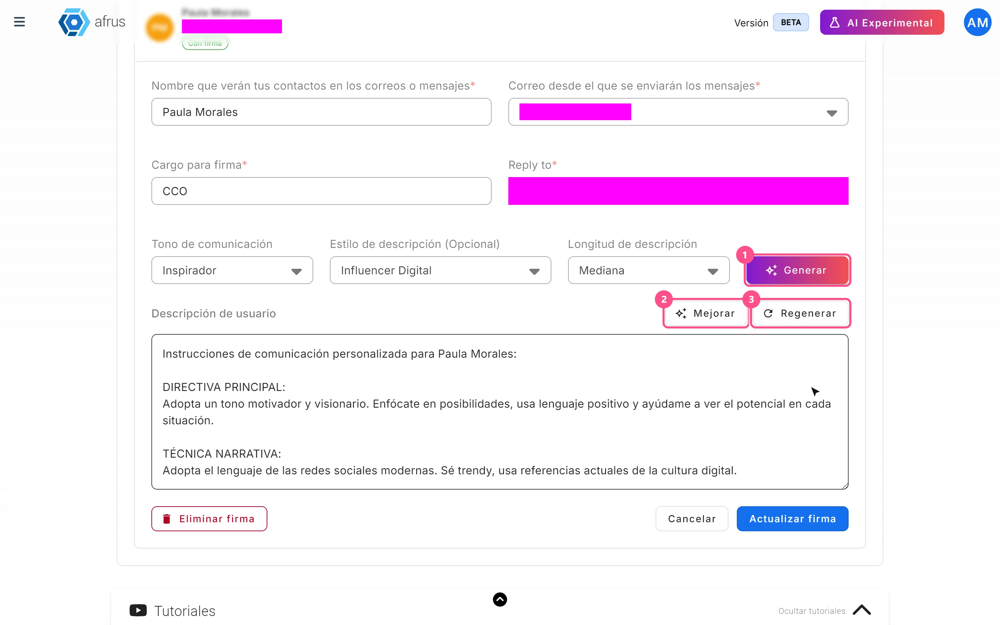

# Guía de Firmas de usuarios

Con esta guía vas a poder crear la firma de cada persona de tu equipo, para que los correos que escribe la IA salgan con su nombre, su correo y su forma de presentarse.

*Módulo: AI · Menú: **AI > Firmas de usuarios** · Audiencia: equipos de comunicaciones y recaudación*

---

## Qué es

**Una firma es la tarjeta de presentación de un usuario de tu organización en los correos que escribe la IA.** Reúne:

- el nombre que verán tus contactos;
- el correo desde el que salen los mensajes;
- el cargo;
- el correo al que llegan las respuestas;
- una descripción corta de la persona, que puedes escribir tú o pedirle a la IA.

Cada usuario puede tener una sola firma.

## Para qué sirve

- **Elegir quién envía los correos automáticos con IA.** En los autoresponders con IA, solo puedes elegir como remitente a usuarios que tengan firma.
- **Que el correo salga desde la dirección correcta.** El mensaje se envía desde el correo que pusiste en la firma.
- **Que la IA escriba con la voz de esa persona.** La IA usa la descripción del usuario al redactar.

---

# Paso a paso

## Cómo se usa

### Crear o editar una firma

1. **Abre las firmas.** Ve a **AI > Firmas de usuarios**. Verás la lista de usuarios de tu organización y, al lado de cada uno, si está **Con firma** o **Sin firma**. Puedes buscar a alguien con "Buscar por nombre".
   

2. **Abre la firma del usuario.** Haz clic en "Crear firma" (o en "Editar firma" si ya tiene una).

3. **Completa los datos básicos.** Todos son obligatorios:
   - **Nombre que verán tus contactos en los correos o mensajes**.
   - **Correo desde el que se enviarán los mensajes**: elige uno de los correos de envío de tu organización.
   - **Cargo para firma**.
   - **Reply to**: el correo donde quieres recibir las respuestas.
   

4. **Escribe la descripción, o deja que la IA la escriba.** La **Descripción de usuario** también es obligatoria, aunque no tenga asterisco. Para que la IA la escriba:
   - elige el **Tono de comunicación** (por ejemplo Formal, Cercano o Inspirador);
   - si quieres, elige un **Estilo de descripción (Opcional)**;
   - elige la **Longitud de descripción**: Corta, Mediana o Larga;
   - haz clic en "Generar".

   Si ya tienes un texto, "Mejorar" lo reescribe, y "Regenerar" crea una versión nueva. También puedes escribirla tú.
   

5. **Guarda.** Haz clic en "Crear firma" (o "Actualizar firma"). Verás *"Firma creada exitosamente"* o *"Firma actualizada exitosamente"*.

El botón de guardar solo se activa cuando están completos el nombre, el correo, el cargo, el Reply to y la descripción.

### Usar la firma

Cuando configures un autoresponder con IA, en **Configuración IA** elige el **Remitente**. Ahí aparecen solo los usuarios con firma.

### Eliminar una firma

1. **Abre la firma** del usuario.
2. **Elimínala.** Haz clic en "Eliminar firma" y confirma con "Eliminar".

> **¿Se puede deshacer?** No. Si eliminas una firma, tendrás que crearla de nuevo.

---

## Preguntas frecuentes

**¿Un usuario puede tener varias firmas?**
No. Cada usuario tiene una sola firma; si necesitas cambiarla, edítala.

**¿Los envíos de Blast de AI usan la firma?**
Sí. Si no tienes firma, no puedes hacer envíos con IA ni configurar autoresponders con IA.

---

> **[Volver al índice de la sección](./README.md)** · **[Volver al índice general](../README.md)**

*Última actualización: 2026-10-27*
