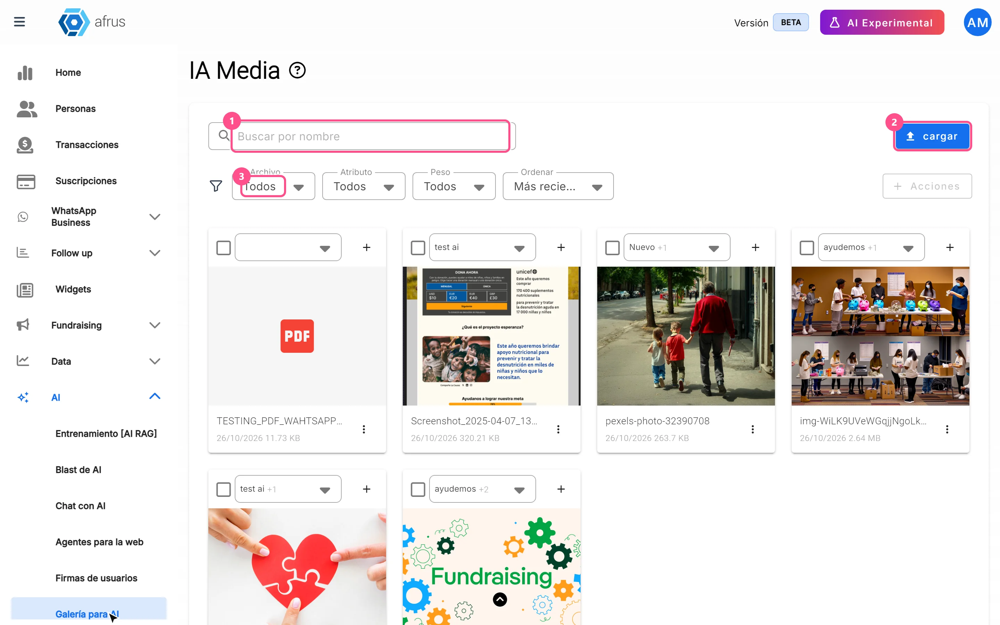
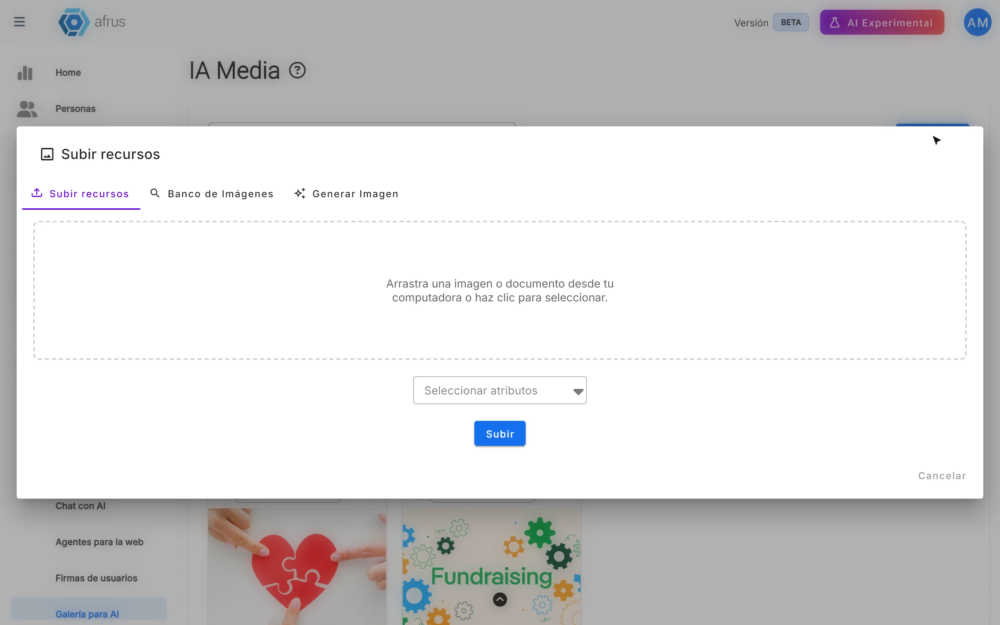
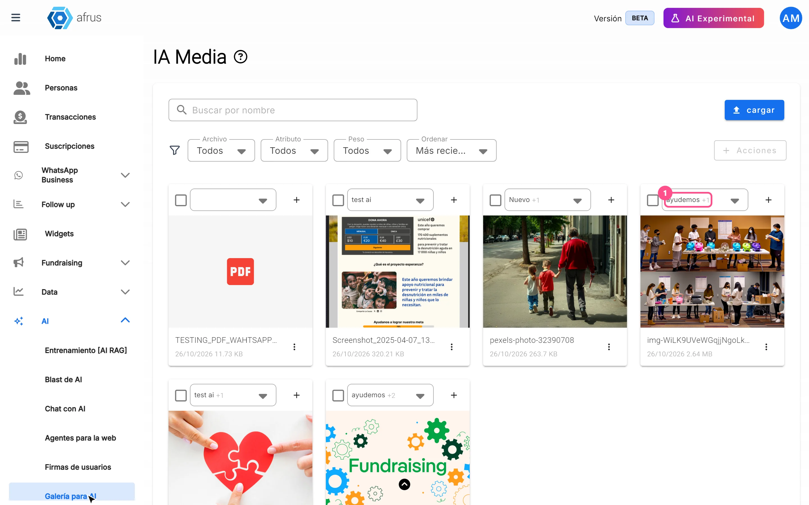

# Guia da Galeria para IA

Com este guia, você vai poder guardar as imagens da sua organização em um só lugar, para que a IA as use nos seus e-mails.

*Módulo: AI · Menu: **AI > Galería para AI** (Galeria para IA; também no menu de perfil, **AI Media**) · Público: equipes de comunicação e design*

> **Sobre os nomes de tela neste guia:** botões, campos e menus estão escritos exatamente como aparecem na versão em espanhol do console, com a explicação em português quando ajuda.

---

## O que é

**A Galeria para IA é o banco de imagens da sua organização.** Ali você envia, organiza e guarda as fotos que quer que a IA use. Na tela, ela aparece com o nome **IA Media**.

Você pode adicionar imagens de três formas: enviando do seu computador, buscando em um banco de imagens ou pedindo para a IA criar uma.

## Para que serve

- **Colocar suas fotos nos e-mails escritos pela IA.** Os e-mails com IA que usam modelos (no Blast de AI e nos autoresponders com IA) pegam daqui a imagem principal.
- **Escolher que tipo de imagem vai em cada e-mail.** Com os atributos (etiquetas), você diz à IA quais imagens usar. A AFRUS escolhe uma ao acaso entre as que têm o atributo indicado; se nenhuma tiver, usa qualquer imagem da galeria.
- **Ter suas imagens à mão em outros lugares.** Elas também aparecem na aba **IA Media** quando você escolhe uma imagem no editor de modelos e no WhatsApp Business.

---

# Passo a passo

## Como usar

### Adicionar imagens

1. **Abra a galeria.** Acesse **AI > Galería para AI**.
   

2. **Abra a janela de envio.** Clique em "cargar" (enviar). Abre a janela **Subir recursos** (Enviar recursos).

3. **Escolha como adicionar.**
   - **Subir recursos** (Enviar): primeiro escolha os atributos em "Seleccionar atributos" (Selecionar atributos), depois clique em "Subir" (Enviar) e escolha o arquivo. Ele é enviado assim que você escolhe.
   - **Banco de Imágenes** (Banco de imagens): digite o que procura (por exemplo, "voluntários"), clique em "Buscar" e depois na foto que você gostar.
   - **Generar Imagen** (Gerar imagem): descreva a imagem que quer (ou use uma das ideias sugeridas), clique em "Generar" (Gerar) e depois na imagem para salvá-la.
   

Ao terminar, você verá *"¡Archivo subido con éxito!"* ou *"¡Imagen subida con éxito!"* (arquivo / imagem enviada com sucesso).

**Formatos aceitos:** JPG, PNG, GIF e WEBP, de até 5 MB.

### Colocar atributos em uma imagem

1. **Encontre a imagem** na galeria.
2. **Escolha os atributos.** No cartão da imagem, marque um ou vários. Se precisar de um novo, clique em "+", digite o **Nombre del atributo** (nome do atributo) e clique em "Crear atributo" (Criar atributo).
   

Assim a IA sabe quais imagens usar em cada tipo de e-mail.

### Baixar, copiar ou excluir

- Em cada imagem você pode "Descargar" (Baixar), "Copiar enlace" (Copiar link) ou "Borrar" (Excluir).
- Para fazer isso com várias de uma vez, marque-as e use o menu **Acciones** (Ações).
- A tela mostra 10 imagens; para ver mais, clique em "Cargar más" (Carregar mais).

> **Dá para desfazer?** Não. Uma imagem excluída não pode ser recuperada.

---

## Perguntas frequentes

**Existe um limite de imagens?**
Não, não existe limite de imagens.

**Em quais lugares essas imagens são usadas?**
Em muitos lugares, por exemplo nas landings, nos blasts (tanto de e-mail quanto de WhatsApp), nos autoresponders e nos fluxos de trabalho.

---

> **[Voltar ao índice da seção](./README.md)** · **[Voltar ao índice geral](../README.md)**

*Última atualização: 2026-10-27*
