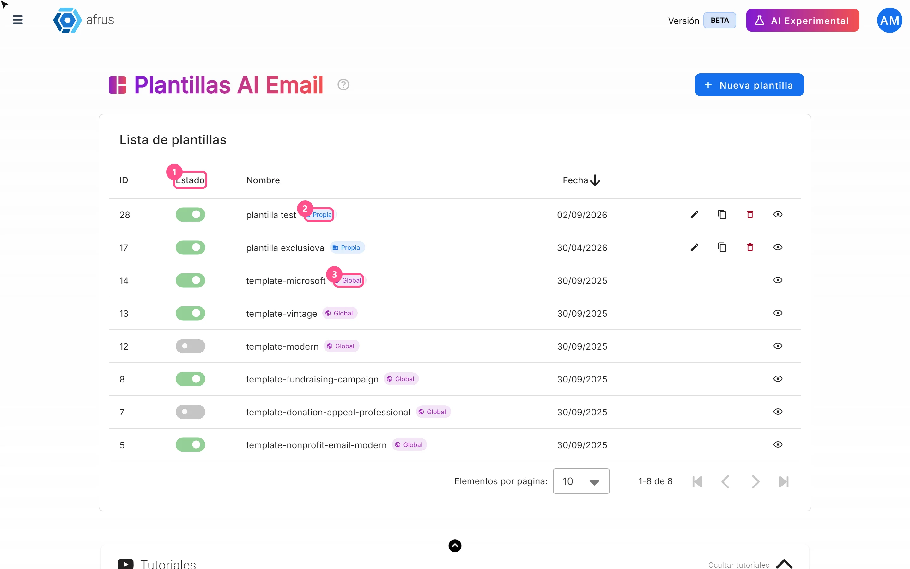
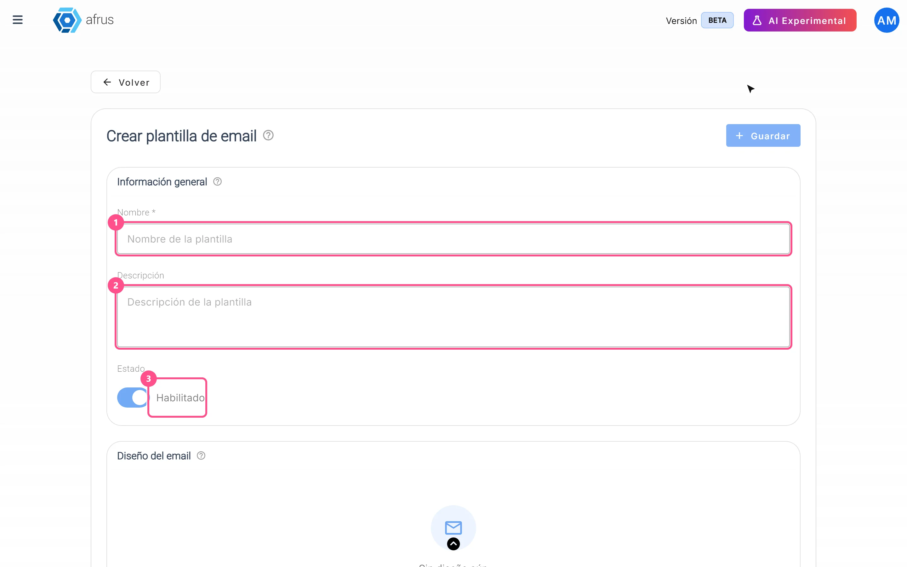
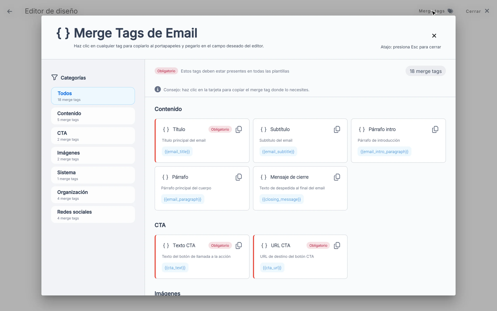

# Guia de Modelos de e-mail com IA

Com este guia, você vai poder escolher o visual dos e-mails escritos pela IA e criar seus próprios modelos.

*Módulo: AI · Menu: **AI > Plantillas AI Email** (Modelos de e-mail com IA) · Público: equipes de comunicação e design*

> **Sobre os nomes de tela neste guia:** botões, campos e menus estão escritos exatamente como aparecem na versão em espanhol do console, com a explicação em português quando ajuda.

---

## O que é

**Os modelos de e-mail com IA são os layouts que a IA usa para montar seus e-mails automáticos.** A IA escreve os textos e o modelo define o visual.

Há dois tipos:

- **Global:** modelos preparados pela Afrus. Você pode ativá-los ou desativá-los.
- **Propia** (Próprio): modelos que sua organização cria. Você pode editá-los, duplicá-los ou excluí-los.

## Para que serve

- **Dar o seu estilo aos e-mails com IA.** Quando um e-mail com IA usa layout de modelo (no Blast de AI e nos autoresponders com IA), a Afrus escolhe ao acaso um dos seus modelos ativos e a IA preenche os textos.
- **Decidir quais layouts são usados.** Só são usados os modelos ativos: os seus em **Habilitado** e os da Afrus que você não desativou.
- **Nunca ficar sem layout.** Se nenhum estiver ativo, a Afrus usa um layout padrão.

---

# Passo a passo

## Como usar

### Ativar ou desativar um modelo

1. **Abra os modelos.** Acesse **AI > Plantillas AI Email**. Você verá a lista com **Estado** (Status), **Nombre** (Nome), **Fecha** (Data) e se é **Propia** ou **Global**.
   

2. **Use a chave.** Na coluna **Estado**, ligue para que a IA possa usar esse modelo ou desligue para que não use. Você verá *"Plantilla activada correctamente"* ou *"Plantilla desactivada correctamente"* (modelo ativado / desativado).

Nos modelos da Afrus (**Global**), ativar ou desativar é a única coisa que você pode fazer, e a mudança só afeta a sua organização.

### Criar seu próprio modelo

1. **Comece um modelo novo.** Clique em "Nueva plantilla" (Novo modelo).

2. **Dê um nome.** Em **Información general** (Informações gerais), digite o **Nombre** (obrigatório) e, se quiser, uma **Descripción** (descrição). Em **Estado**, escolha **Habilitado** se quiser que seja usado já, ou **Borrador** (Rascunho) se ainda estiver preparando.
   

3. **Monte o e-mail.** Em **Diseño del email** (Layout do e-mail), clique em "Abrir editor visual" e monte seu layout.

4. **Adicione os espaços que a IA preenche.** Com o botão **Merge tags**, você insere os espaços onde a IA vai colocar o título, os parágrafos, o botão, a imagem principal, seu logo ou suas redes. Quatro são obrigatórios: o título, o texto do botão, o link do botão e o link para cancelar a inscrição. Se faltar algum, você verá *"Tu plantilla debe incluir los siguientes merge tags obligatorios:"* (Seu modelo deve incluir estes merge tags obrigatórios) com a lista dos que faltam.
   

5. **Salve o layout** no editor.

6. **Salve o modelo.** Clique em "Guardar" (Salvar).

> **Importante:** salve primeiro o layout no editor e depois o modelo. Se você clicar em "Guardar" sem ter salvado o layout, o modelo não é criado e nenhum aviso aparece. Se ele não estiver na lista, abra o editor de novo, salve o layout e salve outra vez.

**Para ver como ficou:** use "Previsualizar" (Pré-visualizar). Abre em outra aba, na visualização de celular ou de computador.

### Outras ações nos seus modelos

Nos modelos **Propia**, você pode:

- **Editar diseño** (Editar layout).
- **Duplicar plantilla** (Duplicar modelo): cria uma cópia com o mesmo nome e a palavra "copy".
- **Eliminar plantilla** (Excluir modelo).

> **Dá para desfazer?** Não. Um modelo excluído não pode ser recuperado. Se você só quer que a IA pare de usá-lo, desligue a chave **Estado**.

---

## Limitações conhecidas

- **Não é possível escolher qual modelo cada envio usa.** A Afrus escolhe ao acaso entre os ativos. Se quiser que só um seja usado, deixe apenas esse ativo.
- **Os modelos da Afrus (Global)** não podem ser editados, duplicados nem excluídos.

## Perguntas frequentes

**Preciso ter a IA ativada para usar esta tela?**
> **Pendente de confirmação.**

**Quantos modelos da Afrus existem?**
> **Pendente de confirmação.**

---

> **[Voltar ao índice da seção](./README.md)** · **[Voltar ao índice geral](../README.md)**

*Última atualização: 2026-10-26*
