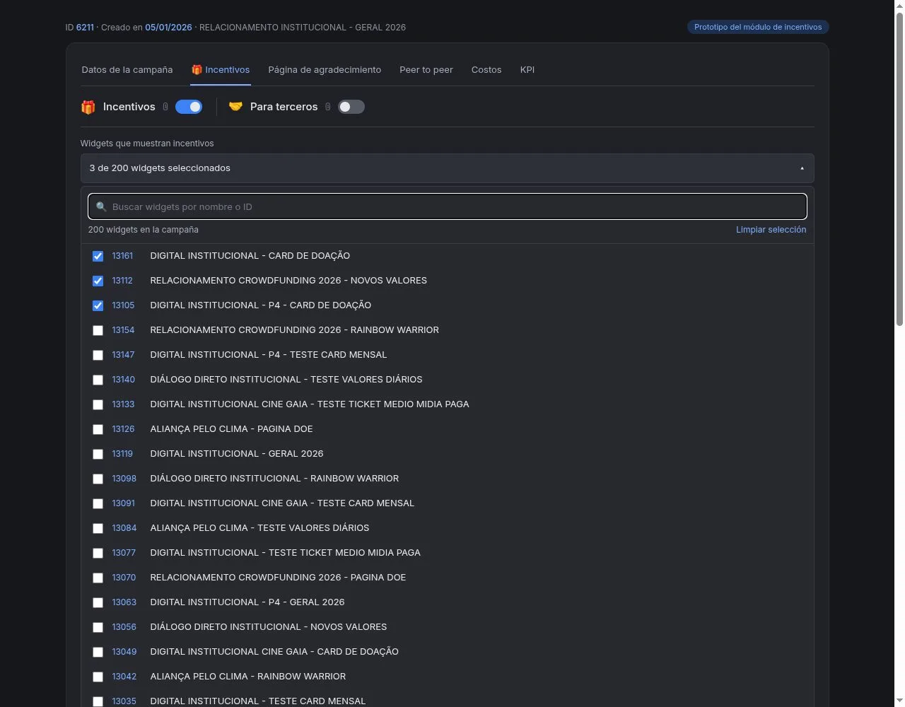
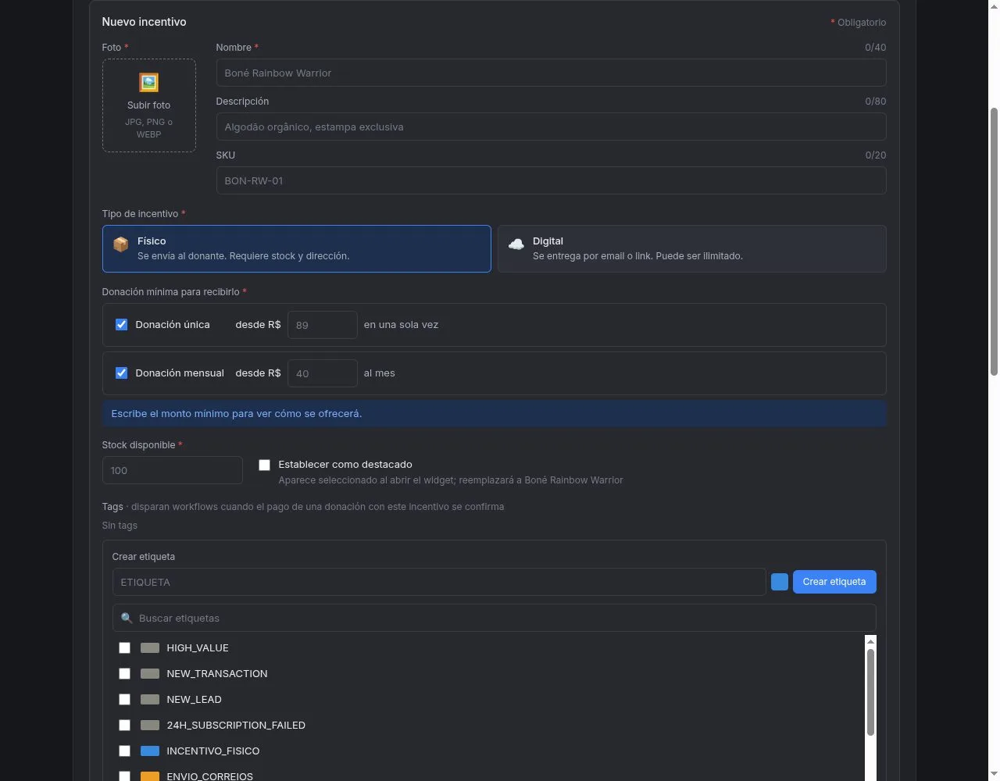
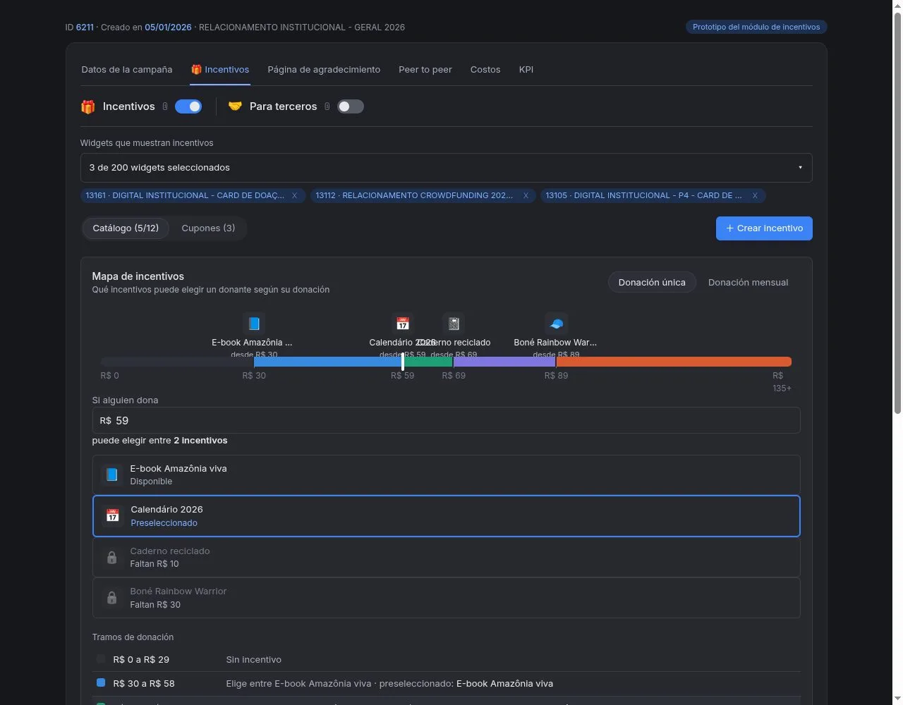
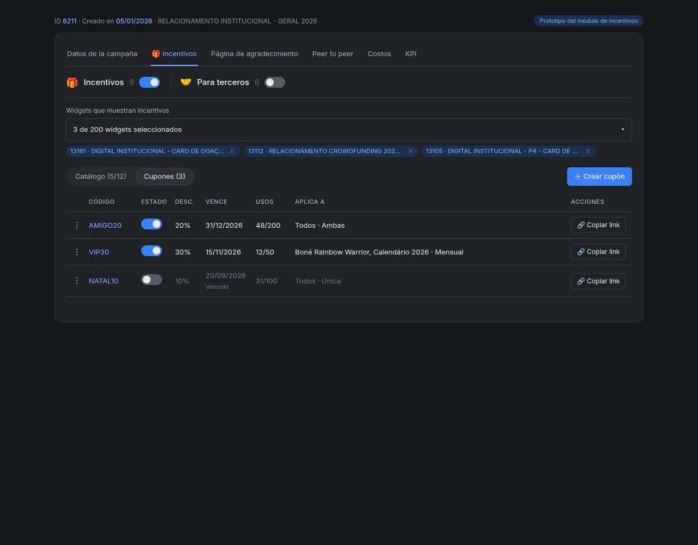
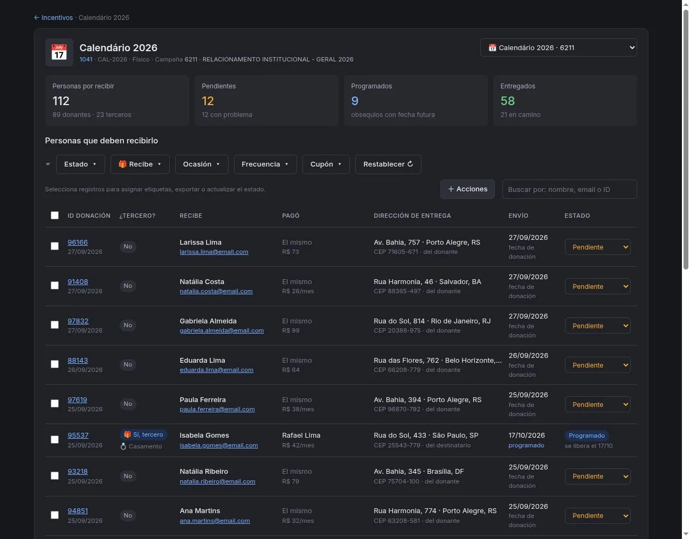
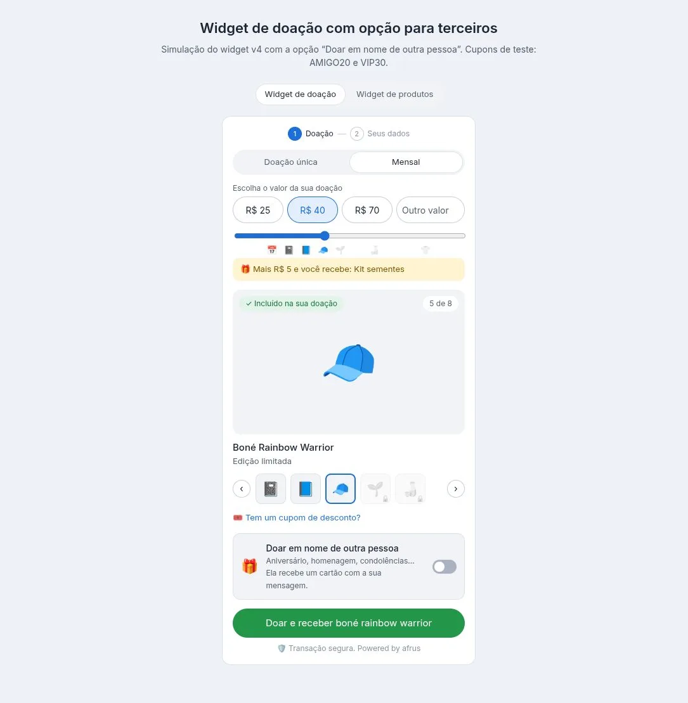

# Guia de Incentivos

Com este guia, você vai poder dar um presente a quem doa a partir de um certo valor, criar cupons, deixar seus doadores presentearem outra pessoa e saber quem ainda precisa receber o presente.

*Módulo: Incentivos · Menu: **Fundraising > Incentivos** · Público: equipes de captação, comunicação e logística*

> **Sobre os nomes de tela:** usamos os nomes da versão em português do console quando os conhecemos. Os demais aparecem como na versão em espanhol, com a tradução entre parênteses.

---

## O que são os incentivos

**Um incentivo é um presente que sua organização oferece a quem doa a partir de um valor mínimo.** Por exemplo: um livro, um calendário ou um certificado digital.

Os incentivos são configurados dentro de uma campanha e aparecem nos seus formulários de doação (widgets). Na AFRUS, você também vai vê-los com o nome de **brinde**, **presente** ou **recompensa**: é tudo a mesma coisa.

Existem dois tipos:

- **Físico:** algo que você envia para um endereço, como um livro ou uma camiseta.
- **Digital:** algo que chega por e-mail, como um certificado ou um download.

## Para que servem

- **Estimular doações maiores.** O doador vê qual presente ganha com cada valor e quanto falta para o próximo.
- **Conquistar mais doadores mensais.** Você pode pedir um valor diferente para quem doa uma vez e para quem doa todo mês.
- **Entregar presentes digitais sem trabalho manual.** A AFRUS envia sozinha por e-mail.
- **Organizar o envio dos presentes físicos.** Você tem uma lista de quem deve receber cada presente, em qual endereço e se você já enviou.
- **Permitir presentear outra pessoa.** Um doador pode doar em nome de alguém (por um aniversário ou uma homenagem, por exemplo) e essa pessoa recebe um cartão.
- **Fazer promoções com cupons.** Um cupom deixa o presente mais fácil de conseguir.

## Como funciona, em 5 passos

1. **Você configura** os presentes dentro da campanha e escolhe em quais formulários eles aparecem.
2. **O doador escolhe** o valor e o presente no formulário.
3. **O pagamento é confirmado.**
4. **A AFRUS atribui o presente,** desconta uma unidade do estoque e o inclui na lista de entregas.
5. **Você entrega** o presente físico (os digitais chegam sozinhos) e marca cada envio.

O presente só é atribuído quando o pagamento está confirmado. Se o pagamento falhar, nada é descontado e não fica nada para entregar.

## Antes de começar

- **Uma campanha criada** em **Fundraising > Campañas** (Campanhas).
- **Pelo menos um widget de Transacción (Transação)** (widget com seletor de valor).
- **Uma foto de cada presente:** em JPG, PNG ou WEBP, de até 2 MB e com pelo menos 800 × 800 pixels. Sem foto, o presente não aparece.
- **Se você for oferecer presentes digitais ou presentes para outra pessoa:** um fluxo de trabalho de entrega. Explicamos como em "Para que criar um workflow nos incentivos".

> **Importante:** os presentes aparecem nos seus formulários assim que você salva; não existe rascunho. Se preferir testar antes, siga "Como testar os incentivos antes de mostrá-los".

---

# Passo a passo

## Como criar incentivos

### Parte 1 — Ative os incentivos e escolha os formulários

1. **Abra sua campanha.** Acesse **Fundraising > Campañas** (Campanhas), abra a campanha e entre na aba **Incentivos**.

2. **Ligue os incentivos.** Ative a chave **Incentivos**.

3. **Escolha os formulários.** Em **Widgets que mostram incentivos**, clique em "Seleccionar widgets" (Selecionar widgets), procure seus formulários pelo nome e marque-os.
   

   *Imagem de referência com dados de exemplo: sua tela pode ser um pouco diferente.*

4. **Salve.** Clique em "Salvar seleção".

Você não precisa editar seus formulários: os presentes são adicionados sozinhos, logo abaixo dos valores.

### Parte 2 — Crie o presente

5. **Abra o formulário do presente.** Em **Catálogo**, clique em "Criar incentivo".
   

   *Imagem de referência com dados de exemplo: sua tela pode ser um pouco diferente.*

   *Na imagem, o texto ao lado de **Tags** diz que as etiquetas "disparam workflows". Na verdade, as etiquetas só servem para agrupar pessoas: o presente é enviado pelo fluxo de trabalho.*

6. **Envie a foto.** Clique em "Subir foto" (Enviar foto) ou arraste a imagem. Você pode recortá-la para ficar quadrada.

7. **Dê um nome.** Em **Nombre** (Nome), escreva o que o doador vai ver (até 40 caracteres). Em **Descripción** (Descrição), você pode incluir um detalhe curto, como o material ou a edição (até 80 caracteres).

8. **Inclua seu código interno (opcional).** Em **SKU**, você pode colocar o código com que sua equipe identifica o presente. Ele ajuda a reconhecê-lo na lista de entregas.

9. **Escolha o tipo.** Marque **Físico** se você vai enviá-lo para um endereço, ou **Digital** se ele chega por e-mail.

10. **Defina a partir de quanto se recebe.** Em **Doação mínima para recebê-lo**, ative **Donación única** (Doação única), **Donación mensual** (Doação mensal) ou as duas, e escreva o valor mínimo de cada uma. Logo abaixo, uma frase confirma a regra, por exemplo: quem doar 89 ou mais em uma única doação, ou 40 ou mais por mês, recebe este incentivo.

11. **Informe quantas unidades você tem.** Escreva em **Estoque disponível**. Se for digital, você pode marcar **Estoque ilimitado**.

12. **Destaque-o (opcional).** Se você marcar **Definir como destaque**, este presente já aparece escolhido quando o doador abre o formulário. Só pode haver um destaque por campanha.

13. **Adicione etiquetas.** Em **Tags**, você pode escolher etiquetas para agrupar quem recebe este presente. **Se o presente for digital, é obrigatório marcar uma como "Tag de entrega".**

14. **Salve.** Clique em "Criar incentivo". Você verá uma mensagem confirmando que o incentivo foi criado.

### Parte 3 — Confira qual presente cada doador recebe

15. **Use o Mapa de incentivos.** Em **Catálogo** fica o **Mapa de incentivos**. Escreva um valor em **Si alguien dona** (Se alguém doar) e você verá quais presentes o doador pode escolher e quanto falta para os outros. Alterne entre doação única e mensal para conferir os dois casos.
    

    *Imagem de referência com dados de exemplo: sua tela pode ser um pouco diferente.*

É o melhor lugar para conferir se os valores fazem sentido antes de publicar.

**Para mudar um presente depois:** no menu da linha dele, você pode editá-lo, destacá-lo ou excluí-lo. Com "Subir" e "Bajar" (Subir e Descer), você muda a ordem em que aparecem no formulário, e com a chave você o ativa ou desativa. As mudanças valem só para as doações novas.

> **Dá para desfazer?** Excluir um presente não tem volta, e só é possível se ninguém o recebeu ainda. Se ele já tiver doações, desative-o: ele deixa de aparecer nos formulários e continua aparecendo nos seus relatórios. Desligar a chave **Incentivos** da campanha pode ser revertido: seus presentes, cupons e formulários escolhidos ficam guardados.

## Como testar os incentivos antes de mostrá-los

Como os presentes aparecem assim que você salva, o mais seguro é testá-los com uma cópia do formulário:

1. **Copie seu formulário.** Em **Fundraising > Widgets**, use "Clonar" no formulário que você vai usar. A cópia fica desligada e não aparece nas suas páginas.
2. **Escolha só a cópia.** Na aba **Incentivos**, deixe marcada só a cópia e clique em "Salvar seleção".
3. **Veja como fica.** Abra a página da cópia e mude valores e frequência para conferir os presentes, as fotos e o cupom.
4. **Passe para seus formulários reais.** Quando estiver bom, volte para **Widgets que mostram incentivos**, tire a cópia, marque seus formulários reais e salve.

> **Importante:** a página de teste é real. Se você concluir uma doação ali, ela é cobrada. Para revisar o visual, basta olhar e mudar os valores.

**Os presentes não aparecem?** Confira se a chave **Incentivos** está ligada, se o formulário está marcado e salvo, se é um formulário de doação e se há pelo menos um presente ativo, com foto e com unidades disponíveis.

## Para que servem os cupons

**Um cupom deixa o presente mais fácil de conseguir: ele baixa o valor mínimo para recebê-lo.** Ele não muda o que é cobrado do doador.

Por exemplo: se um presente é recebido a partir de 100 e o cupom é de 20 %, com o cupom ele é recebido a partir de 80. O doador doa o valor que escolher.

Os cupons servem para premiar um grupo (seus voluntários ou os participantes de um evento) ou para fazer uma promoção por e-mail ou nas redes sociais. Um cupom vale em todos os formulários da campanha que têm presentes.

### Como criar um cupom

1. **Abra os cupons.** Na aba **Incentivos** da campanha, entre em **Cupons** e clique em "Criar cupom".
2. **Escreva o código.** Entre 3 e 15 letras ou números, por exemplo NATAL20.
3. **Escolha o desconto.** Entre 1 % e 90 %.
4. **Coloque a data de vencimento** e **quantas vezes ele pode ser usado** no total.
5. **Escolha a quais presentes ele se aplica.** Se você não marcar nenhum, ele vale para todos. Escolha também se vale para doação única, mensal ou ambas.
6. **Salve.** Clique em "Criar cupom".
   

   *Imagem de referência com dados de exemplo: sua tela pode ser um pouco diferente.*

### Como compartilhar o cupom

Na linha do cupom, clique em "Copiar link". Esse link abre o formulário com o cupom já aplicado: cole-o do jeito que está no seu e-mail ou publicação.

**Lembre-se:**
- Cada pessoa pode usar um cupom uma única vez.
- Quando passa a data, o cupom fica **Vencido**; quando os usos acabam, **Agotado** (Esgotado). Para voltar a usá-lo, mude a data ou o número de usos.
- Se um doador digitar um cupom vencido, esgotado ou que já usou, verá uma mensagem dizendo que o cupom é inválido ou está vencido.

## Como configurar um incentivo para um terceiro

Com esta opção, o doador doa em nome de outra pessoa, por exemplo por um aniversário ou uma homenagem. Essa pessoa recebe um cartão com a mensagem do doador e, quando for o caso, o presente.

1. **Prepare o envio do cartão.** O cartão sai por um fluxo de trabalho. Crie-o primeiro, como explicamos em "Para que criar um workflow nos incentivos".
2. **Ative a opção.** Na aba **Incentivos** da campanha, ligue a chave **Para terceiros**.
3. **Escolha uma etiqueta.** Selecione o **Tag de segmentación para terceros** (Tag de segmentação para terceiros). É obrigatório; se você não tiver uma, crie-a ali mesmo. A AFRUS coloca essa etiqueta em cada pessoa que recebe um presente, para você encontrá-las depois.

Ao terminar, seus formulários vão mostrar a opção **Donar a nombre de otra persona** (Doar em nome de outra pessoa). Se você não escolher a etiqueta, a opção não aparece.

**O que o doador preenche:** a ocasião, o nome e o e-mail da pessoa, sua mensagem, como quer assinar e quando enviar o cartão (assim que a doação for confirmada ou em uma data que ele escolher). Se o presente for físico, ele também escolhe se ele vai para o endereço da outra pessoa ou para o seu, para entregá-lo pessoalmente. Antes de doar, ele vê como a outra pessoa vai receber.

O recibo da doação chega ao doador; o cartão e o presente, à pessoa homenageada.

> **Dá para desfazer?** Sim. Se você desligar **Para terceiros**, a opção desaparece dos formulários.

## Para quais ocasiões é possível doar um incentivo a terceiros

O doador escolhe uma destas ocasiões:

- Aniversário
- Homenagem
- Condolências
- Formatura
- Casamento
- Nascimento
- Outra

Cada ocasião traz uma mensagem sugerida que o doador pode mudar.

Ele também pode programar o cartão para um dia especial: a partir de amanhã e até um ano depois. Nesse dia, ele é enviado às 8h da manhã (horário da sua organização).

## Quais widgets podem ter incentivos

- **Só os widgets de Transacción (Transação)**, ou seja, os que têm valores para escolher. Os de produto, de peer to peer ou de outros tipos não aparecem na lista.
- **Cada formulário pode estar em uma única campanha com presentes.** Se você já o usa em outra, ele aparece como "En uso en la campaña…" (Em uso na campanha…) e não pode ser escolhido.
- **Os presentes são oferecidos na moeda da sua organização.** Se o formulário aceita outras moedas, quem doar em outra moeda faz uma doação normal, sem presente.

## Quantos incentivos posso configurar

**Até 12 presentes por campanha.** A tela mostra quantos ainda restam.

Se você chegar a 12 e quiser adicionar outro, pode excluir um que ninguém recebeu ainda ou editar um dos que você já tem.

Só um pode ser o **destaque** da campanha.

## Para que criar um workflow nos incentivos

**O fluxo de trabalho (workflow) é o que envia os presentes digitais e os cartões para outra pessoa.** Sem ele, esses presentes não chegam.

Ele é criado uma vez só e funciona sozinho: sempre que uma doação com presente é confirmada, a AFRUS envia o e-mail. Você pode anexar, por exemplo, um certificado em PDF.

Para criá-lo:

1. **Crie um fluxo novo.** Acesse **Interacciones > Flujos de trabajo** (Interações > Fluxos de trabalho).
2. **Escolha quando ele começa.** Como gatilho, escolha **Recompensa atribuída**. Se quiser, você pode limitá-lo a uma campanha ou a um presente.
3. **Ative "Permitir reinscripción"** (Permitir reinscrição). É obrigatório, para que a mesma pessoa possa receber mais de um presente.
4. **Adicione um único passo.** Escolha **Enviar correo** (Enviar e-mail), escreva sua mensagem e anexe o arquivo, se precisar. Com um único passo funciona melhor.
5. **Ative o fluxo antes de publicar** seus presentes.

> **Importante:** se não houver um fluxo ativo, a entrega fica **Con problema** (Com problema). A AFRUS tenta de novo várias vezes nas horas seguintes; então, se você criar o fluxo a tempo, o presente chega.

## Quais incentivos exigem um workflow

| Presente | Precisa de fluxo de trabalho? | Como é entregue |
|---|---|---|
| **Digital** para o doador | **Sim** | Chega sozinho por e-mail quando o pagamento é confirmado |
| **Para outra pessoa** (físico ou digital) | **Sim** | O cartão chega por e-mail a essa pessoa, no dia que o doador escolheu |
| **Físico** para o doador | Não | Você envia e marca na lista de entregas |

## O que acontece se o incentivo ficar sem estoque

- **Ele deixa de aparecer no formulário.** Os doadores podem escolher outro presente ou doar sem presente.
- **O estoque é descontado quando o pagamento é confirmado,** não quando o doador escolhe o presente. Enquanto ele paga, o presente fica reservado para ele por 60 minutos.
- **Se acabar enquanto alguém está doando,** o doador vê uma mensagem dizendo que o presente não está mais disponível e que ele pode escolher outro ou continuar sem presente.
- **Se o pagamento já foi feito quando acabou,** o presente é atribuído mesmo assim e a doação fica marcada como **Sobreventa** (venda acima do estoque), para sua equipe decidir como resolver.
- **Para repor,** edite o presente e aumente o **Estoque disponível**.
- **Para ver quais estão acabando,** em **Fundraising > Incentivos**, filtre por **Stock bajo** (Estoque baixo) ou **Agotado** (Esgotado).

## Como acompanhar os incentivos doados

1. **Abra o painel.** Acesse **Fundraising > Incentivos**. No topo, você verá quantos presentes foram atribuídos, quanto foi **Arrecadado com incentivo**, quantos foram para outra pessoa e quantos faltam entregar (**A entregar**). Ali estão todas as suas campanhas.

2. **Confira cada presente.** Na tabela, cada presente mostra quantas vezes foi atribuído, quanto arrecadou, a média por doação, o estoque e quantos faltam entregar. Você pode filtrar por campanha, tipo, estoque e entregas pendentes.

3. **Abra a lista de entregas.** Clique em um presente para ver **Pessoas que devem recebê-lo**: quem recebe, quem pagou, se foi para outra pessoa (e a ocasião), o endereço ou e-mail de entrega, a data e o **Estado** (Status).
   

   *Imagem de referência com dados de exemplo: sua tela pode ser um pouco diferente.*

4. **Marque seus envios.** Selecione as pessoas e, em "＋ Acciones" (Ações), escolha **Marcar como enviado** ou **Marcar como entregado** (Marcar como entregue). Assim sua equipe sabe o que falta despachar. Dali você também pode colocar uma etiqueta nelas ou baixar a lista em Excel ou CSV.

5. **Confira as doações.** Em **Transacciones** (Transações), filtre **Tipo de origem** por **Incentivo** para ver só as doações com presente. As colunas **Incentivo** e **Cupón** (Cupom) mostram qual presente e qual cupom foram usados.

> **Importante:** só os presentes físicos são marcados à mão. Os digitais mudam de status sozinhos.

---

## O que o doador vê

*Imagem de referência com dados de exemplo: sua tela pode ser um pouco diferente.*

- Abaixo dos valores, ele vê uma **barra com os presentes** e a partir de qual valor se ganha cada um. Os que ele ainda não alcança têm um cadeado.
- Um aviso mostra **quanto falta** para o próximo presente.
- Se ele escolher um presente que ainda não alcança, o valor sobe sozinho até o mínimo desse presente.
- Ele sempre pode escolher **Sin obsequio** (Sem brinde), para que toda a sua contribuição vá para a causa.
- Se o presente for físico, pedimos o endereço dele.
- Ele pode digitar um cupom no campo de cupom de desconto.

## Status da entrega

| Status | O que significa | O que você pode fazer |
|---|---|---|
| **Pendiente** (Pendente) | Falta entregar | Se for físico, envie e marque como enviado |
| **Programado** | É para outra pessoa e tem data futura | Nada: é enviado nesse dia |
| **Enviado** | Já saiu | Se for físico, marque como entregue quando chegar |
| **Entregado** (Entregue) | Já chegou | Nada |
| **Con problema** (Com problema) | Não foi possível entregar | Confira o motivo que aparece na lista |

## Para levar em conta

- **Doações mensais:** o presente é entregue uma única vez, com a primeira cobrança.
- **Pagamentos que demoram para ser confirmados** (como boleto ou Pix): o presente é atribuído quando chega a confirmação.
- **Reembolsos:** a doação fica marcada como revertida, mas o estoque não volta sozinho e o presente não é recuperado automaticamente. Sua equipe decide o que fazer.
- **Pagamentos confirmados muito depois:** por privacidade, o endereço é apagado depois de um tempo. Se o pagamento chegar depois disso, o presente fica **Con problema** (Com problema) e é preciso resolver à mão.
- **Se você mudar um presente** (valor, estoque ou etiquetas), a mudança vale para as doações novas. Os presentes já atribuídos não mudam.
- **Se um presente já foi atribuído,** ele não pode passar de físico para digital nem o contrário. Crie um novo.

## Perguntas frequentes

**O cupom muda o que é cobrado do doador?**
Não. Ele só baixa o valor mínimo para receber o presente.

**Em uma doação mensal, o presente é entregue todo mês?**
Não. Ele é entregue uma única vez, com a primeira cobrança.

**O que acontece se o pagamento falhar?**
Nada é descontado do estoque e não fica nada para entregar.

**Posso usar o mesmo cupom em vários formulários?**
Sim. Ele vale em todos os formulários da campanha que têm presentes. Ao copiar o link, você escolhe de qual formulário quer.

**Como desligo os presentes sem perder o que configurei?**
Desligue a chave **Incentivos** da campanha. Seus formulários voltam a ficar como antes e seus presentes, cupons e formulários escolhidos ficam guardados.

**O que acontece se o doador demorar mais de 60 minutos para pagar?**
O presente fica reservado por 60 minutos.

**Funciona com todos os meios de pagamento?**
Sim.

---

> **[Voltar ao índice da seção](./README.md)** · **[Voltar ao índice geral](../README.md)**

*Última atualização: 2026-10-27*
