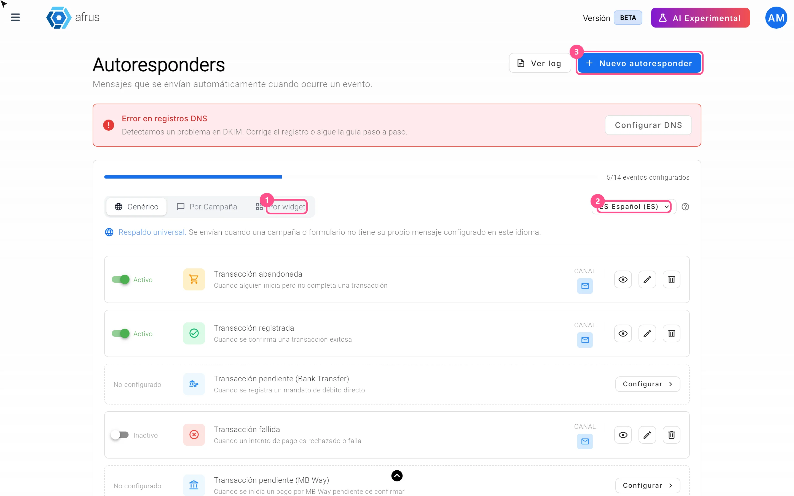
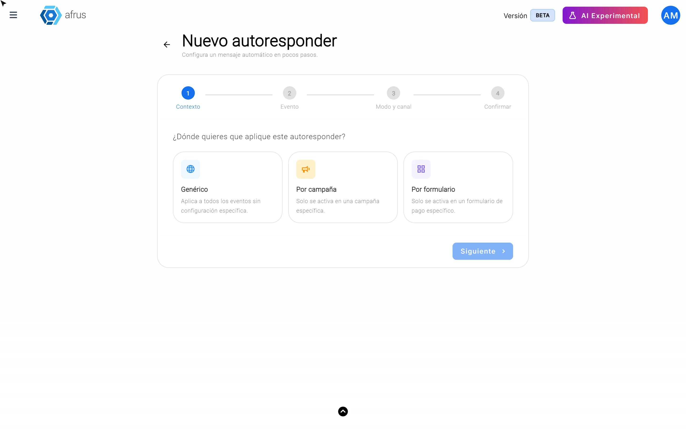
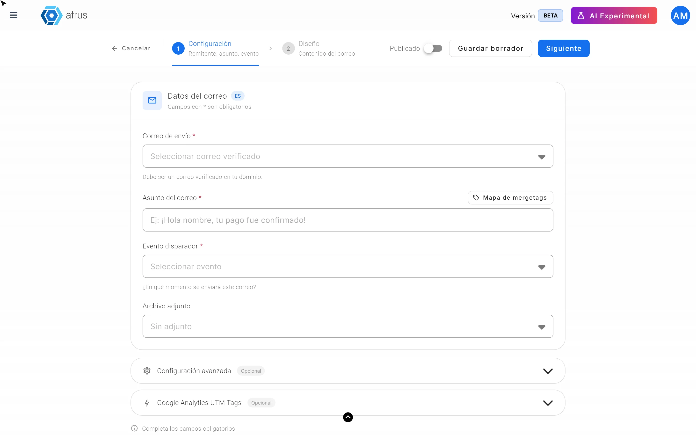
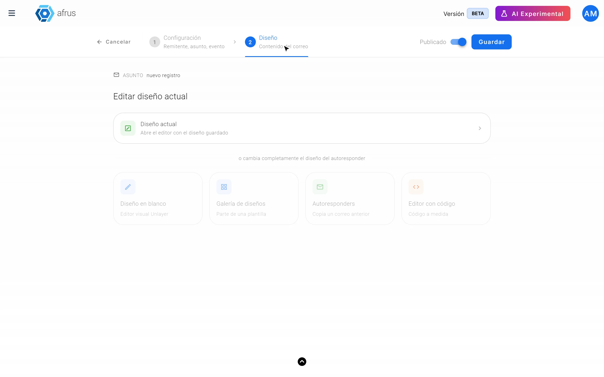
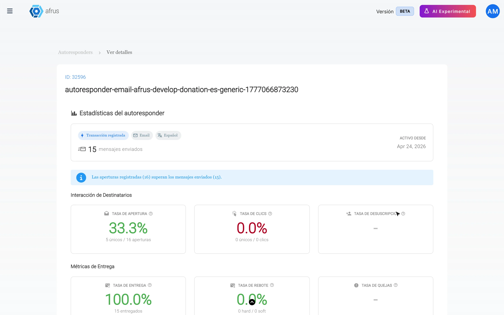

# Guia de Autoresponders

Com este guia você vai poder enviar e-mails automáticos para seus doadores e contatos: um agradecimento quando doam, um aviso quando um pagamento falha e muito mais, sem precisar escrevê-los um por um.

*Módulo: Autoresponders · Menu: **Interacciones > Autoresponders** · Público: equipes de comunicação e captação*

> **Sobre os nomes de tela neste guia:** botões, campos e menus estão escritos exatamente como aparecem na versão em espanhol do console, com a explicação em português quando ajuda.

---

## O que é um autoresponder

**Um autoresponder é um e-mail que a AFRUS envia sozinha, para uma pessoa, quando algo acontece.** Por exemplo: quando alguém se cadastra, quando a doação é confirmada ou falha, ou quando a doação mensal é cobrada.

Você escreve o e-mail uma vez e a AFRUS o envia sempre que esse evento acontece.

## Para que serve

- **Agradecer cada doação na hora.** O doador recebe sua mensagem em poucos minutos, sem trabalho manual.
- **Avisar quando algo dá errado.** Por exemplo, se um pagamento falha, fica pendente ou a pessoa não terminou de doar.
- **Falar com cada pessoa no idioma dela.** Você pode ter o mesmo e-mail em espanhol, inglês e português.
- **Personalizar por campanha ou por formulário.** Você pode ter uma mensagem geral para toda a organização e mensagens especiais para uma campanha ou um formulário de doação.

## Antes de começar

- **Um e-mail para enviar.** Você sempre pode usar o e-mail da AFRUS. Se quiser enviar com o e-mail da sua organização (por exemplo, doacoes@suaorg.org), primeiro é preciso verificar o seu domínio. Você vê isso no cartão que aparece acima da lista de autoresponders.
- **Tenha claro o evento.** Pense em que momento quer que o e-mail chegue: ao doar, ao se cadastrar, quando um pagamento falha…

> **Recomendado:** verificar seu domínio ajuda seus e-mails a chegarem à caixa de entrada. O botão "Configurar DNS" do cartão abre a versão anterior da AFRUS, por isso a tela é diferente. A verificação pode levar até 48 horas.

---

# Passo a passo

## Como usar

### Parte 1 — Escolha onde e quando é enviado

1. **Abra os autoresponders.** Acesse **Interacciones > Autoresponders**.
   

2. **Escolha o idioma.** Acima da lista, escolha **Español (ES)**, **Inglés (EN)** ou **Portugués (PT)**. O autoresponder que você criar ficará nesse idioma.

3. **Comece um novo.** Clique em "Nuevo autoresponder" (Novo autoresponder).

4. **Escolha onde se aplica.** Em **Contexto**, escolha **Genérico** (para toda a organização), **Por campaña** (Por campanha, e escolha a campanha) ou **Por formulario** (Por formulário, e escolha o formulário). Clique em "Siguiente" (Próximo).
   

5. **Escolha o momento.** Em **Evento**, escolha quando é enviado, por exemplo **Transacción registrada** (Transação registrada — "quando uma transação bem-sucedida é confirmada"). Só aparecem os eventos que ainda não têm e-mail nesse idioma.

6. **Escolha o modo.** Em **Modo y canal** (Modo e canal), escolha **Manual** para você mesmo desenhar o e-mail. O canal é **Email**.

7. **Confirme.** Revise o resumo e clique em "Confirmar e ir al editor" (Confirmar e ir para o editor).

### Parte 2 — Preencha os dados do e-mail

8. **Escolha o remetente.** Em **Correo de envío** (E-mail de envio), escolha de qual e-mail ele sai.
   

9. **Dê um nome interno (opcional).** Em **Nombre interno** (Nome interno), escreva um nome que só sua equipe verá.

10. **Escreva o assunto.** Em **Asunto del correo** (Assunto do e-mail), escreva o que a pessoa verá na caixa de entrada. Com "Mapa de mergetags" você pode adicionar dados da pessoa, como o nome, para deixar o e-mail mais próximo. Logo abaixo fica o **Evento disparador** (Evento gatilho): ele já vem preenchido pelo assistente, então só confira se é o correto.

11. **Anexe um arquivo (opcional).** Em **Archivo adjunto** (Anexo) você pode escolher um. Por padrão, não há anexo.

12. **Continue.** Clique em "Siguiente". Se o conteúdo ainda não estiver pronto, use "Guardar borrador" (Salvar rascunho).

### Parte 3 — Desenhe o e-mail e publique

13. **Escolha como desenhar.** Você tem quatro opções:
    - **Diseño en blanco** (Design em branco): começa do zero com o editor visual.
    - **Galería de diseños** (Galeria de designs): parte de um modelo pronto.
    - **Autoresponders:** copia um e-mail que você já tem.
    - **Editor con código** (Editor com código): para quem trabalha com HTML.
    

14. **Publique.** No canto superior direito, ative **Publicado**.

15. **Salve.** Clique em "Guardar" (Salvar). Você verá *"Autoresponder creado correctamente"* (Autoresponder criado com sucesso).

Ao terminar, o autoresponder aparece na lista como **Activo** (Ativo) e é enviado sempre que o evento acontece.

> **Importante:** não publique um e-mail sem conteúdo. Revise sempre o design antes de ativar **Publicado**.

### Criar um autoresponder com IA

Se preferir que a AFRUS escreva o e-mail para você:

1. **Encontre o evento.** Na aba **Genérico**, encontre um evento que diga **No configurado** (Não configurado) e clique em "Configurar".
2. **Escolha Con IA.** Em **Modo de creación** (Modo de criação), escolha **Con IA** (Com IA).
3. **Preencha os dados.** Escolha o **Remitente** (Remetente), o **Diseño** (Design: **Plantilla IA** com design visual, ou **Solo texto**, só texto) e, em **URL call to action**, o link do botão do e-mail.
4. **Salve.** O autoresponder fica criado e publicado.

> **Importante:** use o botão "Configurar" da linha do evento. Se você escolher **Con IA** a partir de "Nuevo autoresponder", o editor manual abre do mesmo jeito. E não deixe a **URL call to action** vazia: se fizer isso, a lista continua mostrando o evento como **No configurado**, mesmo que o e-mail tenha sido publicado.

### Editar, pausar ou excluir um autoresponder

- **Editar:** na linha do evento, use o ícone de editar, mude o que precisar e clique em "Guardar".
- **Pausar:** desative a chave da linha. Ele fica **Inactivo** (Inativo) e não é enviado.
- **Ver resultados:** o ícone de ver abre **Ver detalles** (Ver detalhes), com quantos e-mails foram enviados, abertos e clicados, e uma prévia do e-mail. "Ver log" mostra cada e-mail enviado ou com falha.
  
- **Excluir:** ícone de excluir na linha.

> **Dá para desfazer?** Não. Excluir um autoresponder o apaga na hora, sem pedir confirmação. Se só quiser parar de enviá-lo por um tempo, desative-o com a chave.

## O que considerar se o seu formulário tem vários idiomas

- **Cada idioma é um e-mail diferente.** Para ter a versão em inglês, mude o seletor de idioma para **Inglés (EN)** e crie-a à parte. O mesmo vale para o português.
- **A AFRUS escolhe o idioma da pessoa.** Se a pessoa tem um idioma, recebe o e-mail nesse idioma.
- **Se faltar um idioma, usa-se o genérico.** Se você não tiver o e-mail no idioma da pessoa, a AFRUS envia o seu autoresponder **Genérico**, mesmo que esteja em outro idioma. É melhor receber um agradecimento em outro idioma do que não receber nada.
- **Os de campanha e de formulário são mais rígidos.** Só são enviados no idioma exato. Se não existirem no idioma da pessoa, chega o genérico.

**Recomendação:** se o seu formulário recebe doações em vários idiomas, crie o autoresponder em cada um deles, começando pelo **Genérico**.

## Quando criar um autoresponder genérico, por campanha ou por formulário

| Tipo | Quando usar | Exemplo |
|---|---|---|
| **Genérico** | Sempre, como base. É o e-mail que chega quando não há um mais específico | Um agradecimento geral por qualquer doação |
| **Por campaña** (Por campanha) | Quando uma campanha precisa de uma mensagem própria | "Obrigado por apoiar nossa campanha de Natal" |
| **Por formulario** (Por formulário) | Quando um formulário específico precisa de uma mensagem própria | Um e-mail especial para quem doa pela sua página de emergência |

**Como a AFRUS escolhe qual e-mail enviar:** procura primeiro o mais específico e, se não houver, o mais geral. A ordem é: campanha e formulário juntos, depois campanha, depois formulário e, por fim, o **Genérico**. Só contam os que estão **Activo**.

**Recomendação:** crie primeiro o **Genérico** de cada evento importante. Assim ninguém fica sem resposta, mesmo que uma campanha ou formulário não tenha seu próprio e-mail.

---

## Status

| Status | O que significa |
|---|---|
| **Activo** (Ativo) | Publicado: é enviado quando o evento acontece |
| **Inactivo** (Inativo) | Configurado, mas desligado: não é enviado |
| **Borrador** (Rascunho) | Salvo sem design: não é enviado |
| **No configurado** (Não configurado) | Não há e-mail para esse evento no idioma escolhido |

## Quando o e-mail chega

A AFRUS verifica os eventos novos a cada 5 minutos, então o e-mail costuma chegar poucos minutos depois do evento.

## Para ter em conta

- Por enquanto, os autoresponders novos só podem ser enviados por e-mail (não por WhatsApp).
- Em **Ver detalles**, a taxa de descadastro e os erros aparecem como "No registrado" (Não registrado): esses dados não são medidos nos autoresponders.
- Se sua organização nunca configurou um domínio, o cartão de cima pode mostrar **Error en registros DNS** (Erro nos registros DNS) em vez de "você não tem um domínio verificado". Nos dois casos, o que falta é configurar seu domínio.
- Se você desativar um autoresponder de campanha ou de formulário e houver um **Genérico** ativo para esse evento, o genérico é enviado no lugar.

## Perguntas frequentes

**De qual e-mail saem meus autoresponders?**
Do e-mail da AFRUS, até você verificar seu domínio. Depois você poderá escolher os e-mails dos usuários da sua organização que terminem no seu domínio.

**Posso colocar o nome do doador no e-mail?**
Sim. Use o "Mapa de mergetags" para copiar o dado que quiser, por exemplo o nome, e cole no assunto ou no corpo do e-mail.

**Os autoresponders são enviados para pessoas que se descadastraram ou cujo e-mail retorna?**
> **Pendente de confirmação:** se essas pessoas são excluídas.

**Quais usuários podem criar autoresponders?**
> **Pendente de confirmação:** quais perfis de usuário têm permissão.

---

> **[Voltar ao índice da seção](./README.md)** · **[Voltar ao índice geral](../README.md)**

*Última atualização: 2026-10-26*
