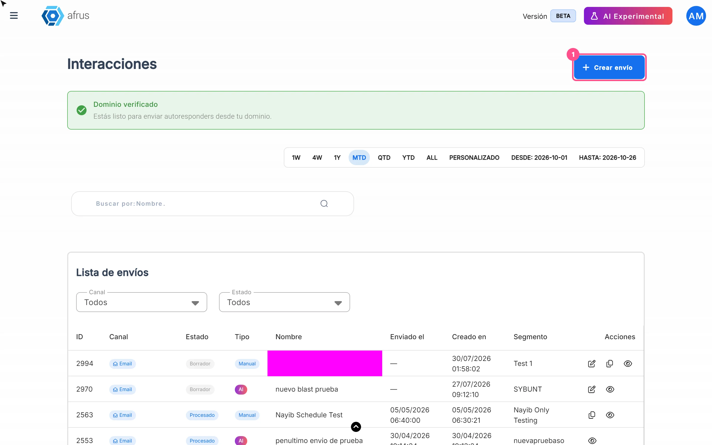
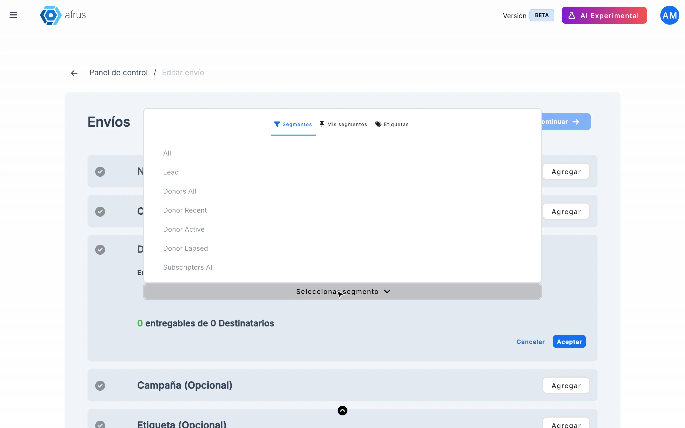
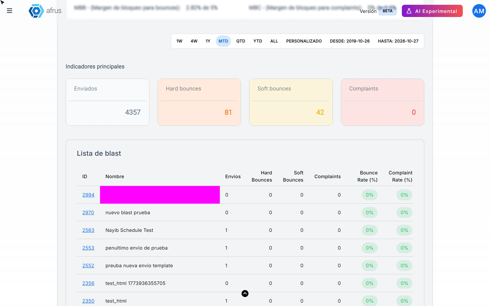
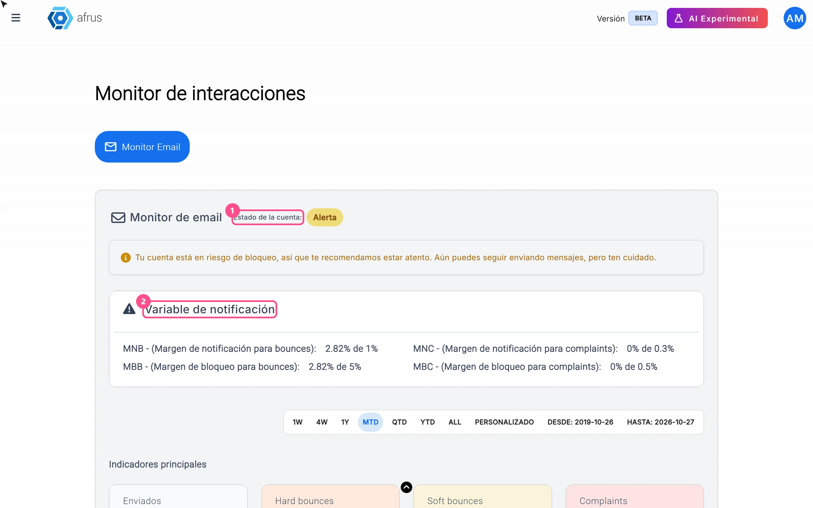
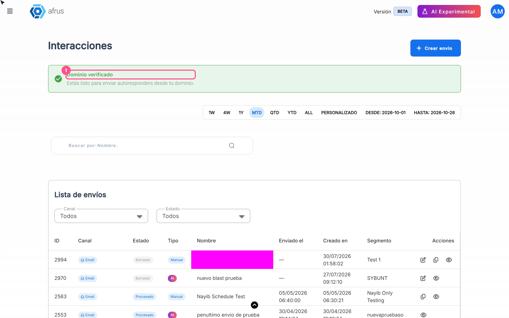

# Blast guide

With this guide you will be able to send bulk emails to your database, see how they did, understand their statuses and look after your list so your emails keep arriving.

*Module: Interacciones (Interactions) · Menu: **Interacciones > Blast** · Audience: communications, marketing and fundraising teams*

> **About the labels in this guide:** buttons, fields and menus are written exactly as they appear in the Spanish version of the console, with an English explanation where it helps.

---

## What a Blast is

**A Blast is an email you send in one go to a group of people in your database.** For example, a newsletter, an event invitation or a call to donate.

You choose who receives it (a segment or a tag), write or pick the email design and decide whether it goes out now or on a date and time you schedule.

The same screen can also send WhatsApp Business messages. This guide covers **email** sends.

## What it is for

- **Keep your community informed.** Send newsletters, news and project results.
- **Ask for donations.** Launch a campaign to everyone in a group with a single send.
- **Check before sending.** Send yourself a test email to see how it looks.
- **Plan ahead.** Leave the email ready to go out on the day and time you choose.
- **Measure results.** See how many people opened the email, how many clicked and how many emails bounced.

## Before you start

- **Have your recipient group ready.** It can be a saved segment (in **Data > Segmentos > Avanzado** or **Básico**) or a tag.
- **Verify your email domain (recommended).** That way your emails go out with your organization's address, not from an Afrus account. We explain how in "How to keep my emails out of spam".
- **Check that your account is not blocked.** If it is, you will see *"Cuenta bloqueada, no puedes enviar interacciones…"* (Account blocked, you can't send interactions) and you will need to contact support.

---

# Step by step

## How to send a Blast

### Part 1 — Choose who you are writing to

1. **Create the send.** Go to **Interacciones > Blast** and click "Crear envío" (Create send).
   

2. **Give it a name.** Type the **Nombre del envío** (Send name). Only you see it; it helps you find it later.

3. **Choose the recipients.** In **Enviar a** (Send to), open the selector and choose your group in one of the tabs: **Segmentos** (groups Afrus already includes), **Mis segmentos** (the ones you saved) or **Etiquetas** (tags). Click "Aceptar" (Accept).
   

   You will see how many people can receive it, for example *"N entregables de M Destinatarios"* (N deliverable out of M recipients). Afrus leaves out anyone who can't receive emails (for example, people who unsubscribed or whose address doesn't exist).

4. **Choose the channel.** Select **Correo** (Email).

5. **Add a campaign and a tag (optional).** If you choose an **Etiqueta** (tag), Afrus adds it to every person who receives the email. That way you can later find who received this send.

6. **Continue.** Click "Continuar" (Continue).

### Part 2 — Prepare the email

7. **Say who is sending.** In **Remitente** (Sender), fill in **Nombre del remitente** (sender name), choose the **Correo electrónico** (email address) it goes out from and the **Email para respuestas** (reply-to email). Click "Guardar" (Save).
   <!-- screenshot pending: how-to-send-a-blast-07 — email step with the Remitente, Asunto and Contenido blocks -->

8. **Write the subject.** It's the first thing people see in their inbox. With "Mapa de merge tags" you can add each person's details, such as their name. Click "Guardar".

9. **Choose the design.** In **Contenido** (Content), click "Agregar" (Add) and choose an option: **Diseño en blanco** (blank design), **Galería de plantillas** (your email templates), **Correos enviados** (to reuse a previous one) or **Editor con código** (code editor). Click "Usar Plantilla" (Use template) and edit the content.
   <!-- screenshot pending: how-to-send-a-blast-09 — Seleccionar contenido window with its four options -->

10. **Send yourself a test.** Click "Enviar prueba" (Send test), type your email and confirm. Check how it looks before sending it to everyone.

### Part 3 — Send or schedule

11. **Choose when it goes out.** Click "Programar" (Schedule) and choose **Enviar ahora** (Send now) or **Programar fecha** (Schedule date), with the day and time. Click "Enviar" (Send) or "Programar".
    <!-- screenshot pending: how-to-send-a-blast-11 — Programar window with Enviar ahora and Programar fecha -->

When you finish you will see *"¡Envío realizado satisfactoriamente!"* (Send completed successfully) or *"¡Envío programado con éxito!"* (Send scheduled successfully), and the send will appear in the list as **Procesando** (Processing) or **Programado** (Scheduled).

**Keep in mind:**
- The "Enviar prueba" and "Programar" buttons become active once you have set the sender, address, subject and content.
- The time uses your computer's time zone.
- A scheduled send may go out a few minutes after the chosen time. A large send takes longer to finish the more people it has.
- You can only change a send that is in **Borrador** (Draft) or **Programado**. To change the date of a scheduled one, use "Reprogramar" (Reschedule).

> **Can it be undone?** No. An email that has gone out can't be recalled. Before sending, check the recipient group carefully and send yourself a test.

## How to see a Blast's statistics

1. **Find your send.** In **Interacciones > Blast**, look at the **Lista de envíos** (list of sends). The list opens with **today's** sends: to see older ones, change the dates at the top.

2. **Open the details.** In the send's row, click "Detalles" (Details).
   <!-- screenshot pending: how-to-see-blast-statistics-02 — send details with Resumen de Audiencia, Interacción de Destinatarios and Métricas de Entrega -->

3. **Read the results.** You will see:
   - **Resumen de Audiencia** (Audience summary): how many people were in the group, how many could receive it and how many emails were sent.
   - **Interacción de Destinatarios** (Recipient interaction): **Tasa de Apertura** (open rate), **Tasa de Clics** (click rate) and **Tasa de Desuscripción** (unsubscribe rate).
   - **Métricas de Entrega** (Delivery metrics): **Tasa de Entrega** (delivery rate), **Tasa de Rebote** (bounce rate: emails that didn't arrive) and **Tasa de Quejas** (complaint rate: people who marked it as spam).
   - **Estados de emails** (Email statuses): each person's email status, with "Ver Eventos" (View events) to see what happened to it.
   - **Clicks per link:** which links were opened most and who clicked each one.

The numbers are read when you open the details. To see new data, open them again.

> **Important:** the **Tasa de Entrega** is calculated by subtracting bounces and errors. It doesn't confirm that the email reached the inbox.

## Blast statuses

| Status | What it means | What you can do |
|---|---|---|
| **Borrador** (Draft) | You created it but haven't sent it yet | Finish it and send or schedule it |
| **Programado** (Scheduled) | It will go out on the date and time you chose | You can edit it or change the date with "Reprogramar" |
| **Procesando** (Processing) | It's getting ready to go out | Wait |
| **Demorado** (Delayed) | It has gone over an hour without finishing | Check the details before resending |
| **Procesado** (Processed) | All the emails went out | Check the statistics |
| **Alerta** (Alert) | Some emails went out and others failed | Check the details and clean your list |
| **Bloqueado** (Blocked) | The send was stopped to protect your account | Contact support |
| **Fallido** (Failed) | All the emails failed | Check the error and use "Reenviar" (Resend) |

## Why my Blast shows failed

**Fallido** (Failed) means **none** of the emails could be sent. It's different from **Alerta** (some went out and others failed) and from **Bloqueado** (the send was stopped to protect your account).

What to do:

1. **Open the details.** In the **Lista de envíos**, click "Detalles" for the send.
2. **Check the error.** Look at the **Incidencias** (Issues) section and the **Estados de emails**. With "Ver Eventos" you can see what happened to each person's email.
3. **Resend.** If the send is **Fallido**, the "Reenviar" (Resend) button appears (*"¿Reenviar blast?"*). Afrus tries again with the people who had an error.
   <!-- screenshot pending: why-does-my-blast-show-failed-03 — details of a failed send with the Reenviar button -->

> **Pending confirmation:** the most common causes of a **Fallido** send.

**What if it says Bloqueado?** Afrus stopped the rest of the send because there were too many bounces or complaints. You receive a warning email and a notification in the console. A blocked send can't be sent again from the screen, so the email isn't sent twice to people who already received it: contact support.

## Where to see bounced emails

An email **bounces** when it doesn't reach the person. There are two types:

- **Hard Bounce:** the address doesn't exist. Afrus stops sending emails to that person.
- **Soft Bounce:** a temporary problem, for example a full inbox. That person keeps receiving emails.

You can see them in three places:

1. **In each send's details.** In **Interacciones > Blast**, open "Detalles" and look at the **Tasa de Rebote** and the **Estados de emails**, with "Ver Eventos" for each person.

2. **In the interactions monitor.** In **Trackers > Monitor de interacciones** you see the total **Hard bounces** and **Soft bounces** of all your sends, and a table with each send's bounces. That way you find which send had the most bounces. Click the **ID** to open its details.
   

3. **In each person's profile.** In **Personas**, each person's email has an icon with its status. In the profile you will see *"Tiene Hard Bounce"* or *"Tiene Soft Bounce"* (Has hard / soft bounce), and in the **Eventos** (Events) tab, the details of each email.

> **Pending confirmation:** whether there is a way to get all bounced emails in a single list.

## How to remove soft and hard bounces

**First, good news:** you don't need to delete anyone to stop sending to them. Afrus already leaves out of your sends people with a **Hard Bounce**, people who unsubscribed (**Opt Out**) and people whose email is disabled. People with a **Soft Bounce** keep receiving, because their problem is usually temporary.

If you still want to remove them from your database:

1. **Find them.** Check the sends with the most bounces in **Trackers > Monitor de interacciones** and, in each send's details, whose email bounced. In each person's profile you will see *"Tiene Hard Bounce"* or *"Tiene Soft Bounce"*.

2. **Delete them.** Open the person's profile and click "Borrar" (Delete). To delete several at once, in **Personas** check them, open **Acciones** (Actions) and choose **Eliminar** (Delete).

> **Pending confirmation:** whether there is a filter or segment that gathers everyone with a bounce, to delete them in one go.

> **Can it be undone?** No. Deleting a person is permanent: their donations, subscriptions and whole history are deleted too. If the person donates or has an active subscription, think twice: Afrus already stops emailing them if they have a **Hard Bounce**.

## How to clean my database so sending isn't blocked

Afrus looks after your email account. While a send is going out, it checks how many emails bounce and how many people mark it as spam:

- If they go over the warning limit, the send goes into **Alerta**.
- If they go over the blocking limit, the rest of the send stops and it becomes **Bloqueado**. You get a warning by email and in the console.

If your account gets blocked, you won't be able to send more until you contact support. That's why it pays to keep your database clean.

1. **Check your account status.** Go to **Trackers > Monitor de interacciones**. **Estado de la cuenta** (Account status) tells you if it is **Activa** (Active), in **Alerta**, **Bloqueada** (Blocked) or with **Envío limitado** (Limited sending). Below, you see your bounce and complaint rates compared with the limit.
   

2. **Find the sends with problems.** In the **Lista de blast** table, the sends in yellow or red are the ones with the most bounces or complaints.

3. **Remove invalid or old addresses.** That's what the screen itself recommends when your account has **Envío limitado**: *"elimina correos inválidos o antiguos de tus listas"* (remove invalid or old emails from your lists). Follow the steps in "How to remove soft and hard bounces".

4. **Send to groups that want to hear from you.** Use segments of people who gave you their email recently or who donated, instead of sending to the whole database.

> **Important:** **Soft Bounces** also count towards your bounce rate, even though those people keep receiving emails.

## How to keep my emails out of spam

These are the actions Afrus lets you take to improve how your emails arrive:

1. **Verify your email domain.** That way your emails go out with your organization's address (for example, from @yourorg.org) and not from an Afrus account. The screen itself recommends it to *"mejorar la entregabilidad"* (improve deliverability).
   - At the top of **Interacciones > Blast** you will see if your domain is verified. If not, click "Configurar DNS" (Set up DNS). This screen opens in the previous version of Afrus, which is why it looks different.
   - Follow the 4 steps: type your domain and add the records the screen shows you at your domain provider. If you don't know how, ask whoever manages your website.
   - Verification can take up to 48 hours. "Comprobar estado" (Check status) checks again.
   

2. **Send from an address of your organization.** Once the domain is verified, you can choose as sender the email addresses of your organization's users with that domain.

3. **Keep your database clean.** Fewer bounces and fewer complaints help your emails arrive. Follow "How to clean my database so sending isn't blocked".

4. **Let people unsubscribe.** Every Afrus email includes an unsubscribe link; if your design doesn't have one, Afrus adds it at the end. It's better for someone to unsubscribe than to mark your email as spam.

5. **Always send yourself a test** and check that the subject and content look right.

> **Pending confirmation:** other content recommendations (subject, images, links) specific to Afrus.

## Best practices for bulk email

Afrus does some of these for you; others are our recommendations.

**What Afrus already does for you:**
- It only sends to people who agreed to receive emails and haven't unsubscribed.
- It leaves out people with an invalid email (**Hard Bounce**), people who marked it as spam and people who unsubscribed.
- It adds an unsubscribe link to every email.
- It stops a send if there are too many bounces or complaints, to protect your account.

**What we recommend:**
- **Verify your domain** before your important sends.
- **Send to groups chosen for that message,** rather than to the whole database.
- **Always send yourself a test** before sending.
- **Check the Monitor de interacciones** after each large send.
- **Clean your database regularly:** remove invalid or very old addresses.
- **Schedule your sends ahead** and check the date and time before confirming.
- **Use a tag on each send** so you know later who received it.

---

## Frequently asked questions

**Can I edit a send that has already gone out?**
No. You can only edit sends in **Borrador** or **Programado**.

**Can I reuse an email I already sent?**
Yes. In **Contenido**, choose **Correos enviados**. You can also use "Duplicar" (Duplicate) in the list of sends.

**Why is the number of recipients smaller than my segment?**
Because Afrus leaves out anyone who can't receive emails: hard bounces, unsubscribes, disabled emails, people who haven't accepted the terms and people marked as spam.

**Are my segments updated every 24 hours?**
The **Mis segmentos** tab says so, but Afrus works out who to send to with the data at the moment of sending.

**What time does a scheduled send go out?**
At the time you choose, in your computer's time zone. It may go out a few minutes later.

---

> **[Back to section index](./README.md)** · **[Back to main index](../README.md)**

*Last updated: 2026-10-26*
