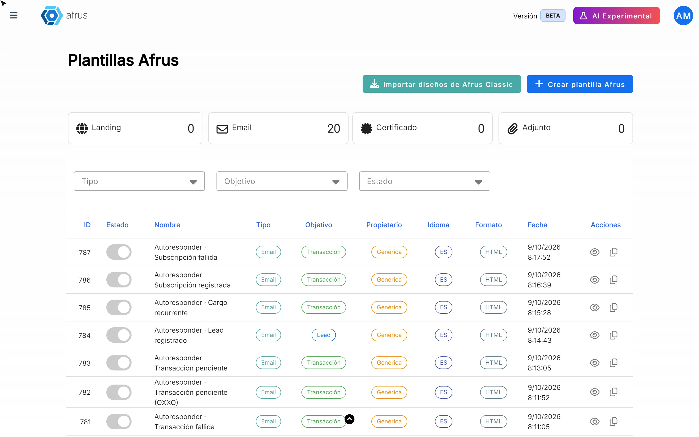
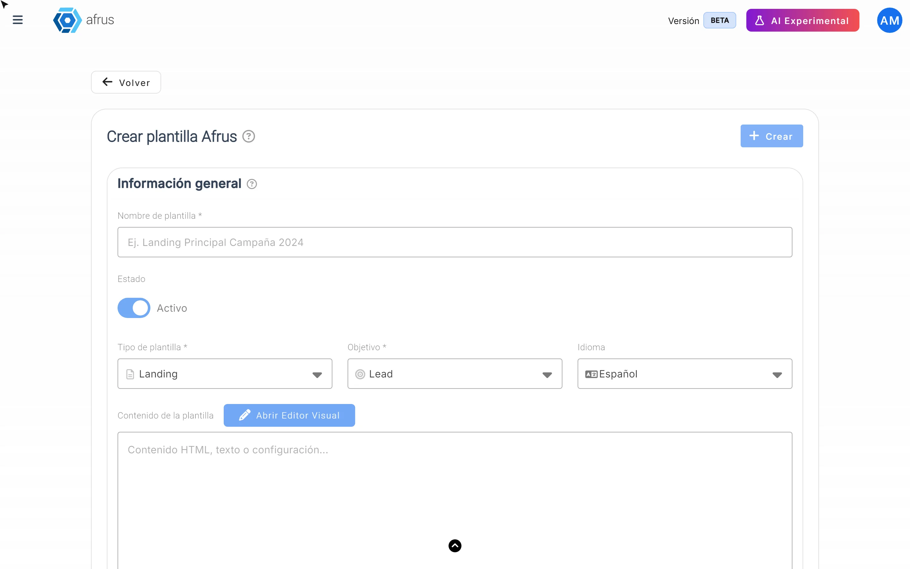

# Guía de Plantillas Afrus

Con esta guía vas a poder encontrar diseños listos para tus correos y páginas, crear tus propias plantillas y reconocer cuáles son tuyas y cuáles trae Afrus.

*Módulo: Plantillas Afrus · Menú: **Interacciones > Plantillas Afrus** · Audiencia: equipos de comunicaciones y diseño*

---

## Qué son las Plantillas Afrus

**Las Plantillas Afrus son una biblioteca de diseños listos para usar:** correos, páginas (landings), archivos adjuntos y certificados.

Algunas las trae Afrus y están disponibles para todas las organizaciones. Otras son las que crea tu equipo para tu organización.

## Para qué sirven

- **Ahorrar tiempo.** Partes de un diseño ya hecho en lugar de empezar desde cero.
- **Mantener tu imagen.** Guardas los diseños de tu organización y los usas una y otra vez.
- **Usarlas en muchos lugares.** Las encuentras al crear un envío masivo (Blast), un autoresponder, un flujo de trabajo o una landing.

---

# Paso a paso

## Qué tipos de plantillas hay

Al entrar a **Interacciones > Plantillas Afrus** verás una tabla con todas tus plantillas.

**Por tipo:**

| Tipo | Para qué es |
|---|---|
| **Email** | Correos: envíos masivos, autoresponders y flujos de trabajo |
| **Landing** | Páginas de donación o de campaña |
| **Adjunto** | Archivos que se adjuntan a un correo |
| **Certificado** | Certificados que se envían a los donantes |

**Por objetivo:** **Transacción** (para donaciones), **Lead** (para registros de contactos) y **Agradecimiento**.

Puedes filtrar la tabla por tipo, objetivo y estado para encontrar lo que buscas.

## Cómo crear una nueva plantilla

1. **Abre las plantillas.** Ve a **Interacciones > Plantillas Afrus** y haz clic en "Crear plantilla Afrus".
   

2. **Completa la información general.**
   - **Nombre de plantilla** (obligatorio): un nombre que tu equipo reconozca.
   - **Estado**: **Activo** o **Inactivo**.
   - **Tipo de plantilla**: correo, landing, adjunto o certificado.
   - **Objetivo**: para qué la vas a usar.
   - **Idioma**: español, inglés, portugués o alemán.

3. **Diseña el contenido.** En **Contenido de la plantilla**, haz clic en "Abrir Editor Visual" para diseñarla sin código. Si tienes el diseño en HTML, también puedes pegarlo ahí.

4. **Guarda.** Haz clic en "Crear". Verás *"Plantilla Afrus creada exitosamente"*.

**¿Tienes diseños en la versión anterior de Afrus?** Con "Importar diseños de Afrus Classic" puedes traerlos al formulario de creación.

**Para editar una plantilla tuya:** en su fila, usa "Editar plantilla", haz los cambios y haz clic en "Guardar cambios".

> **¿Se puede deshacer?** Eliminar una plantilla ("Eliminar plantilla") la quita de tu biblioteca.
> **Pendiente de confirmar:** si una plantilla eliminada se puede recuperar.

## Cómo diferenciar tus plantillas de las que trae Afrus

Mira la columna **Propietario**:

- **Organización:** la creó tu equipo. Puedes editarla, activarla o desactivarla y eliminarla.
- **Genérica:** la trae Afrus y la comparten todas las organizaciones. No se puede editar ni eliminar.

**¿Quieres cambiar una plantilla genérica?** Usa "Duplicar plantilla en mi organización". Se crea una copia que es tuya (**Organización**) y esa sí la puedes editar.

## Cómo usar una plantilla

- **En un Blast:** en el paso de contenido, entra a **Galería de plantillas** y haz clic en "Usar Plantilla". Después puedes ajustarla en el editor.
- **En un autoresponder:** en el paso **Diseño**, elige **Galería de diseños**.
- **En flujos de trabajo y landings:** también aparecen las plantillas del tipo que corresponde.

En las galerías de correo aparecen las plantillas de tipo **Email**: las genéricas y las de tu organización.

---

## Para tener en cuenta

- Marcar una plantilla como **Inactivo** todavía no la oculta de las galerías de Blast y de autoresponders. Por ahora no hay otra forma de ocultarla: si no quieres que tu equipo la use, la única opción es eliminarla.
- Las plantillas genéricas no se pueden editar: siempre duplícalas primero.

## Preguntas frecuentes

**¿Puedo editar una plantilla de Afrus?**
No directamente. Duplícala en tu organización y edita la copia.

**¿Mis plantillas las ven otras organizaciones?**
No. Las plantillas de **Organización** son solo tuyas. Las **Genéricas** son las que comparte Afrus con todos.

**¿Qué usuarios pueden crear plantillas?**
> **Pendiente de confirmar:** qué perfiles de usuario tienen permiso.

---

> **[Volver al índice de la sección](./README.md)** · **[Volver al índice general](../README.md)**

*Última actualización: 2026-10-26*
