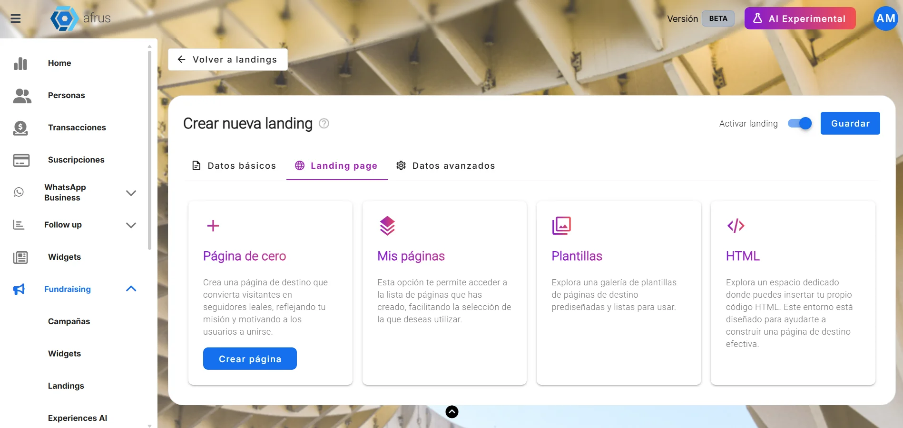

# Landings guide

After reading this guide you will be able to create and publish landing pages on AFRUS, add a widget to them, track them with analytics, use them as a thank-you page and change their address.

*Module: Landings · Menu: **Fundraising > Landings** · Audience: fundraising, digital marketing and communications teams*

> **About the labels in this guide:** buttons, fields and menus are written exactly as they appear in the Spanish version of the console, with an English explanation where it helps.

---

## What Landings is

**Landings is the AFRUS module for creating and publishing landing pages: campaign, donation or thank-you web pages.** You design them with a drag-and-drop visual editor, starting from a template, from one of your earlier pages or from your own HTML code.

Each landing is published on the AFRUS address (`web.afrus.org`) or on your organization's own domain, for example `donate.myorganization.org`.

## What it is for

- **Publish campaign pages without coding**, with an embedded donation or registration widget.
- **Say thank you personally.** A landing can be your thank-you page, showing the donor's name, amount and campaign.
- **Track your visits** with Google Analytics, Google Tag Manager or the Meta (Facebook) Pixel, and **improve SEO** with meta title, description, keywords and a social image.
- **Use your own web address**, with a domain registered in **Fundraising > Dominios**.
- **Reuse your work:** clone landings and move classic landings to version 2.0.
- **Test what works best** with A/B tests ("Experimentos" button). See the [landing experiments guide](../landing-experiments/ab-testing-guide.md).

## Before you start

- **Access to the Fundraising menu.** If you can see **Fundraising > Landings**, you can use the module.
- **To embed a form, have an active widget.** Only active widgets are listed.
- **To use your own domain,** register it first in **Fundraising > Dominios** and wait until it is active.

---

# Step by step

## How to create a landing

### Part 1 — Basic data

1. **Open the module.** Go to **Fundraising > Landings** and click "Nueva landing" (New landing).
   

2. **Fill in the basic data.** In the **Datos básicos** (Basic data) tab, fill in:
   - **Nombre interno** (internal name): only you see it; it helps you find the landing in the list.
   - **Título de la página** (page title): what shows in the browser tab (up to 255 characters).
   - **Dominio** (domain): `web.afrus.org` by default; your active own domains also appear.
   - **Ruta** (path): the last part of the address, for example `/my-campaign`.
   - Optional: **Icono landing page (favicon)** with the "Subir" (Upload) button (jpg, png or svg, up to 1 MB; 16 × 16 pixels recommended).

   The path must start with `/`, have no spaces (they are turned into hyphens automatically), use only unaccented letters, numbers, `/` and `-`, and never `//` in a row.

3. **Decide whether it is active.** Leave or turn off the **Activar landing** (Activate landing) switch.

4. **Save.** Click "Guardar" (Save) or move to the **Landing page** tab: the landing is created at that moment and you will see *"Landing creada exitosamente"* (Landing created successfully). The **Landing page** tab becomes available once internal name, title and path are filled in and the path starts with `/`.

### Part 2 — Design

5. **Choose how to start the design.** The **Landing page** tab offers four options:
   - **Página de cero** (Blank page): click "Crear página" (Create page) to open the empty visual editor.
   - **Mis páginas** (My pages): your 2.0 landings; click "Usar" (Use) to open the editor with a copy of that design.
   - **Plantillas** (Templates): a gallery of ready-made designs; click "Usar plantilla" (Use template).
   - **HTML**: paste your own code in **Ingresar HTML** (Enter HTML), check it with "Vista previa" (Preview) and click "Guardar".
   

6. **Design and save.** Build your page in the visual editor and click "Guardar" (*"Landing page HTML guardada con éxito"*, saved successfully). "Ver" (View) opens the published page in a new tab.

   > **Important:** "Volver" (Back) returns to the landing settings **without saving** the design. Save before leaving.

7. **Set up analytics and SEO (optional).** The **Datos avanzados** (Advanced data) tab becomes available after you visit **Landing page**. See the next section.

When you finish, your page is published at `https://<domain><path>`, for example `https://web.afrus.org/my-campaign`. There is no separate "Publish" button: **saving the design publishes it**. In the list, "Copiar link" (Copy link) copies that address.

> **Important:** until you save a design, the landing exists but has no published page; the eye icon and "Copiar link" are disabled.

**Other actions in the list:**
- **Clonar** (Clone; three-dot menu, 2.0 landings): creates a copy whose name and path end in `-copy-N`, on the same domain, and publishes its page.
- **Clonar a 2.0** (Clone to 2.0; **Clásica** landings): classic landings can't be edited here; this button creates an active 2.0 copy on `web.afrus.org`, with name, title and path ending in `-copy-YYYYMMDD`.
- **Status**: turning the switch off removes the page from its address; turning it on publishes it again with the last saved design.
- **Borrar** (Delete): removes the landing and its published page.

> **Can it be undone?** Deleting a landing, no: the screen warns *"Esta acción no se puede deshacer."* (This action cannot be undone.) Turning **Status** off, yes: turn it back on.

## How to track my landing with analytics

AFRUS adds the Google Analytics or Google Tag Manager code and the Meta Pixel to your page. Visits and conversions are measured **in those tools**, not inside AFRUS.

**Before you start:** the landing must have a saved design. Otherwise, saving shows *"Error al guardar datos avanzados"* (Error saving advanced data).

1. **Open the landing.** In **Fundraising > Landings**, click the landing's pencil icon and go to the **Datos avanzados** tab.
   

2. **Choose your analytics tool.** In the **Analytics** section, under **Analytics track**, choose **Google Analytics** or **Google Tag Manager V4** and type the ID in **Google Analytics ID** (format `G-XXXXXXXXXX` or `UA-XXXXX-Y`) or **Google Tag Manager V4 ID** (format `GTM-XXXXXX`).

3. **Add your Meta Pixel.** In **Facebook Pixel**, type your pixel ID (15 or 16 digits). This lets you measure visits coming from your ads.

4. **Improve SEO (optional).** In the **SEO** section, fill in **Meta Title** (60 characters recommended), **Meta Description** (160), **Palabras clave** (keywords; type and press Enter), **Meta Robots Avanzado** and **Subir foto destacada** (featured image; jpg, gif, webp or png; up to 500 KB; 1200 × 628 recommended). Check the result in **Vista previa en buscadores** (search preview).

5. **Add your own code (optional).** In **Custom Code**, click "Agregar HTML" (Add HTML) to paste your scripts (up to 10 blocks), choosing **Head** or **Body** for each.

6. **Save.** Click "Guardar Cambios" (Save changes), or "Guardar" at the top. You will see *"Datos avanzados y bloques de código guardados con éxito"* (saved successfully).

When you finish, AFRUS republishes the page with your analytics code, the Pixel, the SEO tags and your code blocks.

> **Important:** you can only use **one** of the two, Google Analytics **or** Google Tag Manager; changing the type clears the ID you typed. If you need both, load one as a **Custom Code** block or through Google Tag Manager.

If an ID's format is invalid, it is not saved and you will see *"ID de Google Analytics no válido"*, *"ID de Google Tag Manager no válido"* or *"El ID de Pixel debe tener entre 15 y 16 dígitos"* (the Pixel ID must have 15 or 16 digits). An empty code block also prevents saving.

## How to add a widget to a landing

**Before you start:** have an **active** widget; only active widgets appear in the list.

1. **Open the visual editor.** In your landing's **Landing page** tab, create the page (**Página de cero** > "Crear página") or click "Editar" (Edit) on the existing design.

2. **Choose the widget.** In the top bar, under **Seleccionar widget** (Select widget), choose the widget by name. AFRUS copies its code and you will see *"Código del widget copiado al portapapeles"* (Widget code copied to clipboard).
   

3. **Paste the code into an HTML block.** Drag an **HTML** block from the tools panel onto the canvas and paste the code there.

   > **Important:** choosing the widget doesn't insert it by itself. You always need to paste the code into an HTML block.

4. **Save.** Click "Guardar".

When you finish, the widget shows inside the published page just like on any site where you embed it.

Forms are always added as an AFRUS widget: the editor's own form tool is disabled. If you designed your landing with the **HTML** option, there is no selector: paste the widget's embed code by hand.

## Why create a thank-you page

A thank-you landing shows donors, right after they give, **your organization's own page** with your design, message and calls to action, instead of the default page. You can also personalize it with their details: name, amount and campaign. It is your first chance to build loyalty with someone who has just given.

**Before you start:** you need an active 2.0 landing with a saved design.

1. **Create the thank-you landing.** Follow "How to create a landing".

2. **Personalize the text.** In the visual editor's text blocks, type these variables exactly as shown, with double braces:

   | Variable | Shows |
   |---|---|
   | `{{first_name}}` | Donor's first name |
   | `{{last_name}}` | Last name |
   | `{{email}}` | Email |
   | `{{phone}}` | Phone |
   | `{{amount}}` | Amount (number only, e.g. 250.00) |
   | `{{currency}}` | Currency (code, e.g. BRL) |
   | `{{campaign_name}}` | Campaign name |
   | `{{organization_name}}` | Organization name |
   | `{{donation_id}}` | Donation ID |

   For example: *"Thank you, {{first_name}}. Your gift of {{amount}} {{currency}} to {{campaign_name}} is already making a difference."*

3. **Save.** Click "Guardar" in the editor; this publishes the page with personalization turned on.

4. **Set where it is used as the thank-you page.** Choose one of two ways:
   - **From the campaign:** in the campaign's **Página de agradecimiento** (Thank-you page) section, choose **Tipo** (Type) = **Landings**, then **Elegir una landing** (Choose a landing), check the preview and click "Usar plantilla" (it saves without a confirmation message). Also, in the widget editor, in the **Pagina de agradecimiento** panel, tick **Usa la página de agradecimiento de la campaña.** (Use the campaign's thank-you page). Without that box, the widget doesn't use the campaign's page.
   - **From the widget:** in **URL de la página de agradecimiento** (Thank-you page URL), paste the landing's link ("Copiar link" in the landing list).

5. **Test with a real donation.** This confirms the donor reaches your page and sees their details.

When you finish, after a successful donation the donor lands on your page with their details already filled in.

**Keep in mind:**
- **Only those nine variables work.** Any other (for example `{{campaign}}`, custom fields or email variables) is shown as is, braces included. The editor's "Merge tags" button shows AFRUS's full variable catalog, but most of it does **not** work on landings.
- **Body text only.** They don't work in the page title, meta description, button links, image alt texts or field values.
- **When they show blank.** If the payment needs a later step (3-D Secure verification, or methods confirmed later such as OXXO, PSE or SEPA), or if someone opens the page directly, reloads it after 15 minutes or shares it, the variables show empty. Write your texts so they read well that way too.
- While the page loads the data, the `{{...}}` text may show for an instant.
- Only 2.0 landings can be personalized; classic ones can't.
- If you deactivate the landing or change its path, donors won't see it. If you pasted the link in the widget, update it.

## How to change my landing's URL

**Before you start:** the landing must be 2.0 and have a saved design. If a design was never saved, you will see *"Error al actualizar datos"* (Error updating data) and nothing is published.

1. **Open the landing.** In **Fundraising > Landings**, click the landing's pencil icon and go to the **Datos básicos** tab.

2. **Change the address.** Edit the **Ruta**, the **Dominio**, or both. To use your own domain, register it first in **Fundraising > Dominios**. With your own domain you can use the path `/` so the landing is the domain's home page.
   

3. **Save.** Click "Guardar". You will see *"Datos actualizados con éxito"* (Data updated successfully).

When you finish, the page is published at the new address `https://<domain><path>`.

> **Can it be undone?** You can set the previous address again, but in the meantime **the old link stops working and does not redirect to the new one**. Update every place where you pasted it: widgets, emails, ads and social networks.

> **Important:** AFRUS does not check whether the path is free. If two landings use the same domain and path, that address shows the one saved last. Always use unique paths.

---

## List statuses and columns

| Element | Values | What it means |
|---|---|---|
| **Status** | on / off | On: page published. Off: the page is removed from its address. |
| **Versión** | **2.0** / **Clásica** | 2.0: built with the current editor (editable and clonable). Clásica (Classic): built in the previous version (view only, or "Clonar a 2.0"). |
| **Filtrar por campaña** (Filter by campaign) | campaigns | Shows landings that embed a widget from that campaign. Can't be combined with the date range or the URL search. |
| **Nombre** / **URL** search | text | **Nombre** searches the internal name; **URL** searches name or path. |

**Other visual editor tools:**
- **Fuentes personalizadas** (Custom fonts): add Google Fonts (name and URL). Reload the page to see them.
- **CSS personalizado** (Custom CSS): create styles and assign them to the landing. Also requires reloading.
- **Indicadores de impacto** (Impact indicators): lists the KPIs set up in your campaigns with a variable in square brackets that you copy and paste into the design; on the published page it is replaced with the calculated value. KPIs are created in the campaign settings.

## Frequently asked questions

**Do I need to click a button to publish?**
No. Saving the design in the editor (or in the HTML option) publishes the page.

**Can I use Google Analytics and Google Tag Manager at the same time?**
Not from the selector: only one. Load the other as a **Custom Code** block or through Google Tag Manager.

**Where can I see how many visits my landing had?**
In your analytics tool (Google Analytics, Google Tag Manager or Meta). AFRUS has no per-landing statistics screen.

**Can I edit a classic landing?**
No. Use "Clonar a 2.0" to create an editable copy.

**I changed the URL and the old link no longer works. Is that normal?**
Yes. The page is removed from the previous address and doesn't redirect. Share the new link.

---

> **[Back to section index](./README.md)** · **[Back to main index](../README.md)**

*Last updated: 2026-10-28*
