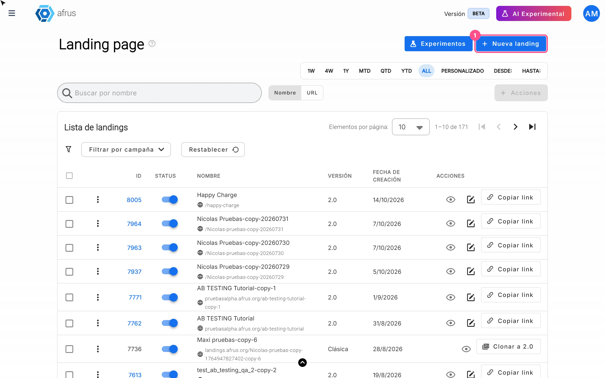
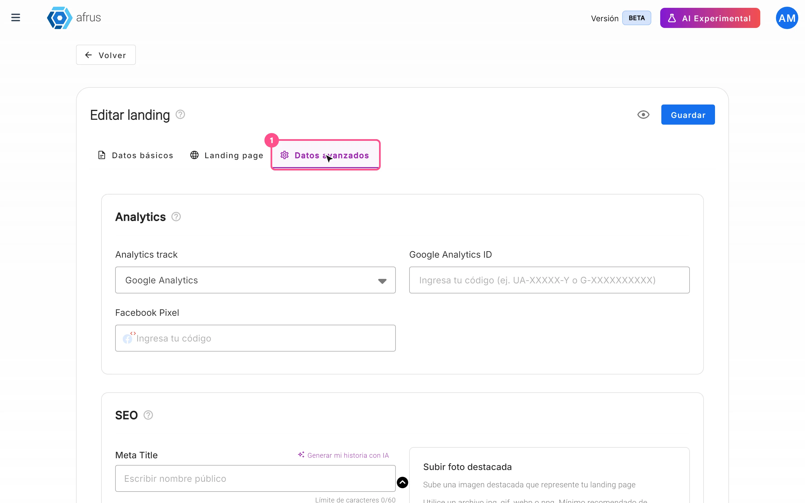
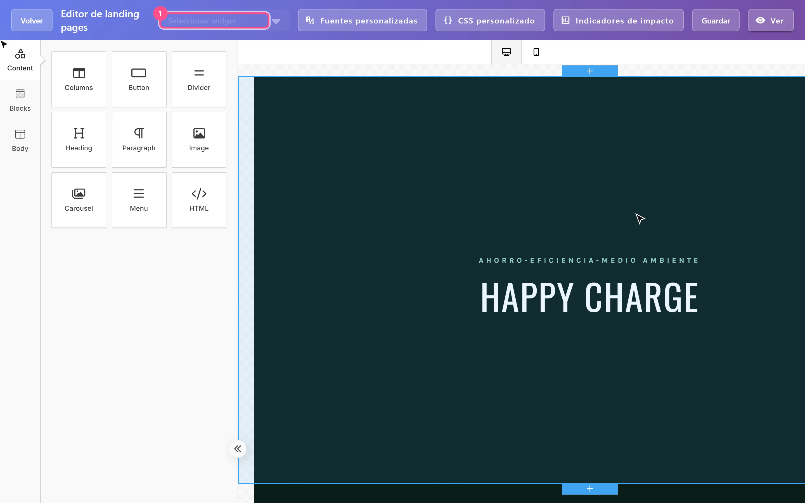
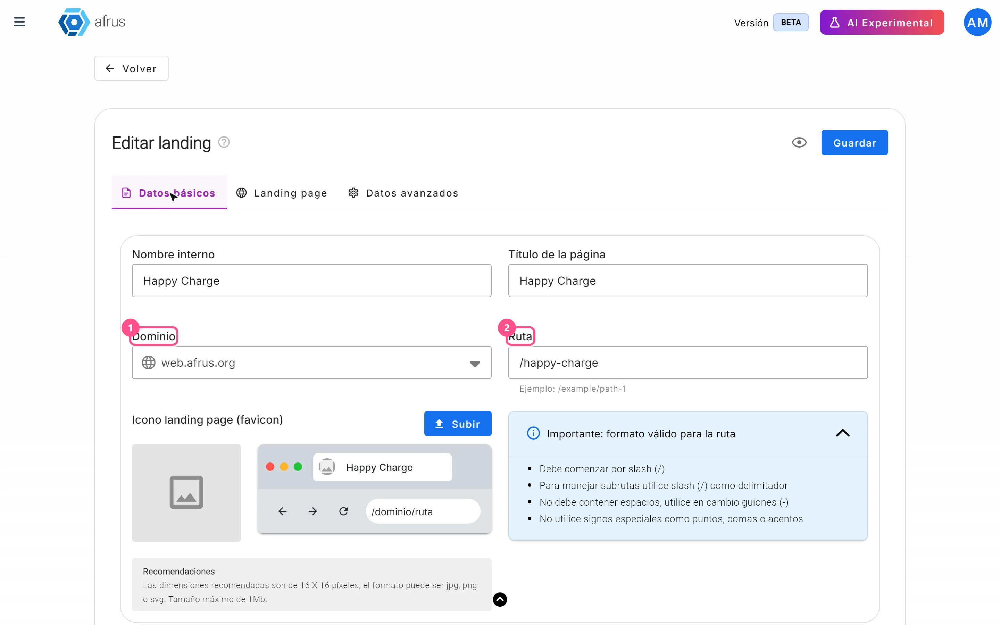

# Guía de Landings

Después de leer esta guía sabrás crear y publicar landing pages en Afrus, ponerles un widget, medirlas con analítica, usarlas como página de agradecimiento y cambiar su dirección.

*Módulo: Landings · Menú: **Fundraising > Landings** · Audiencia: equipos de recaudación, marketing digital y comunicaciones*

---

## Qué es Landings

**Landings es el módulo de Afrus para crear y publicar landing pages: páginas web de campaña, de donación o de agradecimiento.** Las diseñas con un editor visual de arrastrar y soltar, a partir de una plantilla, de una página tuya anterior o de tu propio código HTML.

Cada landing se publica en la dirección de Afrus (`web.afrus.org`) o en un dominio propio de tu organización, por ejemplo `donaciones.miorganizacion.org`.

## Para qué sirve

- **Publicar páginas de campaña sin programar**, con un widget de donación o de registro incrustado.
- **Agradecer de forma personal.** Una landing puede ser tu página de agradecimiento, con el nombre del donante, el monto y la campaña.
- **Medir tus visitas** con Google Analytics, Google Tag Manager o el Pixel de Meta (Facebook), y **mejorar el SEO** con meta título, descripción, palabras clave e imagen para redes.
- **Usar tu propia dirección web**, con un dominio registrado en **Fundraising > Dominios**.
- **Reutilizar tu trabajo:** clonar landings y pasar las landings clásicas a la versión 2.0.
- **Probar qué funciona mejor** con pruebas A/B (botón "Experimentos"). Lo explicamos en la [guía de experimentos de landings](../landing-experiments/ab-testing-guide.md).

## Antes de empezar

- **Acceso al menú Fundraising.** Si ves **Fundraising > Landings**, puedes usar el módulo.
- **Para incrustar un formulario, ten un widget activo.** Solo se listan los widgets activos.
- **Para usar tu dominio,** regístralo antes en **Fundraising > Dominios** y espera a que esté activo.

---

# Paso a paso

## Cómo crear una landing

### Parte 1 — Datos básicos

1. **Abre el módulo.** Entra a **Fundraising > Landings** y pulsa "Nueva landing".
   

2. **Completa los datos básicos.** En la pestaña **Datos básicos**, llena:
   - **Nombre interno**: solo lo ves tú; te ayuda a encontrar la landing en la lista.
   - **Título de la página**: lo que se ve en la pestaña del navegador (máximo 255 caracteres).
   - **Dominio**: por defecto `web.afrus.org`; también aparecen tus dominios propios activos.
   - **Ruta**: la parte final de la dirección, por ejemplo `/mi-campana`.
   - Opcional: **Icono landing page (favicon)** con el botón "Subir" (jpg, png o svg, máximo 1 MB; recomendado 16 × 16 píxeles).

   La ruta debe empezar con `/`, sin espacios (se cambian por guiones automáticamente), solo con letras sin acentos, números, `/` y `-`, y sin `//` seguidos.

3. **Decide si queda activa.** Deja o quita el interruptor **Activar landing**.

4. **Guarda.** Pulsa "Guardar" o pasa a la pestaña **Landing page**: en ese momento se crea la landing y verás *"Landing creada exitosamente"*. La pestaña **Landing page** se habilita cuando nombre interno, título y ruta están completos y la ruta empieza por `/`.

### Parte 2 — Diseño

5. **Elige cómo empezar el diseño.** En la pestaña **Landing page** hay cuatro opciones:
   - **Página de cero**: pulsa "Crear página" para abrir el editor visual vacío.
   - **Mis páginas**: tus landings 2.0; pulsa "Usar" para abrir el editor con una copia de ese diseño.
   - **Plantillas**: galería de diseños prediseñados; pulsa "Usar plantilla".
   - **HTML**: pega tu propio código en **Ingresar HTML**, revísalo con "Vista previa" y pulsa "Guardar".
   <!-- captura pendiente: como-crear-una-landing-05 — pestaña Landing page con las cuatro tarjetas -->

6. **Diseña y guarda.** En el editor visual arma tu página y pulsa "Guardar" (*"Landing page HTML guardada con éxito"*). Con "Ver" abres la página publicada en otra pestaña.

   > **Importante:** "Volver" regresa a la edición de la landing **sin guardar** el diseño. Guarda antes de salir.

7. **Configura analítica y SEO (opcional).** La pestaña **Datos avanzados** se habilita después de visitar **Landing page**. Lo explicamos en la sección siguiente.

Al terminar, tu página queda publicada en `https://<dominio><ruta>`, por ejemplo `https://web.afrus.org/mi-campana`. No hay un botón "Publicar" aparte: **guardar el diseño es publicar**. En la lista, "Copiar link" copia esa dirección.

> **Importante:** mientras no guardes un diseño, la landing existe pero no tiene página publicada; el ojo y "Copiar link" quedan deshabilitados.

**Otras acciones de la lista:**
- **Clonar** (menú de tres puntos, landings 2.0): crea una copia con nombre y ruta terminados en `-copy-N`, en el mismo dominio, y publica su página.
- **Clonar a 2.0** (landings **Clásica**): las landings clásicas no se editan aquí; este botón crea una copia 2.0 activa en `web.afrus.org`, con nombre, título y ruta terminados en `-copy-AAAAMMDD`.
- **Status**: apagar el interruptor retira la página de su dirección; encenderlo la vuelve a publicar con el último diseño guardado.
- **Borrar**: elimina la landing y su página publicada.

> **¿Se puede deshacer?** Borrar una landing, no: la pantalla avisa *"Esta acción no se puede deshacer."* Apagar el **Status**, sí: vuelve a encenderlo.

## Cómo hacer seguimiento con analítica a mi landing

Afrus agrega a tu página el código de Google Analytics o Google Tag Manager y el Pixel de Meta. Las visitas y conversiones se miden **en esas herramientas**, no dentro de Afrus.

**Antes de empezar:** la landing debe tener un diseño guardado. Si no, al guardar verás *"Error al guardar datos avanzados"*.

1. **Abre la landing.** En **Fundraising > Landings**, pulsa el lápiz de la landing y entra a la pestaña **Datos avanzados**.
   

2. **Elige tu herramienta de analítica.** En la sección **Analytics**, en **Analytics track**, elige **Google Analytics** o **Google Tag Manager V4** y escribe el ID en **Google Analytics ID** (formato `G-XXXXXXXXXX` o `UA-XXXXX-Y`) o en **Google Tag Manager V4 ID** (formato `GTM-XXXXXX`).

3. **Agrega tu Pixel de Meta.** En **Facebook Pixel**, escribe el ID de tu pixel (15 o 16 dígitos). Así puedes medir las visitas que llegan desde tus anuncios.

4. **Mejora el SEO (opcional).** En la sección **SEO** completa **Meta Title** (60 caracteres recomendados), **Meta Description** (160), **Palabras clave** (escribe y pulsa Enter), **Meta Robots Avanzado** y **Subir foto destacada** (jpg, gif, webp o png; máximo 500 KB; recomendado 1200 × 628). Revisa el resultado en **Vista previa en buscadores**.

5. **Agrega código propio (opcional).** En **Custom Code**, pulsa "Agregar HTML" para pegar tus scripts (hasta 10 bloques), y elige en cada uno **Head** o **Body**.

6. **Guarda.** Pulsa "Guardar Cambios" (o "Guardar" arriba). Verás *"Datos avanzados y bloques de código guardados con éxito"*.

Al terminar, Afrus vuelve a publicar la página con tu código de analítica, el Pixel, las etiquetas SEO y tus bloques de código.

> **Importante:** solo puedes usar **uno** de los dos, Google Analytics **o** Google Tag Manager; cambiar el tipo borra el ID escrito. Si necesitas ambos, carga uno como bloque en **Custom Code** o a través de Google Tag Manager.

Si el formato de un ID no es válido, no se guarda y verás *"ID de Google Analytics no válido"*, *"ID de Google Tag Manager no válido"* o *"El ID de Pixel debe tener entre 15 y 16 dígitos"*. Un bloque de código vacío también impide guardar.

## Cómo poner un widget en una landing

**Antes de empezar:** ten un widget **activo**; solo esos aparecen en la lista.

1. **Abre el editor visual.** En la pestaña **Landing page** de tu landing, crea la página (**Página de cero** > "Crear página") o pulsa "Editar" sobre el diseño existente.

2. **Elige el widget.** En la barra superior, en **Seleccionar widget**, elige el widget por su nombre. Afrus copia su código y verás *"Código del widget copiado al portapapeles"*.
   

3. **Pega el código en un bloque HTML.** Arrastra al lienzo un bloque **HTML** del panel de herramientas y pega ahí el código.

   > **Importante:** elegir el widget no lo inserta solo. Siempre hay que pegar el código en un bloque HTML.

4. **Guarda.** Pulsa "Guardar".

Al terminar, el widget se ve dentro de la página publicada igual que en cualquier sitio donde lo incrustas.

Los formularios siempre se agregan como widget de Afrus: la herramienta de formulario propia del editor está desactivada. Si diseñaste tu landing con la opción **HTML**, no tienes el selector: pega a mano el código de incrustación del widget.

## Para qué crear una página de agradecimiento

Una landing de agradecimiento muestra al donante, justo después de donar, **una página propia de tu organización** con tu diseño, tu mensaje y tus llamados a la acción, en lugar de la página por defecto. Además, la puedes personalizar con sus datos: nombre, monto y campaña. Es tu primera oportunidad de fidelizar a quien acaba de donar.

**Antes de empezar:** necesitas una landing 2.0 con diseño guardado y activa.

1. **Crea la landing de agradecimiento.** Sigue "Cómo crear una landing".

2. **Personaliza el texto.** En los bloques de texto del editor visual, escribe estas variables exactamente así, con doble llave:

   | Variable | Muestra |
   |---|---|
   | `{{first_name}}` | Nombre del donante |
   | `{{last_name}}` | Apellido |
   | `{{email}}` | Email |
   | `{{phone}}` | Teléfono |
   | `{{amount}}` | Monto (solo el número, ej. 250.00) |
   | `{{currency}}` | Moneda (código, ej. BRL) |
   | `{{campaign_name}}` | Nombre de la campaña |
   | `{{organization_name}}` | Nombre de la organización |
   | `{{donation_id}}` | ID de la donación |

   Por ejemplo: *"Gracias, {{first_name}}. Tu aporte de {{amount}} {{currency}} a {{campaign_name}} ya está haciendo la diferencia."*

3. **Guarda.** Pulsa "Guardar" en el editor; eso publica la página con la personalización activada.

4. **Indica dónde se usa como agradecimiento.** Elige una de estas dos formas:
   - **Desde la campaña:** en la sección **Página de agradecimiento** de la campaña, elige **Tipo** = **Landings**, luego **Elegir una landing**, revisa la vista previa y pulsa "Usar plantilla" (se guarda sin mostrar mensaje). Además, en el editor del widget, en el panel **Pagina de agradecimiento**, marca **Usa la página de agradecimiento de la campaña.** Sin esa casilla, el widget no usa la página de la campaña. Esta pantalla se abre en la versión anterior de Afrus, por eso se ve distinta.
   - **Desde el widget:** en **URL de la página de agradecimiento**, pega el link de la landing ("Copiar link" en la lista de landings).

5. **Prueba con una donación real.** Así confirmas que el donante llega a tu página y ve sus datos.

Al terminar, tras una donación exitosa, el donante llega a tu landing con sus datos ya completados.

**Ten en cuenta:**
- **Solo funcionan esas nueve variables.** Cualquier otra (por ejemplo `{{campaign}}`, campos personalizados o variables de los emails) se muestra tal cual, con las llaves. El botón "Merge tags" del editor muestra el catálogo completo de variables de Afrus, pero la mayoría **no** funciona en landings.
- **Solo en el texto del cuerpo.** No funcionan en el título de la página, la meta descripción, los links de botones, los textos alternativos de imágenes ni los valores de campos.
- **Cuándo aparecen en blanco.** Si el pago necesita un paso posterior (verificación 3-D Secure, o métodos con confirmación posterior como OXXO, PSE o SEPA), o si alguien abre la página directamente, la recarga después de 15 minutos o la comparte, las variables aparecen vacías. Escribe tus textos para que se lean bien también así.
- Mientras la página carga los datos, puede verse un instante el texto `{{...}}`.
- Solo las landings 2.0 se personalizan; las clásicas no.
- Si desactivas la landing o le cambias la ruta, el donante no la verá. Si pegaste el link en el widget, actualízalo.

> **Pendiente de confirmar:** si la personalización funciona con pagos que quedan pendientes en el momento (por ejemplo boleto o Pix), y si la página de agradecimiento de la campaña aplica también a widgets de registro.

## Cómo cambiar la URL de mi landing

**Antes de empezar:** la landing debe ser 2.0 y tener un diseño guardado. Si nunca guardaste un diseño, verás *"Error al actualizar datos"* y no se publica nada.

1. **Abre la landing.** En **Fundraising > Landings**, pulsa el lápiz de la landing y ve a la pestaña **Datos básicos**.

2. **Cambia la dirección.** Modifica la **Ruta**, el **Dominio** o ambos. Si quieres usar tu propio dominio, regístralo antes en **Fundraising > Dominios**. Con un dominio propio puedes usar la ruta `/` para que la landing sea la página principal del dominio.
   

3. **Guarda.** Pulsa "Guardar". Verás *"Datos actualizados con éxito"*.

Al terminar, la página se publica en la nueva dirección `https://<dominio><ruta>`.

> **¿Se puede deshacer?** Puedes volver a poner la dirección anterior, pero mientras tanto **el link viejo deja de funcionar y no redirige a la nueva**. Actualiza todos los lugares donde lo pegaste: widgets, emails, anuncios y redes.

> **Importante:** Afrus no comprueba que la ruta esté libre. Si dos landings usan el mismo dominio y la misma ruta, en esa dirección se ve la última que se guardó. Usa siempre rutas únicas.

---

## Estados y columnas de la lista

| Elemento | Valores | Qué significa |
|---|---|---|
| **Status** | encendido / apagado | Encendido: página publicada. Apagado: la página se retira de su dirección. |
| **Versión** | **2.0** / **Clásica** | 2.0: creada con el editor actual (editable y clonable). Clásica: creada en la versión anterior (solo ver o "Clonar a 2.0"). |
| **Filtrar por campaña** | campañas | Muestra las landings que tienen incrustado un widget de esa campaña. No se combina con el rango de fechas ni con la búsqueda por URL. |
| Buscador **Nombre** / **URL** | texto | **Nombre** busca por nombre interno; **URL** busca por nombre o ruta. |

**Otras herramientas del editor visual:**
- **Fuentes personalizadas:** agrega fuentes de Google Fonts (nombre y URL). Recarga la página para verlas.
- **CSS personalizado:** crea estilos y asígnalos a la landing. También requiere recargar.
- **Indicadores de impacto:** lista los KPI configurados en tus campañas con una variable entre corchetes que copias y pegas en el diseño; en la página publicada se reemplaza por el valor calculado. Los KPI se crean en la configuración de la campaña.

## Limitaciones conocidas

- **Una landing desactivada puede volver a verse al editarla.** Si guardas su diseño, sus **Datos avanzados**, o cambias el título o el favicon, la página vuelve a estar visible aunque el **Status** siga apagado. Después de editar, vuelve a apagar el interruptor.
- **Merge tags que no funcionan.** Al editar el diseño de una landing ya guardada, la lista de merge tags del editor muestra "User Name", "Company" y "Current Date", que no funcionan en la página publicada. Escribe a mano las variables de la tabla de agradecimiento.
- **El botón "Merge tags" solo copia.** No inserta nada y muestra variables de email que no funcionan en landings.
- **Textos sin traducir.** En la galería de plantillas, el título y algunos botones pueden verse en inglés (por ejemplo "Gallery"); los textos de **Analytics**, **SEO** y **Custom Code** también están en inglés.
- **Formatos de favicon distintos.** Al crear se aceptan jpg, png y svg; al editar, además gif y webp.
- **No hay estadísticas por landing dentro de Afrus.** Las visitas se miden en Google Analytics, Google Tag Manager o Meta. La única comparación de resultados en Afrus es la de "Experimentos".

## Preguntas frecuentes

**¿Tengo que pulsar un botón para publicar?**
No. Guardar el diseño en el editor (o en la opción HTML) publica la página.

**¿Puedo usar Google Analytics y Google Tag Manager a la vez?**
No desde el selector: solo uno. Carga el otro como bloque en **Custom Code** o a través de Google Tag Manager.

**¿Dónde veo cuántas visitas tuvo mi landing?**
En tu herramienta de analítica (Google Analytics, Google Tag Manager o Meta). Afrus no tiene una pantalla de estadísticas por landing.

**¿Puedo editar una landing clásica?**
No. Usa "Clonar a 2.0" para crear una copia editable.

**Cambié la URL y el link viejo ya no funciona, ¿es normal?**
Sí. La página se retira de la dirección anterior y no redirige. Comparte el link nuevo.

**¿Los botones "Generar mi historia con IA" de SEO funcionan siempre?**
Usan la IA de tu organización.

> **Pendiente de confirmar:** qué configuración necesita la organización para que funcionen. Si ves *"Error al generar el Meta Title"*, escribe los textos a mano.

---

> **[Volver al índice de la sección](./README.md)** · **[Volver al índice general](../README.md)**

*Última actualización: 2026-10-20*
