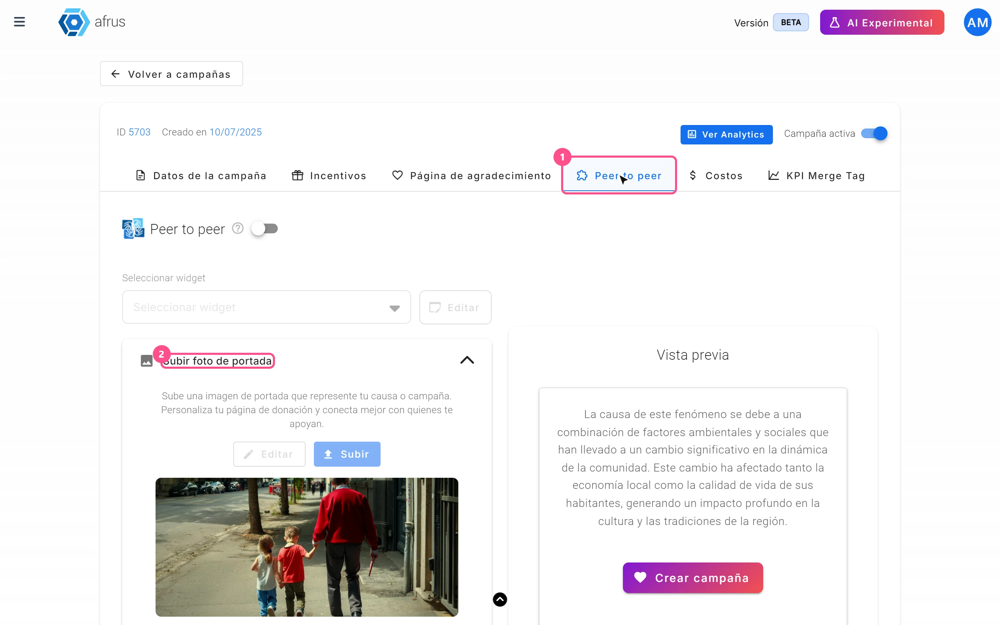
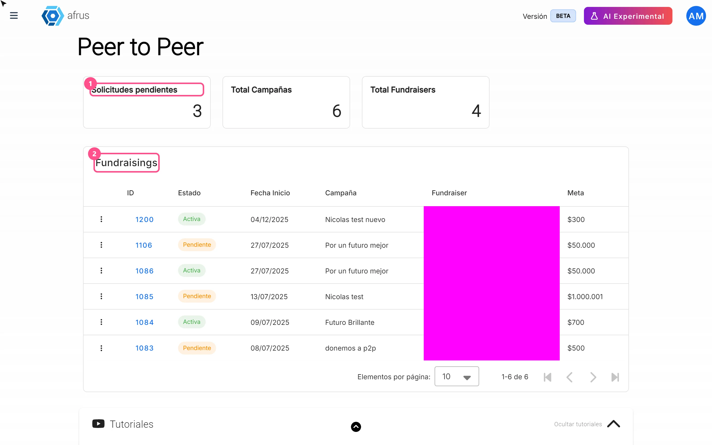

# Guia do Peer to peer

Depois de ler este guia, você vai saber o que é a captação entre pares (peer to peer) na Afrus, para que serve, como trocar suas imagens, o que acontece com um apoiador depois de se cadastrar e como revisar, aprovar e acompanhar as páginas dos seus captadores.

*Módulo: Peer to peer · Menu: **Fundraising > Peer to peer fundraisers** · Público: equipes de captação e de comunidade*

> **Sobre os nomes de tela neste guia:** botões, campos e menus estão escritos exatamente como aparecem na versão em espanhol do console, com a explicação em português quando ajuda.

---

## O que é o Peer to peer

**O Peer to peer permite que seus apoiadores criem a própria página de captação para uma campanha da sua organização.** Chamamos de captador cada apoiador que cria uma página (na tela, *fundraiser*).

Cada página tem sua meta, sua mensagem e seu formulário de doação. Sua organização revisa essas páginas pelo console e decide se aprova, rejeita ou encerra cada uma.

## Para que serve

- **Multiplicar o alcance de uma campanha.** Cada apoiador compartilha sua página pessoal com a própria comunidade.
- **Ver em uma única lista quem está captando.** Você sabe quem criou uma página, em que status ela está e qual é a meta.
- **Controlar o que é publicado.** Você aprova, rejeita ou encerra as páginas dos seus captadores.
- **Atribuir cada doação ao seu captador.** A doação fica vinculada à página de onde veio, e essa página mostra quanto já arrecadou em relação à meta.

## Antes de começar: ative o Peer to peer na sua campanha

Todo o resto depende desta etapa.

1. **Abra a campanha.** Acesse **Fundraising > Campañas**, abra a campanha e vá até a aba **Peer to peer**.
2. **Ligue a chave.** Ela fica ao lado do título "Peer to peer". Você verá o aviso *"Peer to Peer activado"* (Peer to Peer ativado).
3. **Escolha o widget de doação.** Em **Seleccionar widget** (Selecionar widget), escolha o widget que vai aparecer nas páginas dos seus captadores. Assim os doadores de cada página doam pelo formulário que você escolher.
4. **Envie as duas imagens.** Siga a seção "Como trocar as imagens de capa". Enquanto faltar alguma, você verá o aviso **Configuración requerida** (Configuração necessária): *"Para el correcto funcionamiento del módulo peer to peer, asegúrate de subir ambas imágenes."* (Para o módulo funcionar corretamente, envie as duas imagens.)

Ao terminar, todo widget de doação associado a essa campanha mostra, abaixo do formulário, o botão "Crea tu campaña" (Crie sua campanha). Esse botão leva seus apoiadores à página de cadastro de captadores. O texto e a cor do botão (degradê, escuro ou claro) podem ser personalizados na configuração do widget.

> **Importante:** se um widget tiver várias campanhas peer to peer, o botão usa a primeira.

---

# Passo a passo

## Como trocar as imagens de capa

Há dois conjuntos de imagens: os da campanha, que você define pelo console, e os de cada captador, que ele define no editor da própria página.

> **Importante:** as imagens ficam fixas na página do captador no momento em que ele clica em "Publicar". Se você trocar depois as imagens da campanha, as páginas já publicadas não são atualizadas, e o captador não pode editar a página depois de publicada. Por isso, vale deixar as imagens prontas antes de divulgar a campanha.

### Parte 1 — Imagens da campanha (você define)

O Peer to peer precisa estar ativado na campanha: com a chave desligada, os botões de imagem ficam desabilitados.

1. **Abra a aba Peer to peer.** Em **Fundraising > Campañas**, abra a campanha e vá até a aba **Peer to peer**.
   
2. **Escolha qual imagem trocar.** Em **Subir foto de portada** (Enviar foto de capa — a primeira imagem do carrossel superior de cada página) ou em **Subir foto de campaña** (Enviar foto da campanha — a imagem secundária, mais abaixo na página), clique em "Subir" (Enviar) para escolher um arquivo novo, ou em "Editar" para recortar de novo a imagem atual. "Editar" só aparece se já houver uma imagem.
3. **Recorte a imagem.** No recortador você pode escolher a **Relación de aspecto** (Proporção) — **9:16 (Vertical)**, **1:1 (Cuadrado)** (quadrado), **4:3 (Estándar)** (padrão) ou **16:9 (Panorámico)** (panorâmico) — e usar "Rotar a la derecha" (Girar para a direita).
4. **Salve duas vezes.** Clique em "Guardar" (Salvar). Na primeira vez, muda para a pré-visualização de computador (16:9); confira e clique em "Guardar" de novo para enviar a imagem.

Ao terminar, você verá *"Foto de portada actualizada"* (Foto de capa atualizada) ou *"Foto de campaña actualizada"* (Foto da campanha atualizada). Você pode conferir o resultado em "Vista previa" (Pré-visualização).

**Formatos e tamanhos:** são aceitos arquivos jpg, jpeg, png, gif e webp de até 5 MB. A tela recomenda no mínimo 1440 × 530 pixels. Se o arquivo tiver mais de 5 MB ou não for uma imagem válida, você verá *"Error al actualizar la foto de portada"* (ou *"…la foto de campaña"*) — erro ao atualizar a foto. Se a campanha não tiver alguma das duas imagens, a página do captador mostra uma imagem genérica.

> **Dá para desfazer?** Você pode enviar outra imagem quando quiser, mas a mudança só chega às páginas publicadas depois.

### Parte 2 — Imagens do captador (ele define)

Cada captador faz isso no editor que abre depois do cadastro:

5. **Trocar a imagem de capa dele.** Em **Imagen de portada** (Imagem de capa), clicar em "Reemplazar" (Substituir). É a segunda imagem do carrossel superior. Tamanho recomendado: 1080 × 1920 px, menos de 500 KB.
6. **Trocar a foto de perfil.** Em **Foto de perfil**, clicar em "Seleccionar archivo" (Selecionar arquivo). É a foto que aparece ao lado do nome dele. Tamanho recomendado: 1080 × 1080 px, menos de 500 KB.

> **Importante:** por enquanto, o botão "Editar" da imagem de capa do captador não faz nada. Para trocar a imagem, o captador deve usar "Reemplazar".

## O que acontece depois que um apoiador preenche o formulário

Existem dois formulários diferentes: o de cadastro, preenchido por quem quer ser captador, e o de doação, preenchido por quem doa na página de um captador.

### Parte 1 — Um apoiador se cadastra como captador

1. **Preenche o formulário de cadastro.** Pelo botão "Crea tu campaña" do widget, chega à página de cadastro e preenche **Nombre \*** (nome), **Apellido \*** (sobrenome), **Correo electrónico \*** (e-mail), **Teléfono \*** (telefone), **País \*** e **Objetivo de recaudación (en USD)** (meta de arrecadação em USD). Marca **Acepto términos y condiciones** (Aceito os termos e condições) e clica em "INICIAR MI CAMPAÑA SOLIDARIA" (ou "CREAR CAMPAÑA") — iniciar minha campanha.
2. **A página é criada com status Pendente.** Ela aparece na hora na sua lista em **Fundraising > Peer to peer fundraisers** e entra na contagem de **Solicitudes pendientes** (Solicitações pendentes). Se ele deixar a meta em branco, a meta dele é a da campanha. Se esse e-mail já tiver uma página nessa campanha, ele vê *"Ya tienes un diseño para esta campaña"* (Você já tem um design para esta campanha) com o botão "Iniciar sesión" (Entrar).
3. **Monta a página.** Abre o editor. A mensagem vem preenchida com um texto gerado por IA, que ele pode gerar de novo com "✨ Generar mi historia con IA" (Gerar minha história com IA); se não houver texto de IA configurado, é usada uma mensagem padrão. Ele pode enviar suas imagens, escrever a **Mensaje** (mensagem) e adicionar um vídeo em **Agrega un video (Opcional)** (Adicione um vídeo, opcional) → "Insertar" (Inserir).
4. **Publica.** Ao clicar em "Publicar":
   - a página dele é gerada, com um endereço do tipo `web.afrus.org/peer-to-peer-campaign<número>`;
   - o e-mail de contato da sua organização recebe uma mensagem com o assunto *"Tu campana ha sido creada de forma exitosa"* (Sua campanha foi criada com sucesso), com o nome da campanha, o nome do captador, a data e o número da página;
   - o captador vê *"¡Campaña creada exitosamente!"*: *"Tu campaña será aprobada por la organización y te enviarán un correo cuando quede lista para que inicies a empoderar a tu comunidad."* (Sua campanha será aprovada pela organização, e você receberá um e-mail quando estiver pronta.)
5. **Aguarda a aprovação.** Enquanto a página estiver Pendente, se ele tentar entrar no painel verá *"Tu campaña está en revisión, te notificaremos cuando sea aprobada"* (Sua campanha está em revisão; avisaremos quando for aprovada).
6. **Recebe a resposta por e-mail.** Quando você aprova ou rejeita a página, o captador recebe *"Tu campaña fue aceptada"* (aceita) ou *"Tu campaña fue rechazada"* (rejeitada) — sempre em espanhol.
7. **Entra no painel.** Com a página aprovada, ele entra no painel **Mis campañas** (Minhas campanhas) com o e-mail e o telefone. Recebe por e-mail um código de verificação de 6 dígitos, que vence em 10 minutos.

> **Importante:** se o apoiador se cadastrar mas nunca clicar em "Publicar", a solicitação aparece igual na sua lista como **Pendiente**, mas sem página ("Ver página" não abre nada), e sua organização não recebe o e-mail de aviso.

### Parte 2 — Alguém doa na página de um captador

1. **O doador preenche o widget.** A página do captador inclui o widget de doação que você escolheu na aba **Peer to peer**. Funciona como qualquer doação.
2. **A doação é atribuída ao captador.** Fica vinculada à página desse captador e à campanha.
3. **Soma no total da página.** Quando a doação é aprovada, ela soma no **Total recaudado** (Total arrecadado) mostrado na página pública do captador.
4. **Página de agradecimento.** Depois de doar, o doador vê a página de agradecimento ou redirecionamento configurada no widget.

> **Pendente de confirmação:** se o captador ou a sua organização recebem um e-mail a cada doação feita na página de um captador.

## Como ver quem está fazendo Peer to peer, aprovar um captador e saber quanto ele arrecadou

### Parte 1 — Ver quem está captando

1. **Abra o painel.** Acesse **Fundraising > Peer to peer fundraisers**.
   
2. **Leia os cartões.** **Solicitudes pendientes** conta as páginas aguardando aprovação; **Total Campañas**, todas as páginas da lista em qualquer status; **Total Fundraisers**, quantas pessoas diferentes têm páginas.
3. **Confira a tabela Fundraisings.** Ela vem ordenada da mais nova para a mais antiga. Você pode ordenar por **ID**, **Campaña** e **Meta**.

| Coluna | O que mostra |
|---|---|
| Menu de três pontos | "Ver detalle" (Ver detalhes) e "Ver página" (abre a página pública em outra aba) |
| **ID** | Número da página do captador; ao clicar, abre os detalhes |
| **Estado** (Status) | **Activa** (Ativa), **Rechazada** (Rejeitada), **Pendiente** (Pendente) ou **Finalizada** (Encerrada) |
| **Fecha Inicio** (Data de início) | Data de criação da sua campanha, não a data em que o captador se cadastrou |
| **Campaña** (Campanha) | Nome público da campanha |
| **Fundraiser** | Nome, sobrenome e e-mail do captador, ou *Sin usuario asignado* (Sem usuário atribuído) |
| **Meta** | Meta da página |

4. **Abra os detalhes de um captador.** No menu de três pontos, escolha "Ver detalle" (ou clique no **ID**). No topo você verá o endereço da página, com botões para copiá-lo e para "Ver página". Em **Información básica** (Informações básicas) estão a data do cadastro (**Fecha creación de la campaña**), **Nombre**, **Apellido**, **Correo electrónico** e **Número de teléfono**. Em **Origen de contacto** (Origem do contato) estão **Campaña**, **Widget**, **URL página** e **Detalle de la fuente** (Detalhe da origem).

### Parte 2 — Aprovar (ou rejeitar) um captador

Toda página nova começa como **Pendiente** e precisa da sua aprovação: não há aprovação automática.

5. **Abra os detalhes da página.** Na lista, menu de três pontos → "Ver detalle". Antes de decidir, você pode conferir o conteúdo com "Ver página".
6. **Escolha o que fazer.** Os botões dependem do status:
   - **Pendiente:** "Aprobar campaña" (Aprovar), "Rechazar campaña" (Rejeitar) e "Finalizar campaña" (Encerrar).
   - **Rechazada:** "Aprobar campaña" e "Finalizar campaña".
   - **Activa:** só "Finalizar campaña".
   - **Finalizada:** nenhum botão.
7. **Aprove.** Clique em "Aprobar campaña". A ação é imediata, sem confirmação, e você verá *"Campaña aprobada con éxito"* (Campanha aprovada com sucesso). A página passa para **Activa** e o captador recebe o e-mail *"Tu campaña fue aceptada"*; a partir daí ele pode entrar no painel.

   Se depois de aprovar aparecer um erro no lugar dos detalhes, volte para a lista: o status pode já estar como **Activa**, mesmo com o erro na tela.

8. **Ou rejeite / encerre.** "Rechazar campaña" e "Finalizar campaña" pedem confirmação: *"Esta acción eliminará la landing de la campaña y no podrá volver a accederse a la URL. ¿Deseas continuar?"* (Esta ação vai excluir a página da campanha e a URL deixará de funcionar. Deseja continuar?). Ao rejeitar, o status passa para **Rechazada** e o captador recebe *"Tu campaña fue rechazada"*. Ao encerrar, o status passa para **Finalizada** e nenhum e-mail é enviado.

> **Dá para desfazer?** Aprovar não volta para Pendente: uma página ativa só pode ser encerrada. Rejeitar e encerrar são definitivos para a página: o endereço deixa de funcionar. Mesmo que depois você clique em "Aprobar campaña" numa página rejeitada, o status muda para **Activa**, mas a página não é publicada de novo.

### Parte 3 — Saber quanto cada captador arrecadou

9. **Abra a página pública do captador.** Na lista, menu de três pontos → "Ver página". O bloco superior mostra **Total recaudado** (Total arrecadado), a meta e a porcentagem atingida.
   - Soma só as doações aprovadas dessa campanha feitas a partir dessa página; não conta tentativas, pendentes, recusadas nem doações excluídas.
   - Aparece na moeda da sua organização.
   - É calculado ao abrir ou recarregar a página: se ela estiver aberta, recarregue para ver o valor atual.

> **Importante:** por enquanto, o bloco **Total recaudado** dos detalhes no console mostra sempre $0, com ou sem doações, e a lista não mostra valores. Para saber quanto um captador arrecadou, use "Ver página". O mesmo acontece no painel do captador (**Mis campañas**): os cartões mostram 0 e $0, então vale orientá-lo a conferir a própria página pública.

**Total da campanha:** o módulo Peer to peer não tem um total que some todas as páginas. As doações feitas em páginas de captadores são doações da campanha, então contam nos números gerais da campanha em **Fundraising > Campañas**.

---

## Status de uma página de captador

| Status no seu console | Como o captador vê | O que significa | O que você pode fazer |
|---|---|---|---|
| **Pendiente** (Pendente) | En espera (Em espera) | Recém-cadastrada; precisa da sua aprovação | Aprovar, rejeitar ou encerrar |
| **Activa** (Ativa) | Activa | Aprovada pela sua organização | Encerrar |
| **Rechazada** (Rejeitada) | Não aparece | Rejeitada; a página publicada foi excluída | Encerrar |
| **Finalizada** (Encerrada) | Finalizada | Encerrada pela sua organização; a página publicada foi excluída | Nada |

## Limitações conhecidas

- **Total arrecadado no console:** os detalhes de cada página mostram sempre $0, e o painel do captador mostra 0 doações e $0. Para ver o valor arrecadado, abra a página pública com "Ver página".
- **Sem busca nem filtro por status** na lista do console: só dá para ordenar por **ID**, **Campaña** e **Meta**.
- **Símbolo "$":** a coluna **Meta** e o bloco **Total recaudado** do console usam sempre "$", seja qual for a moeda da sua organização.
- **Meta "(en USD)":** o formulário de cadastro pede a meta em USD, mas a página pública a mostra e compara na moeda da sua organização.
- **Fecha Inicio** na lista é a data de criação da sua campanha. A data real do cadastro do captador está nos detalhes, em **Fecha creación de la campaña**.
- **Páginas já publicadas:** mudanças posteriores nas imagens ou no widget da campanha não chegam a elas, e o captador não pode editar a página depois de publicar.
- **Detalhes incompletos:** o campo **Widget** costuma mostrar *No proporcionado* (Não informado) e **Detalle de la fuente** abre vazio.
- **Mensagens de erro:** se o recorte de uma imagem falhar, o aviso pode aparecer como texto técnico; se aprovar, rejeitar ou encerrar falhar, a mensagem pode sair em inglês.
- **E-mails de aprovação e rejeição** para o captador são sempre enviados em espanhol.

## Perguntas frequentes

**Preciso aprovar cada página?**
Sim. Toda página nova começa como **Pendiente** e não há aprovação automática.

**Como consigo o link de cadastro para enviar aos meus apoiadores?**
Hoje ele é acessado pelo botão "Crea tu campaña" dos widgets de doação da campanha.

> **Pendente de confirmação:** se existe outra forma de obter o link de cadastro de captadores pelo console.

**O captador pode mudar a página depois de publicar?**
Não. No painel dele não há opção para editar uma página já publicada.

**As doações dos captadores contam para a minha campanha?**
Sim. São doações da campanha e contam nos números gerais dela.

**Quanto tempo vale o código para entrar no painel do captador?**
10 minutos.

---

> **[Voltar ao índice da seção](./README.md)** · **[Voltar ao índice geral](../README.md)**

*Última atualização: 2026-10-20*
