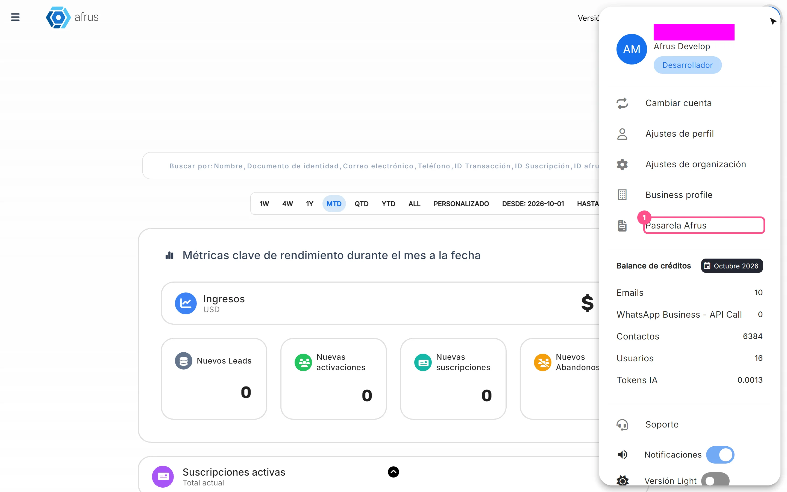
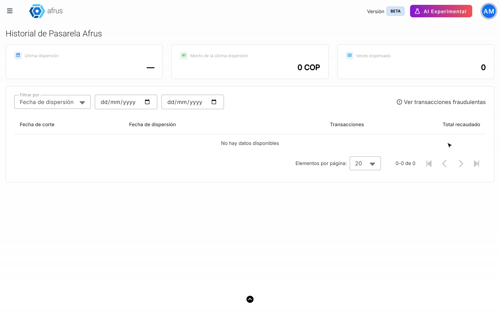

# Guía de Pasarela AFRUS

Con esta guía vas a entender cuánto dinero de tus donaciones te transfiere AFRUS, cuándo te lo transfiere y qué se descuenta en cada transferencia.

*Módulo: Pasarela AFRUS · Menú: **Pasarela AFRUS** (menú de perfil, esquina superior) · Audiencia: equipos de finanzas, contabilidad y dirección*

> **¿No ves esta opción en tu menú?** Solo aparece en las organizaciones que reciben sus donaciones a través de la pasarela de pagos de AFRUS. Si crees que deberías verla, escríbenos.

---

## Qué es la Pasarela AFRUS

**La Pasarela AFRUS es la sección donde ves cada transferencia que AFRUS le hace a tu organización con el dinero de tus donaciones.** A cada una de esas transferencias la llamamos **dispersión**.

Cuando un donante te dona con tarjeta u otro medio de pago a través de la pasarela de AFRUS, el dinero llega primero a AFRUS. Luego, AFRUS te lo transfiere a tu cuenta bancaria, después de descontar la comisión de la pasarela y los costos del banco. En esta sección ves el detalle de cada transferencia.

> **Importante:** esta sección no tiene que ver con lo que tu organización le paga a AFRUS por usar la plataforma (formularios, correos, usuarios, etc.). Ese es un cobro aparte y **no se descuenta de tus dispersiones**.

## Para qué sirve

- **Saber cuánto recibiste y cuándo.** Ves cada transferencia a tu cuenta, con su fecha.
- **Entender los descuentos.** Ves, peso a peso, cuánto se recaudó, cuánto se descontó y por qué.
- **Cuadrar tu contabilidad.** Puedes revisar las donaciones incluidas en cada transferencia y descargar el detalle.
- **Responder preguntas de tu equipo.** Tienes a mano los datos que te pide tu área contable o tu revisor fiscal.

---

# Paso a paso

## Cómo se configura la Pasarela AFRUS

**No tienes que configurar nada.** La sección aparece sola cuando tu organización recibe sus donaciones a través de la pasarela de pagos de AFRUS. Desde ese momento, cada transferencia que te hacemos queda registrada aquí.

Para empezar a usarla:

1. **Abre la sección.** En el menú de perfil (esquina superior), elige **Pasarela AFRUS**.
   

2. **Revisa tus transferencias.** Se abre **Historial de Pasarela AFRUS**. Arriba ves tres resúmenes: **Última dispersión**, **Monto de la última dispersión** y **Veces dispersado** (cuántas transferencias has recibido). Debajo está la lista de tus dispersiones, con las columnas **Fecha de corte**, **Fecha de dispersión**, **Transacciones** y **Total recaudado**.
   

3. **Filtra por fechas (opcional).** En **Filtrar por** elige **Fecha de dispersión** o **Fecha de corte**, y marca la fecha de inicio y la de fin. Así encuentras rápido una transferencia.

> **Consejo:** con "Ver transacciones fraudulentas", arriba a la derecha de la lista, abres la pantalla **Transacciones Fraudulentas**, donde ves las transacciones marcadas como fraude.

> **Pendiente de confirmar:** cada cuánto se hacen las transferencias y cómo pedir que cambie esa frecuencia. Algunas organizaciones las reciben con más frecuencia que otras. Si quieres cambiarla, escríbenos.

## Cómo leer una dispersión

En la lista de **Historial de Pasarela AFRUS**, cada dispersión muestra **Fecha de corte**, **Fecha de dispersión**, **Transacciones** y **Total recaudado**. Además, cada dispersión tiene sus descuentos. Estos son todos los datos:

| Dato | Qué significa |
|---|---|
| **Fecha de corte** | Hasta qué día se incluyeron donaciones en esta transferencia. Por ejemplo, si la dispersión es el 20 de septiembre, la fecha de corte puede ser el 19: entran las donaciones hasta ese día |
| **Fecha de dispersión** | El día en que AFRUS te transfirió el dinero a tu cuenta |
| **Transacciones** | Las donaciones incluidas en esa transferencia |
| **Total recaudado** | Todo lo que donaron tus donantes en ese período, antes de cualquier descuento |
| **Comisión pasarela** | Lo que cobra la pasarela de AFRUS por procesar los pagos: un porcentaje más un valor fijo por cada donación, con su IVA. La tarifa depende de tu contrato |
| **Retención ICA** y **Retención en la fuente** | Descuentos que hace el banco cuando el donante paga con tarjeta. No son cobros de AFRUS |
| Costo de transferencia | El costo fijo de enviar el dinero a tu cuenta bancaria |
| Valor transferido | Lo que finalmente llegó a tu cuenta |

<!-- captura pendiente: como-leer-una-dispersion-01 — detalle de una dispersión con sus montos -->

**En pocas palabras:** Total recaudado − Comisión pasarela − retenciones del banco − costo de transferencia = lo que llega a tu cuenta.

> **Pendiente de confirmar:** los nombres exactos de algunas columnas. Por ejemplo, la comisión puede aparecer como **Total servicio tarjeta** mientras se actualiza la pantalla, y el costo de transferencia y el valor transferido pueden tener otro nombre.

## Cómo ver y descargar las donaciones de cada dispersión

1. **Revisa el detalle.** Además del resumen, la sección muestra los mismos datos para cada donación incluida en la transferencia.
   <!-- captura pendiente: como-descargar-el-detalle-de-una-dispersion-01 — detalle por transacción -->

2. **Descarga el detalle.** Pulsa "Descargar". El archivo trae más información que la que ves en pantalla, por ejemplo la campaña de cada donación. Es el que te conviene enviar a tu área contable.

> **Pendiente de confirmar:** cómo se abre el detalle de una dispersión y en qué formato se descarga el archivo.

---

## Limitaciones conocidas

- **Solo la ven las organizaciones que usan la pasarela de AFRUS.** Si tu organización cobra con otra pasarela (configurada en **Configuración > Pagos > Pasarelas de pago**), no verás esta sección.
- **No incluye el pago de tu plan de AFRUS.** El cobro por usar la plataforma es aparte y no se descuenta de las dispersiones.
- **Las retenciones las define el banco.** AFRUS no puede cambiarlas. Si tu organización no está obligada a alguna retención, debes gestionarlo con el banco.

## Preguntas frecuentes

**¿Por qué recibí menos de lo que donaron mis donantes?**
Porque de cada dispersión se descuentan la comisión de la pasarela, las retenciones del banco y el costo de la transferencia. En el detalle de la dispersión ves cada descuento.

**¿AFRUS me cobra las retenciones de ICA y en la fuente?**
No. Las aplica el banco cuando el donante paga con tarjeta. AFRUS solo te muestra cuánto se descontó.

**¿Pueden descontar de mis dispersiones lo que le debo a AFRUS por la plataforma?**
No. Son dos cobros separados: la pasarela de pagos por un lado y el uso de la plataforma por otro.

**¿Mis donaciones mensuales también aparecen?**
Sí, cada cobro que pasa por la pasarela de AFRUS entra en la dispersión que le corresponde por fecha.

> **Pendiente de confirmar:** si el archivo descargado indica si cada donación es única o mensual.

**Tengo dudas sobre mi tarifa o un descuento. ¿A quién le pregunto?**
Escríbenos con la fecha de la dispersión y te explicamos cada valor.

---

> **[Volver al índice de la sección](./README.md)** · **[Volver al índice general](../README.md)**

*Última actualización: 2026-10-27*
