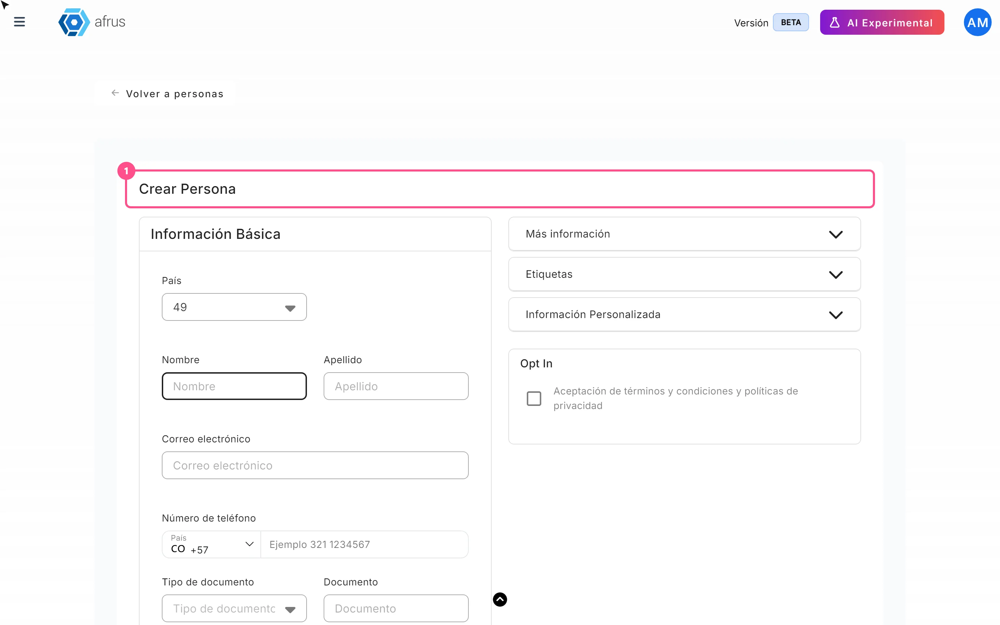
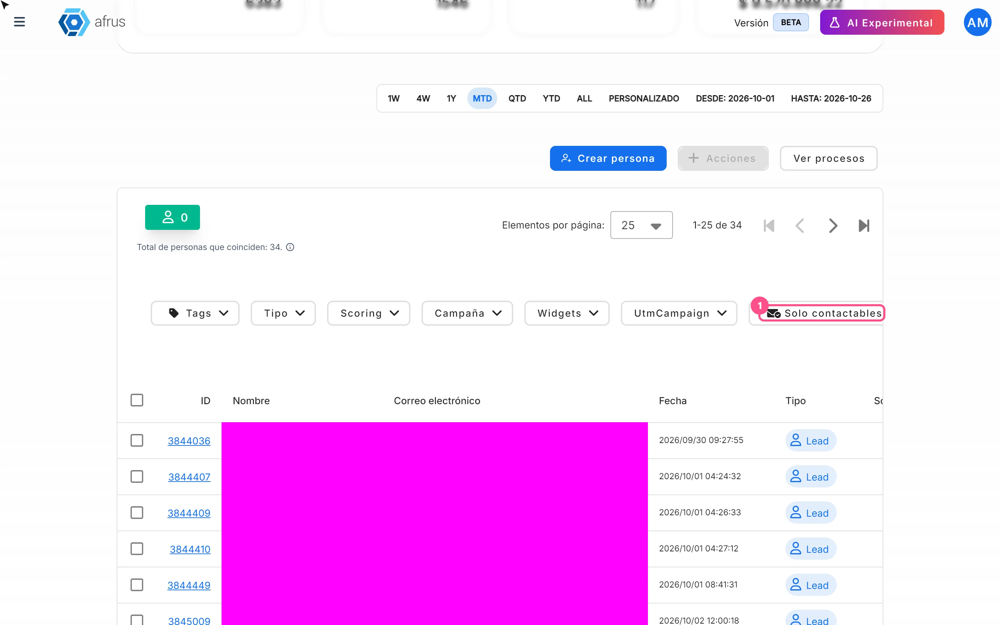
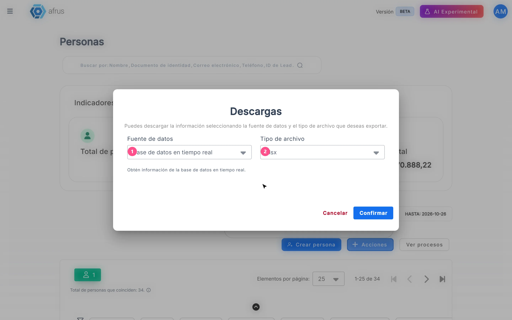
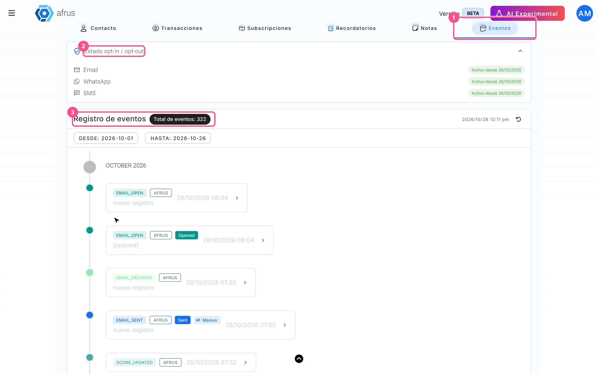
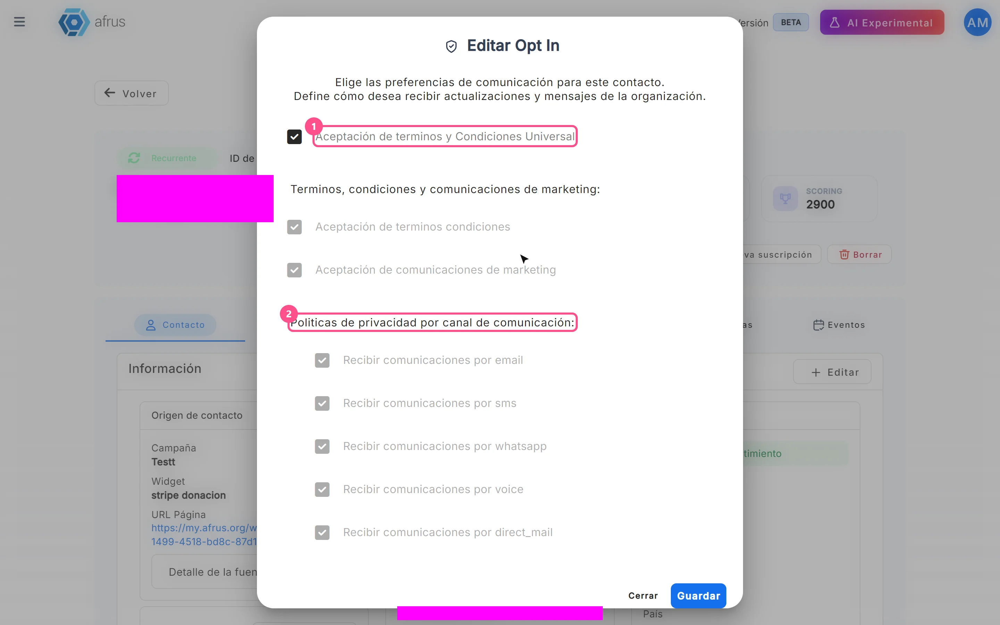
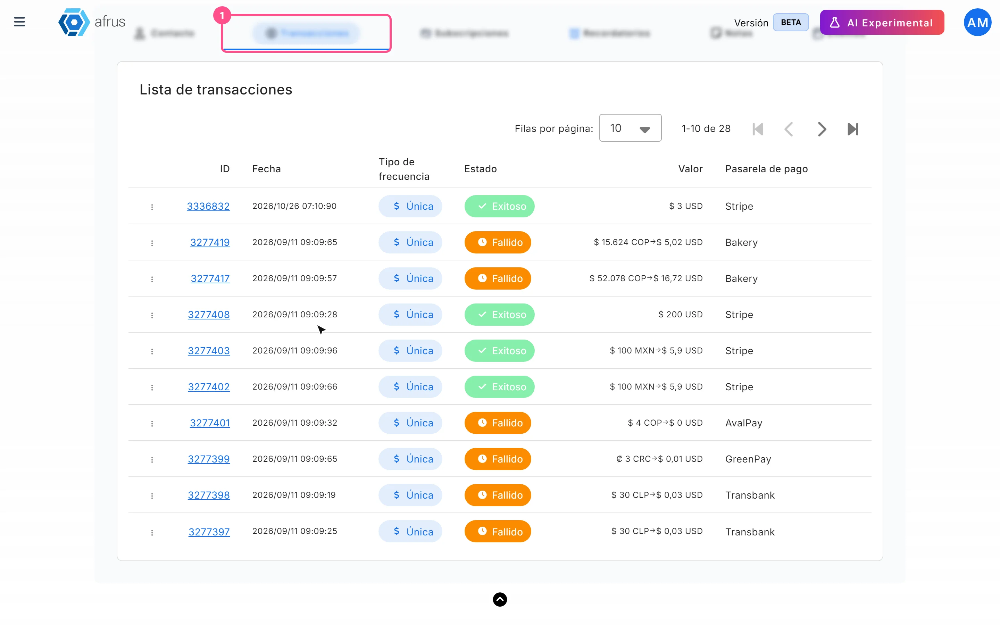
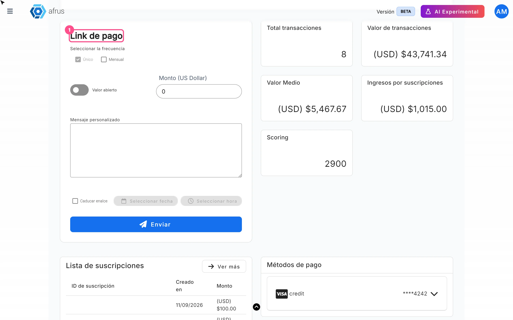

# Guía de Personas

Después de leer esta guía sabrás qué es Personas, para qué te sirve y cómo crear, filtrar, descargar, gestionar y eliminar a tus contactos, además de usar todo lo que ofrece el perfil de cada persona.

*Módulo: Personas · Menú: **Personas** · Audiencia: equipos de recaudación, atención a donantes y comunicaciones*

---

## Qué es Personas

**Personas es la base de contactos de tu organización en AFRUS.** Aquí está cada persona que se registró, donó o que tu equipo creó a mano, con sus datos, etiquetas, consentimientos de comunicación (opt-in), transacciones, suscripciones, notas, recordatorios y el historial de lo que ha hecho.

Al entrar verás los **Indicadores globales** (**Total de personas**, **Activos**, **Suscriptores** y **Monto total**), un buscador, una barra de fechas, los botones "Crear persona", "Acciones" y "Ver procesos", y la tabla de personas. Al hacer clic en el **ID** de una persona se abre su perfil, con las pestañas **Contacto**, **Transacciones**, **Subscripciones**, **Recordatorios**, **Notas** y **Eventos**.

## Para qué sirve

- **Encontrar a tus contactos.** Busca y filtra por etiqueta, tipo, scoring, campaña, widget, UTM, si son contactables y fechas.
- **Conocer a cada persona.** Ve su perfil completo y el historial de todo lo que ha hecho.
- **Registrar y cobrar donaciones.** Registra donaciones manuales, cobra con una tarjeta guardada o crea suscripciones desde su perfil.
- **Respetar sus preferencias.** Gestiona el consentimiento de comunicación (opt-in) por canal.
- **Contactarla directamente.** Envíale un link de pago personalizado o un correo.
- **Trabajar con grupos.** Exporta, etiqueta o elimina grupos de personas.

## Antes de empezar

- **Permisos.** Para eliminar personas tu usuario necesita permiso para editar personas.

---

# Paso a paso

## Cómo crear una persona

1. **Abre el formulario.** En **Personas**, pulsa "Crear persona".
   

2. **Completa los datos.** El **Correo electrónico** es obligatorio y debe tener un formato válido; **Nombre** y **Apellido** solo aceptan letras. También puedes llenar **Número de teléfono**, **Tipo de documento**, **Documento**, **Campaña**, **Widget**, fecha de nacimiento, país, estado, ciudad, código postal, zona horaria, dirección, empresa y **Etiquetas**. Cuantos más datos completes, mejor podrás segmentar después.

3. **Completa los campos personalizados.** En la sección **Información Personalizada** aparecen los campos propios de tu organización.

4. **Registra el consentimiento, si lo dio.** Marca **Aceptación de términos y condiciones y políticas de privacidad** solo si la persona aceptó recibir comunicaciones. Esta casilla acepta **todos** los canales de comunicación a la vez.

5. **Guarda.** Pulsa "Guardar" para volver a la lista, o "Guardar y crear otro" para limpiar el formulario y crear otra persona.

Al terminar verás *"Lead creado con éxito"* y la persona aparecerá en la lista.

> **Importante:** no puedes crear una persona con un correo que ya existe en tu organización. Si lo intentas, el error puede aparecer como el texto técnico `already_exists_email`: significa que ese correo ya está registrado. Búscalo en la lista y edita esa persona.

## Cómo filtrar un grupo de personas

1. **Usa la barra de filtros.** Sobre la tabla tienes **Tags** (una etiqueta), **Tipo** (**Lead**, **Activo** o **Recurrente**), **Scoring** (un rango), **Campaña**, **Widgets**, **UtmCampaign** y el botón "Solo contactables".
   

2. **Busca a alguien en concreto.** En el buscador, elige buscar por **Nombre**, **Documento de identidad**, **Correo electrónico**, **Teléfono** o **ID de Lead**.

3. **Ajusta las fechas.** La barra de fechas filtra por la fecha de creación de la persona.

4. **Revisa o limpia los filtros.** Cada filtro activo aparece como una etiqueta que puedes quitar con la X. Para limpiar todo, pulsa "Restablecer".

Al terminar, la tabla y el texto *"Total de personas que coinciden: N."* se actualizan.

> **Importante:** al abrir la lista, el rango de fechas es **el mes en curso**. En cuanto aplicas un filtro o una búsqueda, el rango pasa a **ALL** (todas las fechas).

- **Widget de origen** y **UTM Campaign de origen** muestran la primera inscripción de la persona. Si filtras por otro widget o UTM y aparece, es porque también pertenece a ese, aunque se registró primero en el que se muestra.
- **Solo contactables** deja fuera los rebotes duros, las bajas y los correos deshabilitados. Por eso los totales pueden ser menores que los de Segmentos.

## Cómo descargar un grupo de personas

1. **Filtra la lista.** Aplica los filtros, la búsqueda y las fechas que necesites.

2. **Elige qué filas exportar (opcional).** Marca las filas que quieras. Si marcas toda la página, aparece el enlace **Seleccionar las N personas de la base.**

3. **Abre la exportación.** Pulsa "Acciones" y elige "Exportar".
   

4. **Elige la fuente de datos.** En **Fuente de datos**, elige **Base de datos en tiempo real** (datos actuales) o **Datos analizados** (*"Estos datos se actualizan cada 24 horas"*).

5. **Elige el formato y confirma.** En **Tipo de archivo** elige xlsx o csv y pulsa "Confirmar".

Al terminar verás *"El proceso de exportacion ha comenzado, ten en cuenta que puede demorar unos minutos en completarse."* con el enlace **Ir a descargas**. El archivo queda en **Data > Descargas** y puedes descargarlo hasta 7 días después de generado.

- Si marcaste filas (sin seleccionar toda la base), se exportan solo esas. Si no marcaste nada o elegiste toda la base, se exportan las personas que cumplen los filtros, la búsqueda y las fechas.
- La exportación en tiempo real incluye una columna por cada campo personalizado.
- Las personas marcadas como spam no se exportan.
- Si ninguna persona coincide verás *"No se encontraron personas que coincidan con los filtros seleccionados. Ajusta los criterios e intenta nuevamente."*

> **Importante:** el filtro "Solo contactables" no se aplica a la exportación: el archivo puede incluir personas no contactables aunque el filtro esté activo. Por ahora no hay una alternativa dentro de esta pantalla; revisa el archivo antes de usarlo para un envío.

## Cómo ver los eventos que ha hecho una persona

1. **Abre el perfil.** En **Personas**, haz clic en el **ID** de la persona.

2. **Entra en la pestaña Eventos.** Arriba verás el **Estado opt-in / opt-out** de cada canal (*"Activo desde …"* o *"No registrado"*).
   

3. **Recorre el historial.** En **Registro de eventos** verás el **Total de eventos**, agrupado por mes. Se cargan 10 eventos y aparecen más al desplazarte. Puedes filtrar por fechas.

4. **Abre un evento.** Haz clic en él para ver su detalle: **ID del evento**, **Monto**, **Score** y, si es un mensaje, la plantilla, el remitente y el destinatario, entre otros datos.

5. **Actualiza la lista si hace falta.** El botón con la hora de la última actualización recarga los eventos.

## Cómo activar o desactivar el opt-in

1. **Abre la ventana de opt-in.** En el perfil de la persona, pulsa "Editar Opt In".
   

2. **Marca o desmarca los consentimientos.**
   - **Aceptación de terminos y Condiciones Universal**: marca todo y bloquea el resto de opciones.
   - **Aceptación de terminos condiciones**.
   - **Aceptación de comunicaciones de marketing**: marca o desmarca todos los canales a la vez.
   - **Recibir comunicaciones por**, canal por canal: email, sms, whatsapp, voice (voz) y direct_mail (correo postal).

3. **Guarda.** Pulsa "Guardar". Así tus envíos respetan lo que la persona aceptó.

Al terminar verás *"El Opt In se ha cambiado correctamente"*. La tarjeta **Opt in** del perfil muestra **Sí** si hay consentimiento en al menos un canal (al pasar el ratón ves cuáles), y la pestaña **Contacto** muestra **Opt In WhatsApp**, **Opt In Email** y **Opt In SMS**.

> **Importante:** mientras **Aceptación de terminos y Condiciones Universal** esté marcada, las demás opciones quedan bloqueadas. Para quitar un canal, primero desmárcala.

> **¿Se puede deshacer?** Sí. Vuelve a abrir "Editar Opt In" y cambia las casillas.

## Cómo eliminar una persona

**Una persona, desde su perfil:**

1. **Abre el perfil y pulsa "Borrar".**
2. **Confirma.** En la ventana *"Eliminar persona"* / *"¿Estás seguro que deseas eliminar esta persona?"*, confirma.

Verás *"La persona se ha eliminado correctamente"* y volverás a **Personas**. Si la persona tenía suscripciones con Débito Recurrente Bancario o Recurrent Payments, se cancelan de inmediato en esa pasarela.

**Varias personas, desde la lista:**

1. **Marca las filas.** Marca al menos una fila, o selecciona toda la base.
2. **Elige Eliminar.** Pulsa "Acciones" y elige "Eliminar". Confirma *"¿Estás seguro de que deseas eliminar a las personas seleccionadas?"*.
3. **Si elegiste toda la base, confirma por escrito.** Aparece *"[CUIDADO] Zona de peligro"* y debes escribir `borrar_toda_la_base` para confirmar.

Verás *"El proceso de borrado de leads ha comenzado, ten en cuenta que puede demorar unos minutos en completarse."*

> **¿Se puede deshacer?** No. *"Esta acción es irreversible. Eliminará permanentemente a la persona, junto con todas sus acciones, eventos, transacciones y suscripciones asociadas."* Si solo quieres dejar de comunicarte con ella, desactiva su opt-in en lugar de borrarla.

> **Pendiente de confirmar:** si al borrar varias personas desde la lista también se cancelan sus suscripciones en la pasarela, y qué pasa con las suscripciones en pasarelas distintas de Débito Recurrente Bancario y Recurrent Payments.

## Cómo ver las transacciones y suscripciones de una persona

1. **Abre el perfil.** En **Personas**, haz clic en el **ID** de la persona.

2. **Revisa el resumen.** En la pestaña **Contacto** verás las tarjetas **Total transacciones**, **Valor de transacciones**, **Valor Medio**, **Ingresos por suscripciones** y **Scoring**.

3. **Abre la pestaña Transacciones.** Verás cada pago con **ID**, **Fecha**, **Tipo de frecuencia**, **Estado**, **Valor**, **Pasarela de pago**, **Metodo de pago**, **Email**, **Widget**, **Campaña**, **URL**, **Campaign Code** y **UTM campaign**. En el menú de cada fila, **Detalles** abre la transacción en otra pestaña y **Reembolsar** aparece solo en transacciones exitosas de pasarelas que permiten reembolsos.
   

4. **Abre la pestaña Subscripciones.** En la *"Lista de Subscripciones"* verás **ID de subscripción**, **Monto**, **Estado** y **Fecha de creación**.

## Para qué sirven y cómo se usan los recordatorios y las notas

**Recordatorios: para no olvidar un seguimiento.** Programas un aviso sobre la persona y, al llegar la fecha, AFRUS te envía un correo (a ti, el usuario que lo creó) con el nombre, el correo y el teléfono de la persona y tu mensaje.

1. **Crea el recordatorio.** En el perfil, pestaña **Recordatorios**, pulsa "Crear recordatorio".
2. **Complétalo.** Escribe **Nombre** y **Mensaje**, elige la fecha en **Seleccionar Fecha** y la hora, y guarda.

Verás *"El recordatorio se ha creado correctamente"*. La *"Lista de recordatorios"* muestra **ID**, **Nombre**, fecha de creación y **Estado**, con filtros por **Estado** (**Creado**, **Completado**, **Programado**, **Todos**) y por fechas. Cada fila se puede editar o eliminar. AFRUS revisa los recordatorios cada 10 minutos, así que el correo puede llegar hasta unos 10 minutos después de la hora elegida; una vez enviado, el estado pasa a **Completado**.

**Notas: para dejar constancia de lo que ya pasó.** Sirven para registrar una interacción que ya ocurrió con la persona, de modo que todo tu equipo tenga el contexto.

1. **Crea la nota.** En el perfil, pestaña **Notas**, pulsa "Crear nota".
2. **Complétala.** Elige la **Categoría** (**General**, **Correo**, **Teléfono** o **Reunión**) y la **Fecha**, y escribe la **Descripción** (hasta 500 caracteres).
3. **Guarda.** Pulsa "Crear nota".

Verás *"La nota se ha creado correctamente"*. La *"Lista de notas"* muestra **Responsable** (quien la creó), **Fecha**, **Categoría** y **Nota**; puedes filtrar por categoría, actualizar y eliminar notas.

## Dónde se ve la información de los campos personalizados

- **En el perfil:** pestaña **Contacto**, tarjeta **Más información**, sección **Información Personalizada**. Cada campo aparece con su valor, o con "-" si está vacío. La sección solo aparece si la persona tiene algún campo personalizado.
- **Al crear o editar:** se completan en la sección **Información Personalizada** de "Crear persona" o de "Editar" (en la pestaña **Contacto**).
- **En la exportación:** salen como columnas al descargar con **Base de datos en tiempo real**.
- **Dónde se definen:** en **Configuración > Avanzado > Campos personalizados**. Esta pantalla se abre en la versión anterior de AFRUS, por eso se ve distinta.

## Cómo enviar links personalizados a una persona

**Antes de empezar:** tu organización necesita un Business profile con URL y un widget predeterminado de donación.

1. **Abre el recuadro de link de pago.** En el perfil de la persona, pestaña **Contacto**, busca el recuadro **Link de pago**. El nombre y el correo de la persona ya vienen puestos.
   

2. **Elige la frecuencia.** En **Seleccionar la frecuencia**, elige **Único** o **Mensual**.

3. **Define el monto.** Escribe el **Monto** (mayor a 0) o activa **Valor abierto** para que la persona elija cuánto donar.

4. **Personaliza el mensaje.** Escribe el **Mensaje personalizado**. Un mensaje cercano aumenta las posibilidades de que done.

5. **Pon fecha de caducidad (opcional).** Marca **Caducar enalce** y elige fecha y hora.

6. **Envía.** Pulsa "Enviar" y confirma *"Desea enviar el link de pago?"*.

Al terminar verás *"¡Link de pago creado con éxito!"* y *"Link de pago enviado exitosamente al siguiente correo: …"*. El enlace lleva a la página de tu Business profile.

- Desde el perfil, el link se envía solo por correo electrónico, al correo de la persona.
- Enviar el link registra a la persona en el widget predeterminado.
- **Otra opción:** el botón "Enviar Mensaje" del perfil envía un correo libre a la persona, con remitente, **Asunto** y **Mensaje**.

## Cómo crear una nueva transacción y una nueva suscripción desde el perfil de una persona

### Nueva transacción

1. **Abre la ventana.** En el perfil, pulsa "Nueva transacción".

2. **Elige el tipo y pulsa "Continuar".**
   - **Electrónica** (*"Pagos con tarjeta, Paypal u otros medios digitales"*): cobra con una tarjeta guardada de la persona o con otro medio configurado.
   - **Manual** (*"Pagos en efectivo, consignación, billetera o cheque"*): registra un pago que ya recibiste fuera de AFRUS.

3. **Completa los datos.**
   - En **Electrónica**: **Método de pago** (la tarjeta usada más recientemente aparece primero, marcada **Usado recientemente**), **Monto**, **Moneda**, **Campaña** y **Widget**.
   - En **Manual**: **Método de pago** (**Efectivo**, **Cheque**, **Transferencia** o **Billetera digital**), **Monto**, **Moneda**, **Referencia (Opcional)**, **Fecha de transacción**, **Fecha de registro en afrus**, **Campaña** y **Widget**. Si el widget es de productos, eliges productos y cantidades y el monto se calcula solo.
   - El **Widget** se elige después de la **Campaña**.

4. **Crea la transacción.** Pulsa "Crear transacción".

Verás *"La transacción se ha creado correctamente"*.

> **Importante:** la opción **Electrónica** solo está disponible si la persona ya tiene una transacción con tarjeta exitosa en una pasarela que permite cobros manuales. Si no, verás *"No hay pasarelas de pago configuradas"*; en ese caso puedes registrar un pago ya recibido con **Manual**.

### Nueva suscripción

1. **Abre la ventana.** En el perfil, pulsa "Nueva suscripción" (se abre la ventana *"Nueva subscripcion"*).

2. **Elige el método de pago y el monto.** En **Metodo de pago** elige una tarjeta guardada de la persona u otro medio configurado, y escribe el **Monto** (obligatorio, mayor a 0).

3. **Elige el día de cobro, si aparece.** Si la tarjeta usa el motor de recurrencias de AFRUS, elige **Fecha automática (recomendada)**, **Fecha de creación de la suscripción** o **Fecha de cobro** (un día del 1 al 28).

4. **Asocia la campaña y el widget.** Elige **Campaña** y luego **Widget**, para que la suscripción cuente en sus resultados.

5. **Crea la suscripción.** Pulsa "Crear subscripcion".

Verás *"La subscripción se ha creado correctamente"* y la suscripción aparecerá en la pestaña **Subscripciones**.

> **Importante:** en esta ventana, las opciones **Modo enhanced** y **Modo de reintentos** no se guardan: la suscripción se crea sin ellas. Por ahora no hay una alternativa dentro de esta ventana.

> **Pendiente de confirmar:** qué pasarelas permiten crear transacciones electrónicas y suscripciones con tarjeta guardada; depende de la configuración de cada pasarela.

---

## Datos y estados

| Dato | Valores |
|---|---|
| **Tipo** | **Lead**, **Activo**, **Recurrente** |
| Estado del correo | **No verificado**, **Verificado**, **Soft Bounce**, **Hard Bounce**, **Opt Out**, **Deshabilitado** |
| Columnas de la lista | **ID**, **Nombre**, **Correo electrónico**, **Fecha**, **Tipo**, **Scoring**, **Total de transacciones ($)**, **Campaña**, **Widget de origen**, **UTM Campaign de origen**, **Tags** |

> **Pendiente de confirmar:** la regla exacta que convierte a una persona en **Lead**, **Activo** o **Recurrente**.

Si el correo rebotó, el perfil muestra *"Tiene Hard Bounce"* o *"Tiene Soft Bounce"*. Si la persona fue marcada como spam, el perfil muestra *"Esta persona fue marcada como spam y está oculta de listas, segmentos, exportaciones y envíos."* con el botón "No es spam".

## Frecuencias y tiempos

| Qué | Cuándo |
|---|---|
| Lista de Personas | Se actualiza al abrirla o cambiar un filtro; el rango inicial es el mes en curso |
| Descarga con **Datos analizados** | Cada 24 horas |
| Archivos en **Data > Descargas** | Disponibles 7 días |
| Exportación y borrado masivo | En segundo plano; puede tardar unos minutos |
| Recordatorios | AFRUS los revisa cada 10 minutos |

## Limitaciones conocidas

- **"Solo contactables" no se aplica a la exportación.** El archivo puede incluir personas no contactables aunque el filtro esté activo.
- **Nueva suscripción:** **Modo enhanced** y **Modo de reintentos** no se guardan.
- **Correo duplicado:** el error puede aparecer como `already_exists_email`; significa que ese correo ya existe en tu organización.
- **Recordatorio con estado vacío:** si el envío de un recordatorio falló, aparece con el **Estado** vacío.
- **Nombres de canal en inglés:** en "Editar Opt In" los canales aparecen como email, sms, whatsapp, voice y direct_mail.

## Preguntas frecuentes

**¿Por qué la lista muestra menos personas de las que esperaba?**
Al abrirla, el rango de fechas es el mes en curso. Aplica cualquier filtro o búsqueda (el rango pasa a **ALL**) o ajusta la barra de fechas.

**¿Por qué no coinciden los totales con y sin "Solo contactables"?**
Porque ese filtro deja fuera los rebotes duros, las bajas y los correos deshabilitados.

**¿Puedo enviar el link de pago por WhatsApp desde el perfil?**
No. Desde el perfil, el link se envía solo por correo electrónico, al correo de la persona.

**¿Puedo recuperar una persona que eliminé?**
No. Eliminar es permanente e incluye sus eventos, transacciones y suscripciones.

---

> **[Volver al índice de la sección](./README.md)** · **[Volver al índice general](../README.md)**

*Última actualización: 2026-10-20*
