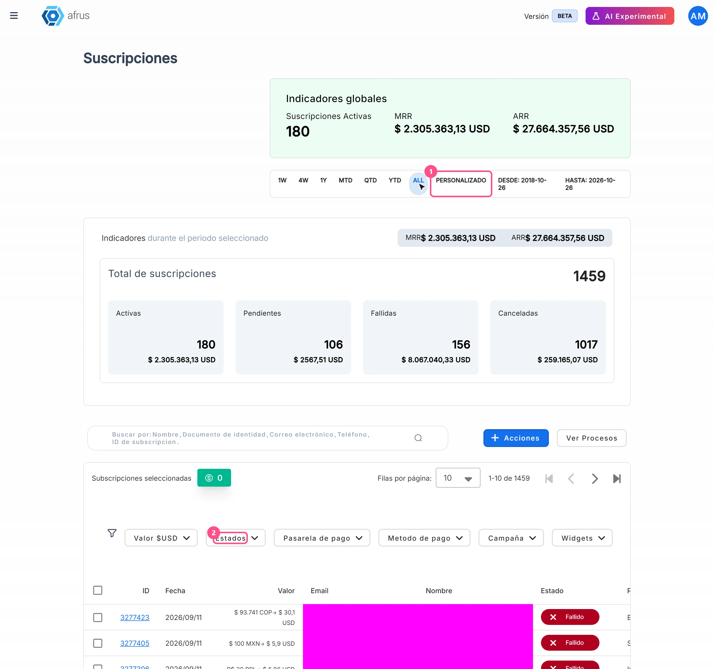
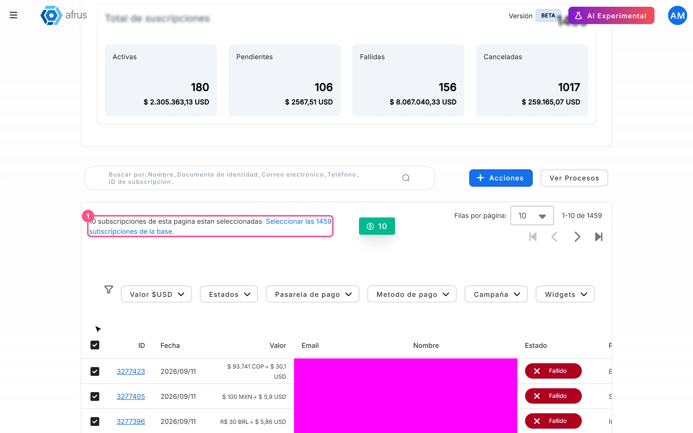
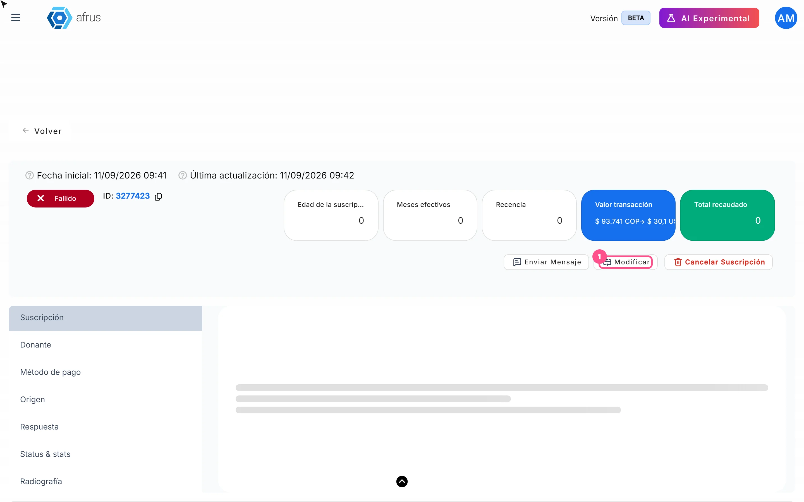
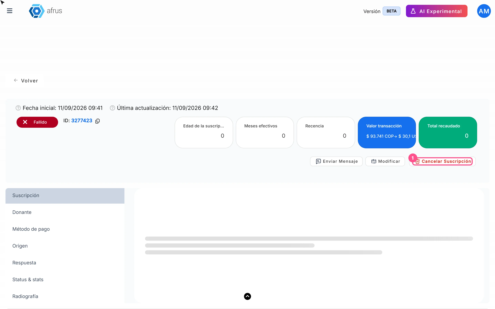
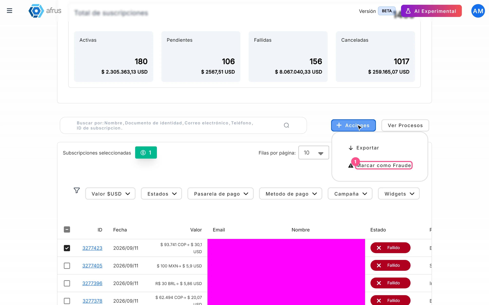

# Guía de Suscripciones

Después de leer esta guía sabrás qué es el módulo Suscripciones, para qué sirve y cómo filtrar, descargar, modificar, cancelar o marcar como fraude las donaciones recurrentes de tu organización.

*Módulo: Suscripciones · Menú: **Suscripciones** · Audiencia: equipos de recaudación, atención a donantes y administración*

---

## Qué es Suscripciones

**Suscripciones es la lista de las donaciones recurrentes de tu organización.** Cada fila es una suscripción, no cada cobro mensual: los cobros de cada mes aparecen en **Transacciones** y en el historial del detalle de la suscripción.

Desde aquí puedes buscar y filtrar suscripciones, exportarlas, marcarlas como fraude y entrar a su detalle para modificarlas o cancelarlas.

## Para qué sirve

- **Saber cuántas suscripciones tienes y en qué estado están.** La columna **Estado** te muestra, por ejemplo, si están activas, fallidas o canceladas.
- **Encontrar la suscripción de un donante.** Busca por nombre, documento, correo, teléfono o ID.
- **Descargar un grupo de suscripciones.** Exporta en Excel las suscripciones que filtraste para analizarlas o compartirlas.
- **Cambiar el monto o la fecha de cobro.** Atiende las peticiones de tus donantes sin que tengan que donar de nuevo.
- **Cancelar una suscripción.** Cuando el donante lo pide.
- **Marcar suscripciones fraudulentas.** Para sacarlas de tus listas y reportes.

## Antes de empezar

- **Permisos.** Para cancelar o modificar suscripciones necesitas permiso para ver y operar suscripciones. Si no ves las opciones, pide acceso al administrador de tu organización.
- **La lista se actualiza al abrirla o al cambiar un filtro.** No se refresca sola mientras la tienes abierta.

---

# Paso a paso

## Cómo filtrar un grupo de suscripciones

1. **Abre el módulo.** Entra a **Suscripciones**.
   

2. **Elige el rango de fechas.** Usa la barra de fechas: **1W**, **4W**, **1Y**, **MTD**, **QTD**, **YTD**, **ALL** o **PERSONALIZADO** (con **DESDE** y **HASTA**). Por defecto verás el mes en curso (**MTD**).

   > **Importante:** el rango filtra por la **fecha de creación** de la suscripción, no por la fecha de cobro. Si buscas una suscripción antigua, amplía el rango (por ejemplo, **ALL**).

3. **Busca un donante (opcional).** Haz clic en **Buscar por**, elige **Nombre**, **Documento de identidad**, **Correo electrónico**, **Teléfono** o **ID de subscripcion**, escribe el valor y pulsa "Buscar". La búsqueda se hace dentro del rango de fechas elegido.

4. **Aplica los filtros de la tabla.** En la fila con el ícono de embudo, elige el filtro, marca lo que necesites y pulsa "Aplicar" (o "Restablecer" para limpiarlo):
   - **Valor:** compara el monto (convertido a la moneda de tu organización) con **Mayor que**, **Igual que** o **Menor que**.
   - **Estados**
   - **Pasarela de pago**
   - **Metodo de pago**
   - **Campaña**
   - **Widgets**
   - **Lapsed:** botón que se activa y desactiva; muestra solo las suscripciones marcadas como caducadas.
   - **Reset:** borra todos los filtros a la vez.

5. **Ajusta cuántas filas ves.** En la paginación puedes mostrar 10, 25, 50 o 100 filas por página.

Al terminar verás la tabla y el contador actualizados. Los filtros quedan guardados en la dirección de la página, así que puedes copiarla y compartirla con tu equipo.

> **Importante:** la lista nunca muestra suscripciones en estado **Fraude**, **Reintentando** ni **Expirada**. Si eliges **Reintentando** o **Expirada** en el filtro **Estados**, el resultado saldrá vacío.

## Cómo descargar un grupo de suscripciones

1. **Filtra las suscripciones.** Ajusta las fechas y los filtros como se explica en "Cómo filtrar un grupo de suscripciones".

2. **Elige qué vas a exportar.** "Exportar" está desactivado hasta que marques al menos una fila.
   - Para exportar solo algunas, marca su casilla.
   - Para exportar todo lo filtrado, marca la casilla de la cabecera (selecciona la página) y luego haz clic en **Seleccionar las N subscripciones de la base.** Verás *"Las N subscripciones de tu base estan seleccionadas"*.
   

3. **Exporta.** Haz clic en "Acciones" y elige **Exportar**.

4. **Confirma.** En la ventana **Descargas**, elige el **Tipo de archivo** y pulsa "Confirmar". Verás *"El proceso de exportacion ha comenzado, ten en cuenta que puede demorar unos minutos en completarse."*

5. **Descarga el archivo.** Cuando esté listo, descárgalo desde **Data > Descargas**. Los archivos se pueden descargar hasta 7 días después de generarse.

Al terminar tendrás un archivo Excel (.xlsx) con una fila por suscripción. Los cobros mensuales no van en este archivo; para eso descarga desde **Transacciones**.

> **Ten en cuenta:**
> - El archivo siempre sale en Excel (.xlsx), aunque elijas CSV.
> - Si marcaste filas sueltas, se exportan solo esas filas, sin aplicar fechas ni filtros.
> - Si exportas toda la base, se aplican las fechas y los filtros **Valor**, **Estados**, **Pasarela de pago**, **Metodo de pago**, **Campaña** y **Widgets**. No se aplican **Lapsed** ni el buscador; si usaste el buscador, la exportación puede fallar. Para un resultado fiable, limpia el buscador antes de exportar toda la base.
> - Si no eliges ningún estado, el total del archivo puede no coincidir con el de la tabla. Para que coincidan, elige en **Estados** los estados que quieres exportar.

## Cómo cambiar la fecha de cobro de una suscripción

1. **Abre la suscripción.** En **Suscripciones**, haz clic en el **ID** de la fila.
   

2. **Pulsa "Modificar".** Según cómo esté conectada la pasarela de esa suscripción, se abre una de estas tres ventanas:

   **Si la ventana se llama "Modificar fecha"** (suscripciones que cobra el motor de AFRUS):
   - Elige una opción:
     - **Fecha automática (recomendada):** deja la fecha que calcula AFRUS.
     - **Fecha de creación de la suscripción:** cobra el mismo día del mes en que se creó (si ese día es mayor que 28, usa el 28).
     - **Fecha manual:** en **Fecha de cobro**, elige un día del 1 al 28.
   - Si el día elegido es posterior a hoy, el próximo cobro será ese día de este mes; si es hoy o anterior, ese día del mes siguiente.
   - También puedes cambiar el monto.

   **Si la ventana se llama "Modificar Suscripción" y muestra "Fecha actual de cobro:"**:
   - En **Fecha**, elige la nueva fecha de cobro (debe ser posterior a hoy) y, si quieres, cambia el **Monto**.

   **Si la ventana se llama "Modificar Suscripción" sin "Fecha actual de cobro:"**:
   - En **Fecha**, elige la nueva fecha de cobro (desde mañana) y, si quieres, cambia el **Monto** (mayor a 0).

3. **Guarda y confirma.** Pulsa "Guardar" y después confirma ("Confirmar", "Confirmar modificación" o "Actualizar Suscripción", según la ventana).

Al terminar verás *"Suscripción actualizada correctamente."* o *"Suscripción actualizada exitosamente"*. Si la suscripción estaba **Activa**, sigue **Activa**.

> **Ten en cuenta:**
> - En la ventana **Modificar fecha**, el mensaje de confirmación aparece en inglés (*"Update subscription"*); es normal.
> - Algunas pasarelas no permiten cambios desde AFRUS. En ese caso verás *"Este gateway actualmente no soporta la actualización de suscripciones."*
> - Las suscripciones que esperan la aceptación del pagador no se pueden modificar: verás *"Acción no disponible"*.
> - Con la pasarela Recurrent Payments no hay campo de fecha. La pantalla informa: *"Los pagos recurrentes se realizan el primer día hábil de cada mes. Si el pago falla, se reintenta semanalmente hasta que sea exitoso."*

> **¿Se puede deshacer?** Sí. Puedes volver a pulsar "Modificar" y poner la fecha o el monto anteriores.

## Cómo cancelar una suscripción

**Antes de empezar:** solo se pueden cancelar suscripciones en estado **Activa** o **Fallido** (con algunas pasarelas, también **Pendiente** y **Revisión pendiente**). El botón aparece en cualquier estado, pero en los demás la cancelación da error.

1. **Abre la suscripción.** En **Suscripciones**, haz clic en el **ID** de la fila.

2. **Pulsa "Cancelar Suscripción".** Es el texto en rojo del detalle.
   

3. **Confirma.** En la ventana *"¿Estás seguro de que deseas cancelar tu suscripción?"*, pulsa "Confirmar" (o "Cerrar" para salir sin cancelar).

Al terminar verás *"La suscripción se ha cancelado correctamente"*. La suscripción pasa a **Cancelada** y se borran los cobros pendientes que AFRUS tenía programados. La cancelación es inmediata; no existe la opción de cancelar al final del período.

> **¿Se puede deshacer?** No. No hay botón para reactivar la suscripción: como avisa la ventana, *"no podrá ser reactivada automáticamente"*. Si el donante quiere volver, tendrá que crear una nueva donación recurrente.

> **Si algo falla:**
> - Si ves *"Error al cancelar la suscripción"*, revisa el estado. Según cómo esté conectada tu organización, algunas pasarelas tampoco permiten cancelar desde AFRUS.
> - Si al pulsar "Confirmar" no pasa nada y no aparece ningún mensaje, la suscripción no se canceló.
>
> En ambos casos, escribe a soporte de AFRUS con el ID de la suscripción.

> **Ten en cuenta:** aunque la ventana dice que se notificará al donante, el aviso depende de su banco emisor, que es quien puede informarle de la reversión. Por eso es mejor que tu organización le avise.

## Cómo marcar como fraude una suscripción

> **Importante:** marcar como fraude hace tres cosas a la vez: la suscripción pasa a **Fraude**, desaparece de la lista **Suscripciones** y **la persona donante asociada se elimina de tu base de Personas**. No se puede deshacer.

**Antes de empezar:** marcar como fraude solo cambia el estado dentro de AFRUS; no cancela nada en la pasarela de pago. Si la pasarela cobra por su cuenta (por ejemplo Stripe), **cancela primero la suscripción** (ver "Cómo cancelar una suscripción") para que no se sigan haciendo cobros.

1. **Selecciona las suscripciones.** En **Suscripciones**, marca la casilla de cada una. Sin ninguna marcada, las opciones de "Acciones" están desactivadas.

2. **Elige la acción.** Haz clic en "Acciones" y elige **Marcar como Fraude**.
   

3. **Confirma.** En la ventana **Marcar como fraude** pulsa "Confirmar". La ventana habla de "transacción(es)": es normal, aplica a las suscripciones que marcaste.

Al terminar verás *"Transacciones marcadas como fraude"* y la tabla se recargará sin esas suscripciones.

> **¿Se puede deshacer?** No. La pantalla lo advierte y no hay botón para revertirlo.

> **Ten en cuenta:** si usaste **Seleccionar las N subscripciones de la base**, solo se marcan las filas de la página actual, aunque el mensaje mencione más. Marca las suscripciones página por página.

---

## Cada cuánto se cobran las recurrencias

Depende de la pasarela de pago de cada suscripción:

| Caso | Quién decide la fecha | Qué sabemos |
|---|---|---|
| Pasarelas que cobran por su cuenta (Stripe, PayU, Pagar.me) | La pasarela | La pasarela decide cuándo cobra, no AFRUS |
| Recurrent Payments | La pasarela | La pantalla informa: el primer día hábil de cada mes; si falla, reintento semanal hasta que sea exitoso |
| Suscripciones que cobra el motor de AFRUS | AFRUS | Puedes elegir el día de cobro con "Modificar" (ver "Cómo cambiar la fecha de cobro") |

Además, en **Ajustes de Organización > Servicio de recurrencia** (pantalla **Configuración del Motor de Recurrencia**) tu organización puede elegir **Modo mejorado** (Standard o Charities), **Periodicidad** (Mensual, Trimestral, Semestral o Anual) y **Modo de reintento** (Standard retries, Charities retries o Custom). La pantalla indica: *"Los cambios se aplicarán a los próximos ciclos de cobro."*

> **Reintentos y cancelación:**
> - **Recurrent Payments:** se hacen de 7 a 10 intentos de cobro al mes y se cobra de forma mensual, sin límite, hasta que tu organización cancele la suscripción.
> - **Tarjetas de crédito:** se hacen 5 reintentos durante 12 meses seguidos antes de cancelar la suscripción.

## Estados de una suscripción

| Estado (columna **Estado**) | Nota | ¿Aparece en la lista? |
|---|---|---|
| **Activa** | | Sí |
| **Pendiente** | También se muestra así cualquier estado que la pantalla no reconoce | Sí |
| **Fallido** | | Sí |
| **Cancelada** | | Sí |
| **PRENOTIFICATION_OK** (en el filtro, **Prenotificada**) | Espera la aceptación del pagador; no se puede modificar | Sí |
| **Pendiente de confirmación** | | Sí |
| **Rechazada** | | Sí |
| **Revisión pendiente** | Hay datos del pagador por corregir (ver abajo) | Sí |
| **TRIALING** (en el filtro, **Reintentando**) | | No |
| **LAPSED** (en el filtro, **Expirada**) | Expirada o caducada | No |
| **Fraude** | Marcada como fraude | No |

**Revisión pendiente:** junto al estado aparece un lápiz. Haz clic, completa **Número de documento**, **Tipo de documento**, **Número de cuenta**, **Banco**, **Tipo de cuenta** y **Monto** en **Editar datos del pagador**, y pulsa "Guardar y reenviar". Verás *"Datos del pagador actualizados y reenvío iniciado"*.

## Preguntas frecuentes

**¿Por qué no encuentro una suscripción que sé que existe?**
Revisa el rango de fechas: filtra por la fecha de creación de la suscripción. Prueba con **ALL**. Recuerda también que las suscripciones en **Fraude**, **Reintentando** o **Expirada** no aparecen en la lista.

**¿Dónde veo los cobros de cada mes?**
En **Transacciones**, o en el historial del detalle de la suscripción.

**¿Puedo cancelar al final del período?**
No. La cancelación desde AFRUS es siempre inmediata.

**¿Puedo reactivar una suscripción cancelada?**
No. El donante tendrá que crear una nueva donación recurrente.

---

> **[Volver al índice de la sección](./README.md)** · **[Volver al índice general](../README.md)**

*Última actualización: 2026-10-27*
