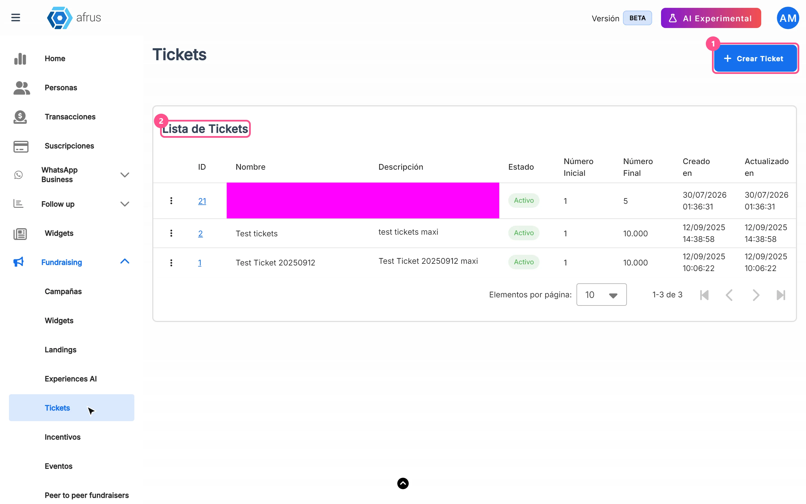
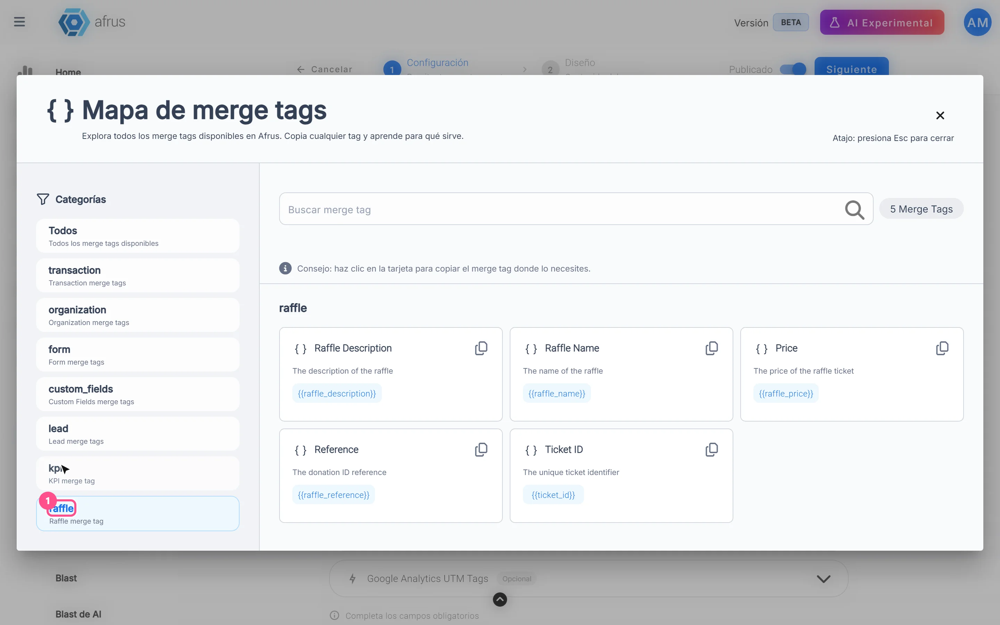

# Tickets guide

After reading this guide you will know what raffle Tickets are in AFRUS, how to sell them with a product widget and how to send each buyer their numbers in the autoresponder.

*Module: Tickets · Menu: **Fundraising > Tickets** · Audience: fundraising, events and communications teams*

> **About the labels in this guide:** buttons, fields and menus are written exactly as they appear in the Spanish version of the console, with an English explanation where it helps.

---

## What Tickets are

**A Ticket is a raffle with a range of numbers, for example from 1 to 500.** When you link it to a product widget, each buyer receives one consecutive ticket number for every unit they buy.

> **Important:** selling event tickets with a QR code is not available yet. Today, **Tickets** is used for raffles.

## What it is for

- **Selling raffle numbers online.** You sell them from a widget, with a price per ticket.
- **Assigning numbers automatically.** Each buyer receives their numbers, and you can show them on the thank-you page and in the autoresponder.
- **Knowing who bought each number.** You see the person, transaction, widget and country of each ticket, so you can hold the draw and contact the winner.

## How often it updates

- **Numbers are assigned instantly**, at the moment the purchase is recorded in the widget.
- **Screens show the data when you open them.** The **Tickets generados por transacción** (Tickets generated per transaction) list and the **Productos y tickets** (Products and tickets) section of the widget dashboard read the data when you open the screen or change a filter. There is no process to wait for.
- **They don't refresh on their own.** To see new purchases, reload the screen or search again.

---

# Step by step

## How to create a product widget

To sell tickets you need two things: the raffle (the Ticket, with its number range) and a widget with the **Producto** (Product) goal that sells it.

### Part 1 — Create the raffle

1. **Open Tickets.** Go to **Fundraising > Tickets** and click "Crear Ticket" (Create Ticket).
   

2. **Name it.** Fill in **Nombre** (Name, at least 3 characters).

   > **Important:** to be able to add the raffle to a widget, the name must not exceed 25 characters and the description 80.

3. **Write a description.** Fill in **Descripción** (Description, up to 500 characters). Although the screen doesn't mark it as required, if you leave it empty you'll see *"Error al crear ticket"* (Error creating ticket).

4. **Choose the status.** In **Estado** (Status), leave **Activo** (Active) — it's the default option.

5. **Set the range.** In **Rango** (Range), enter **Número Inicial** (Start number, at least 1) and **Número Final** (End number), which must be greater than the start number. The first buyer receives the start number.

6. **Create the raffle.** Click "Crear Ticket". You'll see *"Ticket creado exitosamente"* (Ticket created successfully) and the raffle will appear in the **Lista de Tickets** (Ticket list) with its **ID**.

### Part 2 — Create the widget that sells it

7. **Create a new widget.** Go to **Fundraising > Widgets** and click "Nuevo widget" (New widget). The widget editor opens in a new tab.

8. **Choose the Product goal.** In **Objetivo** (Goal), choose **Producto**. Only widgets with this goal assign ticket numbers.

   > **Pending confirmation:** exactly which editor screen is used to choose the goal and add the **Producto** block.

9. **Add the product.** Add the **Producto** block and click "Agregar Producto" (Add product). In **Tipo de Producto** (Product type), choose **Ticket**.

10. **Choose the raffle.** In **Seleccionar Ticket** (Select ticket), choose your raffle. The **Nombre del producto** (product name), **Descripción del producto** (product description), **Límite Inicial** (start limit), **Límite Final** (end limit) and **Stock del producto** (product stock) are filled in automatically and can't be edited.

11. **Set the price.** Type the **Precio del producto** (product price): it's the price of each ticket. Numbers only. The screen doesn't require it, so check that you set it.

12. **Confirm the product.** Click "Agregar Producto". You'll see *"¡Producto agregado satisfactoriamente!"* (Product added successfully).

13. **Save and publish the widget.** Do it as with any other widget.

When you finish, donors choose how many tickets they want in the widget. On the final page they see one card per ticket, with **Cantidad** (Quantity), **Precio unitario** (Unit price) and the label "Ticket <number>".

> **Important:** each widget accepts only one raffle, and regular products can't be mixed with tickets in the same block (*"No se pueden mezclar tipos de productos"*).

## How to include the ticket number and the number of tickets bought in my autoresponder

**Before you start:** you need a transaction autoresponder (email or WhatsApp) that is sent for purchases made in your product widget with a ticket.

1. **Open your autoresponder editor.** Go to **Interacciones > Autoresponders** and open the autoresponder.
2. **Open the merge tag map.** Open **Merge tags** (**Mapa de merge tags**) and find the **Merge Tags de Rifas** (Raffle merge tags) category. Clicking a card copies the merge tag.
   
3. **Paste the merge tags into your text.** Write them exactly like this:

   | Merge tag | Name in the map | What it shows |
   |---|---|---|
   | `{{ticket_id}}` | Ticket ID | **All** ticket numbers from that purchase, separated by commas (e.g. `0042, 0043, 0044`) |
   | `{{raffle_name}}` | Raffle Name | Raffle name |
   | `{{raffle_description}}` | Raffle Description | Raffle description |
   | `{{raffle_price}}` | Price | Price of one ticket |
   | `{{raffle_reference}}` | Reference | Transaction number (donation ID) |

4. **Show the quantity with the numbers.** There is no quantity merge tag. Since one number is generated per ticket bought, the quantity equals how many numbers appear in `{{ticket_id}}`. For example: *"Your numbers for the {{raffle_name}} raffle are: {{ticket_id}}"*.

When the email or WhatsApp is sent, each merge tag is replaced with that purchase's data. You can use the same merge tags on the thank-you page.

> **Important:** the map also shows "Número de Ticket" and "Fecha de Sorteo" (draw date), but they don't match any real raffle merge tag. Use only the ones in the table.

> **Pending confirmation:** whether, with some payment types, the autoresponder can go out before the numbers exist. Make a test purchase to check your message.

## How to see who bought each number

1. **Open the raffle.** In **Fundraising > Tickets**, click the raffle's **ID**. **Tickets generados por transacción** opens.
2. **Adjust the dates.** By default it shows from the start of the month to today.
3. **Filter if needed.** In **Buscar por** (Search by), choose **ID de Lead** (Lead ID), **ID de Donación** (Donation ID), **Email de Lead** (Lead email), **Nombre de Ticket** (Ticket name) or **Descripción de Ticket** (Ticket description), type the value and press Enter.

You'll see one row per number, with **ID de Ticket** (Ticket ID), **Nombre**, **Precio**, **ID de Donación**, **ID de Lead**, **Cantidad** (always 1), **Nombre de Widget** and **Código de País** (country code).

---

## Data and statuses

| Data | What it means |
|---|---|
| **Activo** / **Inactivo** (Active / Inactive) | Just a label. An **Inactivo** raffle that is already in a published widget keeps selling |
| **ID de Ticket** | Assigned number, padded with leading zeros to the length of the end number (with end number 500, 42 shows as `042`) |
| **Cantidad** | Always 1 per row: each ticket bought is one row |
| **Tickets vendidos** (Tickets sold, widget dashboard) | Tickets sold in **successful** purchases in the period |

## Frequently asked questions

**Can I sell event tickets with QR codes?**
Not yet. That feature is in development.

**Is there a merge tag with the number of tickets bought?**
No. Use `{{ticket_id}}`, which lists all the numbers from the purchase.

**Can I put two raffles in the same widget?**
No. Each widget accepts only one raffle.

---

> **[Back to section index](./README.md)** · **[Back to main index](../README.md)**

*Last updated: 2026-10-20*
