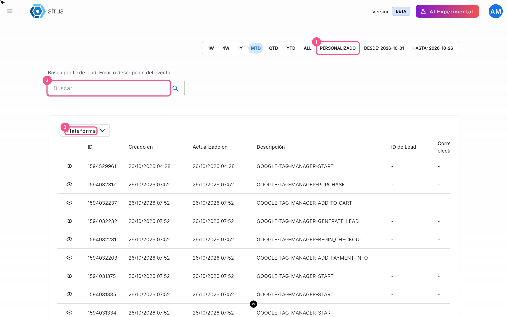
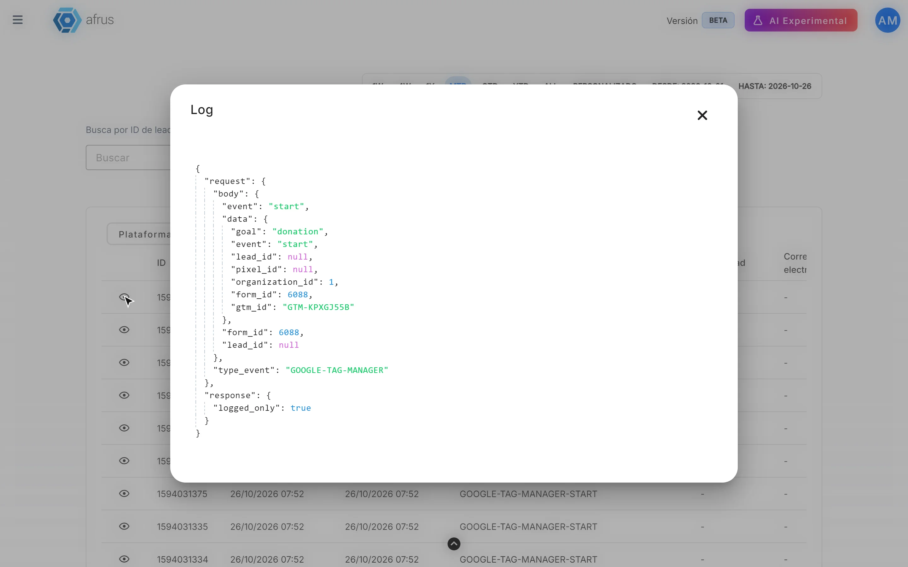

# Guía de Logs de analytics

Con esta guía vas a poder comprobar que tus formularios de donación están avisando a Google Analytics 4, a Meta (Facebook) o a Google Tag Manager cada vez que alguien empieza o completa una donación.

*Módulo: Trackers · Menú: **Trackers > Logs de analytics** · Audiencia: equipos de marketing digital y pauta*

---

## Qué es Logs de analytics

**Es el registro de cada aviso que tus formularios de donación enviaron a Google Analytics 4, a Meta o a Google Tag Manager.**

Si tienes conectada alguna de esas herramientas a un formulario (widget), cada vez que una persona abre el formulario, avanza un paso o completa su donación, AFRUS le avisa a esa herramienta. A cada aviso se le llama **evento**. Esta pantalla muestra cada evento, qué se envió y qué respondió la herramienta.

Si tu formulario no tiene ninguna de esas herramientas configurada, no se envía nada y esta pantalla queda vacía.

## Para qué sirve

- **Comprobar que tu medición funciona.** Ves si los eventos de tus formularios están saliendo hacia Google o Meta.
- **Encontrar errores de configuración.** Por ejemplo, si al formulario le faltan los datos de conexión de Google o de Meta.
- **Revisar los eventos de una persona.** Útil para comprobar una donación de prueba.

---

# Paso a paso

## Qué información encuentro allí y cómo analizarla

1. **Haz una donación de prueba** en tu formulario, o espera a que lleguen donaciones reales.

2. **Abre la pantalla.** Entra a **Trackers > Logs de analytics** y elige un rango de fechas que incluya tu prueba. Al abrirla se muestra el mes en curso.
   

3. **Busca a la persona.** Escribe su correo o su ID en el buscador y pulsa la **lupa**. Con Enter no busca.

4. **Lee la columna Descripción.** Te dice a qué herramienta se envió el evento y cuál fue:
   - `GOOGLE-…` es Google Analytics 4.
   - `FACEBOOK-…` es Meta.
   - `GOOGLE-TAG-MANAGER-…` es Google Tag Manager.

5. **Abre el detalle.** Pulsa el ícono del ojo en la fila. La ventana **Log** muestra lo que se envió y lo que respondió la herramienta.
   

**Qué evento es cada uno** (la parte final de la **Descripción**):

| Termina en | Qué pasó en el formulario |
|---|---|
| `START` | Se abrió el formulario |
| `ADD_TO_CART`, `BEGIN_CHECKOUT`, `ADD_PAYMENT_INFO`, `GENERATE_LEAD` | La persona avanzó un paso con el botón de continuar |
| `PURCHASE` | El pago se confirmó |
| `REGISTER` | La persona se registró en un formulario de registro |

**Cómo leer la respuesta en la ventana Log:**

- **Meta:** si funcionó, verás lo que devolvió Meta. Si falló, verás `success: false` y un mensaje con el motivo, por ejemplo que al formulario le faltan los datos del Pixel.
- **Google Analytics 4:** si ves `missing_ga_credentials`, al formulario le faltan los datos de conexión con GA4 y **el evento no se envió**. Si ves `success: false`, Google respondió con un error. Si no hay error, Google recibió el aviso; para confirmar que lo registró, mira el informe en tiempo real de GA4.
- **Google Tag Manager:** lo normal es ver `logged_only: true`. AFRUS solo anota el evento aquí; a Tag Manager le llega directamente desde el navegador de la persona.

Si tienes activa la conversión de Meta desde AFRUS, también verás filas `FACEBOOK-…` creadas por AFRUS después de cada pago.

---

## Limitaciones conocidas

- **El filtro de Google Analytics no muestra nada.** En el filtro **Plataforma**, la opción **Google Analytics** no trae resultados. Para ver solo los eventos de GA4, no uses ese filtro: escribe en el buscador `google` y el evento (por ejemplo `google purchase`) y pulsa la lupa.
- **Algunos tipos de evento siempre salen vacíos.** En **Tipo de evento**, solo encuentran resultados **Start** / **View Content**, **Add to Cart**, **Begin Checkout** / **Initiate Checkout**, **Add Payment Info** y **Purchase**. Las demás opciones salen vacías porque los formularios no envían eventos con esos nombres.
- **La hora no dice si es de mañana o de tarde.** Se muestra en formato de 12 horas sin AM/PM.
- **La columna ID de Campaña siempre aparece vacía.**
- **Al usar un filtro, las fechas pasan a "ALL"** (todas las fechas).
- **Si cambias un segundo filtro y la lista no cambia,** pulsa la lupa para recargar.
- **La lista empieza por los eventos más antiguos** del rango elegido.
- **Si borras un formulario,** sus eventos dejan de registrarse aquí.
- **La pantalla no se actualiza sola.**

## Preguntas frecuentes

**No veo ninguna fila de mi formulario. ¿Qué pasa?**
Lo más probable es que el formulario no tenga configurado Google Analytics 4, el Pixel de Meta ni Google Tag Manager. Sin esa configuración no se envía nada.

**¿Cuánto tarda en aparecer un evento?**
> **Pendiente de confirmar:** no hay un tiempo fijo.

**¿Cuánto tiempo se guardan estos registros?**
> **Pendiente de confirmar:** cuánto tiempo se conserva el historial.

---

> **[Volver al índice de la sección](./README.md)** · **[Volver al índice general](../README.md)**

*Última actualización: 2026-10-26*
