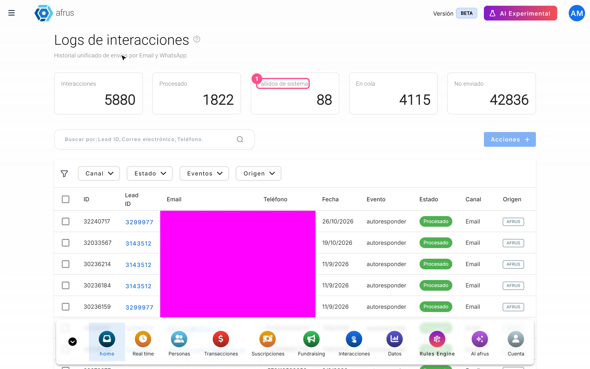
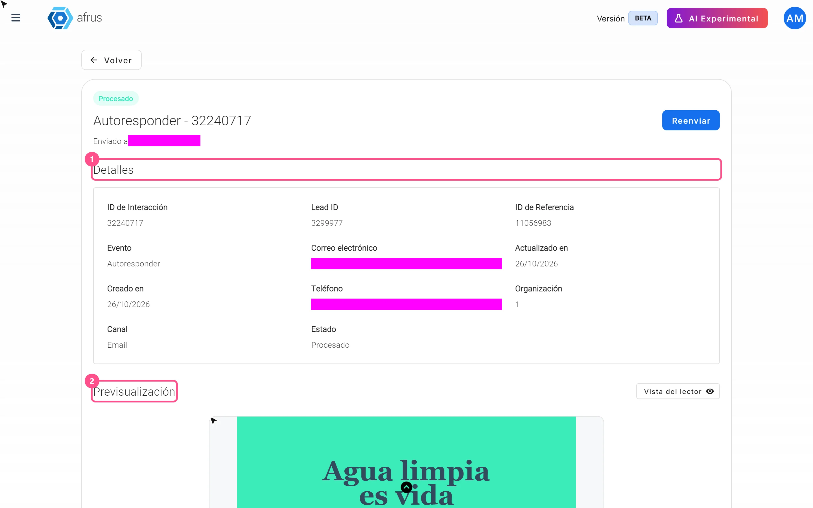

# Guia de Logs de interacciones

Com este guia, você vai conseguir conferir se um e-mail ou um WhatsApp foi enviado a uma pessoa pela AFRUS, ver o que foi enviado e reenviar se deu erro.

*Módulo: Trackers · Menu: **Trackers > Logs de interacciones** (Logs de interações) · Público: equipes de comunicação e atendimento a doadores*

> **Sobre os nomes de tela neste guia:** botões, campos e menus estão escritos exatamente como aparecem na versão em espanhol do console, com a explicação em português quando ajuda.

---

## O que é Logs de interacciones

**É o histórico de cada e-mail e cada WhatsApp que a AFRUS preparou para uma pessoa, com o status de envio.**

Toda vez que a AFRUS prepara uma mensagem para alguém (por exemplo, um e-mail automático de agradecimento ou um envio em massa), ela cria uma linha nesta lista. Ali você vê para quem era, por onde saiu e se foi enviada corretamente.

## Para que serve

- **Responder a um doador que diz que não recebeu um e-mail.** Você busca o e-mail dele e vê se foi enviado, quando e de onde.
- **Ver o que foi enviado.** Você pode abrir a prévia da mensagem como ela saiu.
- **Encontrar envios com erro e reenviá-los.**

---

# Passo a passo

## Que informação encontro ali e como analisá-la

### Parte 1 — Encontre a pessoa

1. **Abra a tela.** Acesse **Trackers > Logs de interacciones**.
   

2. **Busque a pessoa.** No campo de busca, escolha **Lead ID**, **Correo electrónico** (e-mail) ou **Teléfono** (telefone) e digite o dado **completo e exato**. Se digitar só uma parte, ela não aparece.

3. **Filtre se precisar.** Você pode filtrar por **Canal** (**Email** ou **WhatsApp**), por **Estado** (Status), por **Eventos** (de onde a mensagem saiu) e por **Origen** (Origem). Escolha só uma opção por filtro (veja Limitações).

4. **Leia a coluna Estado.** Ela diz o que aconteceu com a mensagem (veja a tabela abaixo).

5. **Veja a mensagem.** Clique em "Ver detalle" (Ver detalhe) para ver a data e a hora exatas e a prévia do e-mail ou do WhatsApp.
   

**O que significa cada status:**

| Status | O que significa |
|---|---|
| **Procesado** (Processado) | A AFRUS entregou a mensagem ao serviço de e-mail ou de WhatsApp sem erro. **Não confirma** que chegou à caixa de entrada nem que foi lida |
| **En cola** (Na fila) | A mensagem está esperando a vez de sair |
| **Fallido** (Falhou) | Houve um erro ao enviar |
| **No enviado** (Não enviado) | A AFRUS decidiu não enviar, por exemplo porque a pessoa não pode ser contatada por esse canal ou porque o envio em massa foi interrompido |

> **Importante:** as linhas **No enviado** não aparecem ao abrir a tela. Para vê-las, filtre **Estado** por **No enviado**.

Se não aparecer nenhuma linha, a AFRUS não preparou nenhuma mensagem para essa pessoa.

**Quer saber se o e-mail foi aberto ou voltou?** Esta tela não mostra isso. Veja a aba **Eventos** do perfil da pessoa ou o detalhe do envio em massa.

**De onde a mensagem saiu (coluna Evento):**

| Evento | No detalhe aparece como | O que é |
|---|---|---|
| `autoresponder` | Autoresponder | Um e-mail automático, como um agradecimento |
| `blast` | Blast | Um envio em massa de e-mail ou de WhatsApp |
| `api` | Mensaje personalizado (Mensagem personalizada) | Uma mensagem escrita pelo agente de IA (a **Origen** é **Alma**) |
| `custom` | WhatsApp personalizado | Um WhatsApp enviado a uma pessoa de uma linha conectada |

**Os cartões no topo:**

- **Interacciones** (Interações) conta as linhas que você vê com sua busca e seus filtros.
- **Procesado**, **Fallidos de sistema** (Falhas do sistema), **En cola** e **No enviado** contam **todo o histórico da sua organização**, sem filtros. Por isso não somam o mesmo que **Interacciones**.

### Parte 2 — Reenvie uma mensagem que falhou

6. **Escolha a mensagem.** Na lista, marque uma ou mais linhas com status **Fallido** e clique em "Acciones" (Ações) > "Reenviar". No detalhe, clique em "Reenviar".

7. **Confira.** Você verá *"Comunicación reenviada correctamente"* (Mensagem reenviada com sucesso) e a linha passará para **En cola**. A AFRUS envia de novo exatamente a mesma mensagem.

> **Dá para desfazer?** Não. Depois de reenviada, a mensagem sai de novo. Reenvie só as mensagens **Fallido**: se reenviar uma **Procesado**, a pessoa recebe duas vezes. Mensagens **En cola** não podem ser reenviadas.

---

## Perguntas frequentes

**"Procesado" quer dizer que a pessoa recebeu o e-mail?**
Não. Quer dizer que a AFRUS entregou ao serviço de envio sem erro. Para saber se chegou, foi aberto ou voltou, veja a aba **Eventos** do perfil da pessoa.

**Quanto tempo uma mensagem leva para passar de "En cola" a "Procesado"?**
Não há um tempo fixo; depende de quantas mensagens estão esperando.

---

> **[Voltar ao índice da seção](./README.md)** · **[Voltar ao índice geral](../README.md)**

*Última atualização: 2026-10-27*
