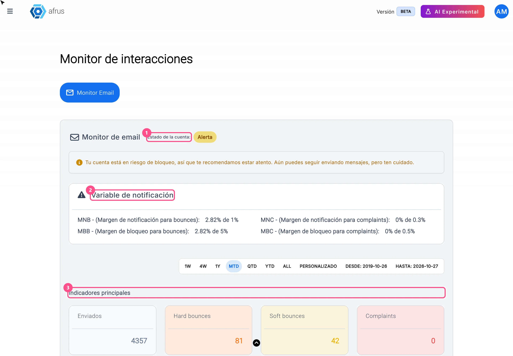
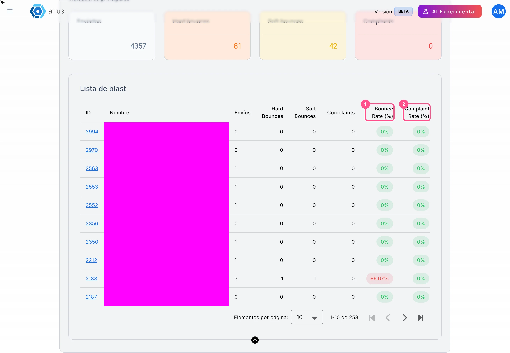

# Guia de Monitor de interacciones

Com este guia, você vai saber se a sua organização pode continuar enviando e-mails em massa sem risco de bloqueio, e qual envio está causando problemas.

*Módulo: Trackers · Menu: **Trackers > Monitor de interacciones** (Monitor de interações) · Público: equipes de comunicação e e-mail marketing*

> **Sobre os nomes de tela neste guia:** botões, campos e menus estão escritos exatamente como aparecem na versão em espanhol do console, com a explicação em português quando ajuda.

---

## O que é Monitor de interacciones

**É um painel que mostra a saúde dos seus e-mails em massa (blasts).** Ele diz quantos e-mails você enviou, quantos voltaram, quantos foram marcados como spam e se a sua conta de envio está em risco.

Um e-mail **volta** (bounce) quando não chega ao destino, por exemplo porque o endereço não existe. Uma **reclamação** (complaint) é quando a pessoa marca o seu e-mail como spam. Se houver muitas devoluções ou reclamações, a AFRUS pode limitar ou bloquear seus envios.

Este painel conta só os e-mails em massa. Não inclui os e-mails automáticos (autoresponders), os e-mails de transações nem os WhatsApp.

## Para que serve

- **Saber se você pode continuar enviando.** Você vê se a conta está ativa, em alerta ou bloqueada.
- **Cuidar da sua taxa de devoluções e reclamações.** Você compara seus números com os limites da AFRUS.
- **Encontrar o envio que causou problemas.** Assim você sabe qual lista limpar.

---

# Passo a passo

## Que informação encontro ali e como analisá-la

### Parte 1 — Confira o status da sua conta

1. **Abra o monitor.** Acesse **Trackers > Monitor de interacciones**. A aba **Monitor Email** é aberta.
   

2. **Veja o Estado de la cuenta (Status da conta).** Você verá um destes rótulos:

| Rótulo | O que significa | O que fazer |
|---|---|---|
| **Activa** (Ativa) | Você pode enviar sem problema | Nada |
| **Alerta** | Suas devoluções ou reclamações passaram do primeiro limite. Você ainda pode enviar, mas a conta está em risco de bloqueio | Limpe suas listas antes do próximo envio |
| **Bloqueada** | Suas devoluções ou reclamações passaram do limite de bloqueio, ou a AFRUS bloqueou a conta. Você não pode enviar | Escreva para o suporte em support@afrus.app |
| **Envío limitado** (Envio limitado) | A conta estava bloqueada, mas a AFRUS liberou um número de envios para você | Limpe suas listas e envie só para grupos menores que o seu saldo de envios |

> **Importante:** se a AFRUS bloqueou a sua conta, ela continua **Bloqueada** mesmo que seus números melhorem. Para desbloquear, escreva para o suporte.

Com **Envío limitado**, uma campanha com mais destinatários do que envios disponíveis não é enviada.

### Parte 2 — Compare suas taxas com os limites

3. **Veja a Variable de notificación (Variáveis de notificação).** Ela mostra quatro linhas, cada uma com a sua taxa atual frente ao limite ("X% de Y%"):
   - **MNB** e **MBB**: sua taxa de devoluções frente ao limite de alerta e ao de bloqueio.
   - **MNC** e **MBC**: sua taxa de reclamações frente ao limite de alerta e ao de bloqueio.

   A taxa de devoluções soma as devoluções permanentes (hard) e temporárias (soft).

4. **Veja os Indicadores principales (Indicadores principais).** **Enviados**, **Hard bounces**, **Soft bounces** e **Complaints**. Esses números contam **todo o seu histórico** de e-mails em massa.

Os limites só se aplicam a partir de 1.000 e-mails enviados. Se você tiver menos, verá: *"El bloqueo de la cuenta solo se aplicará cuando se superen los 1000 envíos."* (O bloqueio só será aplicado depois de 1.000 envios.)

### Parte 3 — Encontre o envio que causa devoluções

5. **Escolha as datas.** Use a barra de datas para ver os envios de um período. Ao abrir, mostra todas as datas. As datas só mudam a tabela de envios; o status da conta e os indicadores sempre usam todo o histórico.

6. **Veja a Lista de blast.** Olhe **Bounce Rate (%)** (devoluções) e **Complaint Rate (%)** (reclamações) de cada envio. As cores ajudam:
   - **Verde:** abaixo do limite de alerta.
   - **Amarelo:** entre o limite de alerta e o de bloqueio.
   - **Vermelho:** no limite de bloqueio ou acima.
   

7. **Abra o envio.** Clique no **ID** para ver o detalhe. A tabela mostra 5 envios por página; você pode mudar para 10, 25 ou 50.

---

## Limitações conhecidas

- **Conta só e-mails em massa.** Não inclui autoresponders, e-mails de transações nem WhatsApp.
- **As devoluções temporárias (soft) também aumentam a sua taxa de devoluções.**
- **Alguns textos estão em inglês** (**Monitor Email**, **Hard Bounces**, **Bounce Rate (%)**…).
- **Clicar nos títulos ID ou Nombre (Nome) não muda a ordem da tabela.** Ela sempre mostra primeiro o envio mais recente.
- **A tela não se atualiza sozinha:** recarregue para ver mudanças.

## Perguntas frequentes

**Minha conta está em Alerta. Posso enviar?**
Sim, mas você está em risco de bloqueio. Antes do próximo envio, tire das suas listas os e-mails inválidos ou muito antigos.

**Quais são os limites da AFRUS?**
Você os vê na seção **Variable de notificación**, ao lado da sua taxa atual. São os mesmos para todas as organizações.

**Quanto tempo uma devolução leva para aparecer?**
> **Pendente de confirmação:** não há um tempo fixo.

---

> **[Voltar ao índice da seção](./README.md)** · **[Voltar ao índice geral](../README.md)**

*Última atualização: 2026-10-26*
