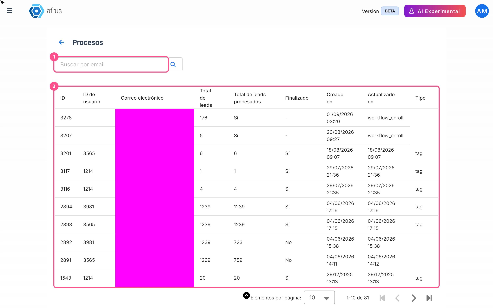

# Guía de Procesos en ejecucion

Con esta guía vas a saber si una acción que hiciste sobre muchas personas a la vez (por ejemplo, ponerles una etiqueta o borrarlas) ya terminó.

*Módulo: Trackers · Menú: **Trackers > Procesos en ejecucion** · Audiencia: equipos de recaudación, datos y comunicaciones*

---

## Qué es Procesos en ejecucion

**Es una lista de las acciones que lanzaste sobre un grupo grande de personas, con el avance de cada una.**

Cuando haces algo sobre muchas personas a la vez, AFRUS no lo hace todo en un segundo: va persona por persona, en segundo plano, mientras tú sigues trabajando. Esta pantalla te muestra en qué va cada una de esas acciones.

Las acciones que aparecen aquí son cuatro:

- **Poner una etiqueta** a un grupo de personas.
- **Borrar** un grupo de personas.
- **Cambiar el permiso de comunicación** (opt-in) de un grupo.
- **Inscribir** un grupo de personas en un flujo de trabajo.

Las importaciones, las descargas y los envíos de correos no aparecen aquí.

## Para qué sirve

- **Saber si una acción ya terminó.** Por ejemplo, antes de enviar un correo a las personas que acabas de etiquetar.
- **Ver cuánto falta.** Comparas cuántas personas tenía el grupo y cuántas ya se procesaron.
- **Saber quién lanzó cada acción y cuándo.** Útil cuando varias personas de tu equipo trabajan con la misma base.

---

# Paso a paso

## Qué información encuentro allí y cómo analizarla

1. **Abre la pantalla.** Entra a **Trackers > Procesos en ejecucion**. También llegas con el botón "Ver procesos" de **Personas**, **Transacciones**, **Suscripciones**, **Segmentos** y **Data > Tags**.
   

2. **Busca tu proceso.** Para ver solo los procesos que lanzó una persona de tu equipo, escribe su correo en **Buscar por email** y pulsa Enter o la lupa.

3. **Ve los más recientes primero.** La lista empieza por los procesos más antiguos. Haz clic en el título de la columna **ID** o **Creado en** para ver primero los más nuevos.

4. **Revisa el avance.** Compara **Total de leads** (cuántas personas tenía el grupo) con **Total de leads procesados** (cuántas lleva). Cuando terminó, la columna **Finalizado** dice "Sí"; mientras tanto dice "No".
   

5. **Recarga para ver cambios.** La pantalla no se actualiza sola. Para ver cómo avanza, recarga la página.

**Las columnas de la tabla:**

| Columna | Qué te dice |
|---|---|
| **ID** | El número del proceso. Anótalo si necesitas escribir a soporte |
| **ID de usuario** y **Correo electrónico** | Quién de tu equipo lanzó la acción |
| **Total de leads** | Cuántas personas tenía el grupo |
| **Total de leads procesados** | Cuántas personas ya se procesaron |
| **Finalizado** | "Sí" si terminó, "No" si sigue en curso |
| **Creado en** | Cuándo se lanzó |
| **Actualizado en** | La última vez que avanzó |
| **Tipo** | Qué acción es (ver la tabla de abajo) |

**La columna Tipo** aparece con un nombre en inglés:

| Tipo | Qué acción es |
|---|---|
| `tag` | Poner una etiqueta a un grupo |
| `delete` | Borrar un grupo de personas |
| `opt-in` | Cambiar el permiso de comunicación de un grupo |
| `workflow_enroll` | Inscribir un grupo en un flujo de trabajo |

> **Consejo:** si la hora de **Actualizado en** no cambia durante mucho tiempo, el proceso se detuvo.

Cuando termina de poner una etiqueta, AFRUS también te deja un aviso en tus notificaciones. Ese aviso está en inglés: *"Tag Leads Process for tag: '…' finished"*.

## Qué hacer si un proceso no termina

Si después de recargar **Finalizado** sigue en "No" y **Total de leads procesados** no avanza, el proceso se detuvo. Esta pantalla no tiene un botón para reintentar.

- **Si era una etiqueta:** vuelve a ponerla al mismo grupo. Las personas que ya la tienen no se duplican.
- **Si era un borrado, un cambio de permiso o una inscripción en un flujo:** anota el **ID** del proceso y escribe a soporte de AFRUS.

---

## Limitaciones conocidas

- **Una etiqueta puede quedar en "No" para siempre.** Si alguna persona del grupo no se pudo procesar (por ejemplo, porque se borró mientras tanto), el proceso puede quedarse en **Finalizado** "No" aunque todas las demás personas sí tengan la etiqueta. Para comprobarlo, revisa la etiqueta en **Data > Tags**.
- **La columna Tipo está en inglés.**
- **Solo aparecen las cuatro acciones de esta guía.** Las importaciones, descargas y envíos tienen sus propias pantallas.

## Preguntas frecuentes

**¿La pantalla se actualiza sola?**
No. Recárgala para ver el avance.

**¿Por qué no veo mi importación aquí?**
Porque las importaciones no se muestran en esta pantalla. Esta lista solo muestra etiquetas, borrados, cambios de permiso e inscripciones en flujos.

**¿Cuánto tiempo se guarda el historial?**
> **Pendiente de confirmar:** cuánto tiempo se conserva el historial de procesos.

---

> **[Volver al índice de la sección](./README.md)** · **[Volver al índice general](../README.md)**

*Última actualización: 2026-10-26*
