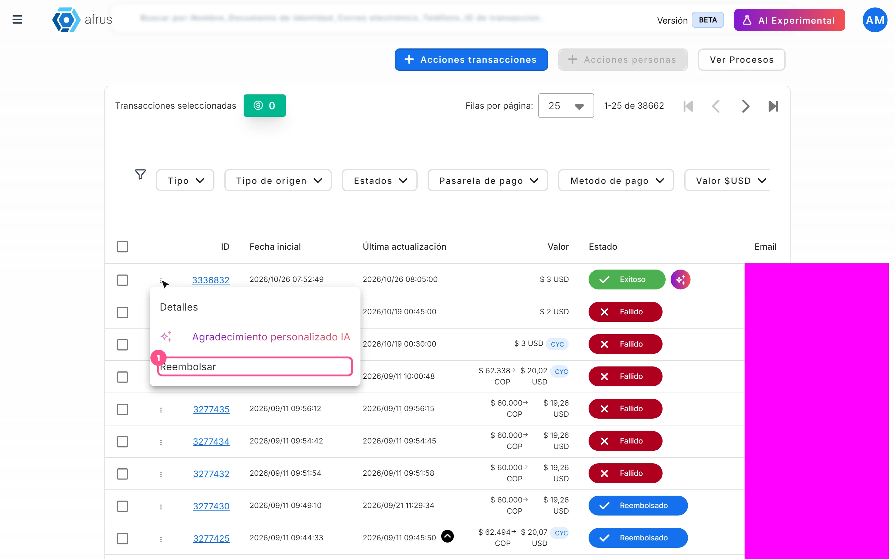
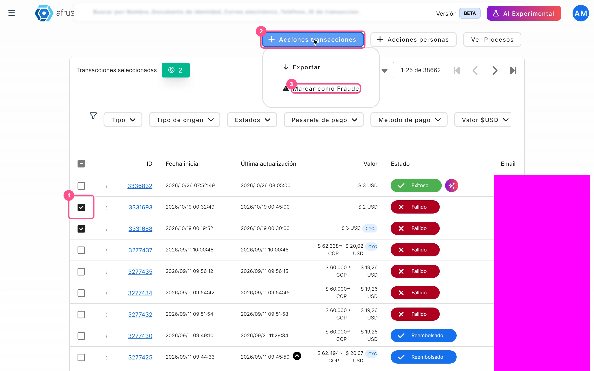
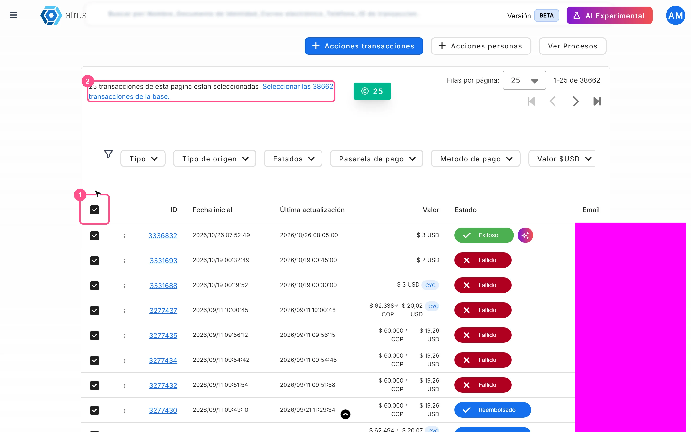
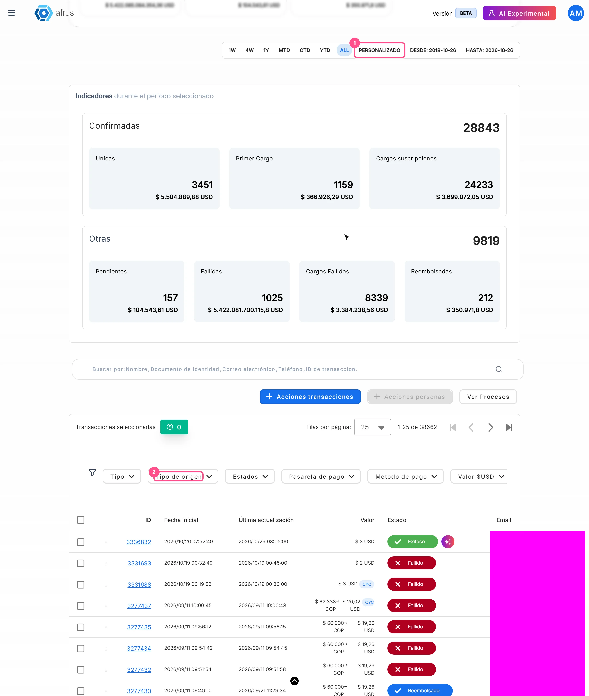
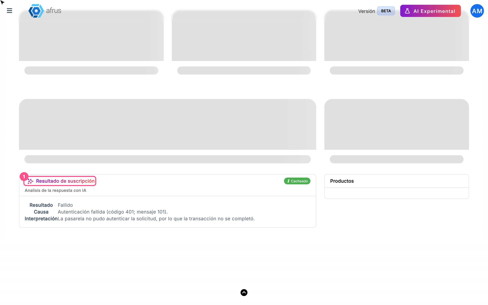

# Transactions guide

After reading this guide you will know what the Transactions module is, what it is for, and how to send an AI thank-you, refund, mark fraud, download, filter and check why a payment failed.

*Module: Transacciones (Transactions) · Menu: **Transacciones** · Audience: fundraising, donor care and finance teams*

> **About the labels in this guide:** buttons, fields and menus are written exactly as they appear in the Spanish version of the console, with an English explanation where it helps.

---

## What Transactions is

**Transactions is the list of every payment your organization receives.** Here you see one-time donations and each charge of recurring donations, with their status, amount, payment gateway, payment method, campaign and source widget.

Subscriptions themselves (the commitment to give every month) are not here: you see them in **Suscripciones** (Subscriptions). What appears in Transactions is each payment that subscription generates.

## What it is for

- **Find any payment.** Search by name, ID document, email, phone or transaction ID and open its details, including the gateway's response when a payment fails.
- **Refund donations.** Return successful donations on gateways that allow it.
- **Clean up fraud.** Mark fraudulent payments to remove them from the list and from your database.
- **Export to Excel.** Download a group of transactions: the ones you choose or all those matching your filters.
- **Say thank you with AI.** Send the donor a thank-you email written with AI.

## Before you start

- **By default the list shows the current month** (**MTD**). Change the period in the date bar if you are looking for older payments.
- **The list updates when you open the screen or change a filter.** It does not refresh on its own while open.

---

# Step by step

## How to create an AI thank-you from Transactions

**You need:**
- the transaction to be in **Exitoso** (Successful) status;
- an active **Business profile** (without it, the option does not appear);
- at least one user with a signature set up in **AI > Firmas de usuarios** (User signatures). Only those users appear as senders.

1. **Open the thank-you.** In **Transacciones**, open the three-dot menu at the start of the row and choose **Agradecimiento personalizado IA** (AI personalized thank-you). You can also use the sparkle-icon button next to the **Exitoso** status.
   
2. **Choose the sender.** In the step **Seleccionar el remitente con el que enviarás el agradecimiento** (Select the sender), choose a user and click "Continuar" (Continue). The email is sent from that user's signature address.
3. **Wait for the draft.** You will see *AI preparando tu mensaje* (AI preparing your message) while the AI writes the email.
4. **Review and edit.** Adjust **Asunto** (Subject, up to 128 characters) and **Cuerpo del correo** (Email body, up to 1600). "Regenerar" (Regenerate) asks for another version of each field; "Volver" (Back) returns to the previous step.
5. **Send.** Click "Enviar mensaje" (Send message). It becomes active once subject and body have text.

When you finish you will see *Mensaje enviado* / *"El agradecimiento se ha enviado correctamente"* (The thank-you was sent successfully). The email goes to the email address of that transaction's person. If something fails, you will see *"Error al enviar el agradecimiento"*.

> **Important:** don't use the **Merge tags** buttons in this email. For now, variables are sent as literal text, not replaced with the donor's data. Type the name and details directly in the text.

> **Can it be undone?** No. Once sent, the email is in the donor's inbox: review it carefully before clicking "Enviar mensaje".

## How to refund a donation

**You need:**
- the transaction to be in **Exitoso** status;
- its gateway to allow refunds from AFRUS (otherwise the **Reembolsar** (Refund) option does not appear);
- your user to have permission for banking operations on transactions. Without it the refund fails: ask an administrator in your organization to do it.

1. **Open the row menu.** In **Transacciones**, find the donation, open the three-dot menu at the start of the row and choose **Reembolsar**.
   
2. **Confirm.** In the **Reembolsar Cargo** (Refund charge) dialog (*"Estas seguro que deseas reembolsar este cargo?"* — Are you sure you want to refund this charge?), click "Confirmar" (Confirm). To cancel, click "Cerrar" (Close).

When you finish you will see *"Reembolsado con éxito."* (Refunded successfully) and the transaction changes to **Reembolsado** (Refunded). If the donation had a valid donation certificate, it is voided. If the gateway rejects the refund, you will see *"Error al reembolsar el cargo."* (Error refunding the charge) and the transaction does not change.

> **Important:** the full amount is always refunded. Partial refunds are not possible from this screen.

> **Can it be undone?** No. The money is returned through the gateway and there is no option to reverse the refund.

> **Pending confirmation:** how long the money takes to reach the donor and how many days after the charge each gateway accepts refunds; also whether refunding a **Cargo** (charge) cancels the subscription. If you want to stop future charges, cancel the subscription in **Suscripciones**.

## How to mark a transaction as fraud

> **Important:** when you mark a transaction as fraud, **the people (donors) linked to it are deleted from your database**, even if they have other legitimate donations. Check carefully before confirming.

1. **Select the transactions.** In the **Transacciones** table, tick the box of one or more rows on the page.
   
2. **Choose the action.** Click "Acciones transacciones" (Transaction actions) and choose **Marcar como Fraude** (Mark as fraud). It is disabled if nothing is selected.
3. **Confirm.** In the **Marcar como fraude** dialog, read the warning (*"…Esta acción no se puede deshacer."* — This action cannot be undone) and click "Confirmar".

When you finish you will see *Transacciones marcadas como fraude* (Transactions marked as fraud). Each transaction changes to **Fraude** status, disappears from **Transacciones** and appears in **Follow up > Radar - monitor de fraude** (fraud monitor), where you see its **Estado anterior** (Previous status) and the date under **Marcada como fraude el** (Marked as fraud on).

> **Important:** marking as fraud only changes the status in AFRUS. It does not refund the payment or cancel any subscription at the gateway.

> **Important:** only the rows selected on the current page are marked. Even if you use "Seleccionar las N transacciones de la base." (Select all N transactions), this action does not apply to the whole database. If there are many, mark them page by page.

> **Can it be undone?** No. The dialog itself warns you, and the Radar has no option to reverse it.

## How to download a group of transactions

1. **Filter what you need.** Set the dates, search and filters (see "How to filter a group of transactions").
2. **Select the transactions.** Tick the rows you want. To export everything filtered, tick the header box and click "Seleccionar las N transacciones de la base."
   
3. **Export.** Click "Acciones transacciones" and choose **Exportar** (Export). It is disabled if nothing is selected.
4. **Confirm the file.** In the **Descargas** (Downloads) dialog, choose **Tipo de archivo** (File type) and click "Confirmar". You will see *Exportar archivo* (*"El proceso de exportacion ha comenzado…"* — the export has started and may take a few minutes).
5. **Download the file.** Go to **Data > Descargas** and download it when it is ready.

You will get an Excel file. If you selected individual rows, it contains exactly those, regardless of the date range; if you chose the whole database, it contains everything matching dates, search and filters.

> **Important:** the file is always generated as Excel (.xlsx), even if you choose CSV. Also, the **CYC** filter is not applied when exporting with "whole database": if you need it, filter by **CYC** on screen and tick the rows one by one, because that way exactly the rows you choose are exported.

> **Important:** files can be downloaded for up to 7 days after they are generated.

## How to filter a group of transactions

1. **Choose the period.** In the date bar, click **1W**, **4W**, **1Y**, **MTD**, **QTD**, **YTD**, **ALL** or **PERSONALIZADO** (custom). The default is **MTD** (from the start of the month to today). The period applies to the transaction's **Fecha inicial** (Start date), in your time zone.
   
2. **Search (optional).** Use **Buscar por** (Search by) with **Nombre** (Name), **Documento de identidad** (ID document), **Correo electrónico** (Email), **Teléfono** (Phone) or **ID de transaccion** (Transaction ID).
3. **Apply filters.** In the row with the funnel icon choose:
   - **Tipo** (Type): **Unicas** (One-time) / **Cargos** (Charges)
   - **Tipo de origen** (Source type): Estándar, Incentivo, Peer to peer, Producto
   - **Estados** (Statuses), **Pasarela de pago** (Gateway), **Metodo de pago** (Payment method)
   - **Valor** (Amount): Mayor que / Igual que / Menor que (greater / equal / less than), compared on the amount converted to your organization's currency
   - **Campaña** (Campaign), **Widgets**
   - **CYC**: Con CYC / Sin CYC, to see donations where the donor covered the cost
4. **Clear whenever you want.** "Reset" removes all filters.

The table and totals are recalculated. Filters are kept in the page address, so you can copy the link and share the same view with your team.

> **Important:** if you tick both **Unicas** and **Cargos** in **Tipo**, only one-time donations are shown. To see both, leave **Tipo** empty.

## How to find out why a transaction failed

The list has no reason column: the reason is in the transaction details.

1. **Open the details.** In the row of a **Fallido** (Failed) or **Rechazada** (Rejected) transaction, open the three-dot menu and choose **Detalles** (Details), or click the **ID**. It opens in a new tab.
   
2. **Read the AI explanation.** The **Resultado de suscripción** card (**Analisis de la respuesta con IA** — AI analysis of the response) explains in plain language what the gateway answered. It requires an active **Business profile**; otherwise you will see *Activación necesaria para ver la respuesta con IA* (Activation required) and the "Ir a business profile" button.
3. **Check the original response.** Under **Respuesta** > **Respuesta Gateway** (Gateway response) is the gateway's response, with the decline code or message it sent.

The analysis is generated the first time you open the details and is then shown with the **Cacheado** (Cached) label. If the payment has no gateway response, there is no analysis.

---

## One-time vs Charge: what's the difference

The **Tipo de frecuencia** (Frequency type) column and the **Tipo** filter distinguish two kinds of payment:

| In the column | In the **Tipo** filter | What it is |
|---|---|---|
| **Única** (One-time) | **Unicas** | A single-payment donation. It does not come from a subscription. |
| **Cargo** (Charge) | **Cargos** | A charge of a recurring donation. Each month or cycle of the subscription creates a new charge. |

The subscription itself (the "parent" record, **Recurrente**) does not appear in this list: you see it in **Suscripciones**.

## Transaction statuses

| Status | What it means |
|---|---|
| **Exitoso** (Successful) | The payment went through. You can send an AI thank-you or refund it |
| **Pendiente** (Pending) | The payment is not confirmed yet (some methods take time) |
| **Pendiente de confirmación** (Awaiting confirmation) | Your team must confirm or reject it with **Confirmar transacción** / **Rechazar transacción** |
| **Fallido** / **Rechazada** (Failed / Rejected) | The payment did not go through. Check the reason in the details |
| **Reembolsado** (Refunded) | The payment was returned to the donor |
| **Propuesta** (Proposal) | Pending confirmation of what this status means |
| "PRENOTIFICATION_OK" | Shown like this, as technical text, for pre-notified transactions |

Transactions in **Fraude**, **Cancelada** or **Contracargo** (Fraud, Cancelled, Chargeback) do not appear in **Transacciones**. Fraud ones are in **Follow up > Radar - monitor de fraude**.

## Known limitations

- **Fraud deletes people:** linked people are removed from your database, even if they have other valid donations.
- **Fraud only on the current page:** "Seleccionar las N transacciones de la base." does not apply to **Marcar como Fraude**.
- **Exports are always Excel** (.xlsx), whatever file type you choose, and without the **CYC** filter.
- **Unicas + Cargos together** shows only one-time donations; leave **Tipo** empty to see everything.
- **Merge tags in the AI thank-you** are sent as literal text.
- **Refunds** are always for the full amount and cannot be undone.
- **"PRENOTIFICATION_OK"** appears as untranslated technical text.

## Frequently asked questions

**Can I make a partial refund?**
No. From AFRUS the full transaction amount is always refunded.

**Why don't I see the Reembolsar option?**
It only appears on **Exitoso** transactions whose gateway allows refunds from AFRUS.

**Does marking as fraud return the money?**
No. It only changes the status in AFRUS. If you also need to return the payment, refund it before marking it as fraud.

**Where do I see subscriptions?**
In **Suscripciones**. In Transactions you see each charge (**Cargo**) they generate.

---

> **[Back to section index](./README.md)** · **[Back to main index](../README.md)**

*Last updated: 2026-10-20*
