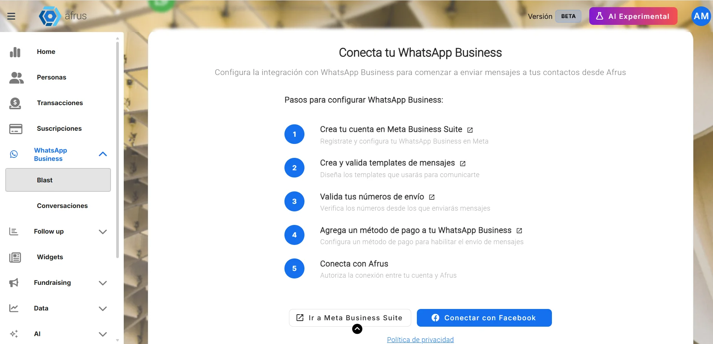
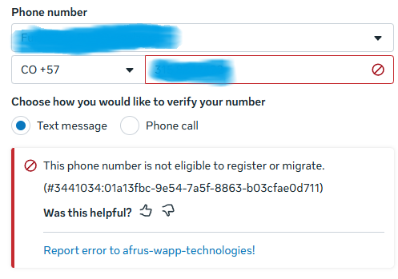

# WhatsApp Business guide

After reading this guide you will be able to connect your WhatsApp Business account to AFRUS, create templates, send bulk messages, send images and reply to your contacts from **Conversaciones** (Conversations).

*Module: WhatsApp Business · Menu: **WhatsApp Business > Blast** and **WhatsApp Business > Conversaciones** · Audience: fundraising, communications and donor care teams*

> **About the labels in this guide:** buttons, fields and menus are written exactly as they appear in the Spanish version of the console, with an English explanation where it helps.

---

## What WhatsApp Business is

**WhatsApp Business in AFRUS is the connection to Meta's official WhatsApp Business API.** With it you send bulk messages using templates approved by Meta, and you reply from AFRUS to the contacts who write to you.

The module has two screens: **WhatsApp Business > Blast**, your account dashboard with your numbers, templates and bulk sends, and **WhatsApp Business > Conversaciones**, where you read and reply to messages.

## What it is for

- **Sending bulk campaigns on WhatsApp.** You send a Blast to a segment and each contact receives the message personalized with their own data.
- **Creating and editing templates in AFRUS.** You design them in AFRUS and send them to Meta for review without leaving the platform.
- **Replying to your contacts.** In **Conversaciones** you see and reply to incoming messages in real time.
- **Measuring your sends.** You see how many messages were sent, delivered, read and failed.

## Before you start

- **A Meta Business Suite account with WhatsApp Business.** The connection is made with your Meta account.
- **A payment method on your WhatsApp Business.** The connection screen recommends it as a prior step.
- **Sending numbers validated in Meta.** Numbers are added from Meta's Phone Manager, not from AFRUS.

---

# Step by step

## How to connect WhatsApp Business to AFRUS

1. **Open the module.** Go to **WhatsApp Business > Blast**. If no account is connected yet, AFRUS takes you to the **Conecta tu WhatsApp Business** (Connect your WhatsApp Business) screen, which lists the recommended prior steps.
   

2. **Connect with Meta.** Click "Conectar con Facebook" (Connect with Facebook). A Meta window opens: sign in and choose (or create) your WhatsApp Business account and number. This authorizes AFRUS to send on behalf of your account.

3. **Check the verification.** When you finish, AFRUS syncs your templates and opens **Verificando tu configuración** (Verifying your setup, **PASO 2 DE 3** — step 2 of 3). It checks **Cuenta de WhatsApp Business conectada** (account connected), **Número de teléfono registrado** (phone number registered) and **Plantillas sincronizadas** (templates synced).

4. **Send a test message (optional).** In **Enviar mensaje de prueba (opcional)**, choose the **Número de teléfono de envío** (sending number), type the **Número de teléfono del destinatario** (recipient number) and click "Enviar mensaje de prueba" (Send test message). Then click "Ir al Dashboard" (Go to dashboard).

When you finish you will see the **Conectado** (Connected) chip and your business name on the dashboard. Your numbers appear under **Números conectados** (Connected numbers).

> **Important:** the connection with Meta expires. AFRUS warns you with *"Tu conexión expirará en N días"* (Your connection will expire in N days) and, once expired, shows **Renueva tu conexión de WhatsApp Business** with the "Reconectar con Facebook" (Reconnect with Facebook) button.

> **Can it be undone?** You can disconnect with "Desconectar cuenta" (Disconnect account), but sends stop and, as the screen warns, you lose access to your templates from AFRUS.

**To add a new number:** add it in Meta's Phone Manager and then click "Actualizar números" (Update numbers) or "Sincronizar con Meta" (Sync with Meta) in AFRUS.

### If you see the error "This phone number is not eligible to register or migrate"

This error means the number is still linked to another WhatsApp account. To free it up:

1. **If the number has WhatsApp or WhatsApp Business on a phone:** in the app, go to Settings > Account > Delete account. Uninstalling the app is not enough.
2. **If it was connected to another WhatsApp API provider or to another Meta account:** ask them to disconnect it and turn off the two-step verification PIN.
3. **Try again.** Wait a few minutes and connect the number again from AFRUS.

### Enabling the bulk send button

The "Enviar blast masivo" (Send bulk blast) button stays locked until two conditions are met:

- **The required checks are green:** **Cuenta de WhatsApp Business Conectada**, **Número de Teléfono Registrado (Calidad OK)** (number registered, quality OK), **Plantilla de Mensaje Aprobada** (approved template) and **Suscripción a Webhooks (seguimiento de entrega y lectura)** (delivery and read tracking). You see them on the **Preparación para Envío de Mensajes** (Messaging readiness) card; click "Verificar" (Verify) if needed.
- **There is at least one successful test message.** Click "Enviar Mensaje de Prueba" on the dashboard and send it to a number with WhatsApp.

> **Important:** that test uses an approved template **with no variables and no media**. If you have none, you will see *"Aún no tienes plantillas de mensaje. Crea una en Facebook para poder enviar mensajes de prueba."* (You don't have message templates yet…). Create a simple text-only template so you can complete the test. The sample "hello_world" template does not count.

**Método de Pago** (payment method) and **Verificación del Negocio** (business verification) appear as **Recomendado** (Recommended): they don't block sending, but they are worth having.

## How to create a template

To message a contact first on WhatsApp Business you need a template approved by Meta.

1. **Open the templates.** In **WhatsApp Business > Blast**, section **Plantillas de WhatsApp Meta**, click "Crear plantilla" (Create template).
   

2. **Fill in the basic information.** In **Información básica** (Basic information), type the **Nombre de la plantilla** (template name: lowercase letters, numbers and underscores only, starting with a letter), choose the **Categoría** (category: **Marketing**, **Utilidad** — Utility — or **Autenticación** — Authentication) and the **Idioma del mensaje** (message language). Click "Continuar".

3. **Add media (optional).** In **Diseño del mensaje** (Message design), under **Contenido multimedia** (media) choose **Ninguna** (None), **Imagen** (Image), **Video** or **Documento** (Document) and click "Subir" (Upload). The file replaces the text header.

4. **Write the header (optional).** If you don't use media, you can write a text **Encabezado** (header, up to 60 characters).

5. **Write the body.** Fill in the **Cuerpo del mensaje** (message body, up to 1024 characters). You can use variables like {{1}} to personalize the message with each contact's data.

6. **Add a footer and buttons (optional).** Write a **Pie de página** (footer, up to 60 characters) and add **Botones** (buttons): **Personalizado** (quick reply), **Ir al sitio web** (go to website, static or dynamic URL) or **Llamar por teléfono** (call). Each button text allows up to 25 characters.

7. **Review and send to Meta.** Check the **Vista previa** (preview) and click "Enviar a Meta" (Send to Meta).

When you finish you will see *"Plantilla enviada para aprobación"* (Template sent for approval) and the template will be **Pendiente** (Pending). According to the screen, Meta's review takes between 5 minutes and 24 hours. The status changes automatically when Meta replies; you can also click "Sincronizar con Meta".

**Media formats:** JPEG or PNG image up to 5MB; MP4 or MOV video up to 16MB; PDF document up to 100MB.

> **Important:** **Autenticación** templates have fixed text defined by Meta, are only for verification codes and **cannot be used in bulk sends**.

> **Can it be undone?** You can edit a template, but Meta reviews it again and it goes back to **Pendiente**; while under review it cannot be changed. Deleting a template cannot be undone and also deletes its language variants.

## How to send a bulk message (Blast) on WhatsApp Business

**Before you start:** the "Enviar blast masivo" button must be enabled (see *Enabling the bulk send button*) and you need at least one **Aprobada** (Approved) template that is not Authentication.

### Part 1 — Create the send

1. **Start the send.** In **WhatsApp Business > Blast**, click "Enviar blast masivo". Send creation opens with the **WhatsApp Business** channel already selected.
   

2. **Name it and choose recipients.** Fill in **Nombre del envío** (send name), choose the segment in **Seleccionar segmento** (Select segment) and click "Continuar".

### Part 2 — Set up the message

3. **Choose number and template.** Choose the sending **Número de teléfono** (phone number) and the template in **Plantilla de mensaje** (Message template).

4. **Map the variables.** In **Mapeo de Variables** (Variable mapping), assign a contact field to each variable (for example, their name). This way each person gets a personalized message. If the template has media in the header, click "Seleccionar media de la galería" (Select media from gallery) and choose the file.

5. **Test the message (optional).** Use "Enviar prueba" (Send test) to receive it on a number, with **Valores de prueba** (test values) typed by hand.

### Part 3 — Send or schedule

6. **Check your quota.** Click "Enviar" (Send). AFRUS shows **Estado de Cuota Diaria** (Daily quota status) with the recipients, remaining quota and daily limit. If it isn't enough, you will see **Cuota Diaria Insuficiente** (Insufficient daily quota) and the "Enviar de todos modos" (Send anyway) button.

7. **Send or schedule.** Choose **Enviar ahora** (Send now) or **Programar fecha** (Schedule, with date and time) and confirm with "Enviar" or "Programar".

When you finish, AFRUS sends the messages one by one. In the send's detail you see each recipient's status: **En cola** (Queued), **Enviado** (Sent), **Entregado** (Delivered), **Leído** (Read), **Error** or **No enviado** (Not sent).

> **Important:** always check the message with "Enviar prueba" before sending.

**Who receives the message:** only contacts in the segment who have a phone number. AFRUS leaves out those who rejected the WhatsApp Business channel and numbers Meta reported as "not on WhatsApp" (for 90 days; the exclusion lifts automatically if the person writes to you). If no one in the segment qualifies, you will see *"No hay destinatarios entregables en este segmento..."* (No deliverable recipients in this segment).

**Before sending**, AFRUS checks that the template is still approved. If it isn't, you will see *"La plantilla ya no está aprobada"* (The template is no longer approved).

## How many messages can I send per day

The daily limit is set by **Meta** according to your account tier; AFRUS reads it and shows it in the **Límite diario compartido** (Shared daily limit) bar under **Números conectados**.

| Account tier in Meta | Messages per day |
|---|---|
| 0 (new account) | 250 |
| 1 | 2,000 |
| 2 | 10,000 |
| 3 | 100,000 |
| 4 | Unlimited |

Keep in mind:

- **The limit belongs to your Meta business portfolio, not to each number.** All your numbers share the same quota.
- **AFRUS only counts what is sent from AFRUS.** Messages you send outside AFRUS also use your quota, but AFRUS can't see them.
- **The "Enviados hoy" (Sent today) counter works as a 24-hour window.**
- **If a send reaches the limit**, it moves to **Límite alcanzado** (Limit reached) and resumes on its own when quota is available: AFRUS checks these sends every 30 minutes. The screen says the remaining messages resume "in ~24 hours when the quota is freed".

## How to increase the daily sending limit

Your daily limit goes up when Meta assigns you a higher tier. What we know today:

1. **Verify your business in Meta.** Moving to tier 1 comes after business verification. In AFRUS, **Verificación del Negocio** appears as **Recomendado** on the **Preparación para Envío de Mensajes** card, with the message *"Verify your business to increase your daily messaging rate"*.
2. **Take care of your message quality.** Tiers 2 and 3 are assigned based on quality. Check in AFRUS that your number stays at **Número de Teléfono Registrado (Calidad OK)** without warnings.

## How to send images

Images are sent in a template's header, as part of a bulk send.

1. **Create a template with an image.** When creating the template, under **Contenido multimedia** choose **Imagen** and click "Subir" (JPEG or PNG up to 5MB). Wait for Meta to approve it.
2. **Have the image in the AFRUS gallery.** The image you uploaded when creating the template is only used for Meta's review and **is not saved in the gallery**. Upload it to the gallery with "Subir imagen" (Upload image).
3. **Choose the image in the send.** In the Blast, under **Mapeo de Variables**, section **Media del Encabezado** (Header media), click "Seleccionar media de la galería" and choose the image (up to 5MB; AFRUS accepts jpg, jpeg, png, gif and webp).

When you finish, every recipient gets that same image in the message header.

**Videos:** for now **it is not possible to send a Blast with a video template from AFRUS** (known issue). You can create the video template and Meta approves it, but in the send the video can only be picked from the gallery, which only accepts images. In the meantime, use image templates or add an **Ir al sitio web** button that links to the video.

**In Conversaciones** you can't attach files: you will see *"Adjuntar archivos no está disponible aún"* (Attaching files is not available yet).

## How to reply in Conversaciones

1. **Open the conversation.** Go to **WhatsApp Business > Conversaciones** and choose one. You can use **Buscar conversación...** (Search conversation) or the **Todos** (All), **No leídos** (Unread) and **Generado por IA** (AI-generated) filters.
2. **If it says "Abierta (expira en …)" (Open, expires in…), write.** Type in **Escribe un mensaje...** (Type a message) and send. You can send free text because less than 24 hours have passed since the contact's last message.
3. **If it says "Cerrada" (Closed), send a template.** You will see *"La ventana de 24h ha expirado. Envía un template para reabrir la conversación."* (The 24h window has expired. Send a template to reopen the conversation.) Click "Enviar plantilla" (Send template), choose an approved template, fill in the variables and click "Enviar plantilla".

When you finish, your message appears in the chat instantly.

> **Important:** if you send a template with an image, video or document header from Conversaciones, you will see *"El encabezado multimedia no se envía en mensajes directos de conversación"* (Media headers aren't sent in direct conversation messages): AFRUS sends the template without the file and the send may fail. From Conversaciones, use text-only templates.

Images, videos, audio and documents a contact sends you are shown in the chat, but Meta makes them expire: after a while you will see *"Este recurso ya no está disponible. El contenido multimedia de WhatsApp expira y no puede recuperarse."* (This resource is no longer available…).

## What AI-generated messages in Conversaciones are

**They are the messages sent by Alma, AFRUS's autonomous fundraising agent, which writes on its own.** The **Generado por IA** filter in **Conversaciones** shows only conversations with messages from Alma.

- **Messages your team writes from AFRUS are not included in this filter**, even if you send them from Conversaciones.
- **A conversation with Alma may appear as a separate entry** from the regular conversation with the same contact.

---

## Statuses

| Template status | What it means | What you can do |
|---|---|---|
| **Aprobada** (Approved) | Can be used in sends and conversations | Use it |
| **Pendiente** (Pending) | Meta is reviewing it | Wait; it can't be changed |
| **Rechazada** (Rejected) | Meta rejected it | See Meta's reason and fix it |
| **Pausada** / **Deshabilitada** (Paused / Disabled) | Statuses set by Meta; not approved for sending | Use another template |
| **En apelación** / **Eliminación pendiente** (Under appeal / Pending deletion) | Statuses set by Meta | Wait for Meta's answer |

| Conversation window | What it means | What you can do |
|---|---|---|
| **Abierta (expira en …)** (Open) | Less than 24 h since the contact's last message | Write free text |
| **Cerrada** (Closed) | 24 h or more since the contact's last message | Only "Enviar plantilla" |

| Send status | What it means |
|---|---|
| **Límite alcanzado** (Limit reached) | Your Meta portfolio's daily limit was reached. The send retries automatically when quota is available |

## Frequently asked questions

**Can I be penalized?**
Yes, it can happen: penalties are applied by Meta. AFRUS shows you the risk signals: if your number's quality is red, **Número de Teléfono Registrado (Calidad OK)** shows a warning that the number may be limited and drop a tier; if Meta rejects your display name, that check fails; and templates can become **Pausada** or **Deshabilitada**. Also, AFRUS doesn't retry messages Meta rejects permanently, for example because of a blocked account, a spam limit, content that violates policies or people who blocked your marketing messages. With **Marketing** templates, users can unsubscribe.

**If I send a message from AFRUS, can I reply later from my phone, even after 24 hours without a reply from the contact?**
In AFRUS, not with free text: 24 hours after the contact's last message, the conversation becomes **Cerrada** and you can only send a template. If the contact replies, the window opens again.

> **Keep in mind:** the number can't be linked to any other bulk messaging service or have a WhatsApp Business account associated with it. If it is, when you connect it to AFRUS, Meta will say the number is ineligible and you won't be able to connect it.

**Can I start a conversation with a contact without sending a Blast first?**
Not from **Conversaciones**: there is no "new conversation" button, and the list only shows chats where the contact wrote to you at least once. To write first, send a Blast with an approved template. If the person writes to your number first, the conversation does appear and you can reply with free text for 24 hours.

**How long does Meta take to approve a template?**
According to the screen, between 5 minutes and 24 hours. The timeline is set by Meta.

**Why can't I click "Enviar blast masivo"?**
Because a required check or a successful test message is missing. Check the **Preparación para Envío de Mensajes** card.

---

> **[Back to section index](./README.md)** · **[Back to main index](../README.md)**

*Last updated: 2026-10-28*
