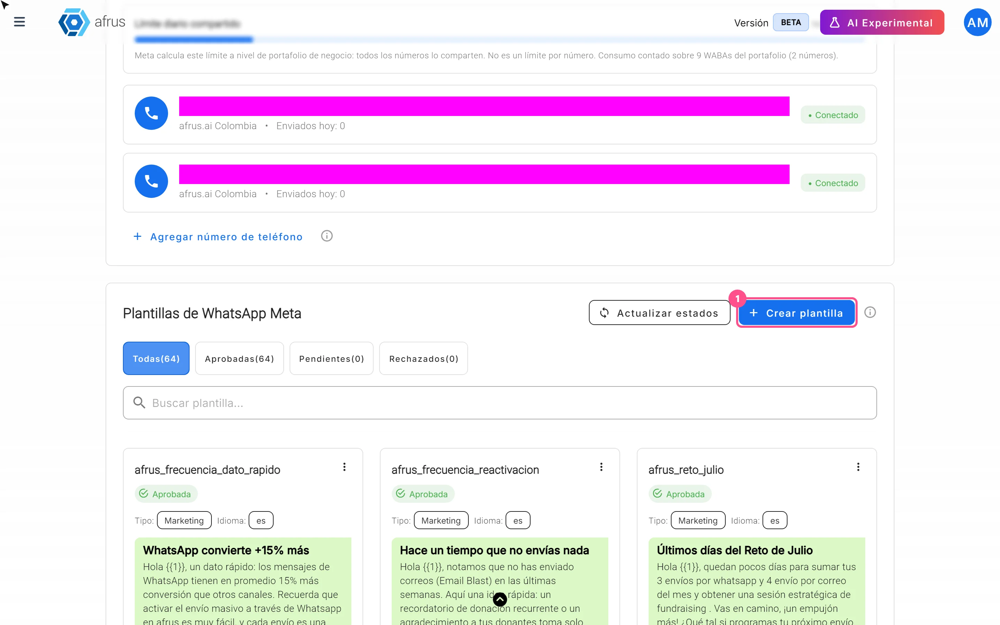
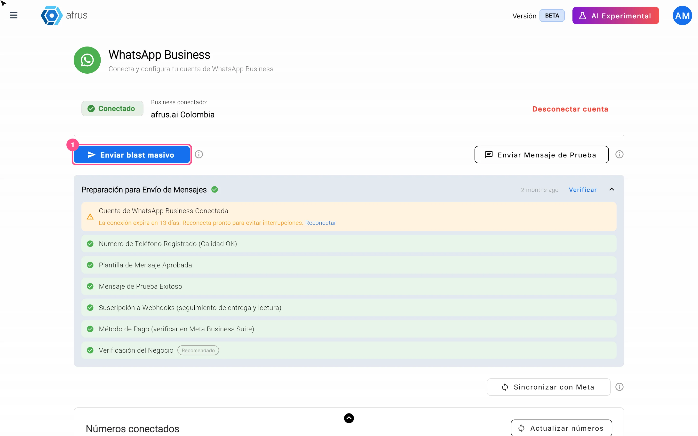

# Guía de WhatsApp Business

Después de leer esta guía sabrás conectar tu cuenta de WhatsApp Business a AFRUS, crear plantillas, hacer envíos masivos, enviar imágenes y responder a tus contactos desde **Conversaciones**.

*Módulo: WhatsApp Business · Menú: **WhatsApp Business > Blast** y **WhatsApp Business > Conversaciones** · Audiencia: equipos de recaudación, comunicaciones y atención a donantes*

---

## Qué es WhatsApp Business

**WhatsApp Business en AFRUS es la conexión con la API oficial de WhatsApp Business de Meta.** Con ella envías mensajes masivos usando plantillas aprobadas por Meta y respondes desde AFRUS a los contactos que te escriben.

El módulo tiene dos pantallas: **WhatsApp Business > Blast**, el panel de tu cuenta con tus números, tus plantillas y los envíos masivos, y **WhatsApp Business > Conversaciones**, donde lees y respondes los mensajes.

## Para qué sirve

- **Enviar campañas masivas por WhatsApp.** Envías un Blast a un segmento y cada contacto recibe el mensaje personalizado con sus propios datos.
- **Crear y editar plantillas desde AFRUS.** Las diseñas en AFRUS y las mandas a revisión de Meta sin salir de la plataforma.
- **Responder a tus contactos.** En **Conversaciones** ves y respondes los mensajes que llegan, en tiempo real.
- **Medir tus envíos.** Ves cuántos mensajes se enviaron, se entregaron, se leyeron y tuvieron error.

## Antes de empezar

- **Una cuenta en Meta Business Suite con WhatsApp Business.** La conexión se hace con tu cuenta de Meta.
- **Un método de pago en tu WhatsApp Business.** La pantalla de conexión lo recomienda como paso previo.
- **Números de envío validados en Meta.** Los números se agregan desde el Administrador de Teléfonos de Meta, no desde AFRUS.

---

# Paso a paso

## Cómo conectar WhatsApp Business en AFRUS

1. **Abre el módulo.** Entra a **WhatsApp Business > Blast**. Si aún no hay una cuenta conectada, AFRUS te lleva a la pantalla **Conecta tu WhatsApp Business**, que lista los pasos previos recomendados.
   <!-- captura pendiente: como-conectar-whatsapp-business-en-afrus-01 — pantalla Conecta tu WhatsApp Business -->

2. **Conéctate con Meta.** Pulsa "Conectar con Facebook". Se abre una ventana de Meta: inicia sesión y elige (o crea) tu cuenta de WhatsApp Business y el número. Así AFRUS queda autorizado a enviar en nombre de tu cuenta.

3. **Revisa la verificación.** Al terminar, AFRUS sincroniza tus plantillas y abre **Verificando tu configuración** (**PASO 2 DE 3**). Ahí revisa **Cuenta de WhatsApp Business conectada**, **Número de teléfono registrado** y **Plantillas sincronizadas**.

4. **Envía un mensaje de prueba (opcional).** En **Enviar mensaje de prueba (opcional)**, elige el **Número de teléfono de envío**, escribe el **Número de teléfono del destinatario** y pulsa "Enviar mensaje de prueba". Luego pulsa "Ir al Dashboard".

Al terminar verás en el panel el chip **Conectado** y el nombre de tu negocio. Tus números aparecen en **Números conectados**.

> **Importante:** la conexión con Meta vence. AFRUS te avisa con *"Tu conexión expirará en N días"* y, cuando ya venció, muestra **Renueva tu conexión de WhatsApp Business** con el botón "Reconectar con Facebook".

> **¿Se puede deshacer?** Puedes desconectar con "Desconectar cuenta", pero ten en cuenta que se detienen los envíos y, como avisa la pantalla, pierdes el acceso a las plantillas desde AFRUS.

**Para agregar un número nuevo:** agrégalo en el Administrador de Teléfonos de Meta y luego pulsa "Actualizar números" o "Sincronizar con Meta" en AFRUS.

### Habilitar el botón de envío masivo

El botón "Enviar blast masivo" queda bloqueado hasta que se cumplen dos condiciones:

- **Las verificaciones obligatorias están en verde:** **Cuenta de WhatsApp Business Conectada**, **Número de Teléfono Registrado (Calidad OK)**, **Plantilla de Mensaje Aprobada** y **Suscripción a Webhooks (seguimiento de entrega y lectura)**. Las ves en la tarjeta **Preparación para Envío de Mensajes**; pulsa "Verificar" si hace falta.
- **Hay al menos un mensaje de prueba exitoso.** Pulsa "Enviar Mensaje de Prueba" en el panel y envíalo a un número con WhatsApp.

> **Importante:** esa prueba usa una plantilla aprobada **sin variables ni multimedia**. Si no tienes ninguna así, verás *"Aún no tienes plantillas de mensaje. Crea una en Facebook para poder enviar mensajes de prueba."* Crea una plantilla sencilla, solo con texto, para poder completar la prueba. La plantilla de ejemplo "hello_world" no cuenta.

**Método de Pago** y **Verificación del Negocio** aparecen como **Recomendado**: no bloquean el envío, pero conviene tenerlos.

## Cómo crear una plantilla

Para escribir primero a un contacto por WhatsApp Business necesitas una plantilla aprobada por Meta.

1. **Abre las plantillas.** En **WhatsApp Business > Blast**, sección **Plantillas de WhatsApp Meta**, pulsa "Crear plantilla".
   

2. **Completa la información básica.** En **Información básica**, escribe el **Nombre de la plantilla** (solo minúsculas, números y guiones bajos, y debe empezar con una letra), elige la **Categoría** (**Marketing**, **Utilidad** o **Autenticación**) y el **Idioma del mensaje**. Pulsa "Continuar".

3. **Agrega multimedia (opcional).** En **Diseño del mensaje**, en **Contenido multimedia** elige **Ninguna**, **Imagen**, **Video** o **Documento** y pulsa "Subir". El archivo reemplaza al encabezado de texto.

4. **Escribe el encabezado (opcional).** Si no usas multimedia, puedes escribir un **Encabezado** de texto (hasta 60 caracteres).

5. **Escribe el cuerpo.** Completa el **Cuerpo del mensaje** (hasta 1024 caracteres). Puedes usar variables como {{1}} para personalizar el mensaje con los datos de cada contacto.

6. **Agrega pie y botones (opcional).** Escribe un **Pie de página** (hasta 60 caracteres) y agrega **Botones**: **Personalizado** (respuesta rápida), **Ir al sitio web** (URL fija o dinámica) o **Llamar por teléfono**. El texto de cada botón admite hasta 25 caracteres.

7. **Revisa y envía a Meta.** Mira la **Vista previa** y pulsa "Enviar a Meta".

Al terminar verás *"Plantilla enviada para aprobación"* y la plantilla quedará **Pendiente**. Según la pantalla, la revisión de Meta tarda entre 5 minutos y 24 horas. El estado cambia solo cuando Meta responde; también puedes pulsar "Sincronizar con Meta".

**Formatos de multimedia:** imagen JPEG o PNG de hasta 5MB; video MP4 o MOV de hasta 16MB; documento PDF de hasta 100MB.

> **Importante:** las plantillas de **Autenticación** llevan un texto fijo que define Meta, son solo para códigos de verificación y **no se pueden usar en envíos masivos**.

> **¿Se puede deshacer?** Puedes editar una plantilla, pero Meta la revisa de nuevo y vuelve a **Pendiente**; mientras está en revisión no se puede modificar. Eliminar una plantilla no se puede deshacer y borra también sus variantes de idioma.

## Cómo hacer un envío masivo por WhatsApp Business

**Antes de empezar:** el botón "Enviar blast masivo" debe estar habilitado (ver *Habilitar el botón de envío masivo*) y necesitas al menos una plantilla **Aprobada** que no sea de Autenticación.

### Parte 1 — Crea el envío

1. **Inicia el envío.** En **WhatsApp Business > Blast**, pulsa "Enviar blast masivo". Se abre la creación del envío con el canal **WhatsApp Business** ya elegido.
   

2. **Ponle nombre y elige a quién enviar.** Completa **Nombre del envío**, elige el segmento en **Seleccionar segmento** y pulsa "Continuar".

### Parte 2 — Configura el mensaje

3. **Elige número y plantilla.** Elige el **Número de teléfono** de envío y la plantilla en **Plantilla de mensaje**.

4. **Asigna las variables.** En **Mapeo de Variables**, asigna a cada variable un campo del contacto (por ejemplo, su nombre). Así cada persona recibe su mensaje personalizado. Si la plantilla tiene multimedia en el encabezado, pulsa "Seleccionar media de la galería" y elige el archivo.

5. **Prueba el mensaje (opcional).** Usa "Enviar prueba" para recibirlo en un número, con **Valores de prueba** escritos a mano.

### Parte 3 — Envía o programa

6. **Revisa tu cuota.** Pulsa "Enviar". AFRUS muestra **Estado de Cuota Diaria** con los destinatarios, la cuota restante y el límite diario. Si no alcanza, verás **Cuota Diaria Insuficiente** y el botón "Enviar de todos modos".

7. **Envía o programa.** Elige **Enviar ahora** o **Programar fecha** (con fecha y hora) y confirma con "Enviar" o "Programar".

Al terminar, AFRUS envía los mensajes uno por uno. En el detalle del envío ves el estado de cada destinatario: **En cola**, **Enviado**, **Entregado**, **Leído**, **Error** o **No enviado**.

> **¿Se puede deshacer?** Pendiente de confirmar si un envío se puede detener una vez iniciado. Revisa siempre el mensaje con "Enviar prueba" antes de enviar.

**Quién recibe el mensaje:** solo los contactos del segmento que tienen teléfono. AFRUS deja fuera a quienes rechazaron el canal WhatsApp Business y a los números que Meta reportó como "no está en WhatsApp" (durante 90 días; la exclusión se levanta sola si la persona te escribe). Si nadie del segmento cumple, verás *"No hay destinatarios entregables en este segmento..."*.

**Antes de enviar**, AFRUS comprueba que la plantilla siga aprobada. Si no lo está, verás *"La plantilla ya no está aprobada"*.

## Cuántos mensajes puedo enviar diariamente

El límite diario lo asigna **Meta** según el nivel de tu cuenta, y AFRUS lo lee y te lo muestra en la barra **Límite diario compartido** de **Números conectados**.

| Nivel de la cuenta en Meta | Mensajes por día |
|---|---|
| 0 (cuenta nueva) | 250 |
| 1 | 2.000 |
| 2 | 10.000 |
| 3 | 100.000 |
| 4 | Ilimitado |

Ten en cuenta:

- **El límite es de tu portafolio de negocio en Meta, no de cada número.** Todos tus números comparten la misma cuota.
- **AFRUS solo cuenta lo que se envía desde AFRUS.** Los mensajes que envíes por fuera de AFRUS también consumen tu cuota, pero AFRUS no los ve.
- **El contador de "Enviados hoy" funciona como una ventana de 24 horas.**
- **Si un envío llega al límite**, queda en **Límite alcanzado** y se reanuda solo cuando hay cuota disponible: AFRUS revisa estos envíos cada 30 minutos. La pantalla avisa que los mensajes restantes se reanudan "en ~24 horas cuando la cuota se libere".

> **Pendiente de confirmar:** el nivel exacto de tu cuenta lo decide Meta. Revisa la barra **Límite diario compartido** para ver tu límite real.

## Cómo aumentar el número de envíos diarios

Tu límite diario sube cuando Meta te asigna un nivel más alto. Lo que sabemos hoy:

1. **Verifica tu negocio en Meta.** El paso al nivel 1 llega tras la verificación del negocio. En AFRUS, **Verificación del Negocio** aparece como **Recomendado** en la tarjeta **Preparación para Envío de Mensajes**, con el aviso *"Verify your business to increase your daily messaging rate"*.
2. **Cuida la calidad de tus mensajes.** Los niveles 2 y 3 se asignan por calidad. Revisa en AFRUS que tu número siga en **Número de Teléfono Registrado (Calidad OK)** sin advertencias.

> **Pendiente de confirmar:** los criterios y plazos exactos con los que Meta sube de nivel una cuenta. Los define Meta y pueden cambiar.

## Cómo enviar imágenes

Las imágenes se envían en el encabezado de una plantilla, dentro de un envío masivo.

1. **Crea una plantilla con imagen.** Al crear la plantilla, en **Contenido multimedia** elige **Imagen** y pulsa "Subir" (JPEG o PNG de hasta 5MB). Espera a que Meta la apruebe.
2. **Ten la imagen en la galería de AFRUS.** La imagen que subiste al crear la plantilla solo sirve para la revisión de Meta y **no queda guardada en la galería**. Súbela a la galería con "Subir imagen".
3. **Elige la imagen en el envío.** En el Blast, en **Mapeo de Variables**, sección **Media del Encabezado**, pulsa "Seleccionar media de la galería" y elige la imagen (hasta 5MB; AFRUS acepta jpg, jpeg, png, gif y webp).

Al terminar, todos los destinatarios reciben esa misma imagen en el encabezado del mensaje.

> **Pendiente de confirmar:** desde qué pantalla del menú se abre la galería para subir la imagen antes del envío.

**Videos:** por ahora **no es posible enviar un Blast con una plantilla de video desde AFRUS** (problema conocido). Puedes crear la plantilla de video y Meta la aprueba, pero en el envío el video solo se puede elegir de la galería, que solo admite imágenes. Mientras tanto, usa plantillas con imagen o agrega un botón **Ir al sitio web** que lleve al video.

**En Conversaciones** no se pueden adjuntar archivos: verás *"Adjuntar archivos no está disponible aún"*.

## Cómo responder en Conversaciones

1. **Abre la conversación.** Entra a **WhatsApp Business > Conversaciones** y elige una. Puedes usar **Buscar conversación...** o los filtros **Todos**, **No leídos** y **Generado por IA**.
2. **Si dice "Abierta (expira en …)", escribe.** Escribe en **Escribe un mensaje...** y envía. Puedes enviar texto libre porque pasaron menos de 24 horas desde el último mensaje del contacto.
3. **Si dice "Cerrada", envía una plantilla.** Verás *"La ventana de 24h ha expirado. Envía un template para reabrir la conversación."* Pulsa "Enviar plantilla", elige una plantilla aprobada, completa las variables y pulsa "Enviar plantilla".

Al terminar, tu mensaje aparece en el chat al instante.

> **Importante:** si envías desde Conversaciones una plantilla con imagen, video o documento en el encabezado, verás *"El encabezado multimedia no se envía en mensajes directos de conversación"*: AFRUS manda la plantilla sin el archivo y el envío puede fallar. Desde Conversaciones, usa plantillas solo de texto.

Las imágenes, videos, audios y documentos que te envía un contacto se ven en el chat, pero Meta los hace caducar: pasado un tiempo verás *"Este recurso ya no está disponible. El contenido multimedia de WhatsApp expira y no puede recuperarse."*

## Qué son los mensajes generados por IA en Conversaciones

**Son los mensajes que envía Alma, el agente autónomo de fundraising de AFRUS, que escribe por su cuenta.** El filtro **Generado por IA** de **Conversaciones** muestra solo las conversaciones con mensajes de Alma.

- **Los mensajes que escribe tu equipo desde AFRUS no entran en este filtro**, aunque los envíes desde Conversaciones.
- **Una conversación con Alma puede aparecer como una entrada aparte** de la conversación normal con el mismo contacto.

---

## Estados

| Estado de la plantilla | Qué significa | Qué puedes hacer |
|---|---|---|
| **Aprobada** | Se puede usar en envíos y en conversaciones | Usarla |
| **Pendiente** | Meta la está revisando | Esperar; no se puede modificar |
| **Rechazada** | Meta la rechazó | Ver el motivo que dio Meta y corregirla |
| **Pausada** / **Deshabilitada** | Estados que asigna Meta; no está aprobada para enviar | Usar otra plantilla |
| **En apelación** / **Eliminación pendiente** | Estados que asigna Meta | Esperar la respuesta de Meta |

| Ventana de conversación | Qué significa | Qué puedes hacer |
|---|---|---|
| **Abierta (expira en …)** | Pasaron menos de 24 h desde el último mensaje del contacto | Escribir texto libre |
| **Cerrada** | Pasaron 24 h o más desde el último mensaje del contacto | Solo "Enviar plantilla" |

| Estado del envío | Qué significa |
|---|---|
| **Límite alcanzado** | Se alcanzó el límite diario de tu portafolio de Meta. El envío se reintenta automáticamente cuando hay cuota disponible |

## Limitaciones conocidas

- **No se pueden enviar Blasts con plantillas de video.** Alternativa: plantillas con imagen o un botón **Ir al sitio web** que enlace al video.
- **Plantillas con multimedia desde Conversaciones:** se envían sin el archivo y pueden fallar. Usa plantillas solo de texto en Conversaciones.
- **La prueba que habilita los Blasts solo usa plantillas sin variables ni multimedia.** Ten al menos una plantilla así.
- **La galería y las plantillas no comparten archivos:** lo que subes al crear la plantilla no aparece en la galería.
- **En Conversaciones no se pueden adjuntar archivos.**
- **No hay botón de "nueva conversación".**
- **Los números se agregan desde Meta**, no desde AFRUS.

## Preguntas frecuentes

**¿Me pueden penalizar?**
Sí, puede pasar: las penalizaciones las aplica Meta. AFRUS te muestra las señales de riesgo: si la calidad de tu número está en rojo, **Número de Teléfono Registrado (Calidad OK)** muestra una advertencia de que el número puede ser limitado y bajar de nivel; si Meta rechaza el nombre para mostrar, esa verificación falla; y las plantillas pueden quedar **Pausada** o **Deshabilitada**. Además, AFRUS no reintenta los mensajes que Meta rechaza de forma definitiva, por ejemplo por cuenta bloqueada, límite por spam, contenido que viola políticas o personas que bloquearon tus mensajes de marketing. En las plantillas de **Marketing**, los usuarios pueden darse de baja.

> **Pendiente de confirmar:** las reglas de penalización de Meta más allá de estas señales. Las define Meta.

**Si envío un mensaje desde AFRUS, ¿puedo contestar luego desde mi celular, incluso después de 24 horas sin respuesta del cliente?**
En AFRUS, no con texto libre: pasadas 24 horas desde el último mensaje del contacto, la conversación queda **Cerrada** y solo puedes enviar una plantilla. Si el contacto te responde, la ventana se vuelve a abrir.

> **Pendiente de confirmar:** si puedes usar el mismo número en la app de WhatsApp de tu celular al mismo tiempo que en AFRUS. Depende de Meta y de cómo se registró el número.

**¿Puedo iniciar una conversación con un contacto sin haber hecho antes un envío?**
No desde **Conversaciones**: no hay botón de "nueva conversación", y la lista solo muestra chats en los que el contacto te escribió al menos una vez. Para escribir tú primero, haz un envío masivo con una plantilla aprobada. Si la persona te escribe primero a tu número, la conversación sí aparece y puedes responder con texto libre durante 24 horas.

> **Pendiente de confirmar:** si otras funciones de AFRUS, como las automatizaciones, pueden enviar plantillas de WhatsApp Business.

**¿Cuánto tarda Meta en aprobar una plantilla?**
Según la pantalla, entre 5 minutos y 24 horas. El plazo lo define Meta.

**¿Por qué no puedo pulsar "Enviar blast masivo"?**
Porque falta una verificación obligatoria o un mensaje de prueba exitoso. Revisa la tarjeta **Preparación para Envío de Mensajes**.

---

> **[Volver al índice de la sección](./README.md)** · **[Volver al índice general](../README.md)**

*Última actualización: 2026-10-20*
