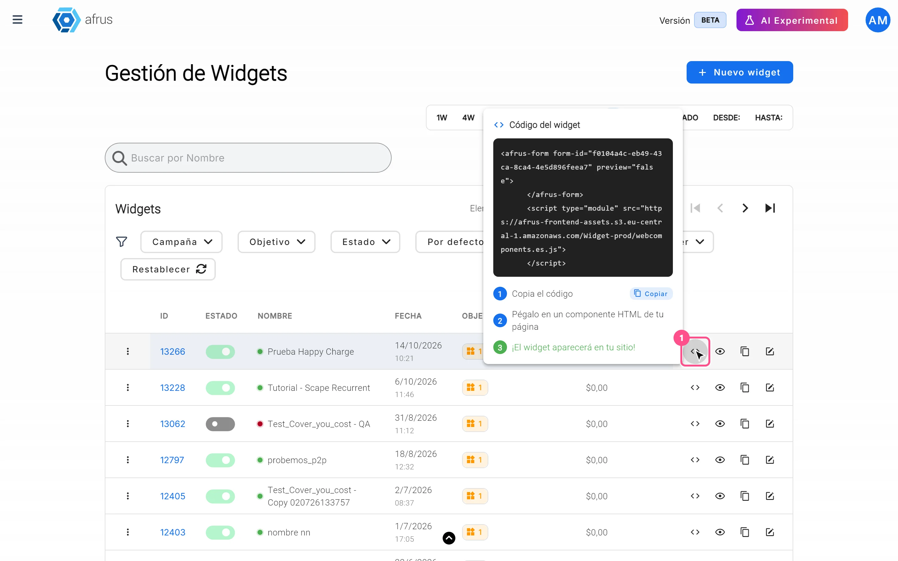

# Widgets guide

After reading this guide you will know what a widget is, which types exist and how to set one up end to end: styles, countries, snippets, payment methods, amounts, recurring offers, thank-you page, advanced options and embedding it on your website.

*Module: Widgets · Menu: **Fundraising > Widgets** · Audience: fundraising, digital marketing and web teams*

> **About the labels in this guide:** buttons, fields and menus are written exactly as they appear in the Spanish version of the console, with an English explanation where it helps.

---

## What a widget is

**A widget is an AFRUS form (donation, registration, payment, etc.) built from blocks called snippets and embedded on any website or landing page with a short code.**

Each widget has an **Objetivo** (Goal) — for example donation or registration —, one or more countries with their language and currency, and a list of snippets: personal information, amounts, payment method, terms and conditions, button, etc.

In **Fundraising > Widgets** you will see the **Gestión de Widgets** (Widget management) screen, with the "Nuevo widget" (New widget) button, filters (**Campaña**, **Objetivo**, **Estado**, **Por defecto**, **Etiqueta** — campaign, goal, status, default, tag) and a table with **Estado**, **Nombre**, **Fecha**, **Objetivo**, **Recaudado**, **Transacciones**, **Suscripciones**, **Vistas** and **Registros** (status, name, date, goal, raised, transactions, subscriptions, views, registrations).

## What it is for

- **Receive donations on your own site.** One-time, monthly or yearly, without donors leaving your page.
- **Capture leads, sell products or tickets and collect payments.** Each use has its own widget type.
- **Speak to each visitor in their language and currency.** The widget shows the country the person is browsing from, if you set it up.
- **Measure performance.** The **Dashboard de Widget** shows views, conversions and revenue for each form.
- **Send conversions to Google and Meta.** With Google Tag Manager, GA4, Pixel and Conversions API.

## Before you start

- **Permissions.** To see the "Nuevo widget" button you need permission to edit donation or lead forms.
- **The editor is in the previous version of AFRUS.** "Nuevo widget" and "Editar" (Edit) open the editor in a new browser tab. This screen opens in the previous version of AFRUS, which is why it looks different (for example, there the create button says "Nuevo formulario", New form).
- **How the editor is organized.** It has two tabs, **Editar** (Edit) and **Instalar** (Install). In **Editar**: on the left, the goal and the **Renderización** (Rendering), **Estilo** (Style) and **Avanzado** (Advanced) panels; in the center, the countries ("Nuevo país"), the snippets ("Agregar", Add) and "Vista previa" (Preview); on the right, **Configuración del snippet** (Snippet settings), with the save button (**Guardar Snippet**). At the top, the widget name, the **Estado** (Status) switch and "Guardar Widget" (Save widget).
- **Connected gateways.** To collect payments, the gateway must be connected in **Configuración > Pagos > Pasarelas de pago** (Settings > Payments > Payment gateways).

---

# Step by step

## Which widget types exist and what each one is for

The widget type is its **Objetivo** (Goal). It is chosen when you create the widget and defines which snippets are added automatically and which options appear. The goals you see are the ones AFRUS has enabled for your organization.

| Goal | What it is for | Snippets added automatically |
|---|---|---|
| **Transacción** (Transaction) | One-time, monthly or yearly donations | Personal information, Donation, Terms and conditions, Payment method, Button |
| **Registros** / **Registro** (Registration) | Capturing people's details (leads), no payment | Personal information, Button (Terms and conditions must be added to save) |
| **Ofrece Misas** / **Regala Misas** (Masses) | Mass and intention forms | Personal information, Mass types, Terms and conditions, Payment method, Button |
| **Pagos** (Payments) | Collecting a payment with a fixed value or a min/max | Personal information, Generic payment, Terms and conditions, Payment method, Button |
| **Producto** (Product) | Selling products or raffle tickets with price and stock | Personal information, Product, Terms and conditions, Payment method, Button |
| **Sign up** | Registering an organization with a pricing plan | Personal information, Sign up, Registration address, Pricing model, Terms and conditions, Payment method, Button |

To create a widget of the type you need:

1. **Open the editor.** In **Fundraising > Widgets**, click "Nuevo widget". The previous version of AFRUS opens in a new tab; there, click "Nuevo formulario".
   <!-- screenshot pending: which-widget-types-exist-01 — Selecciona el objetivo de tu formulario window -->
2. **Choose the goal.** In the **Selecciona el objetivo de tu formulario** (Select your form's goal) window, type the **Nombre del formulario** (Form name, up to 50 characters), choose the **Objetivo** and click "Crear" (Create). You will see *"¡Widget creado satisfactoriamente!"* (Widget created successfully) and the editor opens.
3. **Link a campaign.** In the **Renderización** panel, choose at least one campaign in **Elige tus campañas** (Choose your campaigns). It is required to save.
4. **Choose how it is displayed.** In the **Renderización** panel, under **Mecanismo de renderización** (Rendering mechanism), choose **Estandar** (Standard: the form is embedded in the page) or **Popup** (it opens from a button; then fill in **Texto del botón Pop up**, Popup button text). In the same panel you can turn on the language selector, the country selector and the progress bar.
5. **Set up the snippets and save.** Save each snippet with **Guardar Snippet** and the widget with "Guardar Widget". Then turn on the **Estado** switch so it is active.

If something is missing, "Guardar Widget" shows a red **Errores** (Errors) button with the reason, for example *"Debe seleccionar al menos una campaña en la pestaña de configuración"* (You must select at least one campaign) or *"Debe configurar los términos y condiciones para poder guardar el widget"* (You must set up terms and conditions to save the widget).

> **Pending confirmation:** exactly how the **Popup** mode looks to the visitor (button position).

## How to change the widget's styles

1. **Open the widget editor.** In **Fundraising > Widgets**, click "Editar" on the widget's row. It opens in the previous version of AFRUS, in a new tab.
2. **Choose the field shape.** In the **Editar** tab, **Estilo** panel, under **Seleccione un estilo para el formulario** (Select a form style), choose **Cuadrado**, **Cuadrado redondeado**, **Redondeado** or **Línea** (square, rounded square, rounded, line).
   <!-- screenshot pending: how-to-change-widget-styles-02 — Estilo panel -->
3. **Adjust colors and fonts.** Open **Estilo del formulario** (Form style) and change the **Familia tipográfica** (font family: Roboto, Arial, Calibri, Univers LT Pro), **Color principal** (main color), **Color de botones** (buttons), **Color de fondo** (background), **Color de texto** (text), **Color del texto de error** (error text), **Color de fondo de la caja** and **Color del texto de la caja** (box background and text), **Borde de la caja** (box border), **Borde** (border, with **Radio del border**, radius) and **Sombra** (shadow). This way the form looks like part of your brand.
4. **Adjust header and footer.** In **Encabezado** (Header) change the **Color de fondo**. In **Pie de página** (Footer) adjust alignment, **Color de texto**, the security text color and the typography. The "REINICIAR" (Reset) button goes back to the default values.
5. **Review and save.** Check the result with "Vista previa" and click "Guardar Widget".

When you finish you will see the new styles in the preview and in the published widget.

> **Important:** styles apply to the whole widget, not to each country. The form width is set in the **Instalar** tab (see "How to embed a widget on your website").

> **Can it be undone?** Yes. Change the values again, or use "REINICIAR" in **Pie de página** to restore that section's default values.

## How to add a new country and why

**Why:** each country in the widget has its own **Idioma** (language), its own **Moneda** (currency) and its own list of snippets (amounts, gateways, fields). When someone opens the widget, they see the country they are browsing from, if it is set up; otherwise they see the default country (marked with a star). If you turn on **Habilitar el selector de paises en este formulario** (Enable the country selector), donors can also switch country.

1. **Open the widget editor.** In **Fundraising > Widgets**, click "Editar". It opens in the previous version of AFRUS.
2. **Add the country.** In the center column, click the **Nuevo país** (New country) card.
   <!-- screenshot pending: how-to-add-a-new-country-02 — Idioma y moneda window -->
3. **Fill in language and currency.** In **Idioma y moneda**, choose **Seleccione un país** (Select a country), the **Idioma** (Español, English, Portugues, Italian or Deutsch) and check the **Moneda** (it fills in with the country's currency, but you can change it). If the widget's goal is **Pagos**, also choose the decimal format (1.00 or 1,00).
4. **Add a footer (optional).** Type a **Pie de página** text of up to 250 characters.
5. **Save the country.** Click "Guardar" (Save). You will see *"¡País añadido satisfactoriamente!"* (Country added successfully).
6. **Set up its snippets.** The new country starts without snippets of its own: when you open it, the editor adds the required ones for its goal. Set up amounts and payment method, and click "Guardar Widget".

> **Important:** amounts and gateways from other countries **are not copied**. Set them up again for the new country.

> **Important:** if you later change a country's currency, its **Medio de pago** (Payment method) snippet settings (gateways and frequencies) are deleted and you will need to set them up again.

With each country's three-dot menu you can use **Seleccionar por defecto** (Set as default), **Editar** and **Eliminar** (Delete). When editing, you can change language, currency, decimal format and footer, but not the country. The default country cannot be deleted, and the same country cannot be added twice (*"El País ya existe en este Widget"*, the country already exists in this widget).

> **Pending confirmation:** whether deleting a country can be undone.

## Which snippets are required and which are suggested

In the editor, snippets are either **required** or **optional**. AFRUS does not mark snippets as "suggested": which ones are worth using depends on your form.

> **Pending confirmation:** an official recommendation of suggested snippets per widget type.

**Required** (the editor adds them automatically and does not let you delete them):

- **Información personal** (Personal information): always first.
- **Términos y condiciones** (Terms and conditions): without this snippet, set up with text and URL, no widget can be saved. It is added automatically in every goal except **Registro**, where you must add it with "Agregar".
- **Medio de pago** (Payment method) and the final button (**Botón**): fixed at the end and cannot be moved. **Medio de pago** is added in the Transaction, Masses, Payments, Product and Sign up goals.
- Depending on the goal: **Donación** (Transaction), **Tipos de Misas** (Masses), **Pago Genérico** (Payments), **Producto** (Product), and **Sign up**, **Dirección de registro** and **Modelo de precios** (Sign up).
- **Those required by the gateway:** when you save **Medio de pago**, the editor adds the fields each gateway requires, with the notice *"¡IMPORTANTE! Este snippet es requerido por la pasarela de pago"* (This snippet is required by the payment gateway). They can be first name, last name or email, **Dirección** (address; not required in Brazil), **Documento** (ID document; not required with PayPal or direct debit; with AvalPay **Documento** and phone are always required) and other fields such as phone, gender, date of birth, country, organization or postal code.

**Optional:** **Imagen** (Image), **Texto** (Text), **Separador** (Separator: splits the form into steps), **Campo personalizado** (Custom field), **Campo predeterminado** (Default field), **Dirección** or **Dirección Fija** (Address or Fixed address — you can't use both), **Documento**, **Ofrecer única a recurrente** (Offer one-time to recurring), **ID de la campaña de Salesforce** (not visible on the form) and, for masses, **Imagen con texto**, **Intención** and **Regala intención**. Some only appear if AFRUS enabled them for your organization.

To add a snippet:

1. **Open the widget editor** and the country you want to set up.
2. **Add the snippet.** In the center column, click "Agregar" and choose the snippet.
3. **Set it up.** Click it, fill it in under **Configuración del snippet** and save it with **Guardar Snippet**.
4. **Order it.** Drag it to the position you want.

Most snippets can be added only once per country; **Texto**, **Imagen**, **Separador**, **Campo personalizado** and **Campo predeterminado** can be repeated. A snippet with a red border and an alert icon has incomplete or invalid settings.

## How to set up payment methods in your widget

**Before you start:** the gateway must be connected in **Configuración > Pagos > Pasarelas de pago**. The snippet only shows connected gateways that accept the country's currency. In **Sign up** widgets only Stripe and Niubiz2 are offered.

1. **Open the Medio de pago snippet.** In the widget editor (previous version of AFRUS), choose the country and click the **Medio de pago** snippet.
   <!-- screenshot pending: how-to-set-up-payment-methods-01 — Medio de pago snippet -->
2. **Choose the frequencies.** In **Seleccionar periodicidades** (Select frequencies) check **Única**, **Mensual** and/or **Anual** (one-time, monthly, yearly; at least one).
3. **Choose the gateways.** In **Selecionar pasarelas de pago** (Select payment gateways) choose one or more.
4. **Match method and frequency.** In **Empatar periodicidad y método de pago** (Match frequency and payment method), check for each gateway and each method (card, Pix, boleto, etc.) which frequencies it is offered in.
5. **Order the methods.** In **Orden de los métodos de pago Única / Mensual / Anual** (Payment method order), drag the methods. With the "set default" button you mark the preselected method (it shows a star).
6. **Save.** Click **Guardar Snippet** and then "Guardar Widget".

When you finish, donors will see only the methods enabled for the frequency they chose, in the order you set.

- Pix, boleto and cash can only be offered as **Única** (one-time). The exception is Pix with Infopago, which also allows monthly.
- The same method cannot be assigned to two gateways in the same frequency.
- Some methods are only shown for certain countries.
- Changing the country's currency deletes these settings.

## How to set up the Donation snippet (amounts, images, one-time and monthly)

**Before you start:** set up **Medio de pago** first. The Donation snippet frequencies (Única / Mensual / Anual) come from the frequencies you checked there. The editor warns you: *"IMPORTANTE: Para realizar sugerencias de cantidades, es imprescindible haber configurado previamente el snippet de 'MEDIOS DE PAGO'."* (To suggest amounts, you must first set up the payment methods snippet.)

1. **Open the Donation snippet.** In the widget editor, choose the country and click **Donación**.
2. **Choose the options.** Check the ones you need:
   - **Quiero campo de monto** (I want an amount field): a free field where donors type their amount. It also lets you change the **Texto personalizado para el campo de monto libre** (custom text for the free amount field, up to 250 characters).
   - **No quiero sugerir cantidades.** (I don't want to suggest amounts): hides the amount buttons (only with the amount field on).
   - **Quiero escribir una frase de solicitud para cada cantidad** (a request phrase per amount), with its background color.
   - **Quiero poner una imagen y descripción por cada cantidad** (an image and description per amount).
3. **Set amounts per frequency.** Click "Configurar frecuencias" (Set up frequencies). In the **Selecciones las cantidades por frecuencias** window, on each tab:
   - add up to 4 amounts with "Agregar cantidad" (Add amount);
   - mark the default amount with the star (one per frequency, required);
   - optionally set a **Mínimo** (minimum) amount and change the name donors see with **Editar texto de frecuencía** (Edit frequency text);
   - if there are several frequencies, choose the preselected one with **Seleccionar frecuencia por defecto** (Select default frequency).
   <!-- screenshot pending: donation-snippet-setup-03 — Selecciones las cantidades por frecuencias window -->
4. **Add images (if you turned them on).** Upload one image per amount with "Subir imagen" (Upload image) or choose it from **Galería** (Gallery), and write an optional description. Use jpg, webp or png, recommended maximum 150 × 150 pixels and 1 MB.
5. **Save.** Click "Guardar" inside the window and then **Guardar Snippet**.
6. **Order the frequencies (optional).** In **Orden de las frecuencias** (Frequency order), drag to decide the order of Única, Mensual and Anual.

When you finish, donors will see one tab per frequency with your suggested amounts and, if you turned it on, the free amount field.

- Up to 4 amounts per frequency (*"Límite de campos de montos alcanzado"*, amount limit reached).
- If a frequency is missing its star, you will see *"Selecciona un monto predeterminado para: …"* (Select a default amount for: …).
- The **Editar texto de frecuencía** text is not translated into other languages.
- Each country has its own Donation snippet.

## Scape recurrent: show the one-time donation only as a link

With this option, the form shows only the monthly donation and leaves the one-time option as a discreet link. It helps push recurring giving without taking away the option to give once.

**Before you start:** in the **Donación** snippet, the **Mensual** frequency must be active with at least one amount, and **Única** must also be active. Otherwise the checkbox doesn't appear.

1. **Open the Donation snippet** in the widget editor.
2. **Turn on the option.** Check **Mostrar la donación única solo como enlace debajo del botón de pago** (Show the one-time donation only as a link below the payment button).
   <!-- screenshot pending: scape-recurrent-02 — checkbox in the Donación snippet -->
3. **Save.** Click **Guardar Snippet** and then "Guardar Widget".

When you finish, the **Única** tab is hidden and donors see only the monthly frequency. Below the payment button the link *"Hacer donación única"* (Make a one-time donation) appears, which switches the donation to one-time.

> **Important:** the link only appears if the one-time frequency has amounts set up or if **Quiero campo de monto** is on.

> **Can it be undone?** Yes. Uncheck the box and save.

## Conversion cards: offer one-time donors to become monthly

The **Ofrecer única a recurrente** (Offer one-time to recurring) snippet shows a card inviting one-time donors to become monthly donors.

**Before you start:**
- AFRUS must enable this snippet for your organization, and it only exists in **Transacción** widgets.
- The monthly frequency must be enabled in the **Donación** snippet with at least one amount. Otherwise you will see: *"La frecuencia mensual debe estar habilitada y tener al menos un monto configurado en el snippet de Donación antes de usar esta función."* (The monthly frequency must be enabled and have at least one amount.)

1. **Add the snippet.** In the widget editor, click "Agregar" and choose **Ofrecer única a recurrente**. It is placed right after **Donación**, with a separator, and moves together with Donation.
2. **Turn it on.** Turn on **Habilitar** (Enable).
3. **Customize the card (optional).** Fill in **Título** and **Subtítulo** (title, subtitle), and choose **Color del botón** (button color), **Color de degradado superior** (top gradient color) and **Color de fondo de la tarjeta** (card background). If you leave a color empty, the **Estilo** panel palette is used.
   <!-- screenshot pending: conversion-cards-03 — Ofrecer única a recurrente settings -->
4. **Set the rates.** Fill in **Tasa 1 (%)** and **Tasa 2 (%)** (Rate 1 and 2), whole numbers from 1 to 99 (default 50 and 25). They are the percentages of the one-time amount proposed as a monthly donation.
5. **Save.** Click **Guardar Snippet** and then "Guardar Widget".

**What donors see:**
- **During the form:** if they chose a one-time donation, they see the card *"Conviértete en donante mensual"* (Become a monthly donor) with two buttons *"Donar {amount}/mes"*, calculated with Rate 1 and Rate 2 on their amount, and the option *"Mantener mi donación única de {amount}"* (Keep my one-time donation). If they accept, the donation becomes monthly.
- **After paying:** if they paid a one-time donation by card through a gateway managed by AFRUS, they see *"Conviértelo en un regalo mensual"* (Make it a monthly gift) before the thank-you page. If they accept, a monthly subscription is also created; the one-time donation already charged does not change.

> **Important:** if the donor already accepted the offer inside the form, they don't see the after-payment offer. With PayPal, bank debit, Pix or other gateways not managed by AFRUS, only the in-form offer can appear.

> **Can it be undone?** Yes. Turn off **Habilitar** and save.

## Cover your cost: let donors cover the costs

With **Cover Your Cost**, donors can cover the gateway fee, so your organization receives the full donation amount.

**Before you start:** AFRUS must turn on Cover Your Cost for your organization; it can't be turned on from the console. Until then, the section doesn't appear. It is set up **per gateway**, not inside the widget editor.

1. **Open the gateway.** Go to **Configuración > Pagos > Pasarelas de pago** and open the gateway.
   
2. **Turn it on.** In the **Cover Your Cost** section, turn on **Activar Cover Your Cost**.
3. **Set the fee.** Fill in **Comisión de pasarela (%)** (gateway fee, minimum 0.01). The **Comisión AFRUS (%)** (AFRUS fee) is read-only. Both together must be under 80%.
4. **Choose whether it is preselected.** With **Preseleccionar la opción para el donante** (Preselect the option for the donor) on, donors see the switch on and can turn it off; with it off, they see it off and must turn it on.
5. **Save the gateway.** Repeat for each gateway that should offer it.

When you finish, in the widget's last step, with that gateway selected, donors will see the card *"Cubrir el 100% los costos de donación"* (Cover 100% of the donation costs), with **Donación base** (base donation), **Costo aproximado de transacción** (approximate transaction cost) and **Total**. The total is calculated so that, after fees, your organization receives at least the base amount, rounded up; that's why donors pay slightly more than the simple sum of the percentages.

> **Important:** if the AFRUS fee can't be loaded, the gateway can't be saved (*"No se pudo cargar la comisión de AFRUS. Inténtalo de nuevo."*, the AFRUS fee couldn't be loaded, try again). Try again.

> **Can it be undone?** Yes. Turn off **Activar Cover Your Cost** in the gateway and save.

## How to set up a thank-you page

1. **Open the panel.** In the widget editor (previous version of AFRUS), **Editar** tab, open the **Avanzado** panel and, inside it, **Página de agradecimiento** (Thank-you page).
   <!-- screenshot pending: how-to-set-up-a-thank-you-page-01 — Página de agradecimiento panel -->
2. **Option A: use the campaign's page.** Check **Usa la página de agradecimiento de la campaña.** (Use the campaign's thank-you page). After paying, donors go to the thank-you page you created in the campaign. As the editor warns, check the countries that don't have the same translation in the campaign.
3. **Option B: set your own URLs.** Click "Configurar" (Set up). In the **Páginas de agradecimiento** window, turn on **Habilitar página de agradecimiento** (Enable thank-you page) and choose:
   - one **Página de agradecimiento general** (general thank-you page) URL for every case; or
   - **Página de agradecimiento personalizada** (custom thank-you page; only in transaction and mass widgets): in **Transacciones unicas** and **Transacciones recurrentes** (one-time and recurring transactions) fill in **Redirección de transacción exitosa** (successful transaction redirect) and **Redirección de transacción pendiente de confirmación** (pending transaction redirect). For masses, one URL per mass type.
4. **Save.** Click "Guardar" and then "Guardar Widget".

When you finish, after the operation donors will go to the matching URL. If the thank-you page is disabled, they see the form's own confirmation.

- URLs must start with `http://` or `https://` and be under 255 characters.
- If you checked the campaign's page and the campaign has one set up, it takes priority.
- A declined donation does not redirect to any custom page.

## "Avanzado" options: captcha, analytics, Face to Face, Facebook CAPI and measurement protocol

All of them are set up in the widget editor's **Avanzado** (Advanced) panel (previous version of AFRUS) and saved with "Guardar Widget".

1. **Recaptcha.** Turn on the **Recaptcha** switch (*"Permitir que se requiera la validación de captcha en todo momento"*, always require captcha validation) so donors always have to type a 6-character verification code. Without the switch, the captcha can still appear when the system detects a suspicious attempt.
2. **Google Tag Manager 4 (analytics).** Paste your **Código de seguimiento** (tracking code: your container ID). The widget sends the donor journey events to your container, so you can measure them in your tools.
3. **Protocolo de medición** (Measurement protocol). Fill in your GA4 property's **Measurement Id** and **Api secret**. With these, AFRUS sends events to GA4, including the purchase, also from the server.
4. **Facebook Capi.** Fill in **Pixel id** and **Access Token**. AFRUS sends events to Meta from the browser (Pixel) and from the server (Conversions API), including the purchase or registration conversion.
5. **Face to Face** (transaction widgets only). Use it for in-person donations, when a fundraiser fills in the form for each donor on a shared device:
   - turn on **Face to Face** (*"Habilitar configuración Face to Face para transacciones presenciales"*);
   - fill in **Correo del captador** (fundraiser email, required) and, optionally, **Correo del supervisor** (supervisor email);
   - **Desactivar autocompletado del navegador** (Turn off browser autofill) is checked automatically, so the browser doesn't offer the previous donor's details.
   <!-- screenshot pending: advanced-options-05 — Avanzado panel with Face to Face -->
6. **Save.** Click "Guardar Widget".

When you finish:
- **Face to Face:** the fundraiser and the supervisor receive an email for every successful or failed donation in that widget.
- **Analytics:** events reach the configured accounts. A landing page's Pixel and Google Analytics are set up separately, in the landing.

> **Important:** with Face to Face on, the widget can't be saved without **Correo del captador**. If your organization has a Meta setup at organization level, AFRUS may use that token instead of the one you entered in the widget.

## How to embed a widget on your website

**Quick option (from the list):**

1. **Open the code.** In **Fundraising > Widgets**, click the code icon on the widget's row. **Código del widget** (Widget code) opens.
   
2. **Copy the code.** Click "Copiar" (Copy).
3. **Paste it on your page.** Paste it into an HTML block or component on your site. The widget will appear there.

**Option with custom width (from the editor):**

1. **Open the Instalar tab.** In the widget editor (previous version of AFRUS), open **Instalar** (Install).
2. **Set the width.** In **Configura el ancho del formulario** (Set the form width), use pixels (px), percentage (%), ems (em), rems (rem) or viewport width (vw). For a different width on narrower screens, turn on "Aplicar ancho especifico" (Apply specific width) with an **Ancho de aplicación**.
3. **Save and copy.** Click "Guardar Widget" and copy the **Código de inserción** (Embed code) with "Copiar".
4. **Paste it on your page**, in an HTML block.

- The code is the same for all the widget's countries; the country is chosen automatically when it opens.
- If the widget is inactive (**Estado** off), it doesn't receive donations.
- To check it without publishing, use "Vista previa" or, in the **Dashboard de Widget**, "Abrir para probar" (Open to test).

> **Pending confirmation:** how long a saved change takes to show in the already published widget.

---

## Other actions in the list

| Action | What it does |
|---|---|
| "Clonar" (Clone) | Creates a copy of the widget |
| **Establecer como predeterminado** (Set as default) | Marks the widget as the default form for its goal |
| **Asignar tags** (Assign tags) | Assigns tags so you can filter it |
| **Estado** switch | Turns the widget on or off |
| **Eliminar** (Delete) | Deletes the widget; asks you to type its name to confirm |

> **Can it be undone?** Deleting a widget can't be undone. A widget with linked donations can't be deleted: archive or deactivate it instead.

## Known limitations

- **The editor is in the previous version of AFRUS.** "Nuevo widget" and "Editar" open a new browser tab.
- **Untranslated texts.** Some editor texts always appear the same, in any language: the "set default" button, the titles **Recaptcha**, **Google Tag Manager 4**, **Protocolo de medición**, **Facebook Capi** and the fields **Measurement Id**, **Api secret**, **Pixel id** and **Access Token**.
- **Image description counter per amount.** The counter shows "/144", but the real limit is 150 characters. Stick to 144 to stay within it.
- **Changing a country's currency deletes its payment method settings.** Set them up again after the change.

## Frequently asked questions

**Why does the editor look different from the rest of the console?**
Because it opens in the previous version of AFRUS, in a new tab. That's why some names change: in the editor's list the button says "Nuevo formulario" and in the console it says "Nuevo widget".

**Can I have different amounts per country?**
Yes. Each country has its own Donation snippet and its own payment method.

**Can I offer Pix or boleto as a monthly donation?**
No, except Pix with Infopago, which also allows monthly. Pix, boleto and cash are offered only as **Única**.

**Where do I turn on Cover Your Cost inside the widget?**
Nowhere in the widget: it is set up per gateway, in **Configuración > Pagos > Pasarelas de pago**, and only if AFRUS turned it on for your organization.

---

> **[Back to section index](./README.md)** · **[Back to main index](../README.md)**

*Last updated: 2026-10-20*
