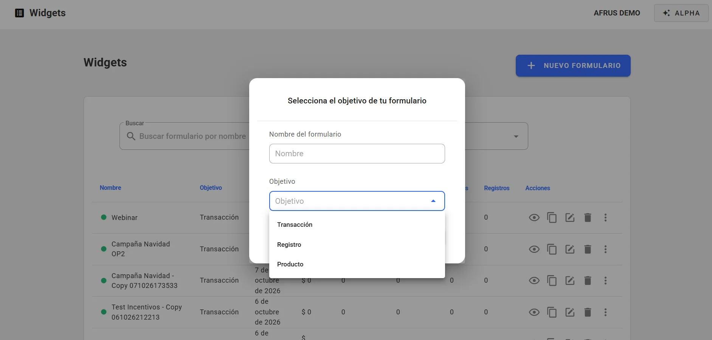
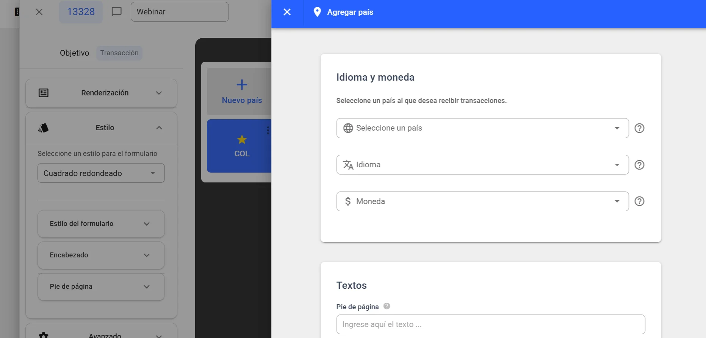
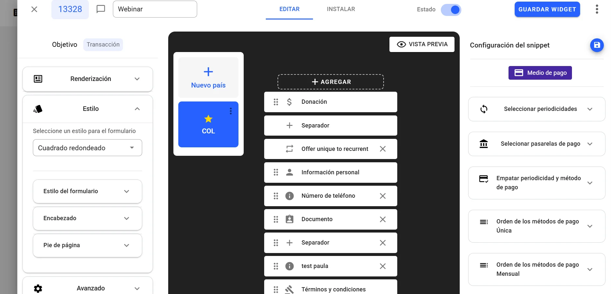
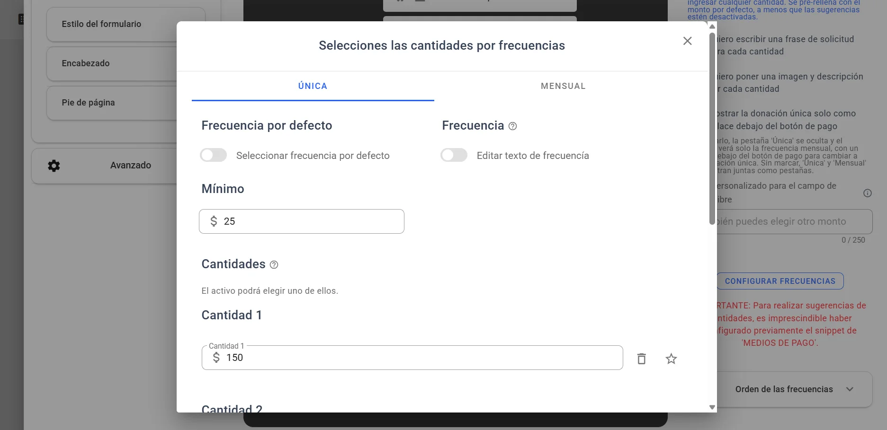
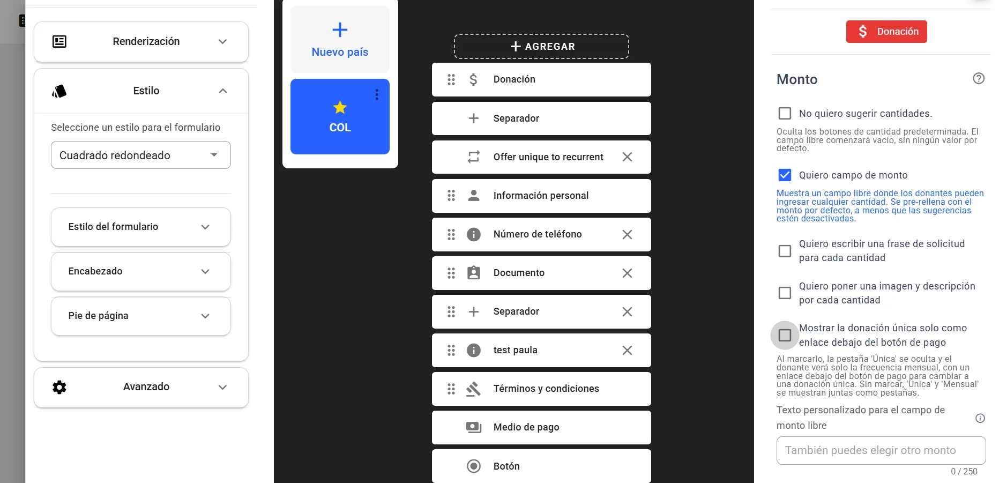
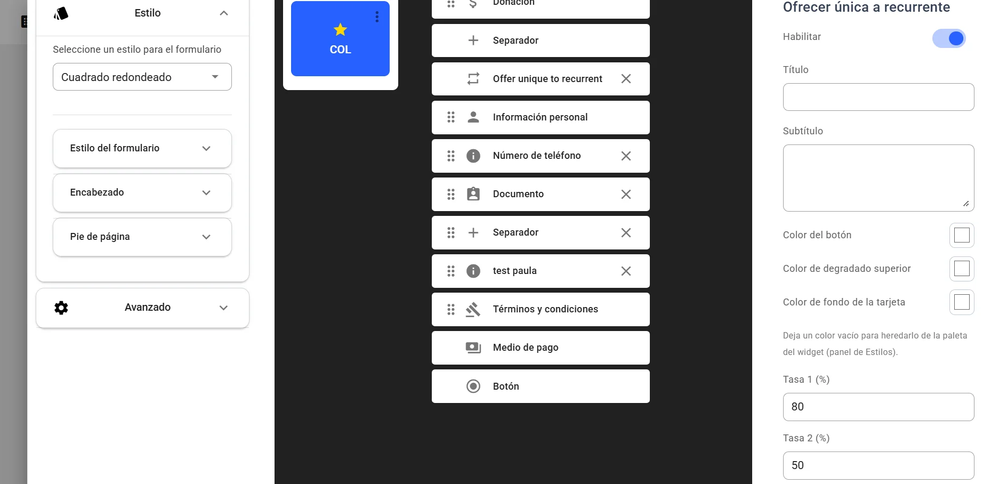
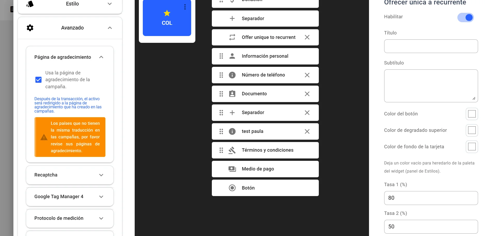
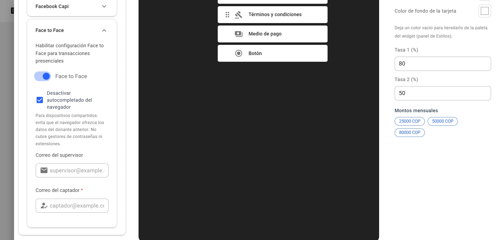

# Guia de Widgets

Depois de ler este guia, você vai saber o que é um widget, quais tipos existem e como configurá-lo de ponta a ponta: estilos, países, snippets, métodos de pagamento, valores, ofertas de recorrência, página de agradecimento, opções avançadas e inserção no seu site.

*Módulo: Widgets · Menu: **Fundraising > Widgets** · Público: equipes de captação, marketing digital e web*

> **Sobre os nomes de tela neste guia:** botões, campos e menus estão escritos exatamente como aparecem na versão em espanhol do console, com a explicação em português quando ajuda.

---

## O que é um widget

**Um widget é um formulário da AFRUS (de transação, de cadastro, de produto) montado com blocos chamados snippets e inserido em qualquer site ou landing com um pequeno código.**

Cada widget tem um **Objetivo** — por exemplo, transação ou cadastro —, um ou mais países com seu idioma e moeda, e uma lista de snippets: informações pessoais, valores, meio de pagamento, termos e condições, botão etc.

Em **Fundraising > Widgets** você verá a tela **Gestión de Widgets** (Gestão de widgets), com o botão "Nuevo widget" (Novo widget), filtros (**Campaña**, **Objetivo**, **Estado**, **Por defecto**, **Etiqueta** — campanha, objetivo, status, padrão, etiqueta) e uma tabela com **Estado**, **Nombre**, **Fecha**, **Objetivo**, **Recaudado**, **Transacciones**, **Suscripciones**, **Vistas** e **Registros** (status, nome, data, objetivo, arrecadado, transações, assinaturas, visualizações, cadastros).

## Para que serve

- **Receber doações no seu site.** Únicas, mensais ou anuais, sem o doador sair da sua página.
- **Captar cadastros (leads) e vender produtos ou tickets.** Cada uso tem seu tipo de widget.
- **Falar com cada visitante no idioma e na moeda dele.** O widget mostra o país de onde a pessoa navega, se você o configurou.
- **Medir o desempenho.** O **Dashboard de Widget** mostra visualizações, conversões e receita de cada formulário.
- **Enviar as conversões para o Google e a Meta.** Com Google Tag Manager, GA4, Pixel e Conversions API.

## Antes de começar

- **Permissões.** Para ver o botão "Nuevo widget" você precisa da permissão de edição de formulários de doação ou de leads.
- **O editor abre em uma nova aba.** "Nuevo widget" e "Editar" abrem o editor em uma nova aba do navegador. Lá, o botão de criar diz "Nuevo formulario" (Novo formulário).
- **Como o editor está organizado.** Ele tem duas abas, **Editar** e **Instalar**. Em **Editar**: à esquerda, o objetivo e os painéis **Renderización** (Renderização), **Estilo** e **Avanzado** (Avançado); no centro, os países ("Nuevo país"), os snippets ("Agregar", Adicionar) e "Vista previa" (Pré-visualização); à direita, **Configuración del snippet** (Configuração do snippet), com o botão de salvar (**Guardar Snippet**). No topo, o nome do widget, a chave **Estado** (Status) e "Guardar Widget" (Salvar widget).
- **Gateways conectados.** Para cobrar, o gateway de pagamento precisa estar conectado em **Ajustes de Organización > Pasarelas de pago** (Ajustes da organização > Gateways de pagamento).

---

# Passo a passo

## Quais tipos de widget existem e para que serve cada um

O tipo de widget é o seu **Objetivo**. Ele é escolhido na criação e define quais snippets são adicionados automaticamente e quais opções aparecem. Os objetivos que você vê são os que a AFRUS habilitou para a sua organização.

| Objetivo | Para que serve | Snippets adicionados automaticamente |
|---|---|---|
| **Transacción** (Transação) | Doações únicas, mensais ou anuais | Informações pessoais, Doação, Termos e condições, Meio de pagamento, Botão |
| **Registro** (Cadastro) | Captar dados de pessoas (leads), sem pagamento | Informações pessoais, Botão (Termos e condições precisa ser adicionado para salvar) |
| **Producto** (Produto) | Vender produtos ou tickets de rifa com preço e estoque | Informações pessoais, Produto, Termos e condições, Meio de pagamento, Botão |

Para criar um widget do tipo que você precisa:

1. **Abra o editor.** Em **Fundraising > Widgets**, clique em "Nuevo widget". O editor abre em uma nova aba; lá, clique em "Nuevo formulario".
   
2. **Escolha o objetivo.** Na janela **Selecciona el objetivo de tu formulario** (Selecione o objetivo do formulário), digite o **Nombre del formulario** (nome do formulário, até 50 caracteres), escolha o **Objetivo** e clique em "Crear" (Criar). Você verá *"¡Widget creado satisfactoriamente!"* (Widget criado com sucesso) e o editor abre.
3. **Vincule uma campanha.** No painel **Renderización**, escolha pelo menos uma campanha em **Elige tus campañas** (Escolha suas campanhas). É obrigatório para salvar.
4. **Escolha como ele aparece.** No painel **Renderización**, em **Mecanismo de renderización**, escolha **Estandar** (Padrão: o formulário aparece incorporado na página) ou **Popup** (abre a partir de um botão; nesse caso preencha **Texto del botón Pop up**). No mesmo painel você pode ativar o seletor de idiomas, o seletor de países e a barra de progresso.
5. **Configure os snippets e salve.** Salve cada snippet com **Guardar Snippet** e o widget com "Guardar Widget". Depois ative a chave **Estado** para que ele fique ativo.

Se faltar algo, "Guardar Widget" mostra um botão vermelho **Errores** (Erros) com o motivo, por exemplo *"Debe seleccionar al menos una campaña en la pestaña de configuración"* (selecione pelo menos uma campanha) ou *"Debe configurar los términos y condiciones para poder guardar el widget"* (configure os termos e condições para salvar).

## Como criar um widget de produto

Um widget de produto serve para vender produtos ou tickets de rifa com preço e estoque.

1. **Crie o widget com o objetivo Producto.** Em **Fundraising > Widgets**, clique em "Nuevo widget" e, na nova aba, em "Nuevo formulario" (Novo formulário). Escreva o **Nombre del formulario** (Nome do formulário), escolha o **Objetivo** **Producto** (Produto) e clique em "Crear" (Criar). O editor adiciona sozinho os snippets **Información personal** (Informações pessoais), **Producto**, **Términos y condiciones** (Termos e condições), **Medio de pago** (Meio de pagamento) e **Botón** (Botão).
2. **Vincule uma campanha.** No painel **Renderización**, escolha pelo menos uma campanha em **Elige tus campañas** (Escolha suas campanhas). É obrigatório para salvar.
3. **Adicione o produto.** Abra o snippet **Producto** e clique em "Agregar Producto" (Adicionar produto).
4. **Escolha o tipo de produto e preencha os dados.** Em **Tipo de Producto** (Tipo de produto), escolha o que você vai vender e preencha o nome, a descrição, o preço e o estoque do produto. Se for vender números de uma rifa, escolha **Ticket** e depois sua rifa em **Seleccionar Ticket** (Selecionar ticket): o nome, a descrição e o estoque são preenchidos sozinhos e você só precisa escrever o **Precio del producto** (Preço do produto, o preço de cada ticket). Antes, você precisa ter criado a rifa em **Fundraising > Tickets** (veja o [Guia de Tickets](../tickets/tickets-guide.pt.md)).
5. **Confirme o produto.** Clique em "Agregar Producto". Você verá *"¡Producto agregado satisfactoriamente!"* (Produto adicionado com sucesso).
6. **Complete o resto e salve.** Configure **Términos y condiciones** e **Medio de pago** (veja "Como configurar os métodos de pagamento do seu widget"), salve cada snippet com **Guardar Snippet** e o widget com "Guardar Widget". Depois ative o botão **Estado**.

> **Importante:** em um mesmo snippet **Producto** não é possível misturar produtos comuns com tickets (*"No se pueden mezclar tipos de productos"*, não é possível misturar tipos de produtos), e cada widget aceita uma só rifa.

## Como mudar os estilos do widget

1. **Abra o editor do widget.** Em **Fundraising > Widgets**, clique em "Editar" na linha do widget. Ele abre em uma nova aba.
2. **Escolha o formato dos campos.** Na aba **Editar**, painel **Estilo**, em **Seleccione un estilo para el formulario** (Selecione um estilo para o formulário), escolha **Cuadrado**, **Cuadrado redondeado**, **Redondeado** ou **Línea** (quadrado, quadrado arredondado, arredondado, linha).
   
3. **Ajuste cores e tipografia.** Abra **Estilo del formulario** e altere a **Familia tipográfica** (fonte: Roboto, Arial, Calibri, Univers LT Pro), **Color principal** (cor principal), **Color de botones** (botões), **Color de fondo** (fundo), **Color de texto** (texto), **Color del texto de error** (texto de erro), **Color de fondo de la caja** e **Color del texto de la caja** (fundo e texto da caixa), **Borde de la caja** (borda da caixa), **Borde** (borda, com **Radio del border**, raio) e **Sombra**. Assim o formulário parece parte da sua marca.
4. **Ajuste cabeçalho e rodapé.** Em **Encabezado** (Cabeçalho) mude a **Color de fondo**. Em **Pie de página** (Rodapé) ajuste o alinhamento, a **Color de texto**, a cor do texto de segurança e a tipografia. O botão "REINICIAR" (Redefinir) volta aos valores de fábrica.
5. **Revise e salve.** Veja o resultado em "Vista previa" e clique em "Guardar Widget".

Ao terminar, você verá os novos estilos na pré-visualização e no widget publicado.

> **Importante:** os estilos valem para o widget inteiro, não para cada país. A largura do formulário é definida na aba **Instalar** (veja "Como inserir um widget no seu site").

> **Dá para desfazer?** Sim. Altere os valores de novo, ou use "REINICIAR" em **Pie de página** para voltar aos valores de fábrica dessa seção.

## Como adicionar um novo país e para quê

**Para quê:** cada país do widget tem seu próprio **Idioma**, sua própria **Moneda** (moeda) e sua própria lista de snippets (valores, gateways, campos). Quando alguém abre o widget, vê o país de onde navega, se ele estiver configurado; se não, vê o país padrão (marcado com estrela). Se você ativar **Habilitar el selector de paises en este formulario** (Habilitar o seletor de países), o doador também pode trocar de país.

1. **Abra o editor do widget.** Em **Fundraising > Widgets**, clique em "Editar".
2. **Adicione o país.** Na coluna central, clique no cartão **Nuevo país** (Novo país).
   
3. **Preencha idioma e moeda.** Em **Idioma y moneda**, escolha **Seleccione un país** (Selecione um país), o **Idioma** (Español, English, Portugues, Italian ou Deutsch) e confira a **Moneda** (ela é preenchida com a moeda do país, mas você pode mudá-la).
4. **Adicione um rodapé (opcional).** Escreva um texto de **Pie de página** de até 250 caracteres.
5. **Salve o país.** Clique em "Guardar" (Salvar). Você verá *"¡País añadido satisfactoriamente!"* (País adicionado com sucesso).
6. **Configure os snippets dele.** O país novo começa sem snippets próprios: ao abri-lo, o editor adiciona os obrigatórios do objetivo. Configure valores e meio de pagamento e clique em "Guardar Widget".

> **Importante:** os valores e os gateways dos outros países **não são copiados**. Configure-os de novo para o país novo.

> **Importante:** se depois você mudar a moeda de um país, a configuração do snippet **Medio de pago** (Meio de pagamento) desse país — gateways e periodicidades — é apagada e precisará ser refeita.

No menu de três pontos de cada país você tem **Seleccionar por defecto** (Definir como padrão), **Editar** e **Eliminar** (Excluir). Ao editar, você pode mudar idioma, moeda, formato decimal e rodapé, mas não o país. O país padrão não pode ser excluído, e não é possível adicionar o mesmo país duas vezes (*"El País ya existe en este Widget"*, o país já existe neste widget).

> **Dá para desfazer?** Não. A exclusão de um país não pode ser desfeita.

## Quais snippets são obrigatórios e quais são sugeridos

No editor, os snippets são **obrigatórios** ou **opcionais**. A AFRUS não marca snippets como "sugeridos": quais vale a pena usar depende do seu formulário.

**Obrigatórios** (o editor adiciona automaticamente e não deixa excluir):

- **Información personal** (Informações pessoais): sempre vem primeiro.
- **Términos y condiciones** (Termos e condições): sem esse snippet, configurado com texto e URL, nenhum widget pode ser salvo. Ele é adicionado automaticamente em todos os objetivos menos **Registro**, onde é preciso adicioná-lo com "Agregar".
- **Medio de pago** (Meio de pagamento) e o botão final (**Botón**): ficam fixos no final e não podem ser movidos. **Medio de pago** é adicionado nos objetivos Transação e Produto.
- Conforme o objetivo: **Donación** (Transação) ou **Producto** (Produto).
- **Os exigidos pelo gateway:** ao salvar **Medio de pago**, o editor adiciona os campos que cada gateway exige, com o aviso *"¡IMPORTANTE! Este snippet es requerido por la pasarela de pago"* (Este snippet é exigido pelo gateway de pagamento). Podem ser nome, sobrenome ou e-mail, **Dirección** (endereço; não é exigido no Brasil), **Documento** (não é exigido com PayPal nem com débito direto; com AvalPay, **Documento** e telefone são sempre exigidos) e outros campos como telefone, gênero, data de nascimento, país, organização ou CEP.

**Opcionais:** **Imagen** (Imagem), **Texto**, **Separador** (divide o formulário em etapas), **Campo personalizado**, **Campo predeterminado** (Campo padrão), **Dirección** ou **Dirección Fija** (Endereço ou Endereço fixo — não dá para usar os dois), **Documento**, **Ofrecer única a recurrente** (Oferecer única para recorrente), **ID de la campaña de Salesforce** (não aparece no formulário). Alguns só aparecem se a AFRUS os habilitou para a sua organização.

Para adicionar um snippet:

1. **Abra o editor do widget** e o país que quer configurar.
2. **Adicione o snippet.** Na coluna central, clique em "Agregar" e escolha o snippet.
3. **Configure-o.** Clique nele, preencha em **Configuración del snippet** e salve com **Guardar Snippet**.
4. **Ordene-o.** Arraste-o para a posição que quiser.

A maioria dos snippets só pode ser adicionada uma vez por país; **Texto**, **Imagen**, **Separador**, **Campo personalizado** e **Campo predeterminado** podem se repetir. Um snippet com borda vermelha e ícone de alerta tem a configuração incompleta ou inválida.

## Como configurar os métodos de pagamento do seu widget

**Antes de começar:** o gateway precisa estar conectado em **Ajustes de Organización > Pasarelas de pago**. No snippet aparecem apenas os gateways conectados que aceitam a moeda do país.

1. **Abra o snippet Medio de pago.** No editor do widget, escolha o país e clique no snippet **Medio de pago**.
   
2. **Escolha as periodicidades.** Em **Seleccionar periodicidades** marque **Única**, **Mensual** e/ou **Anual** (única, mensal, anual; pelo menos uma).
3. **Escolha os gateways.** Em **Selecionar pasarelas de pago** escolha um ou vários.
4. **Combine método e periodicidade.** Em **Empatar periodicidad y método de pago**, marque, para cada gateway e cada método (cartão, Pix, boleto etc.), em quais periodicidades ele é oferecido.
5. **Ordene os métodos.** Em **Orden de los métodos de pago Única / Mensual / Anual**, arraste os métodos. Com o botão "set default" você marca o método pré-selecionado (aparece com uma estrela).
6. **Salve.** Clique em **Guardar Snippet** e depois em "Guardar Widget".

Ao terminar, o doador verá apenas os métodos habilitados para a periodicidade escolhida, na ordem que você definiu.

- Um mesmo método não pode ficar atribuído a dois gateways na mesma periodicidade.
- Alguns métodos só aparecem para certos países.
- Mudar a moeda do país apaga essa configuração.

## Como configurar o snippet Doação (valores, imagens, única e mensal)

**Antes de começar:** configure primeiro **Medio de pago**. As frequências do snippet Doação (Única / Mensal / Anual) vêm das periodicidades marcadas lá. O editor avisa: *"IMPORTANTE: Para realizar sugerencias de cantidades, es imprescindible haber configurado previamente el snippet de 'MEDIOS DE PAGO'."* (Para sugerir valores, é preciso configurar antes o snippet de meios de pagamento.)

1. **Abra o snippet Donación.** No editor do widget, escolha o país e clique em **Donación** (Doação).
2. **Escolha as opções.** Marque as que precisar:
   - **Quiero campo de monto** (Quero campo de valor): um campo livre para o doador digitar o valor. Também permite mudar o **Texto personalizado para el campo de monto libre** (até 250 caracteres).
   - **No quiero sugerir cantidades.** (Não quero sugerir valores): oculta os botões de valores (só com o campo de valor ativo).
   - **Quiero escribir una frase de solicitud para cada cantidad** (uma frase de pedido por valor), com cor de fundo.
   - **Quiero poner una imagen y descripción por cada cantidad** (uma imagem e descrição por valor).
3. **Configure os valores por frequência.** Clique em "Configurar frecuencias". Na janela **Selecciones las cantidades por frecuencias**, em cada aba:
   - adicione até 4 valores com "Agregar cantidad" (Adicionar valor);
   - marque com a estrela o valor padrão (um por frequência, obrigatório);
   - se quiser, defina um valor **Mínimo** e mude o nome que o doador vê com **Editar texto de frecuencía**;
   - se houver várias frequências, escolha a pré-selecionada com **Seleccionar frecuencia por defecto**.
   
4. **Adicione imagens (se ativou).** Envie uma imagem por valor com "Subir imagen" ou escolha em **Galería**, e escreva uma descrição opcional. Use jpg, webp ou png, máximo recomendado de 150 × 150 pixels e 1 MB.
5. **Salve.** Clique em "Guardar" dentro da janela e depois em **Guardar Snippet**.
6. **Ordene as frequências (opcional).** Em **Orden de las frecuencias**, arraste para decidir em que ordem aparecem Única, Mensal e Anual.

Ao terminar, o doador verá uma aba por frequência com seus valores sugeridos e, se ativado, o campo de valor livre.

- Máximo de 4 valores por frequência (*"Límite de campos de montos alcanzado"*, limite de valores atingido).
- Se faltar a estrela em uma frequência, você verá *"Selecciona un monto predeterminado para: …"* (Selecione um valor padrão para: …).
- O texto de **Editar texto de frecuencía** não é traduzido para outros idiomas.
- Cada país tem seu próprio snippet Doação.

## Scape recurrent: mostrar a doação única só como link

Com esta opção, o formulário mostra apenas a doação mensal e deixa a única como um link discreto. Ajuda a incentivar a recorrência sem tirar do doador a opção de doar uma vez.

**Antes de começar:** no snippet **Donación**, a frequência **Mensual** precisa estar ativa com pelo menos um valor, e **Única** também precisa estar ativa. Caso contrário, a caixa não aparece.

1. **Abra o snippet Donación** no editor do widget.
2. **Ative a opção.** Marque **Mostrar la donación única solo como enlace debajo del botón de pago** (Mostrar a doação única só como link abaixo do botão de pagamento).
   
3. **Salve.** Clique em **Guardar Snippet** e depois em "Guardar Widget".

Ao terminar, a aba **Única** fica oculta e o doador vê apenas a frequência mensal. Abaixo do botão de pagamento aparece o link *"Hacer donación única"* (Fazer doação única), que muda a doação para única.

> **Importante:** o link só aparece se a frequência Única tiver valores configurados ou se **Quiero campo de monto** estiver ativo.

> **Dá para desfazer?** Sim. Desmarque a caixa e salve.

## Cards de conversão: oferecer a passagem de única para recorrente

O snippet **Ofrecer única a recurrente** mostra um cartão que convida quem doa uma vez a se tornar doador mensal.

**Antes de começar:**
- A AFRUS precisa habilitar esse snippet para a sua organização, e ele só existe em widgets de objetivo **Transacción**.
- A frequência mensal precisa estar habilitada no snippet **Donación** com pelo menos um valor. Caso contrário, você verá: *"La frecuencia mensual debe estar habilitada y tener al menos un monto configurado en el snippet de Donación antes de usar esta función."* (A frequência mensal precisa estar habilitada e ter pelo menos um valor.)

1. **Adicione o snippet.** No editor do widget, clique em "Agregar" e escolha **Ofrecer única a recurrente**. Ele é colocado logo depois de **Donación**, com um separador, e se move junto com Doação.
2. **Ative-o.** Ative **Habilitar**.
3. **Personalize o cartão (opcional).** Preencha **Título** e **Subtítulo**, e escolha **Color del botón** (cor do botão), **Color de degradado superior** (cor do degradê superior) e **Color de fondo de la tarjeta** (fundo do cartão). Se deixar uma cor vazia, é usada a paleta do painel **Estilo**.
   
4. **Defina as taxas.** Preencha **Tasa 1 (%)** e **Tasa 2 (%)** (Taxa 1 e 2), números inteiros de 1 a 99 (vêm com 50 e 25). São as porcentagens do valor único propostas como doação mensal.
5. **Salve.** Clique em **Guardar Snippet** e depois em "Guardar Widget".

**O que o doador vê:**
- **Durante o formulário:** se escolheu uma doação única, vê o cartão *"Conviértete en donante mensual"* (Torne-se doador mensal) com dois botões *"Donar {valor}/mes"*, calculados com a Taxa 1 e a Taxa 2 sobre o valor dele, e a opção *"Mantener mi donación única de {valor}"* (Manter minha doação única). Se aceitar, a doação passa a ser mensal.
- **Depois de pagar:** se pagou uma doação única com cartão em um gateway gerenciado pela AFRUS, vê *"Conviértelo en un regalo mensual"* (Transforme em uma doação mensal) antes da página de agradecimento. Se aceitar, é criada também uma assinatura mensal; a doação única já cobrada não muda.

> **Importante:** se o doador já aceitou a oferta dentro do formulário, não vê a oferta depois do pagamento. Com PayPal, débito bancário, Pix ou outros gateways não gerenciados pela AFRUS, só a oferta dentro do formulário pode aparecer.

> **Dá para desfazer?** Sim. Desative **Habilitar** e salve.

## Cover your cost: o doador cobre os custos

Com **Cover Your Cost**, o doador pode cobrir a taxa do gateway, para que sua organização receba o valor integral da doação.

**Antes de começar:** a AFRUS precisa ativar o Cover Your Cost para a sua organização; não dá para ativá-lo pelo console. Enquanto não estiver ativo, a seção não aparece. Ele é configurado **por gateway**, não dentro do editor do widget.

1. **Abra o gateway.** Acesse **Ajustes de Organización > Pasarelas de pago** e abra o gateway.
   
2. **Ative a opção.** Na seção **Cover Your Cost**, ative **Activar Cover Your Cost**.
3. **Defina a taxa.** Preencha **Comisión de pasarela (%)** (taxa do gateway, mínimo 0.01). A **Comisión AFRUS (%)** (taxa AFRUS) aparece só para leitura. A soma das duas precisa ser menor que 80%.
4. **Escolha se vem pré-selecionada.** Com **Preseleccionar la opción para el donante** (Pré-selecionar a opção para o doador) ativado, o doador vê a chave ligada e pode desligá-la; desativado, ele a vê desligada e precisa ligá-la.
5. **Salve o gateway.** Repita em cada gateway que deve oferecê-lo.

Ao terminar, na última etapa do widget, com esse gateway selecionado, o doador verá o cartão *"Cubrir el 100% los costos de donación"* (Cobrir 100% dos custos da doação), com **Donación base** (doação base), **Costo aproximado de transacción** (custo aproximado da transação) e **Total**. O total é calculado para que, depois das taxas, sua organização receba pelo menos o valor base, arredondado para cima; por isso o doador paga um pouco mais que a soma simples das porcentagens.

> **Importante:** se a taxa AFRUS não puder ser carregada, o gateway não pode ser salvo (*"No se pudo cargar la comisión de AFRUS. Inténtalo de nuevo."*, não foi possível carregar a taxa AFRUS, tente de novo). Tente novamente.

> **Dá para desfazer?** Sim. Desative **Activar Cover Your Cost** no gateway e salve.

## Como configurar uma página de agradecimento

1. **Abra o painel.** No editor do widget, aba **Editar**, abra o painel **Avanzado** e, dentro dele, **Página de agradecimiento** (Página de agradecimento).
   
2. **Opção A: use a da campanha.** Marque **Usa la página de agradecimiento de la campaña.** (Usar a página de agradecimento da campanha). Depois do pagamento, o doador vai para a página de agradecimento que você criou na campanha. Como o editor avisa, revise os países que não têm a mesma tradução na campanha.
3. **Opção B: configure suas URLs.** Clique em "Configurar". Na janela **Páginas de agradecimiento**, ative **Habilitar página de agradecimiento** e escolha:
   - uma URL de **Página de agradecimiento general** (página geral), para todos os casos; ou
   - **Página de agradecimiento personalizada** (personalizada; só em widgets de transação): em **Transacciones unicas** e **Transacciones recurrentes** (transações únicas e recorrentes), preencha **Redirección de transacción exitosa** (redirecionamento de transação bem-sucedida) e **Redirección de transacción pendiente de confirmación** (redirecionamento de transação pendente). Em missas, uma URL por tipo de missa.
4. **Salve.** Clique em "Guardar" e depois em "Guardar Widget".

Ao terminar, depois da operação o doador irá para a URL correspondente. Se a página de agradecimento estiver desabilitada, ele verá a confirmação do próprio formulário.

- As URLs devem começar com `http://` ou `https://` e ter menos de 255 caracteres.
- Se você marcou a página da campanha e a campanha tem uma configurada, ela tem prioridade.
- Uma doação recusada não redireciona para nenhuma página personalizada.

## Opções de "Avanzado": captcha, analytics, Face to Face, Facebook CAPI e protocolo de medição

Todas são configuradas no painel **Avanzado** (Avançado) do editor do widget e salvas com "Guardar Widget".

1. **Recaptcha.** Ative a chave **Recaptcha** (*"Permitir que se requiera la validación de captcha en todo momento"*, exigir sempre a validação de captcha) para que o doador sempre tenha que digitar um código de verificação de 6 caracteres. Sem a chave, o captcha ainda pode aparecer quando o sistema detecta uma tentativa suspeita.
2. **Google Tag Manager 4 (analytics).** Cole o seu **Código de seguimiento** (código de acompanhamento: o ID do seu contêiner). O widget envia os eventos da jornada do doador para o seu contêiner, para você medi-los nas suas ferramentas.
3. **Protocolo de medición** (Protocolo de medição). Preencha **Measurement Id** e **Api secret** da sua propriedade GA4. Com esses dados, a AFRUS envia os eventos ao GA4, incluindo a compra, também a partir do servidor.
4. **Facebook Capi.** Preencha **Pixel id** e **Access Token**. A AFRUS envia os eventos à Meta pelo navegador (Pixel) e pelo servidor (Conversions API), incluindo a conversão de compra ou cadastro.
5. **Face to Face** (só em widgets de transação). Use para doações presenciais, quando um captador preenche o formulário para cada doador em um dispositivo compartilhado:
   - ative **Face to Face** (*"Habilitar configuración Face to Face para transacciones presenciales"*);
   - preencha **Correo del captador** (e-mail do captador, obrigatório) e, se quiser, **Correo del supervisor** (e-mail do supervisor);
   - **Desactivar autocompletado del navegador** (Desativar o preenchimento automático do navegador) é marcado sozinho, para que o navegador não ofereça os dados do doador anterior.
   
6. **Salve.** Clique em "Guardar Widget".

Ao terminar:
- **Face to Face:** o captador e o supervisor recebem um e-mail para cada doação bem-sucedida ou com falha desse widget.
- **Analytics:** os eventos chegam às contas configuradas. O Pixel e o Google Analytics de uma landing são configurados à parte, na landing.

> **Importante:** com Face to Face ativo, o widget não pode ser salvo sem **Correo del captador**. Se a sua organização tem uma configuração da Meta no nível da organização, a AFRUS pode usar esse token em vez do que você colocou no widget.

## Como inserir um widget no seu site

**Opção rápida (pela lista):**

1. **Abra o código.** Em **Fundraising > Widgets**, clique no ícone de código da linha do widget. Abre **Código del widget** (Código do widget).
   
2. **Copie o código.** Clique em "Copiar".
3. **Cole na sua página.** Cole em um bloco ou componente HTML do seu site. O widget aparecerá ali.

**Opção com largura personalizada (pelo editor):**

1. **Abra a aba Instalar.** No editor do widget, abra **Instalar**.
2. **Defina a largura.** Em **Configura el ancho del formulario** (Configure a largura do formulário), use pixels (px), porcentagem (%), ems (em), rems (rem) ou largura da janela (vw). Para outra largura em telas mais estreitas, ative "Aplicar ancho especifico" com um **Ancho de aplicación**.
3. **Salve e copie.** Clique em "Guardar Widget" e copie o **Código de inserción** (código de inserção) com "Copiar".
4. **Cole na sua página**, em um bloco HTML.

- O código é o mesmo para todos os países do widget; o país é escolhido automaticamente ao abrir.
- Se o widget estiver inativo (**Estado** desligado), ele não recebe doações.
- Para revisá-lo sem publicar, use "Vista previa" ou, no **Dashboard de Widget**, "Abrir para probar" (Abrir para testar).

As alterações salvas aparecem na hora no widget já publicado.

---

## Outras ações da lista

| Ação | O que faz |
|---|---|
| "Clonar" | Cria uma cópia do widget |
| **Establecer como predeterminado** (Definir como padrão) | Marca o widget como formulário padrão do seu objetivo |
| **Asignar tags** (Atribuir tags) | Atribui etiquetas para filtrá-lo |
| Chave **Estado** | Ativa ou desativa o widget |
| **Eliminar** (Excluir) | Exclui o widget; pede para digitar o nome dele para confirmar |

> **Dá para desfazer?** Excluir um widget não pode ser desfeito. Um widget com doações associadas não pode ser excluído: arquive-o ou desative-o.

## Perguntas frequentes

**Posso ter valores diferentes por país?**
Sim. Cada país tem seu próprio snippet Doação e seu próprio meio de pagamento.

**Onde ativo o Cover Your Cost dentro do widget?**
Em nenhum lugar do widget: ele é configurado por gateway, em **Ajustes de Organización > Pasarelas de pago**, e só se a AFRUS o ativou para a sua organização.

---

> **[Voltar ao índice da seção](./README.md)** · **[Voltar ao índice geral](../README.md)**

*Última atualização: 2026-10-28*
